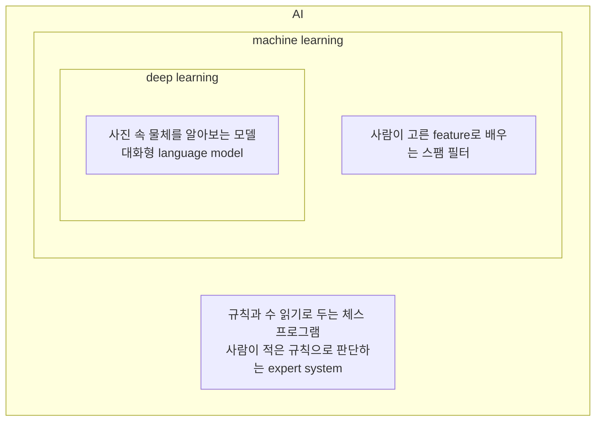
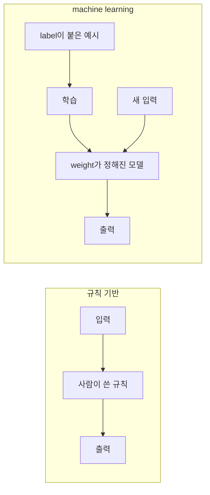
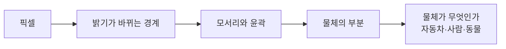

# 1.1 AI·machine learning·deep learning

> **수준** L1 · **선수** — · **이 장의 질문** 셋은 어떤 포함 관계인가? 규칙을 짜 넣은 프로그램과 데이터로 배우는 모델은 무엇이 다른가?

## 한눈에

- artificial intelligence(AI, 인공지능)는 사람의 지능이 필요하다고 여기는 일을 컴퓨터가 하게 만드는 분야 전체의 이름이다. machine learning(머신러닝)은 그 안에서 동작 규칙을 사람이 짜 넣지 않고 데이터에서 배우게 하는 방법이다. deep learning(딥러닝)은 machine learning 안에서 여러 layer(층)를 쌓은 neural network(신경망)로 배우는 방법이다.
- 그래서 셋은 AI ⊃ machine learning ⊃ deep learning의 포함 관계다. 모든 AI가 machine learning은 아니고, 모든 machine learning이 deep learning도 아니다.
- 규칙 기반 프로그램은 사람이 동작을 코드로 적는다. machine learning 모델은 사람이 모델의 틀과 학습 방법과 데이터를 주고, 동작을 정하는 숫자인 weight(가중치)는 학습이 채운다.
- deep learning은 입력에서 무엇을 볼지, 곧 feature(특징)까지 데이터에서 배운다. 그래서 사람이 feature를 설계하기 어려운 사진·음성·글에서 강하다.

## 1. 세 이름의 포함 관계

### 1.1 AI: 분야 전체의 이름

「artificial intelligence」라는 이름을 처음 쓴 문서로 꼽히는 것은 1955년의 한 연구 제안서다. John McCarthy, Marvin Minsky, Nathaniel Rochester, Claude Shannon이 이듬해 여름 Dartmouth 대학에서 열 연구 모임을 제안한 문서다. 제안서는 학습을 비롯한 지능의 모든 측면을 기계가 흉내 낼 수 있을 만큼 정확히 기술할 수 있다는 추측을 출발점으로 삼았고, 기계가 언어를 쓰고 추상 개념을 만들고 문제를 풀고 스스로 나아지게 하는 법을 연구 주제로 들었다 [@McCarthy1955].

이처럼 AI는 처음부터 특정 기술이 아니라 목표에 붙은 이름이다. 그 목표에 다가가는 방법은 여러 가지다. 사람이 아는 지식을 규칙으로 적어 넣는 방법도 AI이고, 데이터에서 배우게 하는 방법도 AI다.

### 1.2 machine learning: 데이터에서 배우는 방법

1959년 Arthur Samuel은 「Some Studies in Machine Learning Using the Game of Checkers」라는 논문에서 체커(체스판에서 두는 보드게임) 프로그램을 학습시킨 결과를 보고했다. 게임 규칙과 몇 가지 단서만 주고 8~10시간쯤 게임을 두게 하자, 프로그램은 그것을 짠 사람보다 체커를 잘 두게 되었다 [@Samuel1959]. Samuel은 문제를 푸는 방법을 사람이 하나하나 정확히 지정하는 일은 시간과 비용이 많이 들고, 경험에서 배우도록 프로그래밍하면 그런 세세한 프로그래밍이 대부분 필요 없어질 것이라고 썼다.

machine learning 교과서에서 널리 인용하는 정의는 Tom Mitchell의 것이다 [@Mitchell1997].

> **핵심** 어떤 task(과제) T에서 performance measure(성능 척도) P로 잰 성능이 experience(경험) E를 쌓을수록 나아지면, 그 프로그램은 E로부터 배운다고 한다.

Mitchell이 든 예는 체커다.

| 요소 | 체커 프로그램 |
|---|---|
| task T | 체커 두기 |
| performance measure P | 상대와 둔 게임에서 이긴 비율 |
| experience E | 자기 자신과 연습 게임 두기 |

이 정의에는 「사람처럼 생각한다」 같은 말이 없다. 정해 둔 task에서, 정해 둔 척도로 재었을 때, 경험이 쌓일수록 점수가 오르면 배운 것이다. machine learning을 공학으로 다룰 수 있는 이유가 여기에 있다. 무엇을 풀지, 무엇으로 잴지, 무엇으로 배울지를 정하면 학습이 되었는지 숫자로 확인할 수 있다.

### 1.3 deep learning: 여러 layer로 쌓아 배우는 방법

deep learning은 machine learning의 한 갈래다. 쉬운 개념을 먼저 배우고, 그 위에 더 복잡한 개념을 쌓아 가며 배운다. 이렇게 쌓인 개념을 그래프로 그리면 layer가 여러 겹인 깊은(deep) 그래프가 된다. 이름이 deep learning인 까닭이다 [@Goodfellow2016]. 이렇게 layer를 쌓는 모델이 neural network다. neural network는 뇌의 신경세포에서 이름을 따왔지만, 뇌를 그대로 흉내 낸 모형이 아니라 수학 함수를 이어 붙인 계산이다 [@Goodfellow2016].

Goodfellow 등의 교과서는 machine learning과 deep learning 사이에 representation learning(표현 학습)이라는 갈래를 하나 더 두어 AI ⊃ machine learning ⊃ representation learning ⊃ deep learning으로 그린다 [@Goodfellow2016]. representation learning은 §3에서 다룬다.

그림: AI·machine learning·deep learning의 포함 관계와 각 영역의 예. 바깥 상자일수록 넓은 이름이다.

| 예 | AI | machine learning | deep learning |
|---|---|---|---|
| 체스 규칙과 수 읽기로 두는 체스 프로그램 | 예 | 아니오 | 아니오 |
| 사람이 적은 「만약 ~이면 ~이다」 규칙으로 판단하는 expert system(전문가 시스템) | 예 | 아니오 | 아니오 |
| 사람이 고른 단어 feature로, 스팸 표시가 된 메일에서 배우는 스팸 필터 | 예 | 예 | 아니오 |
| 사진의 픽셀을 그대로 받아 물체를 알아보는 모델 | 예 | 예 | 예 |
| ChatGPT 같은 대화형 language model(언어 모델) | 예 | 예 | 예 |

## 2. 규칙을 짜 넣은 프로그램과 데이터로 배우는 모델

### 2.1 규칙 기반 프로그램

스팸 메일을 거르는 프로그램을 짠다고 하자. 가장 먼저 떠오르는 방법은 규칙을 적는 것이다. 「제목에 '무료'가 있고 보낸 사람이 주소록에 없으면 스팸」처럼 조건문을 쌓는다. 동작은 전부 사람이 쓴 코드에 있다. 결과가 틀리면 어느 규칙이 틀렸는지 찾아 고치면 된다.

규칙을 말로 다 적을 수 있는 문제라면 이 방법이 가장 좋다. 세금 계산이나 체스에서 말이 움직일 수 있는 칸 검사가 그렇다. 체스는 64칸과 32개의 말, 정해진 이동 규칙으로 완전히 기술된다. 사람에게는 어려운 추상적·형식적 과제가 컴퓨터에게는 오히려 쉬운 편이다 [@Goodfellow2016].

어려운 것은 사람에게 쉬운 과제다. 얼굴을 알아보거나 말소리를 알아듣는 일은 사람이 직관으로 해내지만, 어떻게 하는지 규칙으로 적기는 거의 불가능하다 [@Goodfellow2016]. 세상에 관한 지식을 형식 언어로 적어 넣고 논리 규칙으로 추론하게 하는 knowledge base(지식 베이스) 방식의 AI 프로젝트들이 있었지만, 큰 성공을 거두지 못했다. 사람이 세상을 정확히 기술할 만큼 복잡한 규칙을 만들어 내기 어려웠기 때문이다 [@Goodfellow2016].

스팸 필터도 비슷한 벽에 부딪힌다. 규칙이 늘수록 서로 부딪히고, 스팸을 보내는 쪽이 문구를 바꾸면 사람이 규칙을 다시 써야 한다.

### 2.2 데이터로 배우는 모델

machine learning에서는 규칙을 직접 쓰지 않는다. 대신 다음을 정한다.

1. **모델의 틀.** 입력을 받아 출력을 내는 계산의 모양이다. 계산 안에는 아직 정해지지 않은 숫자(weight)가 많이 들어 있다.
2. **학습 방법.** 모델이 낸 답을 정답과 비교해 weight를 조금씩 고치는 절차다.
3. **데이터.** 「이 메일은 스팸, 이 메일은 정상」처럼 정답인 label(라벨)이 붙은 예시를 많이 모은다.

학습을 돌리면 weight가 정해지고, 그 weight를 담은 모델이 새 메일을 받아 스팸인지 판단한다. 소프트웨어로 말하면 모델은 함수이고, 그 함수의 몸통 중 동작을 좌우하는 숫자를 사람이 아니라 학습이 채운다. 모델을 돌리는 코드와 학습 코드는 여전히 사람이 쓴다.

그림: 규칙 기반 프로그램은 사람이 쓴 규칙이 입력을 출력으로 바꾼다. machine learning은 예시로 먼저 학습해 모델을 만들고, 그 모델이 새 입력을 출력으로 바꾼다.

| | 규칙 기반 프로그램 | machine learning 모델 |
|---|---|---|
| 동작을 정하는 것 | 사람이 쓴 규칙 | 학습으로 정해진 weight |
| 사람이 하는 일 | 규칙을 생각해 코드로 적는다 | 모델의 틀, 학습 방법, 데이터를 정한다 |
| 동작을 바꾸려면 | 규칙을 고친다 | 데이터를 바꾸거나 더해 다시 학습한다 |
| 잘 맞는 문제 | 규칙을 말로 다 적을 수 있는 문제 | 예시는 많이 모을 수 있지만 규칙을 적기 어려운 문제 |
| 틀렸을 때 | 어느 규칙이 틀렸는지 찾아 고친다 | 원인이 코드에 바로 보이지 않는다. 데이터와 학습 과정을 살펴야 한다 |

> **주의** machine learning 모델은 학습한 데이터와 비슷한 입력에서는 잘 맞지만, 많이 다른 입력에서는 틀리기 쉽다. 규칙 기반 프로그램처럼 「이 조건이면 반드시 이렇게 된다」를 보장하지 않는다. 그래서 모델은 성능을 숫자로 재어 확인한 뒤에 쓴다.

## 3. deep learning은 무엇이 더 다른가: feature까지 배운다

### 3.1 고전 machine learning은 feature를 사람이 고른다

machine learning 모델이 입력을 그대로 보는 것은 아니다. 고전적인 machine learning에서는 사람이 입력에서 쓸모 있는 정보 조각을 골라 모델에 넣는다. 이 정보 조각을 feature라고 한다. 스팸 필터라면 「'무료'라는 단어가 있나」「링크가 몇 개인가」 같은 것이다.

이런 모델의 성능은 어떤 feature를 주느냐에 크게 달린다. Goodfellow 등은 의사가 정리해 준 환자 정보(feature)로 제왕절개 권고 여부를 판단하는 logistic regression(로지스틱 회귀) 모델을 예로 든다. 이 모델은 feature와 결과의 관계는 배우지만 feature를 어떻게 정할지는 바꾸지 못한다. 정리된 정보 대신 MRI 영상의 픽셀을 그대로 주면 쓸 만한 예측을 하지 못한다. 픽셀 하나하나는 결과와 거의 관계가 없기 때문이다 [@Goodfellow2016].

문제는 많은 task에서 어떤 feature를 뽑아야 할지 사람도 모른다는 것이다. 사진에서 자동차를 찾고 싶어 「바퀴가 있다」를 feature로 쓰려 해도, 바퀴가 어떻게 생겼는지를 픽셀 값으로 정확히 기술하기 어렵다. 그림자가 지거나 빛이 반사되거나 일부가 가려지면 같은 바퀴도 전혀 다른 픽셀이 된다 [@Goodfellow2016].

### 3.2 deep learning은 feature를 layer마다 쌓아 배운다

representation learning은 feature를 사람이 고르지 않고 데이터에서 배우게 하는 방법이다. 여기서 representation(표현)은 모델이 입력을 나타내는 방식, 곧 배운 feature들을 말한다. deep learning은 representation learning을 여러 layer로 쌓는다. 앞쪽 layer가 단순한 feature를 만들면 다음 layer는 그것을 조합해 더 추상적인 feature를 만든다.

사진을 알아보는 deep learning 모델을 예로 들면 다음과 같다 [@Goodfellow2016].

그림: 사진을 알아보는 deep learning 모델의 layer가 차례로 배우는 feature. 각 단계를 사람이 정해 주지 않고 학습이 찾아낸다.

정리하면 방식마다 사람이 설계하는 부분과 데이터에서 배우는 부분이 다르다 [@Goodfellow2016].

| 방식 | 사람이 설계하는 것 | 데이터에서 배우는 것 |
|---|---|---|
| 규칙 기반 프로그램 | 입력에서 출력까지의 프로그램 전체 | 없음 |
| 고전 machine learning | feature | feature에서 출력을 내는 계산 |
| representation learning | — | feature와, feature에서 출력을 내는 계산 |
| deep learning | — | 단순한 feature, 그 위에 여러 layer로 쌓은 더 추상적인 feature, 출력을 내는 계산 |

물론 deep learning에서도 사람이 정하는 것은 많다. layer를 몇 개 어떻게 쌓을지, 어떤 데이터로 어떻게 학습할지는 사람이 정한다. 사람이 설계하던 대상이 feature에서 모델 구조와 학습 과정으로 옮겨 간 것이다. 이 책의 2~14부가 그 설계를 배우는 과정이다.

> **표준과 관례** layer가 몇 개 이상이어야 deep인지 합의된 기준은 없다. deep learning은 전통적인 machine learning보다 학습한 함수나 개념을 훨씬 여러 번 겹쳐 쓰는 모델을 다루는 분야라고 보면 된다 [@Goodfellow2016].

## 4. 왜 지금 deep learning이 중심에 있나

neural network 실험은 1950년대부터 있었다. 그런데도 deep learning이 핵심 기술로 널리 인정받은 것은 그보다 훨씬 뒤다. Goodfellow 등은 그 이유로 학습 알고리즘보다 자원의 변화를 꼽는다. 사람 수준에 이른 학습 알고리즘들은 1980년대에 작은 문제에서 고전하던 알고리즘과 거의 같다. 다만 아주 깊은 구조를 학습하기 쉽게 하는 개선이 더해졌다. 가장 큰 변화는 그 알고리즘에 필요한 자원을 줄 수 있게 된 것이다 [@Goodfellow2016].

- **데이터.** 학습용 데이터셋이 수만 개 규모에서 수십만~수천만 개 규모로 커졌다.
- **계산.** 더 빠른 CPU, 범용으로 쓸 수 있는 GPU, 분산 계산 소프트웨어 덕분에 훨씬 큰 모델을 돌릴 수 있게 되었다.

Goodfellow 등에 따르면 더 큰 neural network가 더 복잡한 task에서 더 높은 정확도를 내고, 데이터가 많을수록 좋은 성능을 내는 데 필요한 사람의 기술도 줄어든다 [@Goodfellow2016]. 이 두 자원이 갖춰지면서 사진·음성·글을 다루는 AI의 중심이 deep learning으로 옮겨 갔다. 이 책이 다루는 모델 대부분도 deep learning 모델이다.

> **표준과 관례**
> - AI는 분야 이름이라 하나로 합의된 엄밀한 정의가 없다. 이 책은 「사람의 지능이 필요하다고 여기는 일을 컴퓨터가 하게 하는 기술 전체」라는 넓은 뜻으로 쓴다.
> - AI ⊃ machine learning ⊃ deep learning이라는 포함 관계는 교과서에서 널리 쓰는 정리다 [@Goodfellow2016].

## 헷갈리기 쉬운 점

| 헷갈리는 짝 | 차이 |
|---|---|
| AI와 machine learning | AI가 더 넓다. 규칙과 수 읽기로 동작하는 프로그램도 AI다. machine learning은 그중 데이터에서 배우는 방법이다 |
| machine learning과 deep learning | deep learning은 machine learning의 한 갈래다. deep learning이 아닌 machine learning 방법(3.9)도 여전히 쓰인다 |
| 모델과 프로그램 | 모델도 프로그램 안에서 돌아가는 함수다. 다른 점은 동작을 좌우하는 숫자(weight)를 사람이 아니라 학습이 정한다는 것이다 |
| neural network와 뇌 | 이름은 뇌의 신경세포에서 따왔지만, 뇌를 그대로 흉내 내려는 모형이 아니다. 선형대수·확률·최적화 같은 수학에 기대어 만든 계산이다 |

## 정리

- AI는 지능이 필요한 일을 컴퓨터가 하게 하는 분야 전체, machine learning은 그중 데이터에서 배우는 방법, deep learning은 그중 여러 layer의 neural network로 배우는 방법이다. 포함 관계는 AI ⊃ machine learning ⊃ deep learning이다.
- 규칙 기반 프로그램은 사람이 동작을 코드로 적고, machine learning 모델은 사람이 정한 틀 안의 weight를 학습이 채운다.
- 프로그램이 배운다는 것은 정해 둔 task T에서 performance measure P로 잰 성능이 experience E를 쌓을수록 나아진다는 뜻이다.
- 고전 machine learning은 feature를 사람이 고르고, deep learning은 feature까지 layer마다 쌓아 데이터에서 배운다.
- deep learning이 중심이 된 것은 더 많은 데이터와 더 큰 계산 자원이 갖춰졌기 때문이다.

## 확인 문제

1. 다음 각각이 AI·machine learning·deep learning 중 가장 안쪽으로 어디에 드는지 말하라.
   (a) 체스 규칙과 수 읽기로 두는 체스 프로그램
   (b) 사람이 고른 단어 feature로, 스팸 표시가 된 메일에서 배우는 스팸 필터
   (c) 사진의 픽셀을 그대로 받아 여러 layer를 거쳐 물체를 알아보는 모델
2. Mitchell의 정의에서 task T, performance measure P, experience E를 스팸 필터에 대입하라.
3. 규칙 기반 스팸 필터는 쓸수록 관리가 어려워진다. 이유를 하나 들고, machine learning 필터는 같은 상황에 어떻게 대응하는지 말하라.
4. 고전 machine learning과 deep learning에서 사람이 설계하는 것과 데이터에서 배우는 것은 각각 무엇인가?

답

1. (a) AI. 사람이 준 규칙과 수 읽기로 동작하고 데이터에서 배우지 않는다. (b) machine learning. 데이터에서 배우지만 feature는 사람이 골랐다. (c) deep learning. 픽셀에서 시작해 feature까지 여러 layer로 배운다.
2. task T: 메일을 스팸과 정상으로 나누기. performance measure P: 맞게 나눈 메일의 비율. experience E: 사람이 스팸인지 아닌지 표시해 둔 메일 묶음.
3. 스팸을 보내는 쪽이 문구를 바꾸면 사람이 규칙을 새로 써야 하고, 규칙이 늘수록 서로 부딪힌다. machine learning 필터는 새 스팸에 label을 붙여 데이터에 더하고 다시 학습한다.
4. 고전 machine learning: 사람이 feature를 설계하고, feature에서 출력을 내는 계산을 데이터에서 배운다. deep learning: 단순한 feature부터 추상적인 feature, 출력을 내는 계산까지 데이터에서 배운다. 사람은 모델 구조와 학습 방법, 데이터를 정한다.

## 더 읽을거리

- [@Goodfellow2016] 1장. 규칙 기반 프로그램, 고전 machine learning, representation learning, deep learning의 관계를 그림으로 정리한다
- [@Mitchell1997] 1장. task·performance measure·experience로 학습을 정의하고 여러 학습 문제에 대입한다
- [@Samuel1959] 체커 프로그램이 짠 사람보다 잘 두도록 학습한 초기 machine learning 연구
- [@McCarthy1955] 「artificial intelligence」라는 이름을 처음 쓴 Dartmouth 연구 모임 제안서
