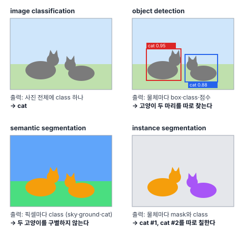

# 1.2 모델 이름을 읽는 여섯 개의 축

> **수준** L1 · **선수** [1.1 AI·machine learning·deep learning](01-01-ai-ml-dl.md) · **이 장의 질문** CNN·ViT·LLM·VLM·diffusion 같은 이름은 어떤 기준으로 붙나? 왜 서로 겹쳐 보이나? 공식 분류 체계가 있나? classification·detection·segmentation 같은 task는 각각 무엇을 출력하나?

## 한눈에

- 이 책은 이름을 분야·구조·과제·방식·학습·규모와 활용이라는 여섯 축으로 나눠 읽는다. 이름 하나가 축 하나에 붙기도 하고, 여러 축을 함께 담기도 한다.
- 축이 다르니 한 모델이 여러 이름을 함께 갖고, 그래서 이름끼리 겹쳐 보인다. 「A냐 B냐」로 비교할 수 있는 것은 같은 축에 있는 이름끼리다.
- 모델 이름은 한 분류표에서 나온 것이 아니다. 여섯 축은 이 책이 고른 정리 방식이고 공식 분류 체계가 아니다. 국제 표준 ISO/IEC 22989는 artificial intelligence(AI, 인공지능)의 개념과 용어를 다룬다. 모델 저장소 Hugging Face는 모델을 task(과제)별로 나눠 둔다.
- image classification(이미지 분류)은 사진 전체에 class(클래스) 하나를, object detection(객체 검출)은 물체마다 위치와 class를, segmentation(분할)은 픽셀마다 class를 출력한다.

## 1. 이름은 여러 축에 붙는다

1.1장에서 본 세 이름은 포함 관계로 정리되었다. 모델 이름은 그렇게 정리되지 않는다. 이름마다 기준이 다르기 때문이다.

소프트웨어에 빗대면 「Python 서버」「REST API 서버」「오픈소스 서버」가 같은 서버 하나를 가리킬 수 있는 것과 같다. 각각 언어·인터페이스·라이선스라는 다른 축의 이름이다. 모델 이름도 이처럼 서로 다른 축에서 온다. 이 책은 모델 이름을 다음 여섯 축으로 나눠 읽는다.

| 축 | 묻는 것 | 자세히 |
|---|---|---|
| 분야 | 어떤 데이터를 다루나 | §2.1 |
| 구조 | 모델 안의 계산이 어떻게 짜여 있나 | §2.2 |
| 과제 | 무엇을 출력하나 | §2.3, §5 |
| 방식 | 출력을 어떤 방법으로 만들어 내나 | §2.4 |
| 학습 | 무엇을 신호로, 어느 단계까지 배웠나 | §2.5, 1.4 |
| 규모와 활용 | 얼마나 크고, 어떻게 쓰나 | §2.6 |

이름 하나가 축 하나에 붙기도 하고, 여러 축을 함께 담기도 한다(§3). 여섯 축은 이름을 읽으려고 이 책이 고른 정리 방식이고, 공식 분류 체계가 아니다(§4).

> **핵심** 모델 이름을 만나면 「이 이름은 어느 축의 이름인가」부터 묻는다. 한 모델의 이름 여러 개가 서로 다른 축에서 온 것임을 알면 겹쳐 보이던 이름들이 풀린다.

## 2. 여섯 축 하나씩

### 2.1 분야: 어떤 데이터를 다루나

글·이미지·음성·영상처럼 데이터의 종류를 modality(모달리티)라고 한다. 분야 축의 이름은 모델이 어떤 modality를 다루는지 말한다.

| 분야 | 다루는 데이터 | 이름의 예 |
|---|---|---|
| computer vision(CV, 컴퓨터 비전) | 이미지, 영상 | vision model, CV 모델 |
| natural language processing(NLP, 자연어 처리) | 글 | language model(언어 모델) |
| speech(음성) | 말소리 | speech recognition model(음성 인식 모델) |
| multimodal(멀티모달) | 둘 이상의 modality를 함께 | vision-language model(VLM, 비전-언어 모델), multimodal model |

VLM은 이미지와 글을 함께 다루는 모델이다. VLM 입문서 한 편은 이미지와 글을 받아 글을 내는 모델, 이미지와 글을 짝지어 배우는 모델, 글로 이미지를 만드는 모델을 모두 VLM으로 다룬다 [@Bordes2024].

language model은 분야 이름이면서 과제 이름이기도 하다. token(토큰)은 language model이 글을 처리하는 단위로, 단어 하나나 단어 조각 하나에 해당한다(7.1). language model이라는 이름은 글을 다룬다는 뜻과 함께, 글 속에서 token이 나올 확률을 계산하는 일을 가리킨다. 글을 만드는 language model은 흔히 앞의 token들을 보고 다음 token이 나올 확률을 계산하도록 배운다(7.2).

### 2.2 구조: 모델 안의 계산이 어떻게 짜여 있나

모델 안에서 layer(층)를 어떤 모양으로 짜고 이었는지를 architecture(구조)라고 한다.

| 이름 | 구성 | 자세히 |
|---|---|---|
| convolutional neural network(CNN, 합성곱 신경망) | 작은 창을 이미지 위로 옮겨 가며 같은 계산을 반복하는 layer를 쌓는다. 이미지에 오래 써 온 구조다 | 5.1, 5.2 |
| recurrent neural network(RNN, 순환 신경망) | 순서가 있는 데이터를 한 칸씩 읽으며, 앞에서 읽은 내용을 다음 칸으로 넘긴다 | 5.3 |
| Transformer | attention으로 입력의 각 위치가 다른 위치를 참고하게 한다. 글을 만드는 데 쓰는 버전에서는 앞쪽 위치만 참고한다 [@Devlin2019]. NLP에서 사실상 표준 구조가 되었다 [@Dosovitskiy2021] | 5.5, 5.6 |
| Vision Transformer(ViT) | 이미지를 작은 patch(패치)로 잘라 단어처럼 늘어놓고 Transformer에 넣는다. 큰 데이터로 먼저 학습하면 CNN 없이 Transformer만으로도 image classification을 잘할 수 있음을 보였다 [@Dosovitskiy2021] | 6.3 |

ViT라는 이름에는 축이 둘 들어 있다. 「Vision」은 분야이고 「Transformer」는 구조다. 다만 ViT 전체는 하나의 구조 이름으로 쓰인다.

### 2.3 과제: 무엇을 출력하나

task는 모델이 무엇을 입력받아 무엇을 출력하는지로 정한다. classifier(분류기), detector(검출기)처럼 task에서 나온 이름이 많다. Hugging Face는 모델을 task별로 나눠 두는데, 입력과 출력을 이름에 그대로 적은 것이 많다. 예를 들어 text-to-image는 글을 받아 이미지를 내고, image-text-to-text는 이미지와 글을 받아 글을 낸다 [@HuggingFace2026]. 대표 task가 무엇을 출력하는지는 §5에서 자세히 본다.

### 2.4 방식: 출력을 어떤 방법으로 만들어 내나

글이나 이미지를 새로 만들어 내는 모델을 generative model(생성 모델)이라고 한다. 방식 축의 이름은 주로 generative model이 출력을 어떻게 만들어 내는지 말한다.

| 이름 | 만드는 방법 | 자세히 |
|---|---|---|
| autoregressive model(자기회귀 모델) | 앞에서 만든 출력을 보고 다음 조각을 하나씩 이어 붙인다. language model이 글을 token 하나씩 만드는 방식이다 | 7.2 |
| diffusion model(확산 모델) | 데이터에 noise(잡음)를 조금씩 더해 망가뜨리는 과정을 거꾸로 되돌리도록 배운다. 만들 때는 noise에서 시작해 noise를 조금씩 제거하며 이미지를 완성한다 [@Ho2020] | 11.5 |
| generative adversarial network(GAN, 생성적 적대 신경망) | 데이터를 만드는 neural network(신경망)와, 데이터가 학습 데이터에서 왔는지 만든 것인지 가려내는 neural network를 함께 배운다. 만드는 쪽은 가려내는 쪽이 틀리도록, 가려내는 쪽은 맞게 가려내도록 배우며 서로 경쟁한다. 다 배운 뒤에는 만드는 쪽에 무작위 noise를 넣어 새 데이터를 만든다 [@Goodfellow2014] | 11.4 |
| variational autoencoder(VAE, 변분 오토인코더) | 데이터를 representation(표현)으로 바꾸는 부분과, representation에서 데이터를 다시 만드는 부분을 함께 배운다. 바꾸는 부분은 representation을 값 하나로 정하지 않고 값마다 나올 확률로 내며, 이 확률이 미리 정해 둔 확률에 가깝도록 배운다. 다 배운 뒤에는 미리 정해 둔 확률에 따라 representation을 무작위로 뽑고, 다시 만드는 부분에 넣어 새 데이터를 만든다 [@Kingma2013] | 11.4 |

diffusion은 구조 이름이 아니다. diffusion model 안에는 noise를 제거하는 neural network가 들어 있다. 한 논문은 2023년 당시 diffusion model이 이 neural network로 CNN 계열 구조를 사실상 표준처럼 썼다고 적는다 [@Peebles2023]. 그 논문은 이 neural network를 Transformer로 바꾼 diffusion model을 내놓았다 [@Peebles2023].

### 2.5 학습: 무엇을 신호로, 어느 단계까지 배웠나

학습 방법의 이름은 1.4장에서 따로 정리한다. 여기서는 모델 이름에 학습이 드러나는 경우만 본다.

- **CLIP.** Contrastive Language-Image Pre-training의 줄임말이다 [@Radford2021]. 인터넷에서 모은 4억 쌍의 사진과 설명 글로, 어느 설명이 어느 사진의 것인지 맞히며 미리 학습했다. 「Contrastive」는 이렇게 맞는 쌍과 틀린 쌍을 가려 배우는 contrastive learning(대조 학습)이라는 학습 신호를, 「Language-Image」는 분야를, 「Pre-training」은 학습 단계를 가리킨다.
- **이름 접미사와 학습 단계.** 이름 끝의 접미사로 학습 단계를 구별하는 모델이 있다. 예를 들어 Meta의 Llama 3는 pre-training(사전학습)만 한 버전과, 지시를 따르도록 더 학습한 버전으로 나왔다. 뒤의 것이 이름 끝에 Instruct가 붙은 Meta-Llama-3-8B-Instruct다 [@Meta2024]. 이 버전은 supervised fine-tuning(SFT, 지도 파인튜닝)과 reinforcement learning from human feedback(RLHF)으로 더 학습했다 [@Meta2024]. SFT는 입력과 바라는 출력을 짝지은 데이터로 모델을 더 학습하는 것이다 [@Zhao2023]. 이 쌍은 사람이 직접 쓰기도 한다 [@Zhao2023]. 지시와 답의 쌍으로 하는 SFT는 instruction tuning이라고도 부른다(9.3) [@Zhao2023]. RLHF는 모델의 답에 대한 사람의 평가를 바탕으로 더 학습하는 것이다 [@Zhao2023]. 평가는 흔히 모델이 낸 여러 답에 사람이 순위를 매기는 방식으로 한다 [@Zhao2023]. 두 학습은 1.4장에서 자세히 본다. Meta는 두 학습을 모두 거친 버전을 instruction tuned 버전이라 부른다 [@Meta2024]. pre-training만 한 버전은 흔히 base model(베이스 모델)이라고 부른다.

### 2.6 규모와 활용: 얼마나 크고, 어떻게 쓰나

모델 안에서 학습으로 정해지는 숫자를 통틀어 parameter(파라미터)라고 한다. 1.1장에서 본 weight(가중치)도 parameter에 속한다. 모델 이름의 「8B」「70B」는 parameter가 각각 약 80억 개, 700억 개라는 뜻이다 [@Meta2024].

| 이름 | 뜻 | 자세히 |
|---|---|---|
| large language model(LLM, 대규모 언어 모델) | parameter가 아주 많은 language model. 보통 수백억~수천억 개 규모의 Transformer language model을 가리킨다. 몇 개부터 「large」인지 정한 공식 기준은 없다 [@Zhao2023] | 7.2 |
| foundation model(파운데이션 모델) | 넓은 데이터로 대규모 학습해 여러 task에 맞춰 고쳐 쓸 수 있는 모델. 2021년 Stanford 대학의 연구 보고서가 이름 붙였다 [@Bommasani2021] | 1.6 |
| pre-trained model(사전학습 모델) | pre-training을 마쳐 다른 task의 출발점으로 쓰는 모델 | 8.1 |

## 3. 왜 이름이 겹쳐 보이나

### 3.1 한 모델에 여러 축의 이름이 붙는다

model card(모델 카드)는 학습한 모델을 공개할 때 함께 내놓는 짧은 설명 문서다 [@Mitchell2019]. 모델의 평가 결과와, 어떤 쓰임을 생각하고 만든 모델인지 같은 정보를 담는다 [@Mitchell2019]. Meta-Llama-3-8B-Instruct 하나를 그 모델의 model card와 함께 축별로 읽으면 다음과 같다 [@Meta2024].

| 이름이나 model card의 표현(영어는 model card 원문 그대로) | 축 | 뜻 |
|---|---|---|
| Llama 3 | — | 모델 계열의 고유 이름 |
| 8B | 규모와 활용 | parameter 약 80억 개 |
| Instruct | 학습 | 지시를 따르도록 SFT와 RLHF로 더 학습한 버전 |
| large language model | 규모와 활용, 분야 | parameter가 많은, 글을 다루는 모델 |
| auto-regressive | 방식 | 글을 token 하나씩 이어 만든다 |
| transformer | 구조 | Transformer를 고친 구조를 쓴다 |
| 글을 받아 글과 코드를 만든다 | 분야, 과제 | 입력은 글만, 출력은 글과 코드만 |

이 모델은 LLM이기도 하고, Transformer 모델이기도 하고, autoregressive model이자 generative model이기도 하다. 이름이 여럿인 것은 축이 여럿이기 때문이다.

### 3.2 한 이름이 여러 축을 묶는다

이름 하나에 여러 축이 들어 있는 경우도 많다. BERT는 Bidirectional Encoder Representations from Transformers의 줄임말이다 [@Devlin2019]. 「Encoder」와 「Transformers」는 구조를, 「Bidirectional」은 앞뒤 문맥을 함께 보며 배운다는 학습 방식을 가리킨다. CLIP(§2.5)과 ViT(§2.2)도 이름 안에 축이 둘 이상 들어 있다.

### 3.3 같은 축의 이름끼리만 비교할 수 있다

「CNN과 ViT 중 무엇을 쓸까」는 말이 된다. 둘 다 구조 이름이라 서로 대신할 수 있다. 「CNN과 detector 중 무엇을 쓸까」는 말이 되지 않는다. detector는 과제 이름이고, CNN은 detector 안에 쓸 수 있는 구조 이름이다. 예를 들어 DETR이라는 detector는 CNN에 Transformer를 더해 만들었다(6.10) [@Carion2020]. 「LLM과 Transformer는 무엇이 다른가」도 마찬가지다. LLM은 규모와 분야의 이름이고 Transformer는 구조 이름이다. 둘은 대립하지 않는다. LLM은 대개 Transformer로 만든다 [@Zhao2023].

### 3.4 같은 이름도 가리키는 범위가 다르다

LLM의 「large」에는 정해진 경계가 없다 [@Zhao2023]. 한 LLM 조사 논문은 parameter가 100억 개를 넘는 모델을 주로 다룬다 [@Zhao2023]. 반면 Meta는 parameter가 약 80억 개인 모델까지 포함한 Llama 3 계열을 large language model이라 부른다 [@Meta2024].

VLM도 쓰는 곳에 따라 범위와 이름이 다르다. §2.1의 VLM 입문서는 그곳에서 든 세 가지 모델을 모두 VLM으로 다룬다 [@Bordes2024]. 앞의 LLM 조사 논문은 LLM이 이미지 같은 다른 modality도 받도록 넓힌 모델을 multimodal large language model(MLLM, 멀티모달 대규모 언어 모델)이라 부른다 [@Zhao2023]. 그 논문은 MLLM을 다루는 절에서 입력을 이미지와 글로, 출력을 글로 정하고 논의한다 [@Zhao2023]. 곧 §2.1에서 든 세 가지 모델 가운데 이미지와 글을 받아 글을 내는 모델을, VLM 입문서는 VLM으로 다루고 이 조사 논문은 MLLM으로 다루는 셈이다. 그 VLM 입문서는 VLM을 몇 종류로 나누는 일 자체가 쉽지 않다고 말한다. 대부분의 모델이 여러 종류의 구성 요소를 섞어 쓰기 때문이다 [@Bordes2024].

## 4. 공식 분류 체계가 있나

모델 이름은 한 분류표에서 나온 것이 아니다. BERT와 CLIP은 각 논문의 저자들이 붙인 이름이다 [@Devlin2019; @Radford2021]. 그래서 이름에서 어느 축을 강조할지도 만든 쪽마다 다르다. LLM처럼 널리 쓰는 이름도 경계에 대한 공식 합의가 없는 경우가 있다(§3.4).

이 장의 여섯 축은 이 책이 이름을 읽으려고 고른 정리 방식이다. 표준 기구나 학계가 정한 분류 체계가 아니다. 이름을 다룰 때 참고할 공식 문서와 널리 쓰는 목록으로는 다음이 있다.

| 무엇 | 어떤 문서인가 | 다루는 것 |
|---|---|---|
| ISO/IEC 22989 | 국제 표준 | 국제 기술 표준화에 쓸 AI의 개념과 용어 [@Sun2026] |
| Hugging Face의 task 목록 | 모델 저장소의 목록 | task 이름을 Multimodal, Natural Language Processing, Computer Vision, Audio 같은 카테고리로 묶고, task마다 모델을 모아 둔다. 예: image-classification, object-detection, text-generation [@HuggingFace2026] |

> **표준과 관례**
> - CNN, RNN, Transformer 같은 구조 이름과 classification 같은 task 이름은 Google의 machine learning(머신러닝) 용어집에 정의가 실려 있다 [@Google2026].
> - LLM, VLM은 널리 쓰지만 경계가 문헌마다 다르다. 같은 Google 용어집도 LLM의 뜻을 두 가지로 적는다. 하나는 parameter가 아주 많은 language model이고, 더 느슨한 다른 하나는 Transformer로 만든 language model 모두다 [@Google2026]. 어느 뜻에도 parameter가 몇 개부터라는 기준은 없다 [@Google2026]. 느슨한 뜻은 규모가 아니라 구조로 LLM을 가르는 쓰임이다. 이 장은 앞의 뜻과 같이 LLM을 규모와 분야의 이름으로 읽는다(§3.3). 이런 이름을 쓸 때는 무엇을 가리키는지 함께 밝힌다.
> - 여섯 축은 이 책이 고른 정리 방식이다. 다른 문헌을 읽을 때 이 축 이름이 그대로 쓰인다고 기대하지 않는다.
> - 이름 끝의 Instruct 같은 접미사와 8B 같은 크기 표기는 Llama 3처럼 모델을 낸 쪽이 붙인 것이다. 접미사와 크기 표기의 뜻은 그 모델의 model card에서 확인한다.

## 5. task별 출력: classification·detection·segmentation

class는 모델이 구별하는 부류 하나다. 예를 들어 사진 속 동물을 cat과 dog로 나누는 모델에서는 cat과 dog가 각각 class다.

같은 사진이라도 task가 다르면 출력의 단위와 형태가 다르다. 고양이 두 마리가 있는 사진으로 비교하면 다음과 같다.

그림: 같은 사진에 대한 image classification, object detection, semantic segmentation(의미론적 분할), instance segmentation(인스턴스 분할)의 출력.

| task | 출력 | 고양이 두 마리 사진의 예 |
|---|---|---|
| image classification(이미지 분류) | 사진 전체에 class 하나. 보통 class마다 그 class일 확률을 함께 낸다 | 「cat」 |
| object detection(객체 검출) | 물체마다 위치를 나타내는 bounding box(경계 상자), class, confidence score(신뢰도 점수) | 「cat, box 1, 0.95」「cat, box 2, 0.88」 |
| semantic segmentation(의미론적 분할) | 픽셀마다 class. 같은 class의 물체끼리는 구별하지 않는다 [@Kirillov2019] | 고양이 픽셀은 모두 「cat」 |
| instance segmentation(인스턴스 분할) | 물체마다 그 물체에 속한 픽셀 묶음인 mask(마스크)와 class [@Kirillov2019] | 고양이 1의 mask, 고양이 2의 mask |
| panoptic segmentation(파놉틱 분할) | 모든 픽셀에 class를 매기고, 셀 수 있는 물체의 픽셀에는 물체 번호까지 매긴다. 앞의 두 segmentation을 합친 task다 [@Kirillov2019] | 하늘·땅은 class만, 고양이는 class와 번호 |

bounding box는 줄여서 box라고 부른다. box는 물체를 둘러싼 사각형이라 모양을 정확히 따라가지 못한다. 물체의 모양까지 필요하면 segmentation을 쓴다.

글과 여러 modality를 다루는 task도 같은 방식으로 읽는다 [@HuggingFace2026].

| task | 입력 | 출력 |
|---|---|---|
| text classification(텍스트 분류) | 글 | 글 전체에 class 하나. 예: 스팸, 정상 |
| text generation(텍스트 생성) | 글 | 이어지는 글 |
| text-to-image | 글 | 이미지 |
| image-text-to-text | 이미지와 글 | 글. language model에 이미지를 받는 부분을 이어 붙인 VLM이 이 task를 한다 [@Bordes2024] |

## 헷갈리기 쉬운 점

| 헷갈리는 개념 | 차이 |
|---|---|
| CNN과 ViT | 둘 다 구조 이름이다. 이미지를 다루는 서로 다른 구조라 서로 대신할 수 있다 |
| LLM과 Transformer | LLM은 규모와 분야의 이름, Transformer는 구조 이름이다. LLM은 대개 Transformer로 만든다 |
| diffusion model과 Transformer | diffusion은 데이터를 만드는 방식의 이름이고, 그 안의 neural network는 CNN 계열일 수도 Transformer일 수도 있다 |
| object detection과 segmentation | detection은 물체를 사각형(box)으로 찾고, segmentation은 픽셀 단위의 모양으로 찾는다 |
| semantic segmentation과 instance segmentation | semantic은 픽셀의 class만 매겨 같은 class의 물체를 구별하지 않고, instance는 물체 하나하나를 따로 나눈다 |

## 정리

- 이 책은 모델 이름을 분야, 구조, 과제, 방식, 학습, 규모와 활용이라는 여섯 축으로 나눠 읽는다. 여섯 축은 이 책의 정리 방식이고 공식 분류 체계가 아니다.
- CNN·RNN·Transformer·ViT는 구조, diffusion·autoregressive는 방식, VLM은 분야, LLM은 규모와 분야의 이름이다.
- 한 모델이 여러 축의 이름을 동시에 갖고 한 이름이 여러 축을 묶기도 해서 이름이 겹쳐 보인다. 같은 축의 이름끼리만 비교할 수 있다.
- LLM·VLM은 경계가 문헌마다 다르다.
- image classification은 사진 전체에 class 하나, object detection은 물체마다 box·class·점수, semantic segmentation은 픽셀마다 class, instance segmentation은 물체마다 mask와 class를 출력한다.

## 확인 문제

1. 다음 이름이 어느 축의 이름인지 말하라: (a) ViT (b) diffusion model (c) detector (d) LLM의 「Large」
2. 어떤 모델 저장소에 「○○-7B-Instruct」라는 모델이 있다. 이름의 「7B」와 「Instruct」는 각각 무엇을 알려 주나?
3. 「diffusion model과 Transformer 중 어느 쪽이 이미지 생성에 낫나」라는 질문은 왜 잘못 짜인 질문인가?
4. 사진 속 사람 세 명을 각각 따로 세고 그 모양까지 알아야 한다. image classification, object detection, semantic segmentation, instance segmentation 중 무엇이 맞나? 그 task는 무엇을 출력하나?

답

1. (a) 구조. 이름에 분야(Vision)도 들어 있지만 전체는 구조 이름으로 쓰인다. (b) 방식. (c) 과제. (d) 규모와 활용.
2. 「7B」는 parameter가 약 70억 개라는 규모를, 「Instruct」는 지시를 따르도록 pre-training 뒤에 더 학습한 버전이라는 학습 단계를 알려 준다. 다만 접미사의 정확한 뜻은 그 모델의 model card에서 확인한다.
3. 두 이름은 축이 다르다. diffusion은 데이터를 만드는 방식이고 Transformer는 구조다. diffusion model 안의 neural network를 Transformer로 만들 수도 있으니 둘 중 하나를 고르는 문제가 아니다.
4. instance segmentation. 사람마다 그 사람에 속한 픽셀 묶음(mask)과 class를 따로 출력하므로 세 명을 구별하고 모양도 안다. object detection은 사람을 따로 찾지만 모양 대신 box만 주고, semantic segmentation은 모양은 주지만 세 명을 구별하지 않는다.

## 더 읽을거리

- [@HuggingFace2026] task를 Multimodal·Natural Language Processing·Computer Vision·Audio 같은 카테고리로 묶은 목록. task마다 데모·사용 예·모델·데이터를 안내한다
- [@Kirillov2019] semantic·instance segmentation을 정리하고 panoptic segmentation을 제안한 논문
- [@Bordes2024] VLM의 종류와 학습 방법을 정리한 입문서
- [@Zhao2023] LLM의 정의와 발전을 정리한 조사 논문
- [@Bommasani2021] foundation model이라는 이름을 붙인 보고서
