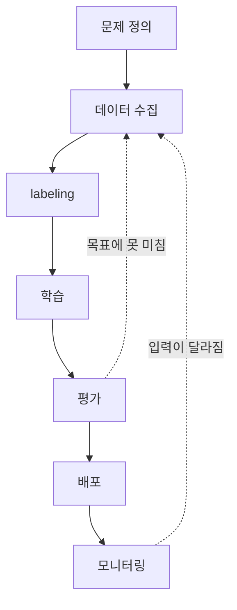

# 1.3 모델의 한살이: 데이터에서 서비스까지

> **수준** L1 · **선수** [1.1 AI·machine learning·deep learning](01-01-ai-ml-dl.md) · **이 장의 질문** 데이터 수집·labeling·학습·평가·배포는 어떻게 이어지나? 학습과 inference는 무엇이 다른가?

## 한눈에

- 모델은 문제 정의 → 데이터 수집 → labeling(라벨링) → 학습 → 평가 → 배포 → 모니터링을 거쳐 서비스가 된다. 단계마다 다음 단계로 넘기는 산출물이 있다.
- 이 흐름은 한 번 지나가고 끝나지 않는다. 평가나 모니터링에서 문제가 보이면 앞 단계로 돌아가 데이터를 더 모으거나 다시 학습한다 [@Amershi2019].
- 학습은 데이터로 weight(가중치)를 정하는 일이다. inference(추론)는 정해진 weight로 새 입력의 출력을 계산하는 일이다. 서비스에서 사용자가 만나는 것은 inference다.
- 실제 서비스에서 모델을 학습하고 돌리는 코드는 작은 부분이다. 그 둘레에 필요한 인프라가 훨씬 크고 복잡하다 [@Sculley2015].

## 1. 한살이를 한눈에

소프트웨어는 요구 사항을 정하고, 코드를 짜고, 테스트하고, 배포하고, 운영한다. machine learning(머신러닝) 모델도 비슷한 길을 간다. 다른 점은 동작을 정하는 것이 사람이 짠 코드가 아니라 데이터와 학습이라는 것이다(1.1). 그래서 데이터를 다루는 단계가 앞에 길게 붙는다.

그림: 모델의 한살이. 점선은 평가나 모니터링에서 문제를 찾아 앞 단계로 돌아가는 길이다. 실제로는 어느 단계로든 돌아갈 수 있다.

| 단계 | 하는 일 | 다음 단계로 넘기는 것 | 자세히 |
|---|---|---|---|
| 문제 정의 | 무엇을 입력받아 무엇을 출력할지, 곧 task(과제)를 정한다. 몇 점이면 쓸 만한지 성공 기준도 정한다 | task와 목표 점수 | 1.2, 3.6 |
| 데이터 수집 | 서비스에서 만날 입력과 닮은 데이터를 모으고, 깨지거나 잘못된 것을 걸러 낸다 | 원본 데이터 | 6.1, 8.4 |
| labeling | 데이터마다 정답인 label(라벨)을 붙인다 | label이 붙은 dataset(데이터셋) | 6.9 |
| 학습 | 데이터로 weight를 정한다 | weight를 담은 파일 | 3.1, 4.11 |
| 평가 | 학습에 쓰지 않은 데이터로 성능을 재고 목표와 견준다 | 점수와 틀린 사례 | 3.6, 3.7 |
| 배포 | 모델을 서비스에 올려 inference를 하게 한다 | 동작하는 서비스 | 13.1, 13.2 |
| 모니터링 | 서비스 중에 들어오는 입력과 성능을 지켜본다 | 새 데이터, 다시 학습할지에 대한 판단 | 13.6 |

> **표준과 관례** 단계를 나누는 방법과 이름은 정해져 있지 않다. Microsoft의 개발 팀들을 조사한 연구는 model requirements, data collection, data cleaning(데이터 정제), data labeling, feature engineering(특징 공학), model training, model evaluation, model deployment, model monitoring의 9단계로 나눴다 [@Amershi2019]. 이 책은 data cleaning을 데이터 수집에 묶고, 사람이 입력에서 쓸모 있는 값을 뽑고 골라 모델에 넣는 feature engineering은 따로 두지 않는다. deep learning(딥러닝)에서는 feature(특징)를 학습이 만들기 때문이다(1.1). 같은 연구도 convolutional neural network(CNN, 합성곱 신경망) 같은 모델에서는 feature engineering이 덜 드러나고 흔히 학습 단계와 섞인다고 적었다.

## 2. 단계마다 하는 일

공장에서 찍은 제품 사진에서 흠집을 찾는 모델을 예로 들어 단계를 하나씩 따라간다.

### 2.1 문제 정의: 무엇을 입력받아 무엇을 내놓나

먼저 task를 정한다. 사진마다 흠집이 「있다·없다」만 알면 되면 image classification(이미지 분류)이다. 흠집이 어디에 있는지까지 알아야 하면 object detection(객체 검출)이다(1.2).

다음으로 성공 기준을 정한다. 어떤 점수를 몇 이상 받으면 쓸 수 있는지다. 흠집을 놓치면 불량품이 밖으로 나간다. 멀쩡한 제품을 흠집으로 잘못 잡으면 검사원이 다시 봐야 한다. 두 실수 중 어느 쪽이 더 비싼지가 기준을 정한다. 이런 점수를 재는 방법은 3.7에서 다룬다.

이 단계에서 어떤 기능을 machine learning으로 만들 수 있고 쓸모가 있는지도 판단한다 [@Amershi2019]. 규칙 몇 줄로 충분한 문제라면 규칙을 쓰는 편이 낫다(1.1).

> **핵심** 문제 정의가 뒤의 모든 단계를 정한다. task를 object detection으로 정하면 label도 흠집마다 위치를 붙여야 하고, 평가 방법과 배포할 모델의 크기도 달라진다.

### 2.2 데이터 수집: 서비스에서 만날 입력을 닮게

학습 데이터는 서비스에서 실제로 들어올 입력과 닮아야 한다. 밝은 조명에서 찍은 사진으로만 학습한 모델은 어두운 생산 라인의 사진에서 틀리기 쉽다. 어떤 값이 얼마나 자주 나오는지를 나타낸 것을 distribution(분포)이라고 한다(2.3). 학습 데이터와 실제 입력의 distribution이 다른 것을 distribution shift(분포 변화)라고 한다. 이것이 크면 더 대표성 있는 데이터를 모아 한살이를 다시 돌린다 [@Amershi2019].

데이터를 처음부터 다 모으지 않을 때도 많다. 이미 있는 범용 dataset으로 먼저 학습한 모델에서 출발해, 내 데이터로 더 학습한다 [@Amershi2019]. 이렇게 단계를 나눠 학습하는 방법은 1.4에서 정리한다.

모은 데이터에서 부정확하거나 지저분한 기록을 걸러 내는 일을 data cleaning이라고 한다 [@Amershi2019]. 깨진 파일이나 흐려서 알아볼 수 없는 사진이 그런 예다.

### 2.3 labeling: 정답을 붙인다

모델의 출력을 입력마다 붙은 정답인 label과 견주며 배우는 방법을 supervised learning(지도 학습)이라고 한다(1.4). 이 방법을 쓰려면 데이터마다 label이 있어야 한다. label의 형식은 task를 따른다. image classification이면 사진마다 class(클래스) 하나를 붙이고, object detection이면 흠집마다 그것을 둘러싼 bounding box(경계 상자)와 class를 붙인다(1.2).

label을 붙이는 일은 여러 사람이 맡을 수 있다. 개발자가 직접 붙이기도 하고, 분야 전문가나 온라인 크라우드소싱 플랫폼의 작업자에게 맡기기도 한다 [@Amershi2019]. 사람마다 「어느 정도부터 흠집인가」를 다르게 보면 label도 흔들린다. 그래서 기준을 글로 정해 두고 작업한다(6.9).

> **주의** 널리 쓰는 공개 dataset에도 틀린 label이 있다. 자주 쓰이는 이미지·글·음성 dataset 10개의 평가용 데이터를 조사한 연구는, 평균 3.3% 이상이 틀린 label이고 ImageNet의 평가용 데이터에서는 6% 이상이라고 추정했다 [@Northcutt2021]. 평가용 데이터의 label이 틀리면 점수를 믿기 어렵고, 배포할 모델을 잘못 고를 수도 있다 [@Northcutt2021].

label 없이 데이터 자체에서 정답을 만들어 배우는 방법도 있다. 1.4에서 다룬다.

### 2.4 학습: 데이터로 weight를 정한다

학습하기 전에 데이터를 나눈다. 일부는 학습에 쓰고, 일부는 학습에 전혀 쓰지 않고 마지막 평가를 위해 남겨 둔다. 남겨 둔 평가용 데이터를 test set(테스트 세트)이라고 한다. 학습하는 동안 모델을 여러 번 재 보고 고르는 데 쓰려고, 학습 데이터와도 test set과도 겹치지 않는 한 갈래를 흔히 더 떼어 둔다. 이것을 validation set(검증 세트)이라고 한다 [@Goodfellow2016]. 데이터를 몇 갈래로 나누고 각각 무엇에 쓰는지는 3.4에서 다룬다.

학습은 다음을 수없이 되풀이한다.

1. 모델이 학습 데이터의 입력에 대해 출력을 낸다.
2. 출력이 label과 얼마나 다른지를 loss(손실)라는 숫자로 계산한다.
3. loss가 줄어드는 쪽으로 weight를 조금 고친다.

되풀이가 끝나면 weight가 정해진다. 학습 중간이나 끝에 모델의 parameter(파라미터), 곧 weight를 비롯해 학습으로 정해지는 값들을 저장한 것을 checkpoint(체크포인트)라고 한다 [@Google2026]. 서비스에 올라가는 것은 이 파일과, 이 파일을 불러 출력을 계산하는 코드다.

학습은 한 번으로 끝나지 않는다. 구조나 설정값을 바꿔 가며 여러 번 학습해 보고, validation set에서 가장 나은 모델을 고른다. 일반 소프트웨어 개발과 견주면 machine learning 개발에서 두드러지는 점이 바로 좋은 모델에 이르기까지 필요한 실험의 양이다 [@Amershi2019]. 실험을 설계하고 기록하는 법은 12.2에서 다룬다.

### 2.5 평가: 학습에 쓰지 않은 데이터로 잰다

test set으로 문제 정의에서 정한 점수를 잰다. 학습에 쓴 데이터로 재면 점수가 부풀려진다. 시험 문제를 미리 보여 주고 시험을 치르는 것과 같다(3.5).

> **주의** test set은 모델을 다 고른 뒤 마지막에 잰다. 학습 데이터와 validation set은 모델을 만드는 과정에 쓰였으므로, 그 점수는 새 입력에서 낼 실제 성능보다 좋게 나온다. test set은 모델에 관한 어떤 선택에도 쓰지 않으므로, 학습을 마친 모델이 새 입력에서 낼 성능을 가늠하게 해 준다 [@Goodfellow2016]. test set 점수를 보며 모델을 고르거나 고치기를 되풀이하면 test set도 모델을 만드는 과정과 얽혀, 마지막 점수를 믿기 어려워진다.

점수만 보고 끝내지 않는다. validation set에서 모델이 틀린 사진을 직접 들여다보고 원인을 찾는다. 원인에 따라 돌아갈 단계가 다르다.

| 틀린 원인 | 돌아갈 단계 |
|---|---|
| 작은 흠집이나 어두운 사진처럼 비슷한 데이터가 부족하다 | 데이터 수집 |
| label 자체가 틀렸거나 기준이 들쭉날쭉하다 | labeling |
| 구조나 설정이 문제에 맞지 않는다 | 학습 |
| 애초에 정한 task나 목표가 현실과 맞지 않는다 | 문제 정의 |

평가에서 앞 단계 어디로든 돌아갈 수 있다 [@Amershi2019]. 실수의 대가가 큰 분야에서는 사람이 직접 결과를 보는 평가를 많이 더하기도 한다 [@Amershi2019].

### 2.6 배포: inference를 서비스로

배포는 학습을 마친 모델과 inference 코드를 실제 입력이 들어오는 곳에 올리는 일이다 [@Amershi2019]. 서버일 수도, 휴대폰일 수도, 공장 카메라 옆의 작은 장치일 수도 있다. 학습한 모델로 예측을 내놓을 수 있게 만드는 일을 serving(서빙)이라고도 한다 [@Google2026].

inference를 언제 하느냐에 따라 두 방식이 있다 [@Google2026].

| 방식 | 하는 일 | 흠집 검사의 예 |
|---|---|---|
| online inference(온라인 추론) | 요청이 올 때마다 그 자리에서 모델을 돌려 결과를 돌려준다 | 사진이 찍히는 즉시 판정해 불량품을 라인에서 빼낸다 |
| offline inference(오프라인 추론) | 미리 한꺼번에 계산해 결과를 저장해 두고, 요청이 오면 저장한 결과를 꺼내 준다 | 전날 찍은 사진을 밤에 모아 판정하고 아침에 보고서로 낸다 |

배포에서는 점수 말고도 따질 것이 많다. 응답 시간, 장치의 메모리, 요청당 비용이다. 점수가 가장 높은 모델이 너무 크거나 느리면 모델을 작게 줄이거나 더 작은 모델을 고른다(13.1).

### 2.7 모니터링: 배포한 뒤에도 지켜본다

배포한 모델은 실제로 돌아가는 동안 계속 지켜본다 [@Amershi2019]. 일반 소프트웨어는 코드가 그대로면 동작도 그대로다. 모델은 코드와 weight가 그대로여도 입력이 바뀌면 성능이 떨어질 수 있다. 공장 조명을 바꾸거나 새 제품이 라인에 들어오면 사진이 학습 데이터와 달라진다. 배포 뒤에 생기는 distribution shift다.

입력과 정답의 관계 자체가 바뀌기도 한다. 이것을 concept drift라고 한다 [@Gama2014]. 예를 들어 품질 기준이 엄격해져 전에는 괜찮다고 보던 작은 흠집을 불량으로 본다면, 같은 사진이라도 정답이 바뀐다. 시간이 지나면 모델의 예측은 점점 틀린다.

이럴 때는 새 데이터를 모으고, label을 붙이고, 다시 학습하고, 평가하고, 다시 배포한다. 이 가운데 새로 모은 데이터로 모델을 다시 학습하는 일을 retraining(재학습)이라고 한다. 한살이가 한 바퀴 더 돈다. 언제 어떻게 다시 학습할지는 13.6에서 다룬다.

## 3. 학습과 inference

1.1에서 모델은 학습으로 내부 값이 정해지는 함수라고 했다. 학습은 그 함수의 weight를 정하는 일이고, inference는 weight가 정해진 함수를 호출하는 일이다. deep learning 모델의 계산은 이 두 단계로 나뉜다. 학습은 parameter를 되풀이해 고쳐 정확한 모델을 만드는 많은 계산이고, inference는 학습된 모델로 입력에서 출력을 만드는 계산이다 [@Patterson2022]. language model(언어 모델)에서는 prompt(프롬프트)를 받아 답을 만드는 일이 inference다 [@Google2026]. prompt는 모델에 입력으로 넣는 지시나 질문 같은 글이다(1.4).

| | 학습 | inference |
|---|---|---|
| 하는 일 | weight를 정한다 | 정해진 weight로 출력을 계산한다 |
| weight | 바뀐다 | 바뀌지 않는다 |
| 쓰는 데이터 | 학습 데이터와 정답 신호. 정답 신호의 종류는 1.4에서 다룬다 | 정답이 없는 새 입력 |
| 계산 | 입력에서 출력 쪽으로 계산하는 forward pass(순전파) 뒤에, 출력에서 거꾸로 거슬러 weight마다 고칠 방향을 계산하는 backpropagation(역전파)을 하고 weight를 고친다. 이를 수없이 되풀이한다 | forward pass만 한다 |
| 언제 | 배포 전에, 또는 다시 학습할 때 몰아서. 서비스하면서 새 데이터로 자주 또는 계속 다시 학습하는 방식도 있다(1.4) | 서비스하는 동안. 요청마다 하거나(online inference) 미리 몰아서 해 둔다(offline inference). 배포 전에 validation set이나 test set으로 점수를 잴 때도 같은 계산을 한다 |
| 결과 | weight 파일 | 예측 |
| 소프트웨어에 빗대면 | 빌드 | 실행 |

language model이 답을 쓸 때는 token(토큰)을 하나씩 만들므로 답 하나에 forward pass를 여러 번 한다(7.2). backpropagation의 원리는 4.3에서 다룬다.

학습은 큰 계산을 한 번에 몰아서 한다. inference는 한 번은 작아도 서비스하는 내내 쌓인다. Google이 2019·2020·2021년 4월의 한 주씩 machine learning에 쓴 에너지를 재 보니, 세 해 모두 약 5분의 3이 inference, 5분의 2가 학습이었다. 연구·개발·테스트·서비스를 모두 합친 수치다 [@Patterson2022]. 그래서 모델을 설계할 때는 학습 비용과 함께 inference 비용도 따진다(14.1).

> **핵심** 학습은 weight를 바꾸고 inference는 weight를 바꾸지 않는다. 어떤 기법이 학습인지 inference인지 헷갈리면 「weight가 바뀌나」를 묻는다. 1.4에서 학습 방법을 「어느 weight를 바꾸나」로 나누는 것도 같은 질문이다.

## 4. 모델 코드는 시스템의 작은 부분이다

실제 machine learning 시스템에서 모델 코드가 차지하는 부분은 작다. Google의 엔지니어들은 이를 그림 한 장으로 보였다. 가운데 작은 상자가 모델 코드이고, 그 둘레를 훨씬 큰 상자들이 둘러싼다. 여기서 모델 코드는 학습이나 예측을 하는 코드를 말한다 [@Sculley2015]. 한살이로 보면 학습과 inference 계산이 이 작은 상자에 들어가고, 데이터 수집·labeling·배포·모니터링을 받치는 코드는 그 바깥에 있다.

Microsoft 팀들을 조사한 연구는 machine learning 개발이 일반 소프트웨어 개발과 크게 다른 점을 셋 꼽았다 [@Amershi2019].

- 필요한 데이터를 찾고, 관리하고, 버전을 매기는 일이 훨씬 복잡하고 어렵다.
- 모델을 문제에 맞게 고치고 다시 쓰는 데는 소프트웨어 팀에 흔치 않은 기술이 필요하다.
- 모델은 일반 소프트웨어 부품처럼 따로 떼어 다루기 어렵다. 여러 모델이 얽혀 있어 하나를 고치면 예상하지 못한 곳의 동작이 바뀌기도 한다.

이 책의 도달점인 「모델을 직접 설계하고 만들기」도 모델 구조를 고르는 데서 끝나지 않는다. 문제 정의부터 모니터링까지 각 단계에서 무엇을 정해야 하는지는 14.2에서 다시 모아 본다.

## 헷갈리기 쉬운 점

| 헷갈리는 짝 | 차이 |
|---|---|
| inference와 reasoning model의 「추론」 | 한국어로 둘 다 「추론」이라고 옮긴다. inference는 학습된 모델로 출력을 계산하는 일 전체다. reasoning model(추론 모델)은 OpenAI o1처럼 답을 내기 전에 풀이 과정을 길게 생성하도록 학습한 language model이다(10.7). reasoning model이 답을 만드는 일도 inference다 |
| machine learning의 inference와 통계학의 inference | 같은 단어지만 통계학에서는 뜻이 조금 다르다 [@Google2026]. 이 책에서 inference는 학습된 모델로 출력을 계산하는 일만 가리킨다 |
| in-context learning과 학습 | 이름에 learning이 있지만 weight를 바꾸지 않는다. prompt에 예시를 넣어 동작을 바꾸므로 inference 중에 일어난다(1.4, 9.2) |
| online inference와 online learning | online inference는 요청마다 바로 결과를 계산하는 배포 방식으로, weight를 바꾸지 않는다. online learning(온라인 학습)은 새 데이터를 받으며 계속 학습하는 방식이다(1.4) |
| 평가와 모니터링 | 평가는 배포 전에 남겨 둔 test set으로 잰다. 모니터링은 배포 뒤 실제 입력으로 계속 지켜본다. 평가를 통과해도 입력이 바뀌면 성능이 떨어질 수 있다 |

## 정리

- 모델은 문제 정의 → 데이터 수집 → labeling → 학습 → 평가 → 배포 → 모니터링을 거친다. 단계를 나누는 방법과 이름은 문서마다 다르다.
- 평가나 모니터링에서 문제를 찾으면 앞 단계로 돌아간다. 한살이는 직선이 아니라 되풀이되는 고리다.
- 문제 정의에서 정한 task와 성공 기준이 label의 형식, 평가 방법, 배포할 모델의 크기를 정한다.
- 학습은 weight를 정하고, inference는 정해진 weight로 출력을 계산한다. 학습은 배포 전이나 다시 학습할 때 몰아서 하거나 서비스하면서 계속하고, inference는 서비스하는 내내 일어난다.
- 코드와 weight가 그대로여도 입력이나 정답의 기준이 바뀌면 성능이 떨어질 수 있다. 그래서 배포한 뒤에도 모니터링하고 다시 학습한다.

## 확인 문제

1. 흠집 검사 모델을 만든다. 흠집이 「있다·없다」만 알면 될 때와 「어디에 있나」까지 알아야 할 때, labeling 단계에서 붙이는 label은 어떻게 다른가?
2. 다음 중 weight가 바뀌는 것을 모두 고르라. (a) 사진 1만 장으로 모델을 처음 학습한다. (b) 학습된 모델로 새 사진을 판정한다. (c) language model의 prompt에 예시 세 개를 넣어 답의 형식을 바꾼다. (d) 새로 모은 사진을 더해 모델을 다시 학습한다.
3. test set 점수가 목표를 넘어 배포했는데, 몇 달 뒤 놓치는 흠집이 늘었다. 코드와 weight는 그대로다. 어떤 원인을 의심할 수 있고, 한살이의 어느 단계로 돌아가야 하나?
4. 「전날 찍은 사진을 밤에 모아 판정해 아침에 보고서를 낸다」와 「사진이 찍히는 즉시 판정해 불량품을 빼낸다」는 각각 어떤 inference 방식인가?

답

1. 「있다·없다」만 알면 image classification이므로 사진마다 class 하나(흠집 있음 또는 없음)를 붙인다. 위치까지 알아야 하면 object detection이므로 흠집마다 bounding box와 class를 붙인다.
2. (a)와 (d). (b)는 inference라 weight가 바뀌지 않는다. (c)는 in-context learning으로, 이름과 달리 weight를 바꾸지 않는다.
3. 입력이 학습 데이터와 달라졌을 수 있다(distribution shift). 조명이나 카메라, 제품이 바뀐 경우다. 흠집을 판정하는 기준이 바뀌었을 수도 있다(concept drift). 어느 쪽이든 데이터 수집으로 돌아가 새 사진을 모으고 label을 붙여 다시 학습한다.
4. 앞의 것은 미리 한꺼번에 계산해 두는 offline inference, 뒤의 것은 요청마다 그 자리에서 계산하는 online inference다.

## 더 읽을거리

- [@Amershi2019] Microsoft 팀들이 쓰는 9단계 machine learning 작업 흐름과, 일반 소프트웨어 개발과 다른 점
- [@Sculley2015] 실제 machine learning 시스템에서 모델 코드 바깥에 쌓이는 유지 비용
- [@Northcutt2021] 공개 dataset의 label 오류와 그것이 평가에 미치는 영향
- [@Google2026] machine learning 용어를 짧게 정의한 용어집
