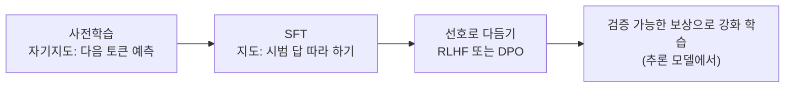

# 1.4 학습 방법 지도: 사전학습에서 강화 학습까지

> **수준** L1 · **선수** 1.3 모델의 한살이: 데이터에서 서비스까지 · **이 장의 질문** 학습 방법의 이름은 어떤 기준으로 나뉘나? 사전학습·파인튜닝·SFT·RLHF·증류는 각각 학습의 어느 단계에서 무엇을 정답으로 삼나? 강화 학습과 선호 학습은 어떤 관계인가? 대화형 AI는 어떤 학습 단계를 거쳐 만들어지나?

## 한눈에

- 학습 방법의 이름은 한 가지 기준으로 나눈 목록이 아니다. 「정답 신호가 어떤 형태로 오나」「모델 한살이의 어느 단계인가」「어느 가중치를 바꾸나」「신호를 누가 만드나」「데이터가 어떻게 들어오나」라는 서로 다른 축에 붙은 이름이다.
- 그래서 학습 한 번에 이름이 여러 개 붙는다. 지도 파인튜닝(SFT)은 신호로 보면 지도 학습이고, 단계로 보면 사후학습이다.
- 대화형 언어 모델은 보통 사전학습 → SFT → 선호나 보상으로 다듬기의 순서로 만든다. 단계의 수와 이름은 개발사마다 다르다.
- 강화 학습(보상으로 행동을 고치는 학습 틀)과 선호 학습(두 결과를 비교한 데이터로 배우는 신호 형태)은 서로 다른 축의 이름이다. 언어 모델의 사후학습에서 RLHF라는 방법으로 만나 한데 묶여 불릴 뿐이다.

## 1. 학습 방법 이름이 헷갈리는 이유

1.2장에서 모델 이름이 분야·구조·과제 같은 여러 축에 붙는다고 했다. 학습 방법의 이름도 똑같다. 「사전학습」은 언제 하는지를, 「강화 학습」은 무엇을 신호로 어떻게 배우는지를, 「LoRA」는 어느 가중치를 바꾸는지를 가리킨다. 기준이 다른 이름들이 한 목록에 섞여 있으니 겹치고 빠진 것처럼 보인다.

소프트웨어에 빗대면 「단위 테스트」「CI에서 도는 테스트」「모킹을 쓴 테스트」가 같은 테스트 하나를 가리킬 수 있는 것과 같다. 각각 범위·실행 시점·방식이라는 다른 축의 이름이다.

> **핵심** 학습 방법 이름을 만나면 「이 이름은 어느 축의 이름인가」부터 묻는다. 그러면 겹쳐 보이던 이름들이 정리된다.

## 2. 다섯 개의 축

### 2.1 학습 신호: 정답이 어떤 형태로 오나

| 이름 | 신호의 형태 | 자세히 |
|---|---|---|
| 지도 학습(supervised learning) | 입력마다 정답(라벨)이 붙어 있다. 예: 사진과 「고양이」 | 3.3 |
| 비지도 학습(unsupervised learning) | 정답 없이 데이터 안의 묶음이나 분포를 찾는다. 예: 비슷한 고객끼리 묶기 | 3.3 |
| 자기지도 학습(self-supervised learning) | 데이터의 일부를 가리고 나머지로 맞히게 해서 데이터 스스로 정답을 만든다. 예: 문장의 다음 단어 맞히기 | 3.3, 8부 |
| 준지도 학습(semi-supervised learning) | 일부 데이터만 라벨이 있고, 나머지는 라벨 없이 함께 쓴다 | 3.10, 9.6 |
| 강화 학습(reinforcement learning, RL) | 정답을 보여 주지 않는다. 모델이 행동(답)을 내면 그 결과에 점수(보상)만 준다 | 10부 |
| 선호 학습(preference learning) | 두 결과 중 어느 쪽이 나은지 비교한 데이터로 배운다 | 10.4, 10.5 |

### 2.2 단계: 모델 한살이의 어디에서 하나

| 이름 | 하는 일 | 자세히 |
|---|---|---|
| 사전학습(pre-training) | 큰 데이터로 넓고 일반적인 표현을 먼저 배운다 | 8부 |
| 추가 사전학습(continual pre-training) | 사전학습한 모델을 특정 분야 데이터로, 사전학습과 같은 방식으로 더 학습한다 | 8.5 |
| 파인튜닝(fine-tuning) | 사전학습한 모델을 특정 과제나 형식에 맞춰 더 학습한다 | 9부 |
| 사후학습(post-training) | 사전학습 뒤에 모델을 다듬는 학습을 통틀어 부른다. 언어 모델에서는 SFT, 선호 최적화, 강화 학습을 포함한다 | 9~10부 |

### 2.3 바꾸는 범위: 어느 가중치를 바꾸나

| 이름 | 바꾸는 것 | 자세히 |
|---|---|---|
| 처음부터 학습(training from scratch) | 무작위 값에서 시작해 모든 가중치를 학습한다 | 4.11, 8.6 |
| 전체 파인튜닝(full fine-tuning) | 사전학습한 모든 가중치를 고친다 | 9.1 |
| 일부 층 고정(freezing) | 앞쪽 층은 그대로 두고 뒤쪽 층만 고친다 | 9.1 |
| 효율적 파인튜닝(PEFT) | 원래 가중치는 그대로 두고 작게 덧붙인 가중치만 학습한다. 예: LoRA | 9.4 |
| 가중치를 바꾸지 않음 | 프롬프트와 예시만으로 원하는 동작을 끌어낸다(in-context learning) | 9.2 |

### 2.4 신호를 만드는 쪽: 누가 가르치나

| 가르치는 쪽 | 예 | 자세히 |
|---|---|---|
| 사람 | 라벨, 사람이 쓴 시범 답, 두 답 중 나은 쪽 고르기 | 6.9, 9.3, 10.4 |
| 다른 모델 | 증류(distillation), pseudo-label, 합성 데이터, AI가 매긴 선호 | 9.6, 12.4 |
| 환경이나 검증기 | 게임 점수, 수학 답 검사기, 코드 테스트 통과 여부 | 10.1, 10.7 |
| 데이터 자체 | 가린 부분 맞히기, 다음 토큰 맞히기 | 8부 |

### 2.5 데이터가 들어오는 방식

| 이름 | 방식 | 자세히 |
|---|---|---|
| 오프라인 학습 | 미리 모아 둔 데이터로 학습한다 | — |
| 온라인 학습 | 학습하는 동안 새 데이터를 받거나 스스로 만든다. 언어 모델의 강화 학습은 보통 모델이 방금 만든 답을 채점받아 배운다 | 10부 |
| 연속 학습(continual learning) | 과제나 데이터가 바뀌어 가는 동안 이어서 배운다. 앞서 배운 것을 잊는 문제가 따라온다 | 3.10, 9.5 |
| 연합 학습(federated learning) | 데이터를 한곳에 모으지 않고 여러 기기에서 학습한 결과만 모은다 | 3.10 |
| 능동 학습(active learning) | 모델이 라벨이 가장 도움이 될 데이터를 골라 라벨을 요청한다 | 3.10 |

이 밖에도 여러 과제를 한 모델로 함께 배우는 다중 과제 학습(multi-task learning, 3.10), 쉬운 데이터부터 어려운 데이터 순으로 배우는 커리큘럼 학습(curriculum learning) 같은 이름이 있다. 이것들은 학습을 어떻게 짜느냐에 붙은 이름이고, 위 축들과 함께 쓰인다.

## 3. 학습 한 번에 붙는 여러 이름

같은 학습을 축마다 다른 이름으로 부를 수 있다.

| 학습 | 신호 | 단계 | 바꾸는 범위 | 가르치는 쪽 |
|---|---|---|---|---|
| 언어 모델 사전학습 | 자기지도(다음 토큰 예측) | 사전학습 | 처음부터, 전체 | 데이터 자체 |
| SFT | 지도(시범 답 따라 하기) | 사후학습 | 전체 또는 LoRA | 사람 또는 큰 모델이 쓴 답 |
| RLHF | 선호 → 보상 → 강화 학습 | 사후학습 | 전체 또는 LoRA | 사람 |
| DPO | 선호 | 사후학습 | 전체 또는 LoRA | 사람 또는 AI |
| 검증 가능한 보상으로 하는 강화 학습 | 강화 학습 | 사후학습 | 전체 또는 LoRA | 검증기 |
| 증류 | 지도(큰 모델의 출력 따라 하기) | 파인튜닝 또는 별도 학습 | 작은 모델 전체 | 큰 모델 |
| 공개 검출 모델을 내 사진으로 학습 | 지도 | 파인튜닝 | 전체 또는 head만 | 사람 라벨 |

## 4. 대화형 언어 모델이 만들어지는 순서

대화형 언어 모델은 보통 다음 순서를 거친다.

그림: 대화형 언어 모델 학습의 일반적인 단계. 마지막 단계는 수학·코드 같은 추론 능력을 키우는 모델에서 쓴다.

1. **사전학습.** 인터넷 글처럼 큰 텍스트에서 다음 토큰을 맞히며 언어와 지식을 배운다. 이 단계만 거친 모델은 글을 이어 쓸 줄은 알지만 질문에 답하는 형식은 모른다.
2. **SFT.** 「질문 → 좋은 답」 쌍을 보여 주고 따라 하게 한다. 대화 형식과 지시를 따르는 법을 배운다.
3. **선호로 다듬기.** 좋은 답을 하나 정해 쓰기는 어렵지만, 두 답 중 어느 쪽이 나은지는 사람이 쉽게 고른다. 이 비교 데이터로 모델을 더 낫게 다듬는다.
4. **검증 가능한 보상으로 강화 학습.** 정답을 확인할 수 있는 문제(수학 답, 코드 테스트)를 풀게 하고, 맞으면 보상을 준다.

사전학습 → SFT → 보상 모델 → 강화 학습(PPO)의 순서를 자세히 공개한 대표 사례가 InstructGPT다 [@Ouyang2022]. 개발사마다 단계를 나누는 방식과 부르는 이름이 다르고, 자세한 구성을 공개하지 않는 경우도 많다.

## 5. 강화 학습과 선호 학습은 왜 함께 묶이나

둘은 다른 축의 이름이다. 강화 학습은 **학습의 틀**이다. 모델이 스스로 행동(답)을 만들고, 그 결과에 대한 점수를 받아, 점수가 오르도록 자기 행동 방식을 고친다. 선호 학습은 **신호의 형태**다. 「A가 B보다 낫다」는 비교에서 배운다.

그래서 둘은 따로 존재할 수 있다.

| | 선호 신호를 쓰지 않음 | 선호 신호를 씀 |
|---|---|---|
| 강화 학습 틀을 씀 | 게임 점수로 배우는 강화 학습, 검증기 보상으로 배우는 강화 학습 | RLHF |
| 강화 학습 틀을 쓰지 않음 | 지도 학습, 자기지도 학습 | DPO, 검색 결과 순위 학습 |

둘이 만난 곳이 RLHF(reinforcement learning from human feedback)다. 사람이 두 결과 중 나은 쪽을 고르고, 그 비교로 「얼마나 좋은 답인가」를 점수로 매기는 보상 모델을 학습한다. 그다음 그 점수를 보상으로 삼아 강화 학습을 한다 [@Christiano2017]. InstructGPT는 이 방법을 언어 모델에 적용했다 [@Ouyang2022].

그 뒤 DPO(direct preference optimization)는 RLHF와 같은 목표 — 좋은 답의 점수를 높이되 출발점인 모델에서 너무 멀어지지 않기 — 를 보상 모델과 강화 학습 과정 없이 선호 쌍에서 바로 최적화하는 방법을 보였다 [@Rafailov2023]. DPO는 강화 학습이 아니지만 RLHF와 같은 자리에서 같은 일을 한다.

정리하면 둘이 한데 묶이는 이유는 같은 종류여서가 아니다. 언어 모델의 사후학습에서 다음 세 가지를 공유하기 때문이다.

- 같은 단계에 온다. SFT 다음에 모델을 다듬는다.
- 같은 문제를 푼다. 정답 하나로 적기 어려운 「더 나은 답」을 배운다.
- 같은 목표를 쓴다. 좋은 답의 점수를 높이되 원래 모델에서 너무 멀어지지 않게 한다.

> **표준과 관례**
> - 지도·비지도·자기지도·강화 학습과 선호 학습은 학계에서 쓰는 분야 이름이다. 자기지도 학습을 비지도 학습의 한 갈래로 분류하는 문헌도 있다.
> - RLHF, DPO는 특정 논문에서 나온 방법 이름이다.
> - 사후학습(post-training)은 업계의 관례 용어라 무엇까지 포함하는지가 개발사마다 다르다.
> - 파인튜닝은 넓은 뜻(사전학습 뒤의 모든 추가 학습, SFT와 RLHF 포함)과 좁은 뜻(라벨 데이터로 하는 지도 추가 학습)으로 섞어 쓴다. 이 책은 좁은 뜻으로 쓰고, 넓은 뜻에는 「사후학습」을 쓴다.

## 헷갈리기 쉬운 점

| 헷갈리는 짝 | 차이 |
|---|---|
| 파인튜닝과 SFT | SFT는 파인튜닝의 한 종류로, 「지시 → 답」 쌍으로 하는 지도 파인튜닝이다 |
| 자기지도 학습과 비지도 학습 | 자기지도 학습은 데이터에서 만든 정답과 비교해 손실을 계산한다. 비지도 학습에는 비교할 정답이 없다 |
| 강화 학습과 선호 학습 | 강화 학습은 보상으로 행동을 고치는 틀이고, 선호 학습은 비교 데이터라는 신호 형태다 |
| 사전학습과 추가 사전학습 | 학습 방식(다음 토큰 예측 등)은 같다. 데이터의 범위와 출발점이 다르다 |
| 증류와 큰 모델의 답으로 하는 SFT | 증류는 원래 큰 모델이 내는 출력 확률 분포를 작은 모델이 따라 하게 하는 방법이다 [@Hinton2015]. 큰 모델이 쓴 답 문장으로 SFT하는 것도 넓게 증류라고 부른다 |

## 정리

- 학습 방법의 이름은 신호, 단계, 바꾸는 범위, 가르치는 쪽, 데이터가 들어오는 방식이라는 다섯 축에 붙는다.
- 사전학습·파인튜닝은 단계의 이름이고, 강화 학습은 학습 틀의 이름이며, 선호 학습은 신호 형태의 이름이다.
- 대화형 언어 모델은 사전학습 → SFT → 선호로 다듬기의 순서를 기본으로 하고, 추론 모델은 검증 가능한 보상으로 하는 강화 학습을 더한다.
- 강화 학습과 선호 학습은 RLHF에서 만난다. DPO는 강화 학습 없이 같은 목표를 푼다.

## 확인 문제

1. SFT를 「신호」 축과 「단계」 축에서 각각 무엇이라고 부르나?
2. 강화 학습이지만 선호 학습은 아닌 예를 하나 들어라.
3. RLHF와 DPO의 공통점과 차이점을 하나씩 말하라.
4. 사람이 라벨을 붙인 결함 사진으로, 공개된 사전학습 검출 모델의 head만 학습했다. 신호·단계·바꾸는 범위·가르치는 쪽 축에서 각각 이름을 붙여라.

답

1. 신호로는 지도 학습이다. 「지시 → 답」 쌍의 답이 정답 노릇을 한다. 단계로는 사후학습이고, 좁은 뜻의 파인튜닝이기도 하다.
2. 게임 점수를 보상으로 배우는 강화 학습, 또는 수학 답 검사기의 맞고 틀림을 보상으로 배우는 강화 학습. 둘 다 두 결과를 비교한 데이터를 쓰지 않는다.
3. 공통점: 두 답 중 나은 쪽을 고른 선호 데이터를 쓰고, SFT 다음 단계에서 같은 목표를 푼다. 차이점: RLHF는 보상 모델을 따로 학습하고 강화 학습으로 최적화하지만, DPO는 보상 모델과 강화 학습 과정 없이 선호 쌍에서 바로 학습한다.
4. 신호: 지도 학습. 단계: 파인튜닝. 바꾸는 범위: 일부 층 고정(head만 학습). 가르치는 쪽: 사람.

## 더 읽을거리

- [@Ouyang2022] 사전학습 → SFT → 보상 모델 → 강화 학습 순서를 자세히 공개한 대표 사례
- [@Christiano2017] 사람의 비교 판단으로 보상 모델을 학습해 강화 학습하는 방법의 대표 논문
- [@Rafailov2023] 보상 모델과 강화 학습 없이 선호 데이터로 바로 학습하는 DPO
- [@Sutton2018] 강화 학습의 표준 교과서
- [@Hinton2015] 지식 증류를 정리한 논문
