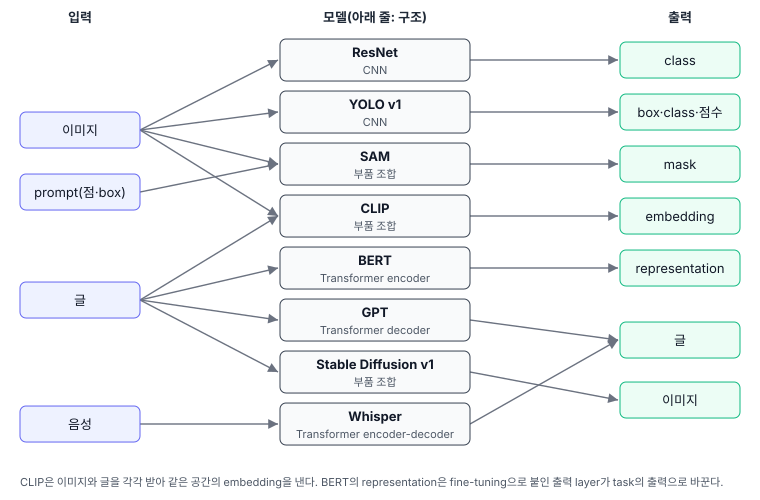
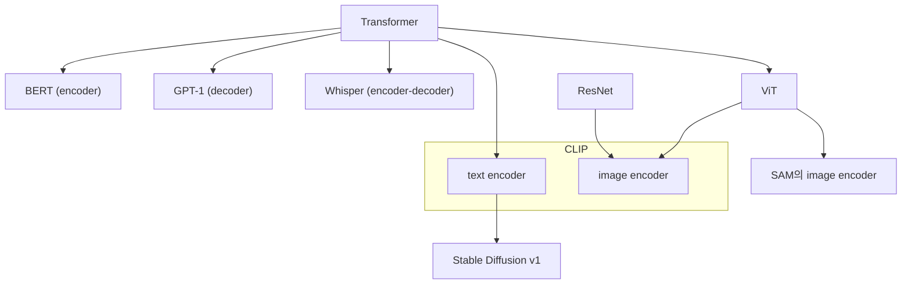

# 1.5 대표 모델 지도

> **수준** L1 · **선수** [1.2 모델 이름을 읽는 여섯 개의 축](01-02-naming-axes.md) · **이 장의 질문** ResNet·YOLO·SAM·CLIP·BERT·GPT·Stable Diffusion·Whisper는 각 축에서 어디에 놓이나?

## 한눈에

- 여덟 모델을 1.2장의 여섯 축에 놓으면 무엇을 받아 무엇을 내고, 어떤 구조로 무엇을 신호로 배웠는지가 표 하나에 정리된다.
- 같은 구조가 여러 modality(모달리티)에 쓰인다. Transformer는 BERT·GPT에서 글을, ViT에서 이미지를, Whisper에서 음성을 다룬다.
- 한 모델이 다른 모델을 부품으로 빌려 쓴다. Stable Diffusion v1은 글을 읽는 부품으로 CLIP의 일부를 쓴다.
- GPT·YOLO·Stable Diffusion은 여러 버전을 묶는 이름이다. 버전마다 구조·크기·학습이 다를 수 있으니 버전 번호를 함께 본다.

## 1. 대표 모델 지도를 읽는 법

이 장은 여덟 모델을 [1.2장](01-02-naming-axes.md#1-이름은-여러-축에-붙는다)의 여섯 축에 하나씩 놓는다. 이미지를 보는 ResNet·YOLO·SAM(§2), 글을 다루는 BERT·GPT(§3), 여러 modality를 잇는 CLIP·Stable Diffusion·Whisper(§4)다.

> **표준과 관례** 「대표 모델」을 정한 공식 목록은 없다. 이 여덟은 이미지·글·음성과 generative model(생성 모델)을 고루 덮고 뒤 장에서 본보기로 다시 나오는 모델이라 이 책이 골랐다.

| 축 | 이 장에서 적는 것 |
|---|---|
| 분야·과제 | 두 축을 합쳐 「이미지 → class(클래스)」처럼 입력과 출력 |
| 구조 | 구조 이름. 부품이 여럿이면 「부품 조합」 |
| 방식 | 출력을 만드는 방법. generative model일 때만 적는다 |
| 학습 | 학습 신호와 학습 단계 |
| 규모와 활용 | 학습 데이터 규모, 다른 모델의 출발점이나 부품이 되나 |

학습 칸은 [1.4장](01-04-training-methods-map.md#2-다섯-개의-축)의 축을 함께 쓴다. pre-training(사전학습)·좁은 뜻의 fine-tuning(파인튜닝)·self-supervised learning(자기지도 학습)·freezing(층 고정)·in-context learning은 1.4장에서 정한 뜻 그대로다.

## 2. 이미지를 보는 모델: ResNet·YOLO·SAM

### 2.1 ResNet: 아주 깊은 CNN을 학습할 수 있게

ResNet은 사진 한 장에 class 하나를 매기는 image classification(이미지 분류) 모델이다. 구조는 convolutional neural network(CNN, 합성곱 신경망)로, 주로 3×3 크기의 작은 창으로 계산하는 layer(층)를 쌓았다 [@He2016].

ResNet 논문은 아주 깊은 neural network(신경망)도 학습하기 쉽게 하는 방법을 내놓았다 [@He2016]. layer 몇 개를 건너뛰는 지름길을 내고, 그 layer들의 입력을 출력에 그대로 더한다 [@He2016]. 이런 연결을 residual connection(잔차 연결)이라 하고, 원 논문은 shortcut connection이라 부른다 [@He2016]. 이 지름길은 parameter(파라미터)도 계산량도 늘리지 않는다 [@He2016]. 왜 깊은 모델의 학습을 돕는지는 5.2장에서 본다.

학습 데이터는 ImageNet이다. ImageNet은 단어 사전 WordNet의 분류 체계에 따라 이미지를 정리한 dataset(데이터셋)으로, 이미지 약 1,420만 장을 담는다(2014년 8월 기준) [@Russakovsky2015]. ResNet이 쓴 것은 그 가운데 image classification 대회 ILSVRC에 쓰는 1000개 class의 부분집합이다 [@He2016; @Russakovsky2015]. 이 부분집합에서는 사진마다 사람이 class를 하나 붙였다 [@Russakovsky2015]. ResNet은 학습 이미지 128만 장으로 배웠다 [@He2016]. 사람이 붙인 label(라벨)과 비교하며 배웠으니 학습 신호는 supervised learning(지도 학습)이다.

### 2.2 YOLO v1: 사진 전체를 한 번 보고 box를 낸다

YOLO는 사진 속 물체마다 bounding box(경계 상자)와 class를 내는 object detection(객체 검출) 모델이다. 이름 You Only Look Once는 이미지를 한 번만 보고 어떤 물체가 어디에 있는지 예측한다는 뜻이다 [@Redmon2016].

YOLO v1에서는 neural network 하나가 이미지 전체를 한 번 계산해 box와 class 확률을 곧바로 낸다 [@Redmon2016]. 이미지를 격자로 나누고, 칸마다 box 몇 개와 그 confidence score(신뢰도 점수), class 확률을 예측한다 [@Redmon2016]. 구조는 CNN이다 [@Redmon2016].

학습은 두 단계다. CNN의 앞부분을 ImageNet의 1000개 class 분류로 먼저 학습한 뒤, detection용으로 바꿔 PASCAL VOC라는 detection dataset으로 학습했다 [@Redmon2016]. [1.4장](01-04-training-methods-map.md#22-단계-모델-개발의-어디에서-하나)의 말로 하면 supervised learning으로 pre-training한 뒤 fine-tuning한 셈이다. YOLO가 다른 detector(검출기)와 어떻게 다른지는 6.5장에서 본다.

### 2.3 SAM: prompt로 찾을 대상을 정한다

SAM은 이미지와 prompt(프롬프트)를 함께 받아 mask(마스크)를 내는 segmentation(분할) 모델이다 [@Kirillov2023]. SAM 논문이 말하는 prompt는 글만이 아니다. 전경과 배경을 찍은 점, 대략의 box나 mask, 자유 글처럼 어느 물체를 찾을지 알려 주는 정보는 모두 prompt다 [@Kirillov2023].

SAM은 세 부품으로 이루어진다 [@Kirillov2023]. 모델 안에서 입력을 읽어 숫자 배열로 바꾸는 부분을 encoder(인코더), 그 숫자 배열에서 출력을 만드는 부분을 decoder(디코더)라고 한다. SAM에서는 image encoder가 이미지를, prompt encoder가 prompt를 각각 숫자 배열로 바꾸면, 가벼운 mask decoder가 둘을 합쳐 mask를 낸다 [@Kirillov2023]. 모델 안에서 입력을 나타내는 숫자 배열을 [1.1장](01-01-ai-ml-dl.md#32-deep-learning은-feature를-layer마다-쌓아-배운다)에서 representation(표현)이라 했다. embedding(임베딩)은 넓게는 모델 안 어느 layer에서든 꺼낸, 입력을 나타내는 숫자 배열을 가리켜 representation과 거의 같은 뜻으로 쓰인다 [@Google2026]. 흔히는 embedding layer라는 layer가 나무 종류 같은 범주마다 하나씩 학습해 두는 숫자 배열을 가리킨다 [@Google2026]. 비슷한 것은 embedding도 비슷하게 배우므로, 두 embedding을 비교해 얼마나 비슷한지 잴 수 있다 [@Google2026]. SAM과 CLIP도 encoder가 내놓는 숫자 배열을 embedding이라 부른다 [@Kirillov2023; @Radford2021]. embedding은 5.4장에서 자세히 본다. image encoder는 미리 학습해 둔 ViT([1.2장 §2.2](01-02-naming-axes.md#22-구조-모델-안의-계산이-어떻게-짜여-있나))를 고해상도 입력에 맞게 조금 고쳐 쓴다 [@Kirillov2023].

연구진은 모델을 labeling(라벨링) 작업 안에 넣어 dataset과 모델을 함께 키웠고, 이것을 data engine이라 불렀다 [@Kirillov2023]. 그렇게 모은 SA-1B dataset은 이미지 1,100만 장과 mask 11억 개이고, 그 mask의 99.1%는 모델이 자동으로 만들었다 [@Kirillov2023]. [1.4장 §2.4](01-04-training-methods-map.md#24-신호를-만드는-쪽-누가-가르치나)의 표로 말하면 정답을 만드는 쪽에 모델이 들어간 예다. SAM 논문은 segmentation을 위한 foundation model(파운데이션 모델)을 목표로 삼았다 [@Kirillov2023]. mask를 내는 방식은 6.7장에서 본다.

## 3. 글을 다루는 모델: BERT·GPT

처음 나온 Transformer는 encoder와 decoder를 모두 둔 encoder-decoder(인코더-디코더) 구조였다 [@Vaswani2017]. 그 decoder는 출력을 한 번에 하나씩 만들고, 매 단계 앞서 만든 출력을 입력으로 더 받는다 [@Vaswani2017]. [1.2장 §2.4](01-02-naming-axes.md#24-방식-출력을-어떤-방법으로-만들어-내나)의 autoregressive model(자기회귀 모델) 방식이다. BERT는 encoder를, GPT는 앞에 놓인 글(주어진 글과 앞서 만든 출력)만 읽는 decoder를 여러 층 쌓아 만들었다 [@Devlin2019; @Radford2018]. 세 구조는 5.7장에서 비교한다.

### 3.1 BERT: encoder로 앞뒤 문맥을 함께 읽는다

BERT라는 이름의 뜻은 [1.2장 §3.2](01-02-naming-axes.md#32-한-이름이-여러-축을-묶는다)에서 보았다. 구조는 여러 층의 Transformer encoder다 [@Devlin2019]. 글을 받아 token(토큰)마다 왼쪽과 오른쪽 문맥을 함께 참고한 representation을 만든다 [@Devlin2019].

BERT는 pre-training과 fine-tuning의 두 단계로 학습한다 [@Devlin2019]. pre-training에는 label이 없는 글을 쓴다 [@Devlin2019]. 입력 token의 일부를 무작위로 가리고, 문맥만으로 가린 token을 맞히게 한다 [@Devlin2019]. 이 학습 목표를 masked language modeling(마스크 언어 모델링)이라 한다. 정답을 데이터 안에서 만들어 배우니 [1.4장 §2.1](01-04-training-methods-map.md#21-학습-신호-정답이-어떤-형태로-오나)의 self-supervised learning이다.

fine-tuning에서는 출력 layer 하나를 더하고, 풀려는 task(과제)의 label 데이터로 모든 parameter를 고친다 [@Devlin2019]. task마다 따로 fine-tuning한 모델을 둔다 [@Devlin2019]. 1.4장에서 정한 좁은 뜻의 fine-tuning이다. BERT-BASE는 parameter 1억 1,000만 개, BERT-LARGE는 3억 4,000만 개다 [@Devlin2019]. 학습 목표는 8.2장에서 본다.

### 3.2 GPT: decoder로 다음 token을 맞힌다

이 장은 첫 논문의 GPT-1과 규모를 크게 키운 GPT-3를 기준으로 쓴다.

GPT-1은 여러 층의 Transformer decoder로 만든 language model(언어 모델)이다 [@Radford2018]. BERT와 달리 각 token은 자기 왼쪽 문맥만 참고한다 [@Devlin2019]. 먼저 label이 없는 글에서 앞 token들을 보고 다음 token의 확률을 맞히게 한다 [@Radford2018]. 1.4장의 next-token prediction(다음 토큰 예측)이고, 논문은 이 단계를 generative pre-training이라 부른다 [@Radford2018]. 그다음 task마다 label 데이터로 parameter를 맞춘다 [@Radford2018]. 원 논문은 이 단계를 supervised fine-tuning(SFT, 지도 파인튜닝)이라 부른다 [@Radford2018]. 입력과 바라는 출력의 쌍으로 배우니 [1.4장](01-04-training-methods-map.md#4-대화형-language-model이-만들어지는-순서)의 정의로도 SFT다. BERT의 fine-tuning도 마찬가지다. 다만 task마다 그 task의 label로 하는 학습이라, 대화 모델을 지시와 답의 쌍으로 학습하는 instruction tuning은 아니다.

GPT-3는 parameter 1,750억 개의 autoregressive language model이다 [@Brown2020]. GPT-3 논문은 fine-tuning 없이, task 설명과 예시 몇 개를 입력 글로만 주어 평가했다 [@Brown2020]. GPT-3 논문은 이렇게 입력 글 안의 예시로 task를 푸는 과정을 in-context learning이라 부른다 [@Brown2020]. [1.4장 §2.3](01-04-training-methods-map.md#23-바꾸는-범위-어느-weight를-바꾸나)에서 본, weight(가중치)를 바꾸지 않는 학습이다. 논문은 예시를 입력 글에 들어가는 만큼(보통 10~100개) 주는 조건을 few-shot, 예시 없이 지시만 주는 조건을 zero-shot이라 부른다 [@Brown2020]. 그리고 language model의 크기를 키우면 few-shot 성능이 크게 올라, 때로는 fine-tuning한 기존 최고 방법과 비슷한 수준에 이른다고 보고했다 [@Brown2020]. 큰 모델일수록 입력 글 안의 예시를 더 잘 활용한다는 것이다 [@Brown2020]. GPT-1과 달리 fine-tuning 없이 task를 풀 수 있게 한 바탕이 규모라는 뜻이다. 글을 만드는 과정은 7.2장에서 본다.

## 4. modality를 잇는 모델: CLIP·Stable Diffusion·Whisper

### 4.1 CLIP: 이미지와 글을 같은 공간에 놓는다

CLIP은 [1.2장 §2.5](01-02-naming-axes.md#25-학습-무엇을-신호로-어느-단계까지-배웠나)에서 본 대로, 이미지와 글의 쌍 4억 개로 contrastive learning(대조 학습)을 한 모델이다 [@Radford2021].

CLIP은 image encoder와 text encoder로 되어 있다 [@Radford2021]. 이미지와 글을 각각 받아 같은 공간의 embedding을 내고, 쌍을 이루는 이미지와 글의 embedding끼리는 가까워지고, 쌍이 아닌 이미지와 글의 embedding끼리는 멀어지도록 배운다 [@Radford2021]. CLIP 논문은 이미지와 짝지은 글로 배우는 비슷한 연구들이 자기 방식을 unsupervised(비지도)·self-supervised·weakly supervised(뜻은 §4.3)·supervised로 저마다 달리 불렀다고 짚는다 [@Radford2021]. 그리고 그 공통점을 자연어를 학습 신호로 쓰는 것으로 본다 [@Radford2021]. text encoder는 Transformer다 [@Radford2021]. image encoder로는 ResNet을 바탕으로 한 구조와 ViT를 모두 써서 학습했다 [@Radford2021].

이렇게 배우면 §3.2처럼 분류할 dataset의 예시 없이 분류하는 zero-shot classification을 할 수 있다. dataset의 class 이름들을 글 후보로 놓고, 이미지의 embedding과 가장 잘 맞는 글을 고른다 [@Radford2021]. 가장 좋은 CLIP 모델은 ImageNet의 학습 이미지 128만 장을 하나도 쓰지 않고, 그 이미지로 학습한 50층 ResNet(ResNet-50)과 맞먹는 정확도를 냈다 [@Radford2021]. 11.1장에서 자세히 본다.

### 4.2 Stable Diffusion v1: 압축한 공간에서 noise를 제거한다

Stable Diffusion은 글을 받아 사진 같은 이미지를 만드는 text-to-image 모델이다 [@CompVis2022]. 방식은 1.2장 §2.4의 diffusion model(확산 모델)이다. 이 장은 v1-4의 model card(모델 카드)를 기준으로 쓴다.

Stable Diffusion은 픽셀 위가 아니라, 이미지를 훨씬 작은 숫자 배열로 압축한 공간에서 diffusion을 한다 [@Rombach2022; @CompVis2022]. 이 방식을 latent diffusion(잠재 확산)이라 하고, 압축한 공간을 latent 공간이라 한다 [@Rombach2022]. 압축은 autoencoder(오토인코더)가 맡는다. 이미지를 압축하는 encoder와, 압축한 것에서 이미지를 되살리는 decoder를 함께 학습한 모델이다 [@Rombach2022]. v1-4의 autoencoder는 가로와 세로를 각각 8분의 1로 줄이고 4채널의 숫자 배열을 만든다 [@CompVis2022]. 색 3채널인 512×512 이미지(512×512×3)라면 64×64×4 latent가 되어, 숫자 786,432개가 16,384개로 48분의 1이 된다. diffusion은 noise(잡음)를 제거하는 계산을 여러 번 반복하므로, 다룰 숫자를 이렇게 줄이면 학습과 이미지 생성에 드는 계산이 크게 준다 [@Rombach2022].

구조는 부품 세 개의 조합이다 [@CompVis2022]. autoencoder가 이미지와 latent 사이를 오가고, UNet이라는 neural network가 latent에서 noise를 제거한다 [@Rombach2022; @CompVis2022]. latent diffusion 원 논문은 이 UNet을 주로 §2.1의 CNN처럼 작은 창으로 계산하는 layer로 짰다 [@Rombach2022]. 글 prompt는 CLIP의 text encoder(ViT-L/14 버전)가 읽는데, v1-4는 이 부품을 미리 학습된 채 freezing해 쓴다(1.4장) [@CompVis2022]. 그 출력이 UNet에 들어가 글에 맞는 이미지를 만들게 한다 [@Rombach2022; @CompVis2022]. 학습할 때는 latent에 noise를 더하고, UNet이 더해진 noise를 맞히도록 배운다 [@CompVis2022]. 이미지를 만들 때는 무작위 noise로 채운 latent에서 시작해 UNet으로 noise를 조금씩 여러 번 제거하고, 마지막에 decoder에 한 번 통과시켜 이미지로 되살린다 [@Rombach2022]. autoencoder의 encoder는 학습할 때 이미지를 latent로 바꾸는 데 쓰고, 이렇게 무작위 noise에서 이미지를 만들 때는 쓰지 않는다 [@Rombach2022]. latent diffusion은 11.5장에서 본다.

### 4.3 Whisper: 인터넷 자막으로 배운 음성 인식

Whisper는 음성을 받아 글을 내는 speech recognition model(음성 인식 모델)이다. 받아쓰기와 번역 같은 여러 task를 한 모델로 하고, decoder에 넣는 특별한 token으로 task를 정한다 [@Radford2023].

연구진은 새 구조를 만들지 않고 이미 검증된 encoder-decoder Transformer를 골랐다 [@Radford2023]. encoder가 음성을 받고, decoder는 음성을 조건으로 받는 language model로서 글의 token을 만든다 [@Radford2023]. decoder는 앞 token들 다음에 올 token을 맞히도록 학습한다 [@Radford2023]. 그래서 방식 축에서는 GPT처럼 token을 하나씩 이어 만드는 autoregressive model에 놓인다.

학습 데이터는 인터넷에서 자막과 짝지어진 음성 68만 시간이다 [@Radford2023]. Whisper 논문은 사람이 검증한 최상급 정답이라는 요건을 낮추고, 덜 깨끗하지만 훨씬 많은 정답으로 배웠다 [@Radford2023]. 이런 학습을 weak supervision(약한 지도)이라 한다 [@Radford2023]. 정답의 질과 양을 맞바꾸는 선택이다 [@Radford2023]. Whisper는 parameter 3,900만 개부터 15억 5,000만 개까지 크기가 다른 여러 모델로 공개되었다 [@Radford2023]. 구조는 11.7장에서 본다.

## 5. 여덟 모델을 한 지도에

§2~§4를 축별로 모으고 학습 데이터 규모를 더하면 다음 표가 된다.

| 모델 | 연도 | 입력 → 출력 | 구조 | 방식 | 학습 | 규모와 활용 |
|---|---|---|---|---|---|---|
| ResNet | 2016 | 이미지 → class | CNN(residual connection) | 해당 없음 | supervised | 학습 이미지 128만 장. CLIP의 바탕 |
| YOLO v1 | 2016 | 이미지 → 물체마다 box·class·점수 | CNN | 해당 없음 | supervised. pre-training → fine-tuning | ImageNet, PASCAL VOC |
| SAM | 2023 | 이미지 + prompt → mask | 부품 조합(ViT image encoder, prompt encoder, mask decoder) | 해당 없음 | supervised. mask 대부분은 모델이 만들었다 | 이미지 1,100만 장, mask 11억 개 |
| BERT | 2019 | 글 → token마다 representation | Transformer encoder | 해당 없음 | self-supervised(masked language modeling) → fine-tuning | 33억 단어 [@Devlin2019]. task마다 fine-tuning하는 출발점 |
| GPT | 2018·2020 | 글 → 이어지는 글 | Transformer decoder | autoregressive | self-supervised(next-token prediction) → GPT-1만 fine-tuning | GPT-1은 책 7,000권 넘게 [@Radford2018], GPT-3는 3,000억 token [@Brown2020] |
| CLIP | 2021 | 이미지 → embedding, 글 → embedding | 부품 조합(CNN이나 ViT image encoder, Transformer text encoder) | 해당 없음 | contrastive learning(§4.1) | 이미지·글 쌍 4억 개. Stable Diffusion v1의 부품 |
| Stable Diffusion v1 | 2022 | 글 → 이미지 | 부품 조합(autoencoder, CNN 계열의 UNet, CLIP text encoder) | diffusion(latent diffusion) | 더한 noise 맞히기 | 영어 설명이 붙은 이미지 dataset LAION-2B(en)과 그 부분집합 [@CompVis2022] |
| Whisper | 2023 | 음성 → 글 | Transformer encoder-decoder | autoregressive | weak supervision | 68만 시간 |

그림: 여덟 모델이 무엇을 받아 무엇을 내는지 이은 지도. 모델 상자의 아래 줄은 구조다.

구조와 부품을 빌려 쓰는 관계만 그리면 다음과 같다. 화살표 끝의 모델이 앞의 것을 구조나 부품으로 쓴다.

그림: 구조와 부품을 빌려 쓰는 관계. 받는 쪽의 논문이나 model card가 적은 구성만 그렸다.

표와 그림에서 네 가지를 읽을 수 있다.

1. **부품 자리에는 같은 축의 이름끼리 바꿔 넣는다.** CLIP은 image encoder에 CNN과 ViT를 모두 넣어 학습했다 [@Radford2021]. 둘 다 구조 이름이라 서로 대신할 수 있다. [1.2장 §3.3](01-02-naming-axes.md#33-같은-축의-이름끼리만-비교할-수-있다)의 「같은 축끼리만 비교한다」가 부품 자리에도 맞는다. 모델을 바꿔 쓰려면 입력과 출력이 맞아야 한다. box를 내는 YOLO v1은 mask가 필요한 곳에 SAM 대신 넣을 수 없다.
2. **Transformer는 글·이미지·음성에 두루 쓰인다.** modality가 달라도 구조 칸은 같을 수 있다. Transformer는 숫자 배열을 한 줄로 늘어놓은 열을 입력으로 받는다 [@Dosovitskiy2021]. 글은 token마다, 이미지는 ViT처럼 patch(패치)마다([1.2장 §2.2](01-02-naming-axes.md#22-구조-모델-안의-계산이-어떻게-짜여-있나)) 숫자 배열을 하나씩 만들어 늘어놓는다 [@Dosovitskiy2021]. Whisper는 음성을 25밀리초 길이의 구간으로 10밀리초씩 옮겨 가며 잘라, 구간마다 숫자 80개로 나타낸 열을 encoder에 넣는다 [@Radford2023]. 어느 modality든 이렇게 숫자 배열의 열로 바꾸면 같은 구조에 넣을 수 있다.
3. **큰 모델이 다른 모델의 부품이나 출발점이 된다.** [1.2장 §2.6](01-02-naming-axes.md#26-규모와-활용-얼마나-크고-어떻게-쓰나)의 foundation model이 이런 모델이고, 그 이름을 붙인 보고서는 BERT와 GPT-3를 예로 든다 [@Bommasani2021]. 넓은 데이터로 한 번 크게 학습해 두면 여러 task에 맞춰 다시 쓸 수 있기 때문이다 [@Bommasani2021]. 이런 모델이 산업에서 이루는 층은 1.6장에서 본다.
4. **사람이 학습용으로 데이터마다 정답을 따로 붙이지 않아도 되는 신호는 데이터를 훨씬 크게 모으기 쉽다.** 사람이 사진마다 class를 붙인 ResNet의 학습 이미지는 128만 장이다 [@He2016]. 인터넷에서 모은 이미지와 글의 쌍으로 배운 CLIP은 4억 쌍이니, 이미지 수로 약 300배다 [@Radford2021]. label이 없는 글에서 정답을 만드는 BERT는 33억 단어, GPT-3는 3,000억 token으로 배웠다 [@Devlin2019; @Brown2020]. Whisper는 덜 깨끗한 인터넷 자막을 받아들여 68만 시간을 모았고 [@Radford2023], SAM은 mask를 만드는 일을 모델에 맡겨 11억 개까지 늘렸다 [@Kirillov2023]. 단위가 달라 숫자끼리 바로 비교할 수는 없지만, §4.3에서 본 정답의 질과 양의 맞바꿈이 이 표의 여러 모델에서 나타난다.

이 책이 직접 만드는 모델도 이 표의 세 행과 같은 칸에 놓인다. 6.2장의 작은 image classifier(분류기)는 ResNet, 9.7장과 14.4장의 detection model(검출 모델)은 YOLO v1, 8.6장과 14.3장의 작은 language model은 GPT 행이다.

## 6. 이름이 모델 하나인가 계열인가

GPT·YOLO·Stable Diffusion은 여러 버전을 묶는 이름이고, 버전마다 구조·크기·학습이 다를 수 있다 [@Redmon2017]. §3.2에서 본 대로 GPT-1은 task마다 fine-tuning했지만 GPT-3는 fine-tuning 없이 in-context learning으로 task를 풀었다. YOLO도 v1은 box를 곧바로 예측했지만, YOLO v2는 미리 정해 둔 기준 box인 anchor box(앵커 박스)를 바탕으로 box를 예측하도록 구조를 바꿨다 [@Redmon2017].

Stable Diffusion v1 안에서도 v1-4는 v1-2의 weight에서 시작해 고른 데이터로 더 fine-tuning한 버전이다 [@CompVis2022]. 논문과 공개 모델이 다를 수도 있다. latent diffusion 원 논문의 text-to-image 모델은 CLIP을 쓰지 않고, 글을 BERT와 같은 방식으로 token으로 쪼갠 뒤(7.1장) Transformer로 읽었다 [@Rombach2022]. 공개된 Stable Diffusion v1-4는 CLIP ViT-L/14의 text encoder를 쓴다 [@CompVis2022]. 그래서 이 장은 Stable Diffusion을 원 논문보다 v1-4의 model card대로 적었다.

이 장의 표는 GPT-1과 GPT-3, YOLO v1, Stable Diffusion v1-4가 기준이다. 모델을 쓸 때는 버전 번호를 함께 보고, 그 버전의 model card나 논문에서 구조·크기·학습 데이터를 확인한다.

## 헷갈리기 쉬운 점

| 헷갈리는 개념 | 차이 |
|---|---|
| ResNet과 CNN | ResNet은 모델 이름이고 CNN은 구조 이름이다. ResNet은 CNN에 residual connection을 더한 모델이다 |
| BERT와 GPT | 둘 다 Transformer를 쓴다. BERT는 encoder로 앞뒤 문맥을 함께 읽어 representation을 만들고, GPT는 decoder로 왼쪽 문맥만 보며 다음 token을 이어 쓴다 |
| CLIP과 Stable Diffusion | CLIP은 이미지와 글을 embedding으로 바꿔 쌍이 맞는지 가릴 뿐 이미지를 만들지 않는다. Stable Diffusion v1은 이미지를 만들고, CLIP의 text encoder를 부품으로 쓴다 |
| GPT와 ChatGPT | GPT는 language model 계열의 이름이고, ChatGPT는 그 계열의 모델을 대화에 맞게 고친 것이다. 2022년 공개 당시의 글에 따르면 GPT-3.5 계열 모델을 사람이 쓴 대화로 SFT하고, reinforcement learning from human feedback(RLHF)로 더 학습했다 [@OpenAI2022] |

## 정리

- 여덟 모델을 여섯 축에 놓으면 입력과 출력, 구조, 방식, 학습, 규모와 활용이 표 하나로 정리된다.
- ResNet·YOLO v1은 CNN, BERT는 Transformer encoder, GPT는 decoder, Whisper는 encoder-decoder이고, SAM·CLIP·Stable Diffusion v1은 부품 조합이다. generative model 가운데 GPT·Whisper는 autoregressive, Stable Diffusion은 latent diffusion이다.
- 학습 신호는 사람이 붙인 label(ResNet·YOLO), 데이터 안에서 만든 정답(BERT·GPT), 이미지와 글의 쌍(CLIP), 덜 깨끗한 인터넷 자막(Whisper) 등으로 갈린다. 사람이 학습용으로 정답을 따로 붙이지 않아도 되는 신호는 데이터를 크게 모으기 쉽다. 같은 이름도 버전마다 다를 수 있다.

## 확인 문제

1. 「말소리를 받아 말한 사람의 감정을 class 하나로 낸다. Transformer encoder로 만들었고, 사람이 감정 label을 붙인 녹음으로 training from scratch(처음부터 학습)를 했다.」 이 모델을 여섯 축에 놓아 보라. 설명만으로 알 수 없는 축은 무엇인가?
2. 서로 바꿔 쓸 수 있는 조합은 무엇인가? (a) CLIP의 image encoder로 CNN 대신 ViT (b) 물체의 모양이 필요할 때 SAM 대신 YOLO v1 (c) 글을 이어 써야 할 때 GPT 대신 BERT
3. Stable Diffusion v1-4 안에서 CLIP은 어느 부품으로 무슨 일을 하나? v1-4를 학습하는 동안 그 부품의 weight는 바뀌나?
4. BERT와 GPT 가운데 글을 이어 쓰는 데 맞는 쪽은 무엇인가? 구조와 pre-training의 학습 목표로 이유를 말하라.

답

1. 분야는 speech(음성)이고 입력과 출력은 「음성 → class」다. 구조는 Transformer encoder, 방식은 generative model이 아니므로 해당 없음이다. 학습은 supervised learning이고 단계는 training from scratch다. 규모와 활용은 설명만으로 알 수 없다.
2. (a). 둘 다 구조 이름이라 서로 대신할 수 있고, CLIP 논문도 두 가지로 모두 학습했다. (b)는 YOLO v1이 mask가 아니라 box를 내서 안 된다. (c)는 BERT가 글을 이어 쓰도록 학습하지 않은 encoder라서 안 된다.
3. CLIP의 text encoder(ViT-L/14 버전)가 글 prompt를 읽고, 그 출력이 UNet에 들어가 글에 맞는 이미지를 만들게 한다. v1-4는 이 부품을 고정해 쓰므로 weight가 바뀌지 않는다.
4. GPT. 각 token이 왼쪽 문맥만 보는 decoder이고, next-token prediction으로 pre-training해서 글을 token 하나씩 이어 쓸 수 있다. BERT는 앞뒤 문맥을 함께 보는 encoder이고 가린 token을 맞히는 masked language modeling으로 배웠다.

## 더 읽을거리

- [@He2016] residual connection으로 아주 깊은 CNN을 학습한 ResNet 원 논문
- [@Radford2018] generative pre-training 뒤 task마다 fine-tuning하는 GPT-1 논문
- [@Rombach2022] autoencoder의 latent 공간에서 diffusion을 하는 latent diffusion 원 논문
- [@Radford2023] 인터넷 자막 68만 시간으로 weak supervision을 한 Whisper 논문
