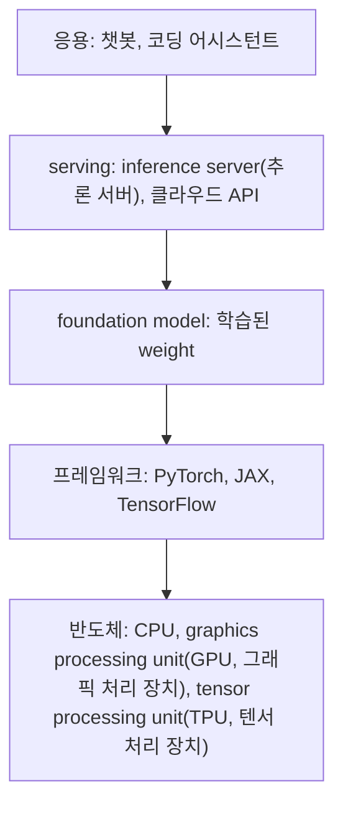
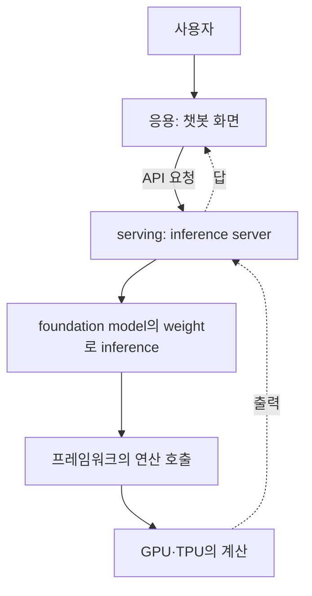

# 1.6 AI 산업의 기술 층위

> **수준** L1 · **선수** [1.3 ML lifecycle: 데이터에서 서비스까지](01-03-model-lifecycle.md) · **이 장의 질문** 반도체·프레임워크·foundation model·serving·응용은 어떻게 층을 이루나? open-weight model과 API 모델은 무엇이 다른가?

## 한눈에

- AI(인공지능) 제품 하나는 반도체, 프레임워크, foundation model(파운데이션 모델), serving(서빙), 응용의 다섯 층 위에서 돈다. 이 다섯 층은 이 책이 고른 정리 방식이다.
- 각 층은 바로 아래 층의 기능을 쓰고, 위 층에는 더 쓰기 쉬운 기능을 내놓는다.
- 1.3장에서 본 「모델 코드는 시스템의 작은 부분」을 산업 전체로 넓힌 그림이다.
- open-weight model(오픈 가중치 모델)은 weight(가중치) 파일을 받아 내 장치에서 돌리고, API 모델은 개발사 서버에 요청을 보내 답만 받는다. 둘을 가르는 것은 weight를 손에 쥐느냐다.

## 1. 왜 층으로 보나

소프트웨어 개발자에게 층은 익숙한 생각이다. 웹 서비스는 하드웨어 위에 운영체제와 드라이버, 그 위에 런타임과 라이브러리, 맨 위에 서비스와 앱이 쌓여 있다. 각 층은 아래 층의 세부를 감추고 위 층에 쓰기 쉬운 기능을 내놓는다.

AI 제품도 이렇게 쌓여 있다. [1.3장 §4](01-03-model-lifecycle.md#4-모델-코드는-시스템의-작은-부분이다)에서 본 대로, 실제 서비스에서 모델을 학습하고 돌리는 코드는 작은 부분이다. 모델 하나를 서비스로 내려면 아래에는 계산할 칩과 칩을 다루는 소프트웨어가, 위에는 요청을 받아 모델을 돌려 주는 체계와 사용자가 만나는 제품이 있어야 한다.

deep learning(딥러닝)은 neural network(신경망)의 크기가 중요해서 고성능 하드웨어와 소프트웨어 기반이 필요하다 [@Goodfellow2016]. foundation model([1.2장 §2.6](01-02-naming-axes.md#26-규모와-활용-얼마나-크고-어떻게-쓰나))이라는 이름을 붙인 보고서도 foundation model은 점점 중요해지지만 AI 시스템의 한 구성 요소일 뿐이라고 적는다 [@Bommasani2021].

층으로 나눠 보면 어떤 기술 이름이 어느 층의 일인지, 한 층을 바꿀 때 무엇이 따라 바뀌는지 가리기 쉽다.

## 2. 다섯 층 한눈에

그림: AI 산업의 다섯 층. 화살표는 위 층이 기대는 방향이다.

| 층 | 하는 일 | 예 | 자세히 |
|---|---|---|---|
| 응용 | 모델의 출력을 사용자가 쓰는 기능으로 만든다 | 범용 챗봇, 코딩 어시스턴트 | §7, 13.3, 13.4 |
| serving | 학습한 모델이 inference(추론)로 예측을 내놓게 한다. 요청이 올 때마다 돌리기도 하고, 미리 한꺼번에 계산해 두기도 한다 | vLLM, OpenAI API | §6, 13.2 |
| foundation model | 넓은 데이터로 학습한 모델을 내놓고, 여러 task(과제)에 맞춰 고쳐 쓰게 한다 | BERT, GPT-3 | §5, 9.1 |
| 프레임워크 | 숫자 배열 계산과 미분을 대신하고, 같은 코드를 여러 칩에서 돌린다 | PyTorch, JAX, TensorFlow | §4, 2.5 |
| 반도체 | 많은 계산을 동시에 한다 | CPU, graphics processing unit(GPU, 그래픽 처리 장치), tensor processing unit(TPU, 텐서 처리 장치) | §3, 2.6, 4.8 |

> **표준과 관례** 이 다섯 층은 산업을 훑어보려고 이 책이 고른 정리 방식이다. 이 장의 층은 neural network의 layer(층)가 아니라 기술 스택의 단계를 가리킨다. 층의 수와 이름을 정한 표준 분류로 쓰지 않는다. 같은 생태계를 다르게 자르는 정리도 있다. foundation model 보고서는 생태계를 데이터 생성, 데이터 정리(보고서의 단계 이름은 data curation), 학습, adaptation(적응), 배포의 단계 순서로 본다 [@Bommasani2021]. 이것은 층이라기보다 [1.3장](01-03-model-lifecycle.md#1-ml-lifecycle-한눈에)에서 본 개발 단계에 가까운 정리다.

## 3. 반도체: GPU와 accelerator

[1.1장 §4](01-01-ai-ml-dl.md#4-deep-learning은-어떻게-핵심-기술이-되었나)에서 deep learning을 키운 자원으로 데이터와 계산을 보았다. [1.3장 §3](01-03-model-lifecycle.md#3-학습과-inference)에서는 학습이 forward pass(순전파)와 backpropagation(역전파)을 수없이 반복하고, inference는 forward pass만 한다고 했다. 이 계산을 맨 아래 층이 맡는다.

예전에는 neural network를 기계 한 대의 CPU로 학습했지만, 2016년 교과서 시점에 이미 대개 GPU나 여러 기계의 CPU를 썼다 [@Goodfellow2016]. GPU는 원래 그래픽 응용을 위해 개발된 하드웨어다 [@Goodfellow2016]. 화면을 그리려면 수많은 꼭짓점에 대해 행렬 곱셈과 나눗셈을 동시에 해야 해서, GPU는 많은 계산을 나란히 하도록 설계됐다 [@Goodfellow2016].

neural network도 행렬 곱셈을 아주 많이 한다. [1.1장 §1.3](01-01-ai-ml-dl.md#13-deep-learning-여러-layer로-쌓아-배우는-방법)에서 layer를 앞 layer의 결과를 받아 단순한 계산 하나를 하는 단위라고 했다. 그 계산의 첫 단계는 입력에 그 layer의 weight 행렬을 곱하는 일이다 [@Goodfellow2016]. 입력 숫자 3개를 받아 출력 2개를 내는 layer라면 weight는 3행 2열의 행렬, 곧 숫자 6개다. 입력 [1, 2, 3]에 weight 행렬 [[1, 0], [0, 1], [1, 1]]을 곱하면 출력은 [1×1 + 2×0 + 3×1, 1×0 + 2×1 + 3×1] = [4, 5]다. 실제 layer는 여기에 숫자를 더하고 간단한 함수를 한 번 거치지만 [@Goodfellow2016], 계산의 중심은 이런 곱하고 더하기다. layer가 쌓이고 입력과 출력의 수가 많아지면 이 곱하고 더하기가 아주 많이 반복된다.

많은 계산을 나란히 하는 GPU의 설계는 neural network의 계산에 잘 맞는다. 학습 알고리즘에는 분기나 복잡한 제어가 많지 않다 [@Goodfellow2016]. 또 많은 계산 단위를 서로 기다리지 않고 따로 계산할 수 있어서, GPU가 여러 계산을 나란히 하는 데서 쉽게 이득을 본다 [@Goodfellow2016]. 메모리에서 값을 읽고 쓰는 속도(메모리 대역폭)가 높다는 점도 GPU가 CPU보다 나은 점의 하나다 [@Goodfellow2016].

이처럼 특정 종류의 계산을 범용 CPU보다 빠르게 하도록 쓰는 하드웨어를 accelerator(가속기)라고 한다.

Google의 TPU가 그런 칩의 한 예다. 2017년 논문이 다룬 첫 TPU는 2015년부터 Google 데이터센터에 배치된 맞춤 칩으로, neural network의 inference를 가속하도록 설계됐다 [@Jouppi2017]. Google은 inference용으로는 이 칩을 만들기로 했고, 학습용으로는 시판 GPU를 샀다 [@Jouppi2017]. 첫 TPU의 중심은 곱하고 더하는 작은 계산 단위 65,536개를 나란히 둔 행렬 곱셈 장치다 [@Jouppi2017]. 논문이 잰 데이터센터 inference 작업 여섯 개에서, 첫 TPU는 같은 데이터센터에 배치된 당시의 K80 GPU와 Haswell CPU보다 약 15~30배 빨랐다 [@Jouppi2017].

칩의 메모리는 돌릴 수 있는 모델의 크기도 제한한다. foundation model은 흔히 accelerator 하나의 주 메모리에 다 들어가지 않을 만큼 크다(2021년 보고서 기준) [@Bommasani2021]. 크기를 어림해 보자. parameter(파라미터) 하나를 16비트, 곧 2바이트로 담으면 parameter 130억 개의 weight는 130억 × 2바이트 = 260억 바이트, 약 26GB다. §6에서 볼 vLLM의 논문은 parameter 130억 개의 모델을 NVIDIA A100 40GB GPU에서 serving할 때 메모리의 약 65%인 26GB가 weight에 쓰이고, 30% 가까이는 요청마다 달라지는 상태를 담는 데 쓰인다고 적는다 [@Kwon2023]. 26 ÷ 40 = 0.65이므로 위의 어림과 맞는다. weight 65%에 상태 30% 가까이를 더하면, 130억 개짜리 모델도 GPU 하나의 메모리가 거의 찬다. 같은 어림으로 parameter 1,750억 개의 GPT-3(§5)는 weight만 1,750억 × 2바이트 = 3,500억 바이트, 약 350GB라서 40GB GPU 하나에 들어가지 않는다. 메모리를 자세히 계산하는 법은 4.8장과 14.1장에서 본다.

## 4. 프레임워크: PyTorch·JAX·TensorFlow

칩을 직접 다루는 코드는 쓰기 어렵다. NVIDIA의 CUDA는 GPU에서 돌 코드를 C와 비슷한 언어로 쓰는 길을 열었다 [@Goodfellow2016]. 그래도 빠른 GPU 코드를 직접 쓰기는 어려워서, Goodfellow 외는 행렬 곱셈 같은 연산을 빠른 라이브러리로 만들어 두고 모델은 그 라이브러리를 부르는 코드로 적는 방식을 권한다 [@Goodfellow2016]. cuDNN 같은 라이브러리가 이런 빠른 계산 조각을 내놓으면서, 그 위의 deep learning framework(딥러닝 프레임워크)가 accelerator를 쓸 수 있게 되었다 [@Paszke2019].

deep learning framework는 모델 코드와 칩 사이에서 세 가지를 대신한다.

- **숫자 배열 계산.** PyTorch는 여러 차원의 숫자 배열 계산을 GPU 가속과 함께 바로 실행한다 [@Paszke2019].
- **미분의 자동 계산.** backpropagation은 weight마다 고칠 방향을 계산하는 일이고(1.3장), 그 방향은 loss(손실)를 weight로 미분해 구한다 [@Goodfellow2016]. 미분을 자동으로 계산하는 기술이 발전하면서 이 고된 일을 완전히 자동화할 수 있게 됐다 [@Paszke2019].
- **칩을 바꿔 돌리기.** PyTorch의 연산은 CPU에서도 GPU에서도 돌고, CPU와 GPU 사이의 동기화는 사용자가 따로 짜지 않는 한 라이브러리가 맡는다 [@Paszke2019].

TensorFlow는 계산을 그래프로 적고, 그 조각을 여러 기계에 나눠 놓는다. 한 기계 안에서는 CPU, GPU, TPU 같은 여러 장치에 나눠 놓는다 [@Abadi2016]. JAX는 accelerator를 겨냥한 배열 계산과 프로그램 변환을 위한 Python 라이브러리다 [@Bradbury2018]. Python·NumPy 함수를 미분하고, TPU·GPU에서 컴파일해 돌린다 [@Bradbury2018].

> **핵심** 프레임워크가 칩의 차이를 감춘다. 연산을 라이브러리 호출로 적어 두면 같은 프로그램을 호출을 바꾸지 않고 CPU나 GPU에서 돌릴 수 있다 [@Goodfellow2016]. 위 층의 모델 코드가 칩에 덜 묶이는 까닭이다.

이 책의 코드는 PyTorch로 쓴다. 쓰는 법은 2.5장에서 본다.

## 5. foundation model: 가운데 층

[1.2장 §2.6](01-02-naming-axes.md#26-규모와-활용-얼마나-크고-어떻게-쓰나)에서 foundation model을 넓은 데이터로 대규모 학습해 여러 task에 맞춰 고쳐 쓸 수 있는 모델이라고 했다. foundation model 보고서는 이렇게 고쳐 쓰는 일을 adaptation이라 부르고, fine-tuning(파인튜닝)을 예로 든다 [@Bommasani2021]. 보고서의 말로, 연구 맥락에서 adaptation은 foundation model을 바탕으로 문서 요약 같은 task를 하는 새 모델을 만드는 일이다 [@Bommasani2021]. 어느 weight를 바꾸느냐로 나눈 방법은 [1.4장 §2.3](01-04-training-methods-map.md#23-바꾸는-범위-어느-weight를-바꾸나)에서 보았고, 9.1장에서 자세히 본다.

[1.5장](01-05-landmark-models.md#5-여덟-모델을-한-지도에)에서는 여덟 대표 모델을 1.2장의 여섯 축에 놓아 보았다. 그 가운데 BERT는 task마다 fine-tuning하는 출발점이고, CLIP의 text encoder(인코더)는 Stable Diffusion v1의 부품이며, SAM 논문은 segmentation(분할)을 위한 foundation model을 목표로 삼았다.

이 층이 산업의 가운데에 서는 까닭은 여러 응용이 소수의 모델에 기대기 때문이다. 2021년 보고서 시점에 최고 수준의 natural language processing(NLP, 자연어 처리) 모델은 거의 모두 BERT 같은 소수의 foundation model 가운데 하나에서 adapt한 것이었다 [@Bommasani2021]. 보고서는 이것을 강력한 레버리지로 보면서도, foundation model의 결함이 거기서 adapt한 모든 모델에 그대로 이어지므로 주의가 필요하다고 적는다 [@Bommasani2021]. 아래 층의 모델 하나가 좋아지면 위의 응용이 함께 좋아지고, 그 모델에 결함이 있으면 위의 응용으로 함께 번진다.

큰 foundation model을 새로 학습하는 데는 큰 계산이 든다. parameter 1,750억 개의 GPT-3는 pre-training(사전학습, [1.4장 §2.2](01-04-training-methods-map.md#22-단계-모델-개발의-어디에서-하나))에 수천 petaflop/s-day의 계산을 썼고, parameter 15억 개의 GPT-2는 수십 petaflop/s-day를 썼다 [@Brown2020]. 1 petaflop/s-day는 1초에 1,000조 번 계산하는 속도로 하루(86,400초) 동안 한 계산이므로, 1,000조에 86,400을 곱한 8,640경 번이다.

## 6. serving: 모델을 부를 수 있게

[1.3장 §2.6](01-03-model-lifecycle.md#26-배포-inference를-서비스로)에서 serving을 학습한 모델이 online inference(온라인 추론)나 offline inference(오프라인 추론)로 예측을 내놓게 만드는 일이라고 했다. 이 층은 그 일을 맡는 소프트웨어와 서비스다. inference 응용은 사용자를 직접 마주하는 경우가 많아서, 대개 처리량보다 응답 시간을 중시한다 [@Jouppi2017].

weight를 칩의 메모리에 올려 두고 들어오는 요청마다 inference를 돌려 결과를 돌려주는 서버 소프트웨어를 inference server라고 한다. [1.2장 §2.6](01-02-naming-axes.md#26-규모와-활용-얼마나-크고-어떻게-쓰나)에서 본 large language model(LLM, 대규모 언어 모델), 곧 parameter가 아주 많은 language model(언어 모델)을 높은 처리량으로 돌리려면 충분히 많은 요청을 한 번에 묶어 처리해야 한다 [@Kwon2023]. 요청들은 같은 weight를 함께 쓰므로, 묶어 처리하면 weight를 옮기는 부담을 묶인 요청들이 나눠 진다 [@Kwon2023]. 여기서 옮긴다는 것은 weight를 메모리에 새로 싣는 일이 아니라, 이미 칩의 메모리에 올라 있는 weight를 읽어 계산에 쓰는 일이다(§3의 메모리 대역폭). 묶지 않으면 §3에서 본 26GB의 weight를 요청 하나마다 읽어야 하지만, 묶으면 한 번 읽어 여러 요청의 계산에 함께 쓰는 셈이다. vLLM은 이런 일을 하는 LLM serving 시스템이고, 소스 코드가 공개돼 있다 [@Kwon2023].

클라우드 API도 이 층이다. OpenAI는 2020년 6월 자사 모델에 접근하는 API를 공개했고, 그 API는 GPT-3 계열의 weight를 쓴 모델을 돌렸다 [@OpenAI2020]. 이때 serving은 개발사가 맡고, 사용자는 요청을 보내 답을 받는다. serving을 빠르게 하는 방법은 13.2장에서 본다.

## 7. 응용: 층 맨 위

LLM은 코딩 어시스턴트와 범용 챗봇 같은 새 응용을 가능하게 했다 [@Kwon2023]. 문서를 찾아 prompt(프롬프트)에 넣어 답하게 하는 구조와, 모델이 도구를 불러 여러 단계를 수행하는 구조는 13.3장과 13.4장에서 본다.

응용은 아래 층 전부에 기댄다. 대화형 서비스에 질문 하나를 보내면 그 요청은 다음 길을 지난다.

그림: 질문 하나가 층을 지나는 길. 실선은 요청, 점선은 답이 가는 길이다. 세부는 시스템마다 다르다.

이 길에서 층 하나를 바꿔 보자. 칩을 바꿔도 프레임워크가 그 차이를 감추면 위의 모델 코드와 응용은 그대로 돈다(§4). 모델을 바꿔도 API의 모양이 같으면 응용 코드는 크게 바뀌지 않는다. 반대로 모델의 결함은 위의 응용에 그대로 드러난다(§5).

## 8. open-weight model과 API 모델

foundation model을 가져다 쓰는 길은 크게 둘이다. weight 파일을 받아 직접 돌리는 open-weight model과, 개발사 서버에 요청을 보내 답만 받는 API 모델이다.

Kapoor 외는 open foundation model을 「model weight가 널리 공개된 foundation model」로 정의하고, 그렇지 않은 모델은 단순하게 모두 closed라 부른다 [@Kapoor2024]. 이 책의 open-weight model도 weight를 받을 수 있느냐로 가른 이름이다. API 모델은 weight를 받지 못하고 개발사의 API로만 부르는 모델을 이 책에서 부르는 이름이다.

예를 보자. Whisper의 코드와 weight는 MIT License로 공개됐다 [@OpenAI2022b]. SAM 모델은 Apache 2.0 라이선스로 공개됐다 [@Meta2026]. Stable Diffusion v1-4의 model card(모델 카드)는 라이선스를 CreativeML OpenRAIL-M으로 적는다 [@CompVis2022]. 반면 §6에서 본 OpenAI의 2020년 API는 GPT-3 계열 모델을 오픈소스로 공개하지 않고 API로만 내놓은 API 모델의 예다 [@OpenAI2020].

| | open-weight model | API 모델 |
|---|---|---|
| weight를 받나 | 받는다 [@Kapoor2024] | 받지 못한다 |
| 돌리는 곳 | 내 장치, 내 서버, 내가 고른 클라우드 [@Kapoor2024] | 개발사 서버 |
| 고쳐 쓰기 | weight를 직접 고친다. fine-tuning 같은 adaptation을 쓸 수 있다 [@Kapoor2024] | weight를 직접 고치지 못한다. 개발사가 서버에서 fine-tuning을 해 주기도 하지만, 범위는 개발사와 시점에 따라 다르다 [@Kapoor2024; @OpenAI2026] |
| 비용 구조 | 장비와 운영 비용을 내가 진다 [@Kapoor2024] | 쓴 token(토큰) 수에 따라 낸다(예: OpenAI, 2026년 11월 기준) [@OpenAI2026b] |
| 데이터 | 입력을 개발사로 보내지 않아도 된다 [@Kapoor2024] | 입력이 개발사 서버로 가고, 개발사가 활동을 지켜볼 수 있다 [@Solaiman2023] |
| 라이선스·약관 | 라이선스가 쓰임을 제한할 수 있다 [@Kapoor2024] | 약관을 따르고, 개발사가 접근을 끊을 수 있다 [@OpenAI2020] |

고쳐 쓰기 범위가 바뀐 예로, 2026년 11월 기준 OpenAI의 API 문서는 fine-tuning 플랫폼을 단계적으로 닫고 있어 새 사용자는 쓸 수 없다고 적는다 [@OpenAI2026].

두 길은 §2의 다섯 층 가운데 어디까지를 내가 맡느냐가 다르다. API 모델을 쓰면 나는 응용 층을 만든다. serving과 그 아래의 모델, 프레임워크, 칩은 개발사 서버 안에 있고, 내 코드는 요청을 보내 답을 받는다(§6). open-weight model을 쓰면 foundation model 층은 받은 weight 파일로 채우고, 나머지 층은 내가 맡는다. weight 파일은 학습이 정한 숫자들을 담은 파일이다([1.1장 §2.2](01-01-ai-ml-dl.md#22-데이터로-배우는-모델)). 이 파일을 §4의 프레임워크로 읽어 칩의 메모리에 올리고, 요청을 받아 inference를 돌릴 serving을 직접 세운다. 그래서 돌릴 장비는 내가 갖추거나 클라우드에서 빌려야 한다(§3, 14.1장). weight가 공개돼도 필요한 전문성과 계산 비용 같은 장벽은 남는다 [@Kapoor2024].

weight를 받을 수 있어도 모든 것을 받는 것은 아니다. Kapoor 외의 정의로는 코드와 데이터를 함께 낼 필요가 없고, 사용 제한을 둘 수 있다 [@Kapoor2024]. 예를 들어 Llama 3 라이선스는 월간 활성 사용자가 7억 명을 넘는 제품에는 Meta에 따로 라이선스를 요청하게 하고, 금지된 쓰임의 목록을 따르게 한다 [@Meta2024]. 라이선스 조항을 읽는 법과 공개 방식을 둘러싼 논의는 13.5장에서 본다.

그래서 「weight를 공개했다」와 「오픈소스다」는 같은 말이 아니다. Open Source Initiative(OSI)의 Open Source AI Definition 1.0은 open source AI(오픈소스 AI)를 사용·연구·수정·공유의 자유를 주는 조건과 방식으로 제공되는 AI 시스템으로 정의한다 [@OSI2024]. 이 자유를 누리려면 시스템을 고치기에 알맞은 형태에 접근할 수 있어야 하고, machine learning(머신러닝) 시스템에서 그 형태는 다음 세 가지를 모두 포함해야 한다 [@OSI2024].

| 요구 | 내용 |
|---|---|
| Data Information | 숙련자가 실질적으로 동등한 시스템을 만들 수 있을 만큼 자세한 학습 데이터 정보. 공유할 수 없는 데이터는 설명으로 대신한다 [@OSI2024] |
| Code | 시스템을 학습시키고 돌리는 데 쓴 완전한 소스 코드 [@OSI2024] |
| Parameters | weight 같은 모델 parameter. OSI 승인 조건으로 제공한다 [@OSI2024] |

weight만 공개하면 OSI 승인 조건으로 냈더라도 Parameters 하나만 채운다 [@OSI2024].

> **표준과 관례** 이 장의 open source AI는 OSI의 Open Source AI Definition 1.0을 따른다. 정의를 둘러싼 세부 해석은 13.5장에서 본다.

## 헷갈리기 쉬운 점

| 헷갈리는 개념 | 차이 |
|---|---|
| GPU와 accelerator | accelerator는 특정 계산을 빠르게 하는 하드웨어를 두루 부르는 말이고, GPU와 TPU는 그 예다. GPU는 원래 그래픽용으로 개발됐고 첫 TPU는 neural network inference용으로 설계됐다 [@Goodfellow2016; @Jouppi2017] |
| 프레임워크와 모델 | 프레임워크는 계산과 미분을 대신하는 라이브러리다. 모델은 그 위에서 정의하고 학습한 구조와 weight다. PyTorch는 모델이 아니다 |
| foundation model과 LLM | foundation model은 여러 task에 고쳐 쓴다는 쓰임에 붙은 이름이고, LLM은 parameter가 아주 많은 language model에 붙은 이름이다. 1.2장은 foundation model을 규모와 활용의 이름으로, LLM을 규모와 분야의 이름으로 읽는다. 두 이름은 가리키는 것이 달라서, SAM처럼 language model이 아닌데 foundation model을 목표로 한 모델도 있다 |
| serving과 inference | inference는 weight를 고정한 채 출력을 계산하는 일이다. serving은 학습한 모델이 inference로 예측을 내놓게 만드는 일이고, 요청이 올 때마다 돌리는 online inference와 미리 한꺼번에 계산해 두는 offline inference를 모두 포함한다(1.3장) |
| open-weight model과 open source AI | open-weight model은 weight를 받을 수 있는 모델이다. OSI 정의의 open source AI는 weight에 더해 학습 데이터 정보와 학습·실행 코드까지 요구한다 [@OSI2024] |

## 정리

- AI 제품은 아래부터 반도체, 프레임워크, foundation model, serving, 응용의 층 위에서 돈다. 이 다섯 층은 이 책의 정리 방식이다.
- GPU 같은 accelerator는 neural network의 많은 계산을 나란히 한다. 첫 TPU는 inference용으로 설계됐다.
- 프레임워크는 숫자 배열 계산, 미분, 칩을 바꿔 돌리기를 대신해 칩의 차이를 감춘다.
- 많은 응용이 소수의 foundation model에 기대므로, 그 모델의 장점과 결함이 함께 위로 번진다.
- open-weight model은 weight를 받아 직접 돌리고, API 모델은 개발사 서버에 요청만 보낸다. API 모델을 쓰면 나는 응용 층만 만들고, open-weight model을 쓰면 serving과 그 아래 층까지 내가 맡는다. weight를 공개했다고 OSI 정의의 open source AI가 되지는 않는다.

## 확인 문제

1. 다음은 각각 어느 층의 일인가? (a) 여러 사용자의 요청을 묶어 GPU에서 한 번에 처리한다. (b) backpropagation을 손으로 짜지 않고 자동으로 계산한다. (c) 이미 학습된 모델을 문서 요약 task에 맞춰 fine-tuning한다. (d) 사진 앱에 배경 지우기 버튼을 단다. (e) 행렬 곱셈 장치를 칩에 넣는다.
2. 사내 문서를 회사 밖 서버로 내보낼 수 없다. open-weight model과 API 모델 가운데 어느 쪽을 쓸지 정할 때 무엇을 먼저 따져야 하나?
3. 「이 모델은 weight를 공개했으니 오픈소스다」라는 말에서 틀린 곳은 어디인가? OSI의 Open Source AI Definition 1.0으로 답하라.
4. inference를 GPU에서 돌리다가 다른 accelerator로 옮겼는데, 그 위의 serving과 응용 코드는 그대로 돈다. 어느 층 덕분인가?

답

1. (a) serving, (b) 프레임워크, (c) foundation model 층의 adaptation, (d) 응용, (e) 반도체.
2. 입력이 어디로 가는지다. API 모델은 요청과 함께 문서가 개발사 서버로 간다. open-weight model은 내 서버에서 돌려 문서를 밖으로 보내지 않을 수 있다. 대신 장비와 운영 비용을 지고, 라이선스가 이 쓰임을 허용하는지 확인한다. 고르는 절차는 14.2장에서 본다.
3. OSI 정의는 사용·연구·수정·공유의 자유와, 그 자유를 누리기 위한 Data Information·Code·Parameters를 모두 요구한다. weight를 OSI 승인 조건으로 공개해도 Parameters 하나만 채운다. 학습 데이터 정보와 학습 코드가 없으면 이 정의의 open source AI가 아니다.
4. 프레임워크다. 프레임워크가 칩의 차이를 감춰서, inference를 돌리는 모델 코드와 그 위의 serving·응용을 그대로 쓸 수 있다(§4, §7).

## 더 읽을거리

- [@Bommasani2021] foundation model의 adaptation과 그 기회·위험
- [@Solaiman2023] 생성 AI 모델을 공개하는 여러 단계
- [@Jouppi2017] inference용으로 설계한 첫 TPU를 당시의 CPU·GPU와 비교한 논문
- [@Paszke2019] PyTorch의 설계와 구현
