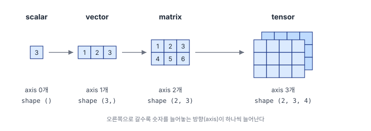
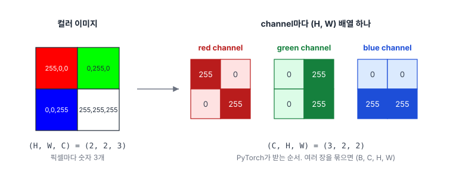
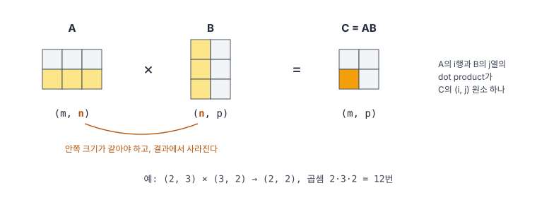

# 2.1 vector·matrix·tensor

> **수준** L2 · **선수** [1.1 AI·machine learning·deep learning](../part01-big-picture/01-01-ai-ml-dl.md) · **이 장의 질문** 사진과 문장은 어떻게 숫자 배열이 되나? tensor의 shape는 어떻게 읽나?

## 한눈에

- 모델이 받는 입력, 모델 안의 weight(가중치), 모델이 내는 출력은 모두 숫자 배열이다. 숫자를 늘어놓는 방향인 axis(축)가 0개면 scalar(스칼라), 1개면 vector(벡터), 2개면 matrix(행렬)라 부르고, axis 수를 정하지 않은 숫자 배열을 통틀어 tensor(텐서)라 부른다.
- shape는 axis마다 숫자가 몇 개인지 적은 것이다. 컬러 이미지 묶음은 `(B, C, H, W)`, 문장 묶음은 `(B, T, D)`처럼 axis마다 뜻이 붙는다.
- layer(층) 하나의 중심 계산은 matrix multiplication(행렬 곱)이다. `(m, n)`과 `(n, p)`는 안쪽 크기 `n`이 같아야 곱할 수 있고, 결과는 `(m, p)`다. 곱셈 수는 $m \cdot n \cdot p$다.
- broadcasting(브로드캐스팅)은 shape가 다른 배열끼리의 원소별 계산을 맨 뒤 axis부터 맞춰 허용한다. 편리하지만, 뜻하지 않은 곳에서 오류 없이 shape를 키우기도 한다.

## 1. 왜 숫자 배열로 보나

[1.1장 §2.2](../part01-big-picture/01-01-ai-ml-dl.md#22-데이터로-배우는-모델)의 스팸 필터는 메일 하나를 숫자 두 개 $x_1$·$x_2$로 바꾸고, weight 세 개로 점수를 냈다. [1.6장 §3](../part01-big-picture/01-06-industry-stack.md#3-반도체-gpu와-accelerator)에서는 layer 하나가 입력 숫자 3개에 3행 2열의 weight 배열을 곱해 숫자 2개를 냈다. 두 예 모두 모델이 다루는 것은 숫자를 늘어놓은 묶음이다. 사진과 글도 모델에 들어가려면 먼저 이런 숫자 묶음이 되어야 한다.

이 장은 1부에서 「숫자 배열」이라 부르던 것에 이름과 계산 규칙을 붙인다. §2는 숫자를 몇 방향으로 늘어놓았는지로 이름을 나누고, §3은 사진과 문장이 실제로 어떤 배열이 되는지 본다. §4는 배열끼리의 계산을, §5는 shape를 읽고 맞추는 법을 다룬다. 목표는 shape만 보고 계산이 되는지, 결과가 어떤 shape일지 판단하는 것이다.

코드는 NumPy로 쓴다. 블록마다 혼자 돌아가고, 적어 둔 출력은 Python 3.14.6, NumPy 2.5.5, Apple M5 Pro CPU에서 돌린 결과다. 같은 계산을 PyTorch로 하는 법과 NumPy를 쓸 때의 관례는 [2.5장](02-05-pytorch-basics.md)에서 본다.

## 2. scalar·vector·matrix·tensor

### 2.1 axis 수로 나눈 네 이름

scalar는 숫자 하나다 [@Goodfellow2016]. 1.1장 스팸 점수의 기본 점수 $w_0 = -2$가 scalar다.

vector는 숫자를 순서대로 늘어놓은 배열이고, 각 숫자는 몇 번째인지를 나타내는 index로 가리킨다 [@Goodfellow2016]. 원소가 실수 $n$개인 vector는 $\mathbb{R}^n$에 속한다고 쓰며, 이때 $n$을 vector의 차원이라 한다 [@Goodfellow2016]. 스팸 필터의 입력 $\mathbf{x} = [x_1, x_2]$는 $\mathbb{R}^2$의 vector다. feature(특징) 하나가 vector의 원소 하나가 된다.

matrix는 행과 열, 두 axis로 숫자를 늘어놓은 배열이라 원소 하나를 index 두 개로 가리킨다 [@Goodfellow2016]. 행이 $m$개, 열이 $n$개인 실수 matrix $\mathbf{A}$는 $\mathbf{A} \in \mathbb{R}^{m \times n}$으로 쓴다 [@Goodfellow2016]. 여기서 $\mathbf{A}_{i,:}$는 $\mathbf{A}$의 $i$번째 행, $\mathbf{A}_{:,j}$는 $j$번째 열이다 [@Goodfellow2016].

axis가 둘보다 많을 수 있는 숫자 배열을 tensor라 부른다 [@Goodfellow2016]. PyTorch의 `torch.Tensor`도 한 가지 숫자 형식, 곧 dtype(데이터 타입, [2.5장 §3.2](02-05-pytorch-basics.md#32-dtype과-메모리))의 원소를 담은, axis가 여럿일 수 있는 배열이다 [@PyTorch2026].

### 2.2 axis와 shape

숫자를 늘어놓는 방향 하나가 axis다. NumPy 문서는 배열의 dimension을 axis라 부른다 [@NumPy2026]. 배열의 axis 수는 `ndim`, axis마다의 크기를 늘어놓은 tuple은 `shape`이고, `shape`의 길이가 곧 axis 수다 [@NumPy2026]. 전체 원소 수 `size`는 `shape`의 원소를 모두 곱한 값이다 [@NumPy2026].

| 이름 | axis 수 | shape 예 | 원소 하나를 가리키는 index |
|---|---|---|---|
| scalar | 0 | `()` | 없음 |
| vector | 1 | `(3,)` | 1개 |
| matrix | 2 | `(2, 3)` | 2개 |
| tensor | 정하지 않음 | `(2, 3, 4)` | axis 수만큼 |



그림: axis가 0개인 scalar부터 3개인 tensor까지. `(2, 3, 4)`는 3행 4열 matrix 2개를 겹쳐 쌓은 모양이다.

```python
import numpy as np

s = np.array(3.0)                        # scalar
v = np.array([1.0, 2.0, 3.0])            # vector
M = np.array([[1, 2, 3], [4, 5, 6]])     # matrix
T = np.zeros((2, 3, 4))                  # axis가 3개인 tensor
for a in (s, v, M, T):
    print(a.ndim, a.shape, a.size)
```

```text
0 () 1
1 (3,) 3
2 (2, 3) 6
3 (2, 3, 4) 24
```

shape는 바깥 axis부터 적는다. `(2, 3, 4)`는 「3행 4열 matrix가 2개」이고, 원소는 $2 \times 3 \times 4 = 24$개다.

「차원」이라는 말은 두 가지를 가리킨다. 3차원 공간의 점 좌표 `[1, 2, 1]`은 axis가 하나이고, 그 axis에 원소가 3개다 [@NumPy2026]. vector의 차원 3은 원소 수이고, 배열의 `ndim` 1은 axis 수다. 이 책은 axis 수를 말할 때 「axis」, 원소 수를 말할 때 「차원」을 쓴다.

> **표준과 관례** §2.1의 tensor 뜻은 deep learning(딥러닝) 교과서와 PyTorch에 공통이다 [@Goodfellow2016; @PyTorch2026]. NumPy의 기본 객체도 같은 type 원소를 담은, axis가 여럿일 수 있는 배열이다 [@NumPy2026]. 이 책에서 tensor는 이 뜻만 가리킨다. 그래서 scalar·vector·matrix도 axis가 0~2개인 tensor라고 말할 수 있다.

## 3. 사진과 문장을 tensor로

### 3.1 사진: 높이·너비·channel

흑백 이미지는 픽셀마다 밝기 숫자 하나를 가진 matrix다. 다음은 높이 4, 너비 4인 흑백 이미지로, 가운데가 빈 고리 모양이다. 이 예에서는 255가 밝은 픽셀, 0이 어두운 픽셀이다.

$$
\begin{bmatrix}
0 & 255 & 255 & 0 \\
255 & 0 & 0 & 255 \\
255 & 0 & 0 & 255 \\
0 & 255 & 255 & 0
\end{bmatrix}
$$

shape는 `(H, W)` = `(4, 4)`이고, `H`는 높이, `W`는 너비다. PyTorch의 이미지 라이브러리 torchvision은 픽셀 값을 8비트 정수(uint8)로 담은 이미지 tensor는 보통 0~255 범위, 부동소수점(float)으로 담은 이미지 tensor는 0~1 범위를 기대한다 [@Torchvision2026].

컬러 이미지는 픽셀마다 red·green·blue 세 강도를 가진다 [@Goodfellow2016]. 그래서 높이와 너비 axis에 색 axis가 하나 더 붙는다. 색 하나에 해당하는 `(H, W)` 배열 하나를 channel(채널)이라 한다. 이미지를 다루는 layer의 입력과 출력은 channel index 하나와 공간 좌표 index 둘, 곧 axis가 3개인 tensor로 볼 수 있다 [@Goodfellow2016].

같은 숫자를 담는 axis 순서는 두 가지가 쓰인다. torchvision은 PIL 이미지나 `(H, W, C)` 순서의 NumPy 배열(0~255)을 받아 `(C, H, W)` 순서, 0~1 범위의 float tensor로 바꾸는 변환을 둔다 [@Torchvision2026]. PyTorch 쪽에서 tensor 이미지는 `(C, H, W)` shape를 기대한다 [@Torchvision2026]. `C`는 channel 수로, 컬러 이미지라면 3이다.



그림: 2×2 컬러 이미지의 `(H, W, C)` 배열을 channel마다 `(H, W)` 배열 하나씩, `(C, H, W)` 배열로 다시 늘어놓았다. 숫자는 그대로이고 axis 순서만 다르다.

구현은 흔히 이미지를 한 장씩이 아니라 여러 장씩 묶어 계산한다. 이렇게 한 번에 계산하려고 묶은 입력을 batch(배치)라 하며, 구현은 batch를 위한 axis를 하나 더 붙여 axis가 4개인 tensor를 쓴다 [@Goodfellow2016]. 이미지 batch는 `(N, C, H, W)`이고 [@Torchvision2026], 이미지를 받는 PyTorch의 `nn.Conv2d`도 입력을 `(N, C, H, W)`로 받는다 [@PyTorch2026]. 여기서 `N`은 batch 크기다 [@PyTorch2026]. 이 책은 batch 크기를 `B`로 써서 `(B, C, H, W)`로 적는다. batch는 4.1장에서 자세히 본다.

```python
import numpy as np

img = np.array([[[255, 0, 0], [0, 255, 0]],
                [[0, 0, 255], [255, 255, 255]]], dtype=np.uint8)  # (H, W, C)
x = img.transpose(2, 0, 1) / 255.0      # (C, H, W), 값은 0~1
print(img.shape, "->", x.shape)
print(x[0])                             # red channel 한 장
batch = np.stack([x, x, x, x])          # 이미지 4장을 묶는다
print(batch.shape)                      # (B, C, H, W)
```

```text
(2, 2, 3) -> (3, 2, 2)
[[1. 0.]
 [0. 1.]]
(4, 3, 2, 2)
```

`transpose(2, 0, 1)`은 axis 순서를 바꾼다(§5.2). 255로 나누어 0~255를 0~1로 옮겼다. 32×32 컬러 이미지 한 장은 `(3, 32, 32)`로 숫자 $3 \times 32 \times 32 = 3{,}072$개이고, 8장을 묶은 `(8, 3, 32, 32)`는 24,576개다. normalization(정규화)이나 크기 바꾸기처럼 모델에 넣기 전의 다른 처리는 6.1장에서 본다.

shape의 `W`는 이미지 너비다. §4부터 나오는 굵은 대문자 $\mathbf{W}$는 weight matrix로, 둘은 다른 것이다.

### 3.2 문장: token id에서 vector 열로

글은 먼저 token(토큰)으로 나뉜다. [1.2장 §2.1](../part01-big-picture/01-02-naming-axes.md#21-분야-어떤-데이터를-다루나)에서 본 대로 token은 language model(언어 모델)이 글을 처리하는 단위로, 단어 하나나 단어 조각 하나에 해당한다. 모델이 아는 token 전체의 목록을 vocabulary(어휘)라 하고, 그 크기를 `V`로 쓴다. 각 token은 vocabulary 안의 번호인 token id(토큰 ID)로 바뀐다. 글을 token으로 나누고 번호를 매기는 방법은 7.1장에서 본다.

번호는 크기를 비교할 수 있는 수가 아니라 이름표일 뿐이다. 그래서 번호 대신, token마다 one-hot encoding(원-핫 인코딩)으로 만든 one-hot vector로 나타낸다 [@Goodfellow2016]. token id가 $i$인 token의 one-hot vector는 길이가 `V`이고 $i$번째 원소만 1, 나머지는 0이다. 이 공간의 차원은 vocabulary 크기 `V`이고, 서로 다른 두 token의 one-hot vector는 어느 쌍이든 Euclidean distance(유클리드 거리)가 $\sqrt{2}$로 같다 [@Goodfellow2016]. 두 one-hot vector는 차이가 1과 −1인 자리 두 곳만 다르므로, 차이를 제곱해 더하고 제곱근을 씌우면 $\sqrt{1^2 + (-1)^2} = \sqrt{2}$다. 이 거리를 재는 식은 §4.3에서 본다. 거리가 모두 같으니 one-hot vector만으로는 어느 token끼리 비슷한지 알 수 없다.

그래서 language model은 token을 vocabulary 크기보다 낮은 차원 `D`의 vector로 옮긴 embedding(임베딩)을 쓴다 [@Goodfellow2016]. PyTorch의 `nn.Embedding`은 크기가 정해진 vocabulary의 embedding을 담아 두는 lookup table로, index 목록을 받아 그 index의 embedding을 돌려준다 [@PyTorch2026]. 그 weight의 shape는 `(num_embeddings, embedding_dim)`, 곧 `(V, D)`이고, 입력 index의 shape가 `(*)`이면 출력은 `(*, D)`다 [@PyTorch2026]. 여기서 `*`는 앞의 axis가 몇 개든, 크기가 얼마든 그대로 둔다는 뜻이다. 길이 `T`인 문장 `B`개의 token id는 `(B, T)`, 이것을 embedding으로 바꾼 것은 `(B, T, D)`가 된다.

one-hot vector와 embedding matrix를 곱하면 그 token의 행 하나가 그대로 나온다. 다음은 token 다섯 개짜리 vocabulary로 확인한 것이다.

```python
import numpy as np

vocab = ["I", "like", "cats", "dogs", "."]     # V = 5
ids = np.array([0, 1, 2])                      # "I like cats"의 token id
onehot = np.eye(len(vocab))[ids]               # (T, V) = (3, 5)
E = np.array([[0.1, 0.2], [0.3, 0.4], [0.5, 0.6],
              [0.7, 0.8], [0.9, 1.0]])         # embedding matrix (V, D) = (5, 2)
print(onehot)
print(onehot @ E)                              # (T, V) @ (V, D) -> (T, D)
print(E[ids])                                  # 같은 행을 index로 바로 꺼낸다
```

```text
[[1. 0. 0. 0. 0.]
 [0. 1. 0. 0. 0.]
 [0. 0. 1. 0. 0.]]
[[0.1 0.2]
 [0.3 0.4]
 [0.5 0.6]]
[[0.1 0.2]
 [0.3 0.4]
 [0.5 0.6]]
```

`@`는 §4.5의 matrix multiplication이다. one-hot vector에서 1인 자리가 embedding matrix의 그 행 하나만 남기므로, 두 결과가 같다. 그래서 실제 구현은 큰 matrix multiplication 대신 index로 행을 바로 꺼낸다. embedding matrix의 값을 어떻게 배우는지, embedding 사이의 거리가 무엇을 뜻하는지는 5.4장에서 본다.


그림: 글이 token으로 나뉘고, token id로 바뀐 뒤, token마다 embedding vector 하나가 된다. 문장 `B`개를 묶으면 `(B, T, D)`다.

음성도 같은 모양이 된다. [1.5장 §4.3](../part01-big-picture/01-05-landmark-models.md#43-whisper-인터넷-자막으로-배운-음성-인식)의 Whisper는 음성을 25밀리초 구간으로 10밀리초씩 옮겨 가며 잘라, 구간마다 숫자 80개를 계산한다 [@Radford2023]. 구간이 `T`개면 `(T, 80)`, 곧 token 열과 같은 「vector의 열」이다.

## 4. vector와 matrix의 계산

### 4.1 원소별 계산

shape가 같은 두 matrix는 같은 자리의 원소끼리 더할 수 있다 [@Goodfellow2016]. matrix에 scalar를 더하거나 곱하면 모든 원소에 그 계산을 한다 [@Goodfellow2016]. 같은 자리의 원소끼리 곱한 것은 element-wise product(원소별 곱) 또는 Hadamard product라 하고 $\mathbf{A} \odot \mathbf{B}$로 쓴다 [@Goodfellow2016]. 이것은 §4.5의 matrix multiplication과 다른 계산이다 [@Goodfellow2016]. NumPy에서 `+`·`*` 같은 산술 연산자는 원소별로 계산하고, matrix multiplication은 `@` 연산자로 한다 [@NumPy2026].

### 4.2 dot product: 곱해서 더하기

차원이 같은 두 vector $\mathbf{x}$·$\mathbf{y}$의 dot product(내적)는 같은 자리끼리 곱해 모두 더한 값이다. 수식으로는 matrix multiplication $\mathbf{x}^\top\mathbf{y}$로 쓴다 [@Goodfellow2016].

$$\mathbf{x}^\top\mathbf{y} = \sum_{i=1}^{n} x_i y_i$$

$x_i$·$y_i$는 두 vector의 $i$번째 원소, $n$은 vector의 차원이다. $\mathbf{x}^\top$의 $\top$는 §4.4의 transpose(전치)다.

1.1장의 스팸 점수 $w_0 + w_1x_1 + w_2x_2$는 dot product로 다시 쓸 수 있다. $\mathbf{w} = [w_1, w_2]$, $\mathbf{x} = [x_1, x_2]$로 두면 다음과 같다.

$$\text{score} = \mathbf{w}^\top\mathbf{x} + b$$

$\mathbf{w}$는 weight vector, $\mathbf{x}$는 feature vector, $b$는 1.1장의 $w_0$이다. '무료'가 있고 링크가 3개인 메일은 $\mathbf{x} = [1, 3]$이고, 1.1장의 weight로 $2 \cdot 1 + 0.5 \cdot 3 + (-2) = 1.5$다.

이런 식에서 $b$를 흔히 bias(편향)라 부른다 [@Goodfellow2016]. $\mathbf{x}$에 언제나 1인 원소를 하나 덧붙이면 그 원소에 곱하는 weight가 bias 역할을 한다 [@Goodfellow2016]. $w_0$을 weight의 하나로 셌던 1.1장의 식이 이 모양이다. 실제로 $[-2, 2, 0.5]$와 $[1, 1, 3]$의 dot product도 $-2 + 2 + 1.5 = 1.5$다. bias는 4.2장에서 다시 본다.

```python
import numpy as np

w = np.array([2.0, 0.5])          # 1.1장 스팸 점수의 w1, w2
b = -2.0                          # 1.1장의 w0
x = np.array([1.0, 3.0])          # '무료' 있음, 링크 3개
print(w @ x + b)                  # dot product + b
print(w * x)                      # element-wise product
a = np.array([3.0, 4.0])
print(np.sqrt(a @ a))             # L2 norm
for c in ([6.0, 8.0], [-4.0, 3.0], [-3.0, -4.0]):
    c = np.array(c)
    print((a @ c) / (np.sqrt(a @ a) * np.sqrt(c @ c)))   # cosine similarity
```

```text
1.5
[2.  1.5]
5.0
1.0
0.0
-1.0
```

`w @ x`는 곱한 뒤 더한 scalar 하나이고, `w * x`는 더하지 않은 vector다. 뒤의 네 줄은 §4.3에서 읽는다.

### 4.3 norm과 cosine similarity

vector의 크기는 norm(노름)이라는 함수로 잰다 [@Goodfellow2016]. norm은 vector를 0 이상의 값으로 보내고, 직관적으로는 원점에서 점 $\mathbf{x}$까지의 거리를 잰다 [@Goodfellow2016]. 자주 쓰는 것은 원점에서 $\mathbf{x}$까지의 Euclidean distance인 $L^2$ norm이고, 흔히 아래첨자 2를 빼고 $\lVert\mathbf{x}\rVert$로 쓴다 [@Goodfellow2016].

$$\lVert\mathbf{x}\rVert_2 = \sqrt{\sum_{i=1}^{n} x_i^2}$$

$x_i$는 $\mathbf{x}$의 $i$번째 원소다. 이 식은 $L^p$ norm $\left(\sum_i \lvert x_i\rvert^p\right)^{1/p}$에 $p = 2$를 넣은 것이다 [@Goodfellow2016]. $[3, 4]$의 norm은 $\sqrt{9 + 16} = 5$다. 두 vector $\mathbf{x}$와 $\mathbf{y}$ 사이의 Euclidean distance는 한쪽을 원점으로 옮겨 잰 거리, 곧 차이 vector의 norm $\lVert\mathbf{x} - \mathbf{y}\rVert_2$다. §3.2에서 두 one-hot vector의 거리를 $\sqrt{1^2 + (-1)^2} = \sqrt{2}$로 셈한 것이 이 식이다.

dot product는 norm으로 다시 쓸 수 있다 [@Goodfellow2016].

$$\mathbf{x}^\top\mathbf{y} = \lVert\mathbf{x}\rVert_2 \lVert\mathbf{y}\rVert_2 \cos\theta$$

$\theta$는 두 vector 사이의 각이다. 양변을 두 norm으로 나눈 $\cos\theta$는 길이와 상관없이 방향이 얼마나 같은지만 남긴다. 이 값을 cosine similarity(코사인 유사도)라 부른다. $\cos\theta$이므로 값은 −1에서 1 사이다. 위 코드에서 $[3, 4]$와 같은 방향인 $[6, 8]$은 길이가 두 배여도 1.0, 직각인 $[-4, 3]$은 0.0, 반대 방향인 $[-3, -4]$는 −1.0이 나왔다. cosine similarity는 5.4장과 11.1장에서 embedding을 비교할 때 다시 나온다.

### 4.4 transpose

matrix의 transpose는 왼쪽 위에서 오른쪽 아래로 가는 대각선을 기준으로 뒤집은 것이다 [@Goodfellow2016]. 행과 열이 바뀌어 $(\mathbf{A}^\top)_{i,j} = \mathbf{A}_{j,i}$이고 [@Goodfellow2016], `(m, n)` matrix의 transpose는 `(n, m)`이다.

vector는 열이 하나인 matrix로 볼 수 있고, 그 transpose는 행이 하나인 matrix다 [@Goodfellow2016]. 이 책의 수식은 따로 밝히지 않으면 vector를 열 하나로 세운 column vector(열벡터)로 쓴다. §4.2의 $[w_1, w_2]$처럼 본문에 가로로 적은 것도 원소를 늘어놓아 보인 것이고, 수식에서는 column vector로 본다. 그래서 dot product를 행 하나($\mathbf{x}^\top$)와 열 하나($\mathbf{y}$)의 곱으로 적었다. 두 matrix의 곱을 transpose하면 순서가 뒤집혀 $(\mathbf{A}\mathbf{B})^\top = \mathbf{B}^\top\mathbf{A}^\top$이 된다 [@Goodfellow2016]. 이 성질은 §4.6에서 수식과 코드를 맞출 때 쓴다.

### 4.5 matrix multiplication과 shape 규칙

matrix multiplication $\mathbf{C} = \mathbf{A}\mathbf{B}$는 $\mathbf{A}$의 열 수가 $\mathbf{B}$의 행 수와 같아야 정의된다 [@Goodfellow2016]. $\mathbf{A}$가 `(m, n)`, $\mathbf{B}$가 `(n, p)`이면 $\mathbf{C}$는 `(m, p)`다 [@Goodfellow2016]. 원소 하나는 다음과 같다 [@Goodfellow2016].

$$C_{i,j} = \sum_{k=1}^{n} A_{i,k} B_{k,j}$$

$C_{i,j}$는 $\mathbf{C}$의 $i$행 $j$열 원소이고, $k$는 $\mathbf{A}$의 열과 $\mathbf{B}$의 행을 함께 훑는 index다. 곧 $C_{i,j}$는 $\mathbf{A}$의 $i$행과 $\mathbf{B}$의 $j$열의 dot product다 [@Goodfellow2016].



그림: `(m, n)`과 `(n, p)`를 곱하면 안쪽 `n`이 맞물려 사라지고 `(m, p)`가 남는다. 결과의 원소 하나는 행 하나와 열 하나의 dot product다.

손으로 해 보자. `(2, 3)`인 $\mathbf{A}$와 `(3, 2)`인 $\mathbf{B}$다.

$$
\mathbf{A} = \begin{bmatrix} 1 & 2 & 3 \\ 4 & 5 & 6 \end{bmatrix}, \quad
\mathbf{B} = \begin{bmatrix} 1 & 0 \\ 0 & 1 \\ 1 & 1 \end{bmatrix}
$$

$\mathbf{A}$의 첫 행 `[1, 2, 3]`과 $\mathbf{B}$는 1.6장 §3의 입력과 weight 배열이라, 첫 행의 결과는 1.6장 §3에서 손으로 구한 `[4, 5]`다. 둘째 행은 $C_{2,1} = 4 \cdot 1 + 5 \cdot 0 + 6 \cdot 1 = 10$이고, $C_{2,2} = 4 \cdot 0 + 5 \cdot 1 + 6 \cdot 1 = 11$이다.

```python
import numpy as np

A = np.array([[1, 2, 3],
              [4, 5, 6]])        # (2, 3)
B = np.array([[1, 0],
              [0, 1],
              [1, 1]])           # (3, 2)
print(A @ B)                     # (2, 3) @ (3, 2) -> (2, 2)
print((A @ B).shape, (B @ A).shape)
```

```text
[[ 4  5]
 [10 11]]
(2, 2) (3, 3)
```

matrix multiplication은 분배법칙과 결합법칙이 성립하지만, 교환법칙은 성립하지 않아 $\mathbf{A}\mathbf{B} = \mathbf{B}\mathbf{A}$가 늘 성립하지는 않는다 [@Goodfellow2016]. 위 예에서는 shape부터 `(2, 2)`와 `(3, 3)`으로 다르다. 두 vector의 dot product는 순서를 바꿔도 같다 [@Goodfellow2016].

**곱셈 수 세기.** 결과 원소 하나는 곱 $n$개를 더한 것이고, 결과 원소는 $m \cdot p$개다. 그래서 `(m, n)`과 `(n, p)`의 matrix multiplication에는 곱셈이 $m \cdot n \cdot p$번, 덧셈이 $m \cdot p \cdot (n - 1)$번 든다. 위 예는 곱셈 $2 \cdot 3 \cdot 2 = 12$번, 덧셈 $2 \cdot 2 \cdot 2 = 8$번이다. 1.6장 §3이 「곱하고 더하기가 아주 많이 반복된다」고 한 것을 이제 셀 수 있다. 입력 512개를 받아 출력 256개를 내는 layer라면 입력 하나에 곱셈 $512 \cdot 256 = 131{,}072$번이고, 입력 32개를 한 batch로 계산하면 $32 \cdot 512 \cdot 256 = 4{,}194{,}304$번이다. 이런 계산량을 부르는 이름과 세는 관례, 그리고 입력 길이에 따라 계산량이 어떻게 늘어나는지는 5.5장과 14.1장에서 본다.

### 4.6 layer 하나: 수식의 $\mathbf{W}\mathbf{x}$와 코드의 `X @ W.T`

`nn.Linear` 같은 layer 하나는 입력 vector에 weight matrix를 곱하고 bias를 더한다. 대부분의 neural network(신경망)는 이 계산 뒤에 고정된 nonlinear(비선형) 함수를 한 번 더 거친다 [@Goodfellow2016]. 1.6장 §3에서 「간단한 함수」라 한 것이 이 함수로, activation function(활성화 함수)이라 하고 4.2장에서 본다. 같은 계산이 세 가지 모양으로 적힌다.

| 어디서 | 쓰는 모양 | weight의 shape | 입력의 모양 |
|---|---|---|---|
| 1.6장 §3 | 행 하나 @ $\mathbf{M}$ | $\mathbf{M}$은 `(in, out)` = `(3, 2)` | 입력 하나를 행 하나로 |
| 이 책의 수식 | $\mathbf{y} = \mathbf{W}\mathbf{x} + \mathbf{b}$ | $\mathbf{W}$는 `(out, in)` | 입력 하나를 column vector $\mathbf{x}$로 |
| 코드·PyTorch `nn.Linear` | `Y = X @ W.T + b` | `W`는 `(out, in)` | 입력 여러 개를 행으로 쌓은 `X`, `(B, in)` |

1.6장의 $\mathbf{M}$과 아래 두 줄의 $\mathbf{W}$는 $\mathbf{M} = \mathbf{W}^\top$ 관계다. 수식 줄에서 $\mathbf{y}$는 출력 vector, $\mathbf{b}$는 출력마다 하나씩인 bias vector다.

PyTorch의 `nn.Linear`는 입력에 $\mathbf{y} = \mathbf{x}\mathbf{A}^\top + \mathbf{b}$를 계산한다 [@PyTorch2026]. 문서의 이 식은 입력 $\mathbf{x}$를 행 하나로 놓은 것이다. 문서의 $\mathbf{A}$가 weight이고, 그 shape는 `(out_features, in_features)`, bias의 shape는 `(out_features)`다 [@PyTorch2026]. 데이터 묶음을 matrix 하나로 나타낼 때는 흔히 행마다 입력 하나, 열마다 feature 하나를 둔다 [@Goodfellow2016]. 그래서 코드는 입력을 행으로 쌓은 `X`에 `W.T`를 오른쪽에서 곱한다. `X`의 $i$번째 행을 $\mathbf{x}_i^\top$라 하면, 결과의 $i$번째 행은 $\mathbf{x}_i^\top\mathbf{W}^\top = (\mathbf{W}\mathbf{x}_i)^\top$이다 [@Goodfellow2016]. column vector로 쓴 수식의 $\mathbf{W}\mathbf{x}_i$를 눕혀 행으로 놓은 것이니, 같은 계산이다.

1.6장 §3의 숫자로 확인한다.

```python
import numpy as np

M = np.array([[1, 0], [0, 1], [1, 1]])   # 1.6장 §3의 matrix, (in, out) = (3, 2)
W = M.T                                  # 수식과 코드의 weight, (out, in) = (2, 3)
x = np.array([1, 2, 3])
print(x @ M, W @ x)                      # 행 하나 @ M, 그리고 Wx
X = np.array([[1, 2, 3], [0, 1, 0]])     # 입력 2개를 행으로 쌓은 batch, (B, in)
print(X @ W.T)                           # (B, out)
```

```text
[4 5] [4 5]
[[4 5]
 [0 1]]
```

1.6장의 matrix를 transpose한 $\mathbf{W}$로 계산해도 같은 `[4, 5]`가 나온다.

**parameter 수 세기.** layer 하나의 parameter(파라미터)는 weight matrix의 행 × 열에 bias의 원소 수를 더한 것이다. [1.2장 §2.6](../part01-big-picture/01-02-naming-axes.md#26-규모와-활용-얼마나-크고-어떻게-쓰나)의 「8B」 같은 숫자는 모델 안에서 학습으로 정해지는 숫자를 모두 센 것이고, 이런 layer의 weight와 bias는 그 일부다. §3.2의 embedding matrix도 parameter다. 1.6장 §3의 layer는 weight $3 \times 2 = 6$개에 bias 2개를 더해 8개이고, 입력 512개·출력 256개인 layer는 $512 \cdot 256 + 256 = 131{,}328$개다. 같은 shape에서 곱셈 수도 나오므로, shape를 알면 parameter 수와 계산량을 함께 어림할 수 있다.

`nn.Linear`의 입력 shape는 `(*, in_features)`이고 출력은 `(*, out_features)`이다 [@PyTorch2026]. 마지막 axis만 바뀌고 앞의 axis는 입력과 같다 [@PyTorch2026]. 그래서 `(B, T, D_in)`인 token vector batch를 넣으면 token마다 같은 weight를 곱해 `(B, T, D_out)`이 나온다.

> **핵심** matrix multiplication의 shape 규칙은 하나다. 곱하는 두 matrix의 안쪽 크기가 같아야 하고, 결과에는 바깥 크기만 남는다. 수식은 입력을 column vector로, 코드는 입력을 행으로 쌓아 쓰지만 같은 계산이다.

## 5. shape 읽기와 broadcasting

### 5.1 axis마다 뜻을 붙여 읽기

tensor를 읽을 때는 axis마다 무엇을 세는지 붙여 읽는다. `(B, T, D)`는 「문장 `B`개, 문장마다 token `T`개, token마다 숫자 `D`개」다. 계산이 어느 axis를 따라 일어나는지도 이 뜻으로 판단한다. `np.mean`은 지정한 axis를 따라 산술평균을 구하고, axis를 주지 않으면 배열 전체의 평균을 낸다 [@NumPy2026]. 평균을 낸 axis는 사라진다.

```python
import numpy as np

x = np.arange(24).reshape(2, 3, 4)   # (B, T, D) = (2, 3, 4)
print(x.mean(axis=1).shape)          # T axis로 평균 -> (B, D)
print(x.mean(axis=2).shape)          # D axis로 평균 -> (B, T)
a = np.arange(6).reshape(2, 3)
print(a.reshape(3, 2))
print(a.T)
```

```text
(2, 4)
(2, 3)
[[0 1]
 [2 3]
 [4 5]]
[[0 3]
 [1 4]
 [2 5]]
```

`T` axis로 평균을 내면 문장마다 vector 하나가 남아 `(B, D)`가 된다. `D` axis로 평균을 내면 token마다 숫자 하나가 남아 `(B, T)`가 된다. 둘 다 계산은 되지만 뜻은 전혀 다르다. 어느 axis를 없앨지는 무엇을 요약하고 싶은지로 정한다.

### 5.2 reshape와 transpose

`reshape`는 데이터를 바꾸지 않고 shape만 바꾼다 [@NumPy2026]. 기본 순서에서는 마지막 axis의 index가 가장 빨리 바뀌는 순서로 원소를 읽어 새 shape에 차례로 채운다 [@NumPy2026]. `transpose`는 axis의 순서를 바꾸며, 결과의 $i$번째 axis는 입력의 `axes[i]`번 axis다 [@NumPy2026].

위 코드의 뒤 두 줄에서 `(2, 3)`인 `a`를 `reshape(3, 2)`로 바꾼 것과 transpose한 `a.T`는 shape가 `(3, 2)`로 같지만 원소가 놓인 자리가 다르다. `reshape`는 `0, 1, 2, 3, 4, 5`를 읽은 순서대로 다시 채웠고, transpose는 행과 열을 바꿨다. §3.1에서 `(H, W, C)`를 `(C, H, W)`로 바꿀 때 `transpose(2, 0, 1)`을 쓴 것도 이 때문이다. 같은 일을 `reshape`로 하면 shape는 맞지만 픽셀과 channel이 뒤섞인다.

### 5.3 broadcasting

deep learning에서는 shape가 다른 matrix와 vector의 덧셈 $\mathbf{C} = \mathbf{A} + \mathbf{b}$도 허용한다 [@Goodfellow2016]. $C_{i,j} = A_{i,j} + b_j$, 곧 $\mathbf{b}$를 $\mathbf{A}$의 행마다 더한다는 뜻이고, $\mathbf{b}$를 행마다 복사한 듯이 계산하는 이 방식을 broadcasting이라 한다 [@Goodfellow2016]. §4.6의 `X @ W.T + b`에서 `(B, out)`에 `(out,)`인 bias를 더하는 것이 바로 이 계산이다.

NumPy의 broadcasting 규칙은 다음과 같다.

1. 두 배열의 shape를 맨 뒤 axis부터 왼쪽으로 하나씩 비교한다 [@NumPy2026].
2. 비교한 두 크기가 같거나 한쪽이 1이면 맞는다 [@NumPy2026]. 맞지 않으면 「operands could not be broadcast together」라는 ValueError가 난다 [@NumPy2026].
3. axis 수가 달라도 되고, 모자란 axis는 크기 1로 본다 [@NumPy2026]. 결과는 axis마다 두 크기 중 큰 쪽이다 [@NumPy2026].
4. 크기 1인 axis는 상대 크기에 맞춰 늘어난다 [@NumPy2026]. 예를 들어 `(8, 1, 6, 1)`과 `(7, 1, 5)`는 `(8, 7, 6, 5)`가 된다 [@NumPy2026].

늘린다는 것은 개념일 뿐이고, NumPy는 실제로 값을 복사하지 않아 메모리와 계산을 아낀다 [@NumPy2026].

```python
import numpy as np

X = np.ones((4, 3))                      # (B, D)
b = np.array([10.0, 20.0, 30.0])         # (D,)
print((X + b).shape)                     # 행마다 b를 더한다
col = np.array([[0], [1], [2]])          # (3, 1)
row = np.array([[0, 10, 20, 30]])        # (1, 4)
print(col + row)                         # (3, 4)
try:
    X + np.array([1.0, 2.0, 3.0, 4.0])   # (4, 3) + (4,)
except ValueError as e:
    print(e)
```

```text
(4, 3)
[[ 0 10 20 30]
 [ 1 11 21 31]
 [ 2 12 22 32]]
operands could not be broadcast together with shapes (4,3) (4,) 
```

`(4, 3)`에 `(3,)`을 더하면 행마다 더해진다 [@NumPy2026]. `(3, 1)`과 `(1, 4)`는 두 axis가 모두 늘어나 `(3, 4)`가 되고, 세로 값과 가로 값의 모든 조합을 더한 표가 나온다 [@NumPy2026]. `(4, 3)`에 `(4,)`를 더하면 맨 뒤 axis가 3과 4로 맞지 않아 오류가 난다 [@NumPy2026]. `(4,)`를 행마다가 아니라 열마다 더하려면 `(4, 1)`로 바꿔야 한다.

axis 순서는 broadcasting에도 영향을 준다. `(256, 256, 3)`인 RGB 배열에 값 3개짜리 배열을 곱하면 맨 뒤 axis가 맞아 색마다 다른 값이 곱해진다 [@NumPy2026]. 같은 이미지를 `(C, H, W)`로 담았다면 맨 뒤 axis가 너비라서 그대로는 맞지 않는다.

```python
import numpy as np

x = np.ones((3, 2, 2))                   # (C, H, W)
scale = np.array([0.5, 1.0, 2.0])        # channel마다 곱할 값
try:
    x * scale                            # 맨 뒤 axis 크기 2와 3이 맞지 않는다
except ValueError as e:
    print(e)
print((x * scale.reshape(3, 1, 1))[:, 0, 0])
```

```text
operands could not be broadcast together with shapes (3,2,2) (3,) 
[0.5 1.  2. ]
```

`scale`을 `(3, 1, 1)`로 바꾸면 channel axis끼리 맞고, 높이와 너비 axis는 늘어나 channel마다 다른 값이 곱해진다.

### 5.4 오류 없이 틀리는 broadcasting

broadcasting은 shape가 맞지 않을 때만 오류를 낸다. shape가 규칙에 맞기만 하면, 뜻하지 않은 계산도 조용히 해 버린다. 다음은 예측 3개와 정답 3개의 차이를 제곱해 평균 내려는 코드다. 예측이 정답과 똑같으니 답은 0이어야 한다.

```python
import numpy as np

pred = np.array([1.0, 2.0, 3.0])             # 예측 3개, (3,)
target = np.array([[1.0], [2.0], [3.0]])     # 정답 3개, (3, 1)
diff = pred - target
print(diff.shape)                            # (3, 3)
print(np.mean(diff ** 2))                    # 예측이 정답과 같은데 0이 아니다
print(np.mean((pred - target[:, 0]) ** 2))   # shape를 (3,)으로 맞추면 0.0
```

```text
(3, 3)
1.3333333333333333
0.0
```

`(3,)`과 `(3, 1)`은 규칙 3·4에 따라 `(3, 3)`으로 늘어나, 예측 하나하나를 정답 셋 모두와 뺐다. 차이 9개의 제곱 합 12를 9로 나눈 1.33이 나왔고, 오류는 나지 않았다. 학습에서 이런 값을 loss(손실)로 쓰면 모델은 엉뚱한 목표를 따라간다. 원소별 계산 뒤에는 결과의 shape가 생각한 것과 같은지 확인하는 습관이 이런 실수를 막는다.

> **주의** broadcasting이 만든 shape는 오류 메시지로 드러나지 않는다. 두 배열을 원소별로 계산할 때는 axis마다 뜻을 붙여 shape를 맞춰 두고, 결과의 shape를 출력해 확인한다.

## 6. (심화) rank와 low-rank

이 절은 9.4장의 LoRA를 공부할 때 다시 펼쳐 봐도 된다.

vector 여러 개에 각각 scalar를 곱해 더한 것을 linear combination(선형 결합)이라 한다. vector 집합에서 어느 vector도 나머지 vector의 linear combination이 아니면 그 집합은 linearly independent(선형 독립)하다 [@Goodfellow2016]. 다른 vector의 linear combination인 vector는 더해도 새로운 방향을 보태지 않는다 [@Goodfellow2016].

matrix의 rank(계수)는, 직관적으로 말하면 그 matrix에서 서로 linearly independent한 열을 최대 몇 개 고를 수 있는지를 나타내는 수다. rank를 계산하는 방법은 여기서 다루지 않고, NumPy의 `matrix_rank`로 잰다. 왼쪽 위에서 오른쪽 아래로 가는 대각선의 원소가 모두 1이고 나머지가 0인 matrix를 identity matrix(단위 행렬)라 한다 [@Goodfellow2016]. `matrix_rank`로 재면 4×4 identity matrix `np.eye(4)`의 rank는 4이고, 대각 원소 하나를 0으로 바꾸면 3이다 [@NumPy2026]. identity matrix의 네 열은 저마다 다른 자리 하나에만 1이 있어 어느 열도 나머지 열의 linear combination으로 만들 수 없으니 rank가 4이고, 한 열을 0으로 만들면, 0인 열은 나머지 열에 모두 0을 곱해 더한 linear combination이라 linearly independent한 열은 나머지 3개만 남는다. 한 열이 다른 열들의 linear combination이면 rank가 열 수보다 작아진다 [@NumPy2026]. 다만 부동소수점 계산에는 오차가 있어, 수학적으로는 0인 값이 아주 작은 수로 나오기도 한다. 그래서 `matrix_rank`는 rank를 세는 중간 계산에서 나온 값 가운데 기준값(tol)보다 작은 것을 0으로 쳐서 rank를 센다 [@NumPy2026].

rank가 낮은 matrix는 작은 matrix 두 개의 곱으로 쓸 수 있다. 다음은 `(4, 1)`과 `(1, 4)`를 곱해 만든 `(4, 4)` matrix다.

```python
import numpy as np

u = np.array([[1], [2], [3], [4]])       # (4, 1)
v = np.array([[1, 0, 2, 1]])             # (1, 4)
A = u @ v                                # (4, 4), 숫자 16개
print(A)
print(np.linalg.matrix_rank(A))
print(np.linalg.matrix_rank(np.eye(4)))
```

```text
[[1 0 2 1]
 [2 0 4 2]
 [3 0 6 3]
 [4 0 8 4]]
1
4
```

`A`의 네 열은 차례로 `u`의 1배·0배·2배·1배라서, 서로 linearly independent한 열을 하나보다 많이 고를 수 없고 rank가 1이다. 이 matrix는 숫자 16개로 이루어져 있지만, `u`와 `v`의 숫자 $4 + 4 = 8$개만 있으면 다시 만들 수 있다.

layer의 weight에도 같은 셈이 맞는다. 입력 $n$개·출력 $p$개인 layer의 weight는 `(p, n)`이고 숫자 $np$개다. 이 layer를 두 layer로 나눠, 출력이 $q$개인 첫 layer의 weight를 $\mathbf{W}_1$ `(q, n)`, 둘째 layer의 weight를 $\mathbf{W}_2$ `(p, q)`라 하자. 두 layer 사이에 activation function(§4.6)이 없으면 §4.5의 결합법칙으로 $\mathbf{W}_2(\mathbf{W}_1\mathbf{x}) = (\mathbf{W}_2\mathbf{W}_1)\mathbf{x}$이므로, 두 layer는 `(p, n)` weight 하나와 같은 계산을 한다 [@Goodfellow2016]. 대신 weight 숫자는 $qn + pq = (n + p)q$개다 [@Goodfellow2016]. $\mathbf{W}_2\mathbf{W}_1$의 열은 모두 $\mathbf{W}_2$의 열 $q$개의 linear combination이라, linearly independent한 열을 $q$개보다 많이 고를 수 없다. 그래서 $q$가 작으면 weight 숫자가 크게 줄지만, 대신 표현할 수 있는 변환이 rank가 $q$ 이하인 것으로 제한된다 [@Goodfellow2016]. 예를 들어 `(4096, 4096)` weight는 숫자 16,777,216개인데, $q = 8$인 두 matrix로 나누면 $8 \times (4096 + 4096) = 65{,}536$개로 256분의 1이 되고, 이 weight의 rank는 8을 넘지 못한다.

[1.4장 §2.3](../part01-big-picture/01-04-training-methods-map.md#23-바꾸는-범위-어느-weight를-바꾸나)에서 본 LoRA가 이 성질을 쓴다. LoRA는 pre-trained weight $\mathbf{W}_0 \in \mathbb{R}^{d \times k}$는 그대로 두고, 그 변화량을 $\mathbf{B} \in \mathbb{R}^{d \times r}$와 $\mathbf{A} \in \mathbb{R}^{r \times k}$의 곱 $\mathbf{B}\mathbf{A}$로 제한한다 [@Hu2021]. 여기서 rank $r$은 $d$와 $k$보다 훨씬 작다 [@Hu2021]. 9.4장에서 자세히 본다.

## 헷갈리기 쉬운 점

| 헷갈리는 개념 | 차이 |
|---|---|
| axis 수(`ndim`)와 vector의 차원 | `[1, 2, 1]`은 axis가 1개이고 원소가 3개다. vector의 차원은 원소 수 3이다 |
| axis 수와 matrix의 rank | axis 수를 tensor의 rank라 부르는 문서도 있어 이름이 겹친다 [@Google2026]. axis 수는 shape만 보면 안다. matrix의 rank는 값에 따라 정해진다. `(4, 4)` matrix는 axis가 2개이지만 rank는 §6의 예처럼 1일 수도 4일 수도 있다 |
| `(H, W, C)`와 `(C, H, W)` | 같은 숫자를 axis 순서만 달리 담은 것이다. torchvision의 변환 기준으로 NumPy 배열·PIL 이미지는 `(H, W, C)`, PyTorch의 tensor 이미지는 `(C, H, W)`다. 바꿀 때는 `reshape`가 아니라 `transpose`를 쓴다 |
| element-wise product와 matrix multiplication | `*`는 같은 자리끼리 곱하고 shape가 같거나 broadcasting이 되어야 한다. `@`는 행과 열의 dot product이고 안쪽 크기가 같아야 한다 |
| 수식의 $\mathbf{W}\mathbf{x}$와 코드의 `X @ W.T` | 같은 계산이다. 수식은 입력 하나를 column vector로 세우고, 코드는 입력 여러 개를 행으로 쌓는다. weight는 둘 다 `(out, in)`이다 |

## 정리

- axis 수로 scalar(0)·vector(1)·matrix(2)를 나누고, axis 수를 정하지 않은 숫자 배열을 통틀어 tensor라 한다. shape는 axis마다의 크기다. 원소 수는 shape를 모두 곱한 값이다.
- 컬러 이미지 batch는 `(B, C, H, W)`, 문장 batch는 token id `(B, T)`에서 embedding을 거쳐 `(B, T, D)`가 된다. NumPy 쪽의 `(H, W, C)`는 `transpose`로 `(C, H, W)`로 바꾼다.
- dot product는 곱해서 더한 scalar이고, norm은 vector의 길이, cosine similarity는 두 vector의 방향이 얼마나 같은지다.
- `(m, n)`과 `(n, p)`의 matrix multiplication은 `(m, p)`를 내고 곱셈 $m \cdot n \cdot p$번이 든다. layer 하나의 parameter 수는 weight의 행 × 열에 bias 수를 더한 것이다.
- broadcasting은 맨 뒤 axis부터 비교해 크기가 같거나 1이면 맞춘다. bias 더하기가 대표 예이고, shape가 규칙에만 맞으면 뜻하지 않은 계산도 오류 없이 한다.

## 확인 문제

1. 이미지 batch tensor의 shape가 `(32, 3, 224, 224)`다. 각 axis는 무엇을 뜻하나? 원소는 모두 몇 개인가?
2. `(64, 128)` matrix와 `(128, 10)` matrix를 곱할 수 있나? 된다면 결과 shape와 곱셈 수는? `(128, 64)`와 `(128, 10)`은 어떤가?
3. 입력 784개를 받아 출력 128개를 내는 `nn.Linear`의 weight shape는 무엇이고, parameter는 모두 몇 개인가?
4. NumPy에서 `(8, 1, 5)` 배열과 `(4, 1)` 배열을 더하면 결과 shape는? `(8, 3, 5)`와 `(4, 1)`은 어떤가?

<details>
<summary>답</summary>

1. 이미지 32장(`B`), 장마다 channel 3개(`C`), 높이 224(`H`), 너비 224(`W`)다. 원소는 $32 \times 3 \times 224 \times 224 = 4{,}816{,}896$개다.
2. 된다. 안쪽 크기가 128로 같으므로 결과는 `(64, 10)`이고, 곱셈은 $64 \cdot 128 \cdot 10 = 81{,}920$번이다. `(128, 64)`와 `(128, 10)`은 안쪽 크기가 64와 128로 달라 곱할 수 없다.
3. weight는 `(out, in)` = `(128, 784)`다. parameter는 weight $784 \times 128 = 100{,}352$개에 bias 128개를 더한 100,480개다.
4. `(4, 1)`은 앞에 크기 1인 axis가 붙어 `(1, 4, 1)`로 보고, axis마다 큰 쪽을 골라 `(8, 4, 5)`가 된다. `(8, 3, 5)`와 `(4, 1)`은 맨 뒤 5와 1은 맞지만 그 앞의 3과 4가 같지도 않고 어느 쪽도 1이 아니라 오류가 난다.

</details>

## 더 읽을거리

- [@Goodfellow2016] 2장. scalar·vector·matrix·tensor, matrix multiplication, transpose, linear independence, norm을 deep learning에 필요한 만큼 정리한다
- [@NumPy2026] 「Broadcasting」 문서. 규칙과 여러 shape의 예, 오류가 나는 경우를 보여 준다
