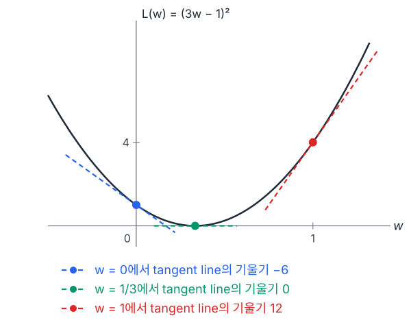
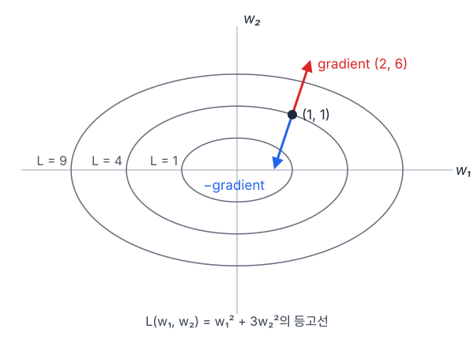
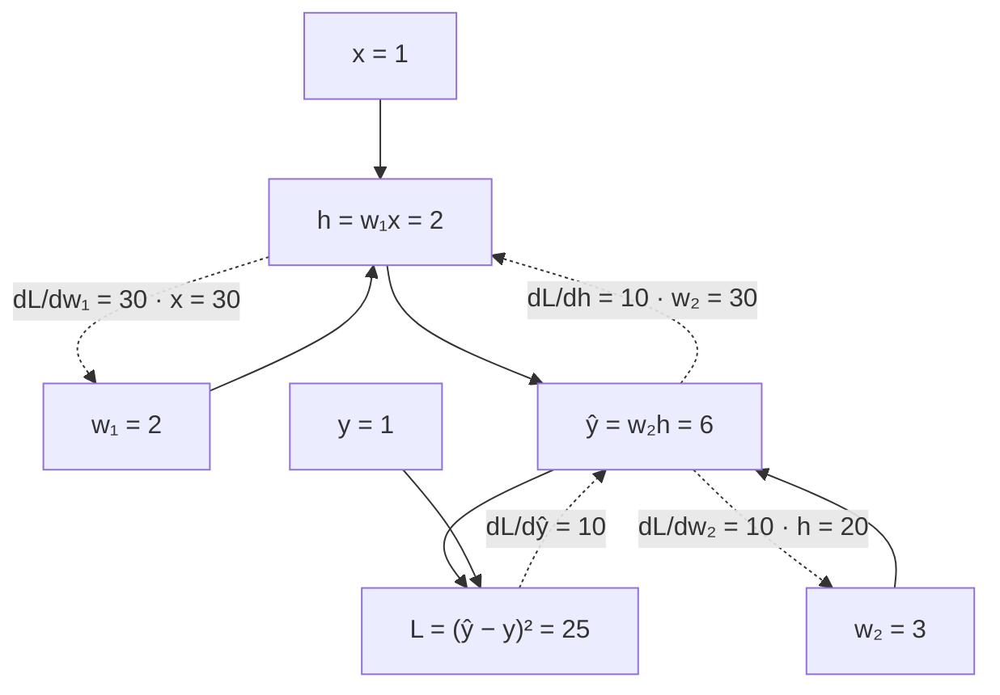

# 2.2 derivative와 gradient

> **수준** L2 · **선수** [2.1 vector·matrix·tensor](02-01-vectors-matrices-tensors.md) · **이 장의 질문** gradient는 무엇을 알려 주나? chain rule은 왜 학습의 핵심인가?

## 한눈에

- derivative(도함수)는 입력을 조금 바꿀 때 출력이 얼마나, 어느 쪽으로 변하는지 알려 주는 배율이다. 부호가 양수면 입력을 늘릴 때 출력이 커지고, 음수면 작아진다.
- weight(가중치)가 여럿이면 하나씩만 움직여 본 partial derivative(편미분)를 모아 gradient(기울기)라는 vector(벡터)를 만든다. gradient는 parameter(파라미터)와 shape가 같고, loss(손실)가 가장 빨리 커지는 방향을 가리킨다. 그 반대 방향으로 조금 움직이면 loss가 준다.
- layer(층)를 거친 계산은 작은 함수를 이어 붙인 것이다. chain rule(연쇄 법칙)은 이어 붙인 함수의 derivative가 단계마다의 derivative의 곱이라는 규칙이다. 이 규칙 덕분에 출력에서 먼 앞쪽 weight의 gradient도 구할 수 있고, backpropagation(역전파)은 이 곱을 출력 쪽부터 차례로 계산한다.
- finite difference(유한 차분)는 입력을 아주 조금 바꿔 본 차이로 derivative를 어림한다. 학습에 쓰기에는 느리고 근사이지만, 손 계산과 gradient 코드의 실수를 잡는 데 쓴다.

## 1. weight를 고칠 방향이 필요하다

[1.3장 §2.4](../part01-big-picture/01-03-model-lifecycle.md#24-학습-데이터로-weight를-정한다)에서 학습은 세 단계를 반복한다고 했다. 모델이 출력을 내고, 출력이 label(라벨)과 얼마나 다른지를 loss로 계산하고, loss가 줄어드는 쪽으로 weight를 조금 고친다. 셋째 단계를 코드로 옮기려면 두 가지를 숫자로 정해야 한다. 어느 쪽으로 고칠지, 그리고 그쪽으로 조금 고치면 loss가 얼마나 변하는지다.

가장 작은 예로 시작한다. weight가 $w$ 하나뿐인 모델이 입력 $x$를 받아 $wx$를 예측하고, 정답 $y$와의 차이를 제곱해 loss로 쓴다.

$$L(w) = (wx - y)^2$$

$L$은 loss, $w$는 weight, $x$는 입력, $y$는 정답이다. 데이터가 $x = 3$, $y = 1$ 하나뿐이고 지금 weight가 $w = 2$라면, 예측은 6, 차이는 5, loss는 25다.

$w$를 늘려야 할까, 줄여야 할까? 이 예는 식이 단순해서 $w = 1/3$이면 예측이 정답과 같아진다는 것을 바로 안다. 하지만 weight가 많고 계산이 여러 단계를 거치면 이렇게 답을 눈으로 찾기 어렵다. 그래서 지금 자리에서 weight를 조금 움직이면 loss가 어떻게 변하는지를 재고, 그것으로 고칠 방향을 정한다. 이 「조금 움직이면 얼마나 변하나」가 derivative다.

## 2. derivative: 조금 바꾸면 얼마나 변하나

### 2.1 정의와 직관

함수 $f$의 그래프에서 두 점 $x$와 $x + h$를 이은 직선을 secant line(할선)이라 한다. 그 기울기는 출력의 변화를 입력의 변화로 나눈 다음 값이다 [@Deisenroth2020].

$$\frac{f(x + h) - f(x)}{h}$$

$h$를 0에 가깝게 줄이면 두 점이 한 점으로 모이고, secant line은 그 점에서 곡선에 닿는 tangent line(접선)이 된다 [@Deisenroth2020]. 이때의 극한이 $x$에서 $f$의 derivative다 [@Deisenroth2020].

$$f'(x) = \lim_{h \to 0} \frac{f(x + h) - f(x)}{h}$$

$f'(x)$는 $x$에서의 derivative이고, $\frac{df}{dx}$로도 쓴다. $\lim_{h \to 0}$은 $h$를 0에 한없이 가깝게 할 때의 값이라는 뜻이다.

derivative는 그 점에서 그래프의 기울기이고, 입력의 작은 변화에 곱해 출력의 변화를 얻는 배율이다 [@Goodfellow2016].

$$f(x + \epsilon) \approx f(x) + \epsilon f'(x)$$

$\epsilon$은 입력을 바꾼 작은 양이고, $\approx$는 근사적으로 같다는 뜻이다. derivative가 있는 점에서는 곡선을 그 점 근처에서 크게 확대하면 거의 직선으로 보이고, 그 직선의 기울기가 derivative다.

§1의 loss로 해 보자. $L(w) = (3w - 1)^2$을 전개하면 $9w^2 - 6w + 1$이다. §2.3의 규칙으로 미분하면 $L'(w) = 18w - 6$이고, $w = 2$에서 $L'(2) = 30$이다. 그러니 $w$를 0.01 늘리면 loss는 약 $0.01 \times 30 = 0.3$ 늘어 25.3쯤이 된다. 실제 값은 $L(2.01) = 5.03^2 = 25.3009$다. $w$를 0.01 줄이면 근사는 24.7이고 실제 값은 24.7009다.

### 2.2 부호와 크기가 알려 주는 것

derivative의 부호는 방향을 알려 준다. $L'(2) = 30$은 양수이므로 $w$를 늘리면 loss가 커지고, 줄이면 작아진다. 일반적으로, 충분히 작은 양만큼 derivative 부호의 반대쪽으로 움직이면 함수 값이 줄어든다 [@Goodfellow2016]. 크기는 그 근처에서 loss가 얼마나 민감한지 알려 준다. 같은 0.01을 움직여도 derivative가 30인 곳에서는 loss가 약 0.3, 12인 곳에서는 약 0.12 변한다.



그림: $L(w) = (3w - 1)^2$의 세 점에서 그은 tangent line. $w = 0$에서는 기울기가 −6이라 $w$를 늘리면 loss가 줄고, $w = 1$에서는 12라 $w$를 줄이면 loss가 준다. 가장 낮은 점 $w = 1/3$에서는 기울기가 0이다.

derivative가 0인 점에서는 derivative가 어느 쪽으로 움직여야 할지 알려 주지 않는다 [@Goodfellow2016]. 이 예에서는 $18w - 6 = 0$인 $w = 1/3$이 loss가 0인 가장 낮은 점이다. 하지만 derivative가 0인 점이 언제나 가장 낮은 점은 아니고, 가장 높은 점이나 가장 낮지도 높지도 않은 점일 수도 있다 [@Goodfellow2016].

### 2.3 자주 쓰는 규칙

매번 극한을 계산하지 않고, 몇 가지 규칙을 조합해 derivative를 구한다.

| 함수 | derivative |
|---|---|
| $x^n$ ($n$은 자연수) | $nx^{n-1}$ |
| 상수 $c$ | $0$ |
| $c\,f(x)$ | $c\,f'(x)$ |
| $f(x) + g(x)$ | $f'(x) + g'(x)$ |
| $f(x)\,g(x)$ | $f'(x)\,g(x) + f(x)\,g'(x)$ |
| $g(f(x))$ | $g'(f(x))\,f'(x)$ |
| $e^x$ | $e^x$ |

$x^n$의 derivative $nx^{n-1}$은 정의의 극한으로 유도할 수 있다 [@Deisenroth2020]. sum rule(합의 규칙), product rule(곱의 규칙), chain rule은 교과서가 기본 미분 규칙으로 드는 것이다 [@Deisenroth2020]. 상수 $c$는 $h$와 상관없이 $(c - c)/h = 0$이라 derivative가 0이다. 이것을 product rule에 넣으면 $(c\,f)' = 0 \cdot f + c\,f' = c\,f'$가 된다. $e^x$는 derivative가 자기 자신이다 [@Deisenroth2020]. exp와 log의 성질은 [2.3장 §6](02-03-probability-statistics.md#6-exp와-log)에서 본다.

§2.1의 $9w^2 - 6w + 1$에 써 보면, 첫 항은 표의 $x^n$ 행과 $c\,f(x)$ 행으로 $9 \cdot 2w = 18w$, 둘째 항은 $-6$, 상수 1은 0이다. sum rule로 더하면 $18w - 6$이다. 표의 chain rule은 §4에서 자세히 본다.

## 3. partial derivative와 gradient

### 3.1 하나씩만 움직이기

weight가 둘 이상이면 loss는 vector를 받아 scalar(스칼라) 하나를 내는 함수다. 이때는 weight를 하나씩만 움직여 본다. partial derivative $\frac{\partial f}{\partial x_i}$는 점 $\mathbf{x}$에서 변수 $x_i$ 하나만 늘릴 때 $f$가 어떻게 변하는지를 잰다 [@Goodfellow2016]. 한 번에 변수 하나만 바꾸고 나머지는 상수로 둔 채 미분하면 된다 [@Deisenroth2020]. $\partial$는 다른 변수를 고정했다는 표시로, $d$ 대신 쓴다.

weight 두 개짜리 loss $L(w_1, w_2) = w_1^2 + 3w_2^2$로 해 보자. $w_2$를 상수로 보면 $3w_2^2$의 derivative는 0이라 $\frac{\partial L}{\partial w_1} = 2w_1$이다. $w_1$을 상수로 보면 $\frac{\partial L}{\partial w_2} = 6w_2$다. 점 $(1, 1)$에서 각각 2와 6이다.

### 3.2 gradient: partial derivative를 모은 vector

partial derivative를 모두 모은 vector를 gradient라 하고 $\nabla_{\mathbf{x}} f(\mathbf{x})$로 쓴다 [@Goodfellow2016]. $i$번째 원소가 $x_i$에 대한 partial derivative다 [@Goodfellow2016]. gradient는 derivative를 vector 입력으로 넓힌 것이다 [@Goodfellow2016].

$$\nabla_{\mathbf{w}} L = \begin{bmatrix} \frac{\partial L}{\partial w_1} \\[4pt] \frac{\partial L}{\partial w_2} \end{bmatrix} = \begin{bmatrix} 2w_1 \\ 6w_2 \end{bmatrix}$$

$\nabla$는 nabla라 읽고, 아래첨자 $\mathbf{w}$는 어느 변수에 대한 gradient인지 밝힌다. 점 $(1, 1)$에서 gradient는 $[2, 6]$이다.

scalar $z$를 tensor(텐서) $\mathbf{X}$로 미분한 gradient는 $\mathbf{X}$와 같은 index를 쓰고, 원소마다 $\mathbf{X}$의 그 원소에 대한 partial derivative다 [@Goodfellow2016]. 그래서 gradient는 parameter와 shape가 같다. weight matrix(행렬)가 `(out, in)`이면 그 gradient도 `(out, in)`이다. [2.5장 §4.3](02-05-pytorch-basics.md#43-backward는-scalar에서-시작한다)에서 PyTorch로 gradient를 구할 때 이 shape를 다시 확인한다.

> **표준과 관례** gradient를 어떤 모양으로 적는지는 교과서마다 다르다. Goodfellow 등은 gradient를 변수와 같은 꼴로 쓴다 [@Goodfellow2016]. Deisenroth 등은 gradient를 row vector(행벡터)로 정의하면서, vector를 column vector(열벡터)로 쓰는 관례에 따라 gradient도 column vector로 정의하는 문헌이 드물지 않다고 밝힌다 [@Deisenroth2020]. 이 책은 gradient를 parameter와 같은 shape로 쓴다. parameter가 vector면 gradient도 [2.1장 §4.4](02-01-vectors-matrices-tensors.md#44-transpose)의 column vector다.

### 3.3 gradient가 가리키는 방향

partial derivative는 축 하나를 따라 움직일 때의 기울기다. 축이 아닌 다른 방향으로 움직이면 어떨까? 길이가 1인 vector $\mathbf{u}$ 방향으로 움직일 때의 기울기를 directional derivative(방향 도함수)라 하고, 이 값은 $\mathbf{u}^\top \nabla_{\mathbf{x}} f(\mathbf{x})$와 같다 [@Goodfellow2016]. 이것은 [2.1장 §4.2](02-01-vectors-matrices-tensors.md#42-dot-product-곱해서-더하기)의 dot product(내적)이고, [2.1장 §4.3](02-01-vectors-matrices-tensors.md#43-norm과-cosine-similarity)대로 norm(노름)과 각으로 다시 쓸 수 있다 [@Goodfellow2016].

$$\mathbf{u}^\top \nabla_{\mathbf{x}} f(\mathbf{x}) = \lVert\mathbf{u}\rVert_2 \, \lVert\nabla_{\mathbf{x}} f(\mathbf{x})\rVert_2 \cos\theta$$

$\theta$는 $\mathbf{u}$와 gradient 사이의 각이다. $\lVert\mathbf{u}\rVert_2 = 1$이므로 값은 $\cos\theta$로 정해지고, $\mathbf{u}$가 gradient와 같은 방향일 때 가장 크고 반대 방향일 때 가장 작다. 곧 gradient는 함수가 가장 가파르게 오르는 방향을, 음의 gradient는 가장 가파르게 내려가는 방향을 가리킨다 [@Goodfellow2016].

점 $(1, 1)$에서 숫자로 확인한다. gradient $[2, 6]$의 norm은 $\sqrt{40} \approx 6.32$다.

| 움직이는 방향 $\mathbf{u}$ | directional derivative $\mathbf{u}^\top\nabla L$ |
|---|---|
| $w_1$만 줄이기 $[-1, 0]$ | $-2$ |
| $w_2$만 줄이기 $[0, -1]$ | $-6$ |
| gradient의 반대 $[-2, -6]/\sqrt{40} \approx [-0.32, -0.95]$ | $-\sqrt{40} \approx -6.32$ |
| gradient 방향 $[2, 6]/\sqrt{40} \approx [0.32, 0.95]$ | $\sqrt{40} \approx 6.32$ |

gradient의 반대 방향에서 가장 큰 음수가 나왔다. loss가 가장 빨리 줄어드는 방향이다. 실제로 $(1, 1)$에서 gradient의 0.01배만큼 반대로 가면 $(0.98, 0.94)$이고 loss는 4에서 3.6112로 준다. 같은 만큼 gradient 쪽으로 가면 4.4112로 는다.



그림: $L(w_1, w_2) = w_1^2 + 3w_2^2$의 값이 1, 4, 9인 점을 이은 등고선과, 점 $(1, 1)$의 gradient(빨강)와 그 반대 방향(파랑). 파란 화살표 쪽으로 조금 가면 loss가 더 작은 등고선 안쪽으로 들어간다.

이 장은 gradient가 방향을 알려 준다는 데서 멈춘다. 음의 gradient 방향으로 움직여 함수를 줄이는 방법을 steepest descent 또는 gradient descent(경사 하강법)라 하고, 한 번에 얼마나 움직일지를 정하는 양수를 learning rate(학습률)라 한다 [@Goodfellow2016]. gradient descent의 절차는 3.1장에서, learning rate와 반복 횟수에 따라 무엇이 달라지는지는 3.2장과 4.5장에서 본다.

> **핵심** gradient는 parameter와 같은 shape의 vector이고, 원소마다 그 parameter를 조금 늘릴 때 loss가 얼마나 변하는지 담는다. 전체로는 loss가 가장 빨리 커지는 방향을 가리키므로, loss를 줄이려면 그 반대로 움직인다.

### 3.4 스팸 점수의 gradient

[2.1장 §4.2](02-01-vectors-matrices-tensors.md#42-dot-product-곱해서-더하기)는 1.1장의 스팸 점수를 $s = \mathbf{w}^\top\mathbf{x} + b$로 다시 썼다. 원소로 풀면 $s = w_1x_1 + w_2x_2 + b$다. $w_1$에 대한 partial derivative를 구할 때는 $w_2$와 $b$를 상수로 보므로 $\frac{\partial s}{\partial w_1} = x_1$이다. 같은 방식으로 $\frac{\partial s}{\partial w_2} = x_2$이고 $\frac{\partial s}{\partial b} = 1$이다. 모으면 다음과 같다.

$$\nabla_{\mathbf{w}} s = \mathbf{x}, \qquad \frac{\partial s}{\partial b} = 1$$

$s = \mathbf{w}^\top\mathbf{x} + b$를 $\mathbf{w}$로 미분한 결과를 Deisenroth 등은 row vector $\mathbf{x}^\top$로 적는다 [@Deisenroth2020]. 이 책은 parameter와 같은 shape의 $\mathbf{x}$로 적는다.

'무료'가 있고 링크가 3개인 메일 $\mathbf{x} = [1, 3]$이라면 gradient는 $[1, 3]$이다. $w_2$를 조금 늘리면 $w_1$을 같은 만큼 늘릴 때보다 점수가 세 배 빨리 오른다. 이 메일의 링크 수가 3이기 때문이다. gradient $\nabla_{\mathbf{w}} s$는 $\mathbf{w}$와 같은 shape `(2,)`다. 이 결과는 3.2장에서 이 스팸 점수처럼 입력에 weight를 곱해 더하는 linear model(선형 모델)을 직접 학습할 때 다시 쓴다.

## 4. chain rule과 computational graph

### 4.1 이어 붙인 함수의 derivative는 곱이다

§2에서는 loss를 전개해 미분했다. 계산이 여러 단계를 거치면 전개가 금방 길어진다. 대신 계산을 작은 단계로 쪼개고, 단계마다의 derivative를 곱한다. $y = g(x)$이고 $z = f(y)$이면 다음이 성립한다 [@Goodfellow2016].

$$\frac{dz}{dx} = \frac{dz}{dy}\,\frac{dy}{dx}$$

$x$가 조금 변하면 $y$가 그 변화의 $\frac{dy}{dx}$배만큼 변하고, $y$의 그 변화가 다시 $z$를 $\frac{dz}{dy}$배만큼 바꾼다. 배율 두 개를 차례로 거치니 곱이 된다. 이것이 chain rule이다. chain rule은 derivative를 아는 함수들을 이어 붙여 만든 함수의 derivative를 구하는 데 쓴다 [@Goodfellow2016].

§1의 loss를 세 단계로 쪼갠다.

$$u = wx, \qquad r = u - y, \qquad L = r^2$$

$u$는 예측, $r$은 예측과 정답의 차이다. $w = 2$, $x = 3$, $y = 1$을 넣고 앞에서부터 계산하면 $u = 6$, $r = 5$, $L = 25$다. 단계마다의 derivative는 $\frac{dL}{dr} = 2r = 10$, $\frac{dr}{du} = 1$, $\frac{du}{dw} = x = 3$이다. 곱하면 다음과 같다.

$$\frac{dL}{dw} = \frac{dL}{dr} \cdot \frac{dr}{du} \cdot \frac{du}{dw} = 10 \cdot 1 \cdot 3 = 30$$

§2에서 전개해 구한 $L'(2) = 30$과 같다.

### 4.2 computational graph: 앞으로 값, 뒤로 derivative

계산을 이렇게 쪼갠 것을 그림으로 그린 것이 computational graph(계산 그래프)다. graph의 node(노드)는 변수 하나를 나타내고, 그 변수는 scalar·vector·matrix·tensor 무엇이든 될 수 있다 [@Goodfellow2016]. operation(연산)은 변수 하나 이상을 받는 단순한 함수이고, 복잡한 함수는 operation 여럿을 이어 붙여 나타낸다 [@Goodfellow2016]. 변수 $x$에 operation을 적용해 $y$를 얻으면 $x$에서 $y$로 화살표를 긋는다 [@Goodfellow2016].

이번에는 weight 두 개를 차례로 거치는 계산을 보자. 입력 $x$에 $w_1$을 곱해 $h$를 만들고, $h$에 $w_2$를 곱해 예측 $\hat{y}$를 낸다. layer 두 개를 쌓은 모델을 숫자 하나짜리로 줄인 모양이다. 실제 layer 사이에 들어가는 activation function(활성화 함수)은 4.2장에서 보고, 여기서는 뺐다.

$$h = w_1x, \qquad \hat{y} = w_2h, \qquad L = (\hat{y} - y)^2$$

$\hat{y}$는 예측이다. $x = 1$, $y = 1$, $w_1 = 2$, $w_2 = 3$으로 앞에서부터 계산하면 $h = 2$, $\hat{y} = 6$, $L = 25$다.



그림: weight 두 개를 거치는 computational graph. 실선은 앞으로 값을 계산하는 방향이고, 점선은 뒤로 derivative를 곱해 내려오는 방향이다.

뒤로 내려오는 계산은 다음 순서다.

1. $L = (\hat{y} - y)^2$에서 $\frac{\partial L}{\partial \hat{y}} = 2(\hat{y} - y) = 10$이다.
2. $\hat{y} = w_2h$에서 $\frac{\partial \hat{y}}{\partial w_2} = h$이고 $\frac{\partial \hat{y}}{\partial h} = w_2$다. 그래서 $\frac{\partial L}{\partial w_2} = 10 \cdot 2 = 20$이고 $\frac{\partial L}{\partial h} = 10 \cdot 3 = 30$이다.
3. $h = w_1x$에서 $\frac{\partial h}{\partial w_1} = x$다. 그래서 $\frac{\partial L}{\partial w_1} = 30 \cdot 1 = 30$이다.

출력에서 먼 $w_1$의 gradient를 구할 때 2단계에서 구해 둔 $\frac{\partial L}{\partial h}$를 그대로 썼다. 뒤에서부터 계산하면 뒤쪽에서 이미 구한 곱을 앞쪽 단계가 다시 쓴다. 식을 전개한 $L = (w_1w_2x - y)^2$을 직접 미분해도 같은 값 30과 20이 나온다.

### 4.3 한 값이 여러 곳에 쓰이면 더한다

한 변수에 operation을 둘 이상 적용하기도 한다 [@Goodfellow2016]. 그때는 그 변수에서 출력까지 가는 경로마다 derivative를 곱하고, 경로들의 값을 모두 더한다 [@Goodfellow2016; @Deisenroth2020]. 그 변수가 조금 변하면 경로마다 출력이 조금씩 변하고, 출력의 전체 변화는 그 변화들을 합한 것이기 때문이다. 예를 들어 $L = r^2$을 곱셈 $L = r \cdot r$로 계산하면 $r$이 곱셈의 두 입력에 모두 쓰인다. 첫째 입력을 거치는 경로의 derivative는 다른 입력의 값 $r$이고, 둘째 경로도 $r$이다. 더하면 $2r$이다. 표의 $x^n$ 행으로 구한 $\frac{dL}{dr} = 2r$과 같다.

변수가 vector면 같은 규칙을 원소마다 쓴다. $\mathbf{y} = g(\mathbf{x})$이고 $z = f(\mathbf{y})$가 scalar이면 다음과 같다 [@Goodfellow2016].

$$\frac{\partial z}{\partial x_i} = \sum_j \frac{\partial z}{\partial y_j}\,\frac{\partial y_j}{\partial x_i}$$

$x_i$는 $\mathbf{x}$의 $i$번째 원소, $y_j$는 $\mathbf{y}$의 $j$번째 원소다. $x_i$가 $\mathbf{y}$의 원소 여럿에 영향을 주면 그 경로를 모두 더한다.

### 4.4 chain rule이 학습의 핵심인 까닭

neural network(신경망)는 layer를 쌓은 것이고, 수식으로는 함수를 여러 번 이어 붙인 것이다. loss는 마지막 출력에서 계산되므로, 앞쪽 layer의 weight가 loss에 주는 영향은 뒤의 단계를 모두 거쳐서 전해진다. chain rule은 그 영향을 단계마다의 derivative의 곱으로 나눠 구하게 해 준다. 단계마다 자기 입력이 조금 변할 때 자기 출력이 얼마나 변하는지만 구할 수 있으면, 여러 단계를 쌓은 모델에서도 모든 weight의 gradient를 구할 수 있다.

[1.3장 §3](../part01-big-picture/01-03-model-lifecycle.md#3-학습과-inference)의 backpropagation이 바로 이 계산이다. backpropagation은 chain rule을 매우 효율적인 순서로 계산하는 알고리즘이다 [@Goodfellow2016]. backpropagation이라는 이름은 gradient를 계산하는 방법만을 가리키고, 그 gradient로 학습하는 일은 다른 알고리즘이 한다 [@Goodfellow2016]. gradient의 식을 쓰는 일은 어렵지 않아도, 그 식을 그대로 계산하면 비용이 클 수 있다 [@Goodfellow2016]. backpropagation이 어떤 순서로 계산해 그 비용을 줄이는지, layer와 matrix 단위로 오차가 어떻게 전해지는지는 4.3장에서 본다.

> **핵심** 이어 붙인 계산의 derivative는 단계마다의 derivative의 곱이고, 한 값이 여러 경로로 쓰이면 경로마다의 곱을 더한다. backpropagation은 이 곱을 출력 쪽에서부터 차례로 계산해 모든 weight의 gradient를 얻는다.

## 5. 숫자로 검산하기: finite difference

### 5.1 정의로 돌아가 어림하기

손으로 구한 derivative나 직접 짠 gradient 코드가 맞는지는 어떻게 확인할까? derivative의 정의로 돌아가, $h$를 0으로 보내는 대신 작은 값 하나로 두고 계산한다 [@Goodfellow2016].

$$f'(x) \approx \frac{f(x + h) - f(x)}{h}$$

이 장에서는 앞쪽으로만 움직인 이 식을 forward difference(전진 차분)라 부른다. 양쪽으로 움직인 centered difference(중심 차분)를 쓰면 근사가 더 정확해진다 [@Goodfellow2016].

$$f'(x) \approx \frac{f(x + h) - f(x - h)}{2h}$$

Goodfellow 등은 폭을 $\epsilon$으로 잡아 $\frac{f(x + \epsilon/2) - f(x - \epsilon/2)}{\epsilon}$으로 쓴다 [@Goodfellow2016]. $\epsilon = 2h$로 두면 같은 식이다. 이렇게 입력을 조금 바꿔 본 차이로 derivative를 어림하는 방법을 finite difference라 한다.

직접 구현한 gradient나 미분 라이브러리에 새로 더한 operation의 derivative는 finite difference로 계산한 값과 비교해 확인할 수 있다 [@Goodfellow2016]. 다음 코드는 parameter를 하나씩 $h$만큼 앞뒤로 움직여 centered difference로 gradient를 어림하고, 이 장에서 손으로 구한 값과 비교한다. 코드는 NumPy로 쓰고, 적어 둔 출력은 Python 3.14.6, NumPy 2.5.5, Apple M5 Pro CPU에서 돌린 결과다.

```python
import numpy as np

def num_grad(f, w, h=1e-5):
    g = np.zeros_like(w)
    for i in range(w.size):              # parameter 하나씩
        e = np.zeros_like(w)
        e[i] = h
        g[i] = (f(w + e) - f(w - e)) / (2 * h)
    return g

L1 = lambda w: (3 * w[0] - 1) ** 2                 # §2, x = 3, y = 1
L2 = lambda w: w[0] ** 2 + 3 * w[1] ** 2           # §3
x = np.array([1.0, 3.0])
s = lambda w: w @ x - 2.0                          # §3 스팸 점수, b = -2
L3 = lambda w: (w[1] * (w[0] * 1.0) - 1.0) ** 2    # §4, w = [w1, w2]
print(num_grad(L1, np.array([2.0])))               # 손 계산 30
print(num_grad(L2, np.array([1.0, 1.0])))          # 손 계산 [2, 6]
print(num_grad(s, np.array([2.0, 0.5])))           # 손 계산 x = [1, 3]
print(num_grad(L3, np.array([2.0, 3.0])))          # 손 계산 [30, 20]
```

```text
[30.]
[2. 6.]
[1. 3.]
[30. 20.]
```

네 줄 모두 출력된 자릿수 안에서 손 계산과 같다. 손 계산이 틀렸다면 여기서 값이 달라 드러난다. 마지막 줄은 §4.2에서 chain rule로 구한 $\frac{\partial L}{\partial w_1} = 30$, $\frac{\partial L}{\partial w_2} = 20$이다.

### 5.2 $h$는 얼마로 잡나

$h$가 크면 근사가 거칠다. 그렇다고 $h$를 한없이 줄이면 되는 것도 아니다. $f(w) = w^3$의 derivative는 $3w^2$이므로 $w = 2$에서 $3 \cdot 2^2 = 12$다. 이 값을 두 방식으로 어림해 오차를 비교한다.

```python
import numpy as np

f = lambda w: w ** 3
w, true = 2.0, 12.0                        # derivative 3w^2 = 12
for h in [1e-1, 1e-3, 1e-5, 1e-7, 1e-9, 1e-11]:
    fwd = (f(w + h) - f(w)) / h            # forward difference
    ctr = (f(w + h) - f(w - h)) / (2 * h)  # centered difference
    print(f"h={h:.0e}  forward 오차 {abs(fwd - true):.1e}  centered 오차 {abs(ctr - true):.1e}")
```

```text
h=1e-01  forward 오차 6.1e-01  centered 오차 1.0e-02
h=1e-03  forward 오차 6.0e-03  centered 오차 1.0e-06
h=1e-05  forward 오차 6.0e-05  centered 오차 2.1e-10
h=1e-07  forward 오차 5.8e-07  centered 오차 6.3e-09
h=1e-09  forward 오차 9.9e-07  centered 오차 9.9e-07
h=1e-11  forward 오차 9.9e-07  centered 오차 9.9e-07
```

$h$가 큰 쪽에서는 $h$를 줄일수록 두 방식 모두 오차가 줄고, 같은 $h$에서 centered difference의 오차가 훨씬 작다. 이 예에서는 식을 전개하면 까닭이 보인다. forward difference는 $\frac{(2 + h)^3 - 2^3}{h} = 12 + 6h + h^2$이고, centered difference는 $\frac{(2 + h)^3 - (2 - h)^3}{2h} = 12 + h^2$이다. $h = 0.1$이면 오차가 각각 0.61과 0.01로, 표의 첫 줄과 같다.

그런데 가장 작은 오차는 centered difference가 $h = 10^{-5}$, forward difference가 $h = 10^{-7}$에서 나왔고, 그보다 작은 $h$에서는 오차가 다시 커졌다. 컴퓨터는 숫자를 유한한 자릿수로 저장하므로, $h$가 너무 작으면 입력에 더한 $h$ 자체가 반올림에 깎인다. 그래서 $h$는 반올림으로 지나치게 깎이지 않을 만큼 커야 한다 [@Goodfellow2016]. Deisenroth 등은 gradient 구현을 확인하는 예로 $h = 10^{-4}$를 든다 [@Deisenroth2020]. 정해진 표준값은 아니다.

### 5.3 학습에는 쓰지 않는 까닭

finite difference는 한 번에 derivative 하나만 구한다 [@Goodfellow2016]. 위 `num_grad`처럼 parameter가 $n$개면 centered difference로 gradient 하나를 구하는 데 loss를 $2n$번 계산해야 한다. parameter가 100만 개면 200만 번이다. 결과도 근사다.

학습에서 gradient를 구하는 방법은 automatic differentiation(자동 미분)이다. §4.4의 backpropagation은 automatic differentiation이라는 더 일반적인 기법의 한 경우다 [@Deisenroth2020]. §4.2에서 뒤로 한 번 내려오며 $w_1$과 $w_2$의 gradient를 함께 얻었듯이, parameter마다 loss를 따로 다시 계산하지 않는다. automatic differentiation은 중간 변수에 chain rule을 적용해 gradient를 숫자로 계산한다 [@Deisenroth2020]. 결과는 기계 정밀도 안에서 정확하다 [@Deisenroth2020]. 기호식을 만드는 방식도, finite difference 같은 수치 근사도 아니다 [@Deisenroth2020]. [2.5장 §4](02-05-pytorch-basics.md#4-autograd)에서 PyTorch의 automatic differentiation을 코드로 쓴다. finite difference는 그 결과를 검산하는 데 쓴다.

## 6. (심화) vector를 내는 함수와 Jacobian

이 절은 [2.5장 §4](02-05-pytorch-basics.md#4-autograd)에서 PyTorch의 `backward()`를 쓸 때나 4.3장을 공부할 때 다시 펼쳐 봐도 된다.

지금까지의 함수는 출력이 scalar 하나였다. layer 하나처럼 vector를 받아 vector를 내는 함수 $\mathbf{f}: \mathbb{R}^m \to \mathbb{R}^n$에는 출력 원소와 입력 원소의 쌍마다 partial derivative가 있다. 이것을 모두 모은 matrix를 Jacobian(야코비 행렬)이라 한다 [@Goodfellow2016]. $\mathbf{J} \in \mathbb{R}^{n \times m}$이고 원소는 다음과 같다 [@Goodfellow2016].

$$J_{i,j} = \frac{\partial f(\mathbf{x})_i}{\partial x_j}$$

$f(\mathbf{x})_i$는 출력의 $i$번째 원소, $x_j$는 입력의 $j$번째 원소다. 행은 출력 원소, 열은 입력 원소에 대응한다.

예를 들어 $\mathbf{f}(x_1, x_2) = [x_1^2, \; x_1x_2]$의 Jacobian은 다음과 같다.

$$\mathbf{J} = \begin{bmatrix} 2x_1 & 0 \\ x_2 & x_1 \end{bmatrix}$$

점 $(1, 2)$에서는 $\begin{bmatrix} 2 & 0 \\ 2 & 1 \end{bmatrix}$이다. [2.1장 §4.6](02-01-vectors-matrices-tensors.md#46-layer-하나-수식의-mathbfwmathbfx와-코드의-x--wt)의 layer $\mathbf{y} = \mathbf{W}\mathbf{x}$라면 $y_i = \sum_j W_{i,j}x_j$이므로 $\frac{\partial y_i}{\partial x_j} = W_{i,j}$다. 곧 Jacobian이 $\mathbf{W}$ 자신이고, shape도 `(out, in)`이다.

§4.3의 원소별 chain rule을 matrix로 모으면 다음과 같다 [@Goodfellow2016].

$$\nabla_{\mathbf{x}} z = \left(\frac{\partial \mathbf{y}}{\partial \mathbf{x}}\right)^\top \nabla_{\mathbf{y}} z$$

$\frac{\partial \mathbf{y}}{\partial \mathbf{x}}$는 $\mathbf{y} = g(\mathbf{x})$의 `(n, m)` Jacobian이고, $z$는 scalar다. $g$ 자리에 위 예의 $\mathbf{f}$를 넣어 $\mathbf{y} = \mathbf{f}(\mathbf{x})$로 두고 $z = y_1 + 3y_2$를 이으면 $\nabla_{\mathbf{y}} z = [1, 3]$이다. 그래서 $(1, 2)$에서 $\nabla_{\mathbf{x}} z$는 다음과 같다.

$$
\nabla_{\mathbf{x}} z = \mathbf{J}^\top[1, 3] = [2 \cdot 1 + 2 \cdot 3, \; 0 \cdot 1 + 1 \cdot 3] = [8, 3]
$$

$z = x_1^2 + 3x_1x_2$를 직접 미분해도 $[2x_1 + 3x_2, \; 3x_1] = [8, 3]$이다.

backpropagation은 graph의 operation마다 이런 Jacobian과 gradient의 곱을 계산한다 [@Goodfellow2016]. 학습에서 계산의 끝은 scalar loss 하나라서, 필요한 것은 loss의 gradient다. 출력이 하나인 graph에서 끝에서부터 Jacobian을 곱해 오면 matrix와 vector의 곱만 있으면 된다 [@Goodfellow2016]. 2019년 PyTorch 논문은 당시 구현이 scalar 출력의 gradient를 여러 입력에 대해 계산하는 방식으로 automatic differentiation을 한다고 밝힌다 [@Paszke2019]. 새로운 미분 가능한 operation을 정의할 때 그 operation의 `backward()`가 정하는 것도 vector-Jacobian product, 곧 vector와 Jacobian의 곱이다 [@Paszke2019]. 그래서 끝이 scalar가 아닌 tensor에서 gradient 계산을 시작하려면 곱할 vector를 따로 정해 줘야 한다 [@PyTorch2026]. PyTorch에서 그 vector를 주는 법은 [2.5장 §4.3](02-05-pytorch-basics.md#43-backward는-scalar에서-시작한다)에서 본다.

## 헷갈리기 쉬운 점

| 헷갈리는 개념 | 차이 |
|---|---|
| derivative와 gradient | derivative는 입력이 하나인 함수에서 출력이 변하는 배율로 숫자 하나다. gradient는 입력이 여럿일 때 partial derivative를 모은 vector이고, parameter와 shape가 같다 |
| 한국어 「기울기」의 두 뜻 | 용어집에서 기울기는 gradient의 번역어다. §2에서 secant line·tangent line이나 그래프의 기울기라 쓴 것은 선이 기울어진 정도로, 숫자 하나이고 입력이 하나인 함수에서는 derivative와 같다. gradient는 partial derivative를 모은 vector다. 그래서 이 책은 gradient를 영어로 쓴다 |
| gradient와 gradient descent | gradient는 loss가 가장 빨리 커지는 방향을 담은 vector다. gradient descent는 그 반대 방향으로 weight를 거듭 옮겨 loss를 줄이는 방법이다(절차는 3.1장, learning rate와 반복 횟수에 따른 차이는 3.2장과 4.5장) |
| gradient의 크기와 loss의 크기 | gradient는 loss가 얼마나 빨리 변하는지를 잰다. $L = w^2 + 100$은 $w = 0$에서 loss가 100이지만 derivative는 0이다. loss가 크다고 gradient가 크지는 않다 |
| finite difference와 automatic differentiation | finite difference는 입력을 조금 바꿔 본 차이로 어림한 근사이고, parameter마다 따로 계산한다. automatic differentiation은 chain rule로 정확한 값을 계산한다([2.5장 §4](02-05-pytorch-basics.md#4-autograd)) |
| backpropagation과 학습 | backpropagation은 gradient를 계산하는 방법까지다. 그 gradient로 weight를 고치는 것은 다른 알고리즘이 한다(3.1장, 4.5장) |

## 정리

- derivative는 입력을 조금 바꿀 때 출력이 변하는 배율이다. $f(x + \epsilon) \approx f(x) + \epsilon f'(x)$이고, 부호의 반대쪽으로 조금 움직이면 함수 값이 준다.
- partial derivative는 변수 하나만 움직일 때 출력이 변하는 배율이고, 이것을 모은 gradient는 parameter와 shape가 같다. gradient는 가장 가파르게 오르는 방향이고, 음의 gradient가 loss를 가장 빨리 줄이는 방향이다.
- 스팸 점수 $s = \mathbf{w}^\top\mathbf{x} + b$의 gradient는 $\nabla_{\mathbf{w}} s = \mathbf{x}$, $\frac{\partial s}{\partial b} = 1$이다.
- chain rule은 이어 붙인 계산의 derivative를 단계마다의 derivative의 곱으로 구하고, 여러 경로는 더한다. computational graph에서 앞으로 값을 먼저 계산해 두면, backpropagation은 그 값을 써서 뒤로 derivative를 곱해 내려오며 gradient를 구한다.
- finite difference는 손 계산과 gradient 코드를 검산하는 도구다. centered difference가 더 정확하고, $h$가 너무 작으면 반올림 오차가 커진다.

## 확인 문제

1. $L(w) = (2w - 4)^2$에서 $w = 1$일 때 derivative는 얼마인가? loss를 줄이려면 $w$를 늘려야 하나, 줄여야 하나?
2. $L(w_1, w_2) = 2w_1^2 + w_1w_2$의 gradient를 점 $(1, 3)$에서 구하라. gradient의 shape는 무엇인가?
3. §4.1처럼 $u = wx$, $r = u - y$, $L = r^2$으로 쪼갠 계산에서 $w = 3$, $x = 2$, $y = 1$이다. 앞으로 계산한 $u$, $r$, $L$과 chain rule로 구한 $\frac{dL}{dw}$는 얼마인가?
4. $(3w - 1)^2$의 derivative를 $2(3w - 1)$이라 구한 답이 있다. $w = 2$에서 centered difference로 확인하면 무엇이 드러나나? 어디를 빠뜨렸나?

<details>
<summary>답</summary>

1. chain rule로 $L'(w) = 2(2w - 4) \cdot 2$이고, $w = 1$에서 $2 \cdot (-2) \cdot 2 = -8$이다. 음수이므로 $w$를 늘리면 loss가 준다.
2. $\frac{\partial L}{\partial w_1} = 4w_1 + w_2 = 7$, $\frac{\partial L}{\partial w_2} = w_1 = 1$이라 gradient는 $[7, 1]$이다. parameter $[w_1, w_2]$와 같은 shape `(2,)`다.
3. $u = 6$, $r = 5$, $L = 25$다. $\frac{dL}{dw} = \frac{dL}{dr} \cdot \frac{dr}{du} \cdot \frac{du}{dw} = 2r \cdot 1 \cdot x = 10 \cdot 2 = 20$이다.
4. 그 식은 $w = 2$에서 $2 \cdot 5 = 10$을 내지만, $h = 10^{-4}$인 centered difference는 약 30을 낸다. 값이 세 배 다르니 답이 틀렸다. 안쪽 함수 $3w - 1$의 derivative 3을 곱하지 않았다. chain rule로는 $2(3w - 1) \cdot 3$이다.

</details>

## 더 읽을거리

- [@Goodfellow2016] 4.3절과 6.5절. gradient와 directional derivative, Jacobian, computational graph와 chain rule, backpropagation을 이 장보다 일반적인 꼴로 정리한다
- [@Deisenroth2020] 5장. derivative의 정의에서 시작해 partial derivative와 gradient, chain rule, automatic differentiation까지 차례로 유도한다
