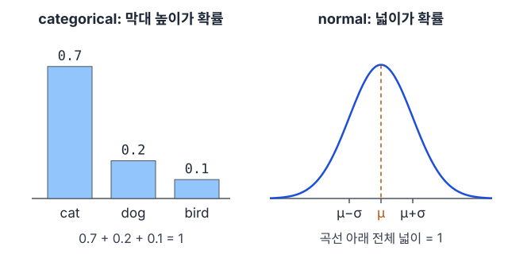
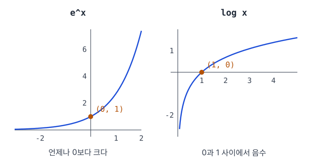
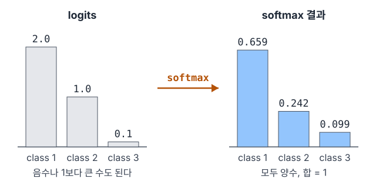
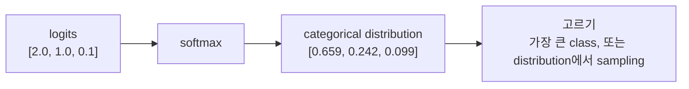

# 2.3 probability와 statistics

> **수준** L2 · **선수** [2.1 vector·matrix·tensor](02-01-vectors-matrices-tensors.md), [2.2 derivative와 gradient](02-02-derivatives-gradients.md) · **이 장의 질문** probability distribution·expectation·variance는 무엇인가? softmax 출력은 확률인가?

## 한눈에

- probability distribution(확률 분포)은 가능한 값마다 확률을 매긴 것이다. 값을 셀 수 있으면 확률을 모두 더해 1, 값이 실수이면 곡선 아래 넓이가 1이다.
- expectation(기댓값)은 확률로 가중한 평균이고, variance(분산)는 값이 평균에서 얼마나 퍼지는지다. `D`차원 vector(벡터) 두 개의 성분 `2D`개가 모두 서로 independent(독립)하고 평균 0·variance 1이면, 두 vector의 dot product(내적)는 variance가 `D`다.
- 학습은 모델이 관측한 데이터에 주는 확률, 곧 likelihood(가능도)를 크게 하는 parameter(파라미터)를 찾는 일로 볼 수 있다. 작은 확률을 많이 곱하면 float에서 0이 되므로 log를 씌워 합으로 다룬다.
- softmax(소프트맥스)는 실수 점수인 logit(로짓)을 0 이상이고 합이 1인 categorical distribution(범주형 분포)으로 바꾼다. 그래서 출력은 수학적으로 probability distribution이다. 다만 0.9를 낸 예측의 90%가 실제로 맞는지는 calibration(보정)으로 따로 재야 한다.

## 1. 모델은 왜 확률을 말하나

[1.2장 §5](../part01-big-picture/01-02-naming-axes.md#5-task별-출력-classificationdetectionsegmentation)의 image classification(이미지 분류) 모델은 사진 한 장에 「cat 0.97, dog 0.03」처럼 class(클래스)마다 확률을 낸다. [1.2장 §2.1](../part01-big-picture/01-02-naming-axes.md#21-분야-어떤-데이터를-다루나)의 language model(언어 모델)은 앞의 token(토큰)들을 보고 다음 token이 나올 확률을 계산한다. [1.4장 §3](../part01-big-picture/01-04-training-methods-map.md#3-학습-한-번에-붙는-여러-이름)의 distillation(증류)은 teacher(교사)가 class마다 낸 probability distribution을 정답으로 삼는다. 모델의 출력은 답 하나가 아니라 확률인 경우가 많다.

machine learning(머신러닝)은 언제나 불확실한 양을 다뤄야 한다 [@Goodfellow2016]. 불확실성은 세 곳에서 온다 [@Goodfellow2016]. 다루는 대상 자체가 무작위일 수 있고, 관측이 불완전할 수 있고, 모델이 관측한 정보 일부를 버리고 단순하게 만들었을 수 있다. 흐릿하게 찍힌 동물 사진은 cat일 수도 dog일 수도 있다. 이럴 때 「cat」 하나만 내는 모델보다 「cat 0.6, dog 0.4」를 내는 모델이 얼마나 확신하는지까지 알려 준다.

이 장은 그 확률이 무엇인지 정리한다. §2~§5는 확률의 기초다. §6은 확률 계산에 늘 따라오는 exp와 log를 정리한다. §7~§9는 모델의 출력으로서의 확률을 다룬다. §7은 학습이 확률과 어떻게 이어지는지, §8은 모델이 확률을 어떻게 내는지, §9는 그 출력을 확률로 믿어도 되는지를 본다.

코드는 NumPy로 쓴다. 블록마다 혼자 돌아가고, 적어 둔 출력은 Python 3.14.6, NumPy 2.5.5, Apple M5 Pro CPU에서 돌린 결과다. 난수를 쓰는 블록은 seed(시드)를 0으로 고정했다. seed는 난수 생성기의 출발값으로, 같은 seed를 주면 같은 난수 열이 다시 나온다. 난수 생성기와 seed의 관례는 [2.5장 §2.4](02-05-pytorch-basics.md#24-난수는-seed를-준-생성기로)에서 본다.

## 2. random variable과 probability distribution

### 2.1 random variable

random variable(확률 변수)은 여러 값을 무작위로 가질 수 있는 변수다 [@Goodfellow2016]. 주사위를 던져 나온 눈, 사진 한 장의 class, 문장의 다음 token이 그런 변수다. random variable 자체는 가질 수 있는 값의 목록일 뿐이고, 각 값이 얼마나 그럴듯한지는 probability distribution이 정한다 [@Goodfellow2016]. probability distribution은 random variable이 가능한 값 각각을 얼마나 그럴듯하게 갖는지를 기술한 것이다 [@Goodfellow2016]. 이 장은 random variable을 대문자 $X$로, 그 변수가 갖는 값 하나를 소문자 $x$로 쓴다.

random variable은 값의 종류에 따라 둘로 나뉜다. 값의 수가 유한하거나 셀 수 있으면 discrete random variable(이산 확률 변수), 실수값을 가지면 continuous random variable(연속 확률 변수)이다 [@Goodfellow2016]. discrete random variable의 값은 정수일 필요가 없고, cat·dog처럼 이름 붙은 상태여도 된다 [@Goodfellow2016].

### 2.2 discrete: probability mass function

discrete random variable의 distribution(분포)은 probability mass function(PMF, 확률 질량 함수)으로 나타낸다 [@Goodfellow2016]. $P(X = x)$는 $X$가 값 $x$를 가질 확률이다. 함수 $P$가 PMF가 되려면 다음 세 조건을 채워야 한다 [@Goodfellow2016].

1. 정의역은 $X$가 가질 수 있는 모든 값이다.
2. 모든 값에서 $0 \le P(X = x) \le 1$이다.
3. 모든 값의 확률을 더하면 1이다. 곧 $\sum_x P(X = x) = 1$이다.

$\sum_x$는 $X$가 가질 수 있는 모든 값 $x$에 대해 더한다는 뜻이다.

공정한 주사위의 눈 $X$는 1~6의 여섯 값을 가지고, 값마다 확률이 $1/6$이다. 여섯 개를 더하면 1이다. 이처럼 값이 $k$개인 discrete random variable의 모든 값에 $1/k$를 주는 distribution을 uniform distribution(균등 분포)이라 한다 [@Goodfellow2016]. 사진 분류 모델이 class 세 개에 낸 「cat 0.7, dog 0.2, bird 0.1」도 PMF다. 셋 다 0과 1 사이이고, 더하면 1이다.

### 2.3 continuous: probability density function

실수값을 갖는 continuous random variable의 distribution은 probability density function(PDF, 확률 밀도 함수) $p(x)$로 나타낸다. PDF가 채워야 할 조건도 셋이다. 정의역은 가능한 모든 값이고, 모든 값에서 $p(x) \ge 0$이며, 전체를 적분하면 1이다 [@Goodfellow2016]. PMF와 달리 $p(x) \le 1$은 요구하지 않는다 [@Goodfellow2016].

$p(x)$는 값 $x$가 나올 확률이 아니다. 아주 작은 폭 $\delta x$ 안에 값이 들 확률이 $p(x)\delta x$이고, 구간 $[a, b]$에 값이 들 확률은 그 구간에서 $p(x)$를 적분한 값이다 [@Goodfellow2016]. 곧 확률은 곡선의 높이가 아니라 곡선 아래 넓이다.

실수 구간 $[a, b]$의 uniform distribution은 구간 안에서 $p(x) = 1/(b - a)$, 구간 밖에서 0인 PDF이고, $X \sim U(a, b)$로 쓴다 [@Goodfellow2016]. 기호 $\sim$는 왼쪽 변수가 오른쪽 distribution을 따른다는 뜻이다. $U(0, 0.5)$의 PDF는 구간 안에서 $1/0.5 = 2$로 1보다 크다. 그래도 넓이는 폭 0.5 × 높이 2 = 1이다. 값이 $[0.1, 0.2]$에 들 확률은 폭 0.1 × 높이 2 = 0.2다.

distribution이라는 말은 [1.3장 §2.2](../part01-big-picture/01-03-model-lifecycle.md#22-데이터-수집-서비스에서-만날-입력을-닮게)에서 「어떤 값이 얼마나 자주 나오는지」로 처음 나왔다. 데이터의 distribution과 모델이 낸 distribution 모두 이 절의 probability distribution과 같은 개념이다.

## 3. 자주 쓰는 distribution

| distribution | 값 | parameter | 쓰이는 곳 |
|---|---|---|---|
| Bernoulli distribution(베르누이 분포) | 0 또는 1 | 1이 나올 확률 $\phi$ | 두 class 분류, 예/아니오 |
| categorical distribution | `K`개 중 하나 | 값마다의 확률을 담은 vector | class `K`개 분류, `V`개 token 중 다음 token |
| uniform distribution | 값 $k$개, 또는 구간 $[a, b]$ | 값의 범위 | 모든 값이 똑같이 그럴듯할 때 |
| normal distribution(정규 분포) | 실수 | 가운데 $\mu$, 폭 $\sigma$ | weight(가중치) 초기화, noise(잡음) |

**Bernoulli distribution**은 값이 0 아니면 1인 random variable 하나의 distribution이고, 1이 나올 확률 $\phi \in [0, 1]$ 하나로 정해진다 [@Goodfellow2016]. $P(X = 1) = \phi$, $P(X = 0) = 1 - \phi$다 [@Goodfellow2016]. 두 class 분류는 입력이 주어질 때 label(라벨)에 대한 Bernoulli distribution으로 볼 수 있어서, 모델은 「label이 1일 확률」 하나만 내면 된다 [@Goodfellow2016]. [1.1장 §2.2](../part01-big-picture/01-01-ai-ml-dl.md#22-데이터로-배우는-모델)의 스팸 필터라면 「이 메일이 스팸일 확률」 하나다.

**categorical distribution**은 값이 유한한 `K`개인 discrete random variable 하나의 distribution이고, 값마다의 확률을 담은 vector로 parameter를 정한다 [@Goodfellow2016]. Goodfellow의 교과서는 multinoulli distribution이라고도 부른다 [@Goodfellow2016]. class `K`개 중 하나를 고르는 분류 모델의 출력, vocabulary(어휘) 크기 `V`개 중 하나인 다음 token이 이 distribution이다. categorical distribution은 대개 사물의 범주를 나타내고 「class 1」을 숫자 1로 보지 않으므로, §4에서 볼 expectation과 variance를 보통 계산하지 않는다 [@Goodfellow2016].

**normal distribution**은 실수 위에서 가장 흔히 쓰는 distribution이다 [@Goodfellow2016]. Gaussian distribution이라고도 하며, PDF는 다음과 같다 [@Goodfellow2016].

$$\mathcal{N}(x; \mu, \sigma^2) = \frac{1}{\sqrt{2\pi\sigma^2}} \exp\left(-\frac{(x - \mu)^2}{2\sigma^2}\right)$$

$\exp(a)$는 $e^a$이고 §6에서 본다. $\mu$는 종 모양 곡선의 봉우리 위치이자 평균이고, $\sigma$는 곡선의 폭을 정하는 standard deviation(표준편차), $\sigma^2$는 variance다 [@Goodfellow2016]. 두 말은 §4에서 정의한다. $\mu = 0$, $\sigma = 1$인 normal distribution을 standard normal distribution(표준 정규 분포)이라 한다 [@Goodfellow2016].

normal distribution은 모델 안에서도 쓰인다. neural network(신경망)의 weight는 거의 언제나 Gaussian 또는 uniform distribution에서 무작위로 뽑은 값으로 학습을 시작한다 [@Goodfellow2016]. 초기화는 4.7장에서 본다. normal distribution은 vector 값으로도 넓혀진다 [@Goodfellow2016]. 그 가장 단순한 꼴인 $\mathcal{N}(\mathbf{0}, \mathbf{I})$는 vector의 성분마다 standard normal distribution에서 값을 따로 뽑아 채운 vector의 distribution이다. $\mathbf{0}$은 성분의 평균이 모두 0이라는 뜻이고, $\mathbf{I}$는 [2.1장 §6](02-01-vectors-matrices-tensors.md#6-심화-rank와-low-rank)의 identity matrix(단위 행렬)다. diffusion model(확산 모델)인 DDPM은 이미지를 만들 때 이 distribution에서 뽑은 noise에서 출발한다 [@Ho2020]. 11.5장에서 본다.



그림: 왼쪽은 class 세 개의 categorical distribution으로, 막대 높이가 곧 확률이고 더하면 1이다. 오른쪽은 standard normal distribution의 PDF로, 확률은 곡선 아래 넓이다.

NumPy의 난수 생성기로 네 distribution에서 표본을 뽑아 본다.

```python
import numpy as np

rng = np.random.default_rng(0)
coin = (rng.random(10) < 0.7).astype(int)    # Bernoulli(0.7) 표본 10개
print(coin, coin.mean())
probs = np.array([0.7, 0.2, 0.1])            # cat, dog, bird
print(rng.choice(3, size=10, p=probs))       # categorical 표본 10개
u = rng.uniform(0.0, 0.5, size=5)            # U(0, 0.5) 표본 5개
print(np.round(u, 3))
x = rng.normal(0.0, 1.0, size=100_000)       # standard normal 표본
print(round(x.mean(), 3), round(x.std(), 3))
```

```text
[1 1 1 1 0 0 1 0 1 0] 0.6
[1 0 1 0 1 0 1 0 0 0]
[0.014 0.062 0.335 0.324 0.308]
-0.001 1.0
```

`rng.random(10)`은 0과 1 사이의 값을 10개 뽑고, 그중 0.7보다 작은 것을 1로 바꾸면 확률 0.7인 Bernoulli 표본이 된다. `Generator.choice(a, size, p)`는 `a`가 정수이면 `np.arange(a)`, 곧 `0, 1, …, a-1`에서 표본을 뽑는다 [@NumPy2026]. `p`는 각 값의 확률이고, 주지 않으면 모든 값에 uniform distribution을 가정한다 [@NumPy2026]. 기본값은 같은 값이 여러 번 뽑힐 수 있는 sampling with replacement(복원 추출), 곧 `replace=True`다 [@NumPy2026].

표본 10개로는 비율이 확률과 다르다. Bernoulli 표본에서 1은 7개가 아니라 6개 나왔고, categorical 표본에서 확률 0.2인 dog(1)이 10개 중 4개 나왔다. normal 표본 10만 개의 평균과 standard deviation은 $\mu = 0$, $\sigma = 1$에 가깝다. 표본 수와 이 차이의 관계는 §4.5에서 본다.

## 4. expectation·variance와 표본 통계

### 4.1 expectation: 확률로 가중한 평균

$X$를 distribution $P$에서 뽑을 때 함수 $f(X)$가 평균적으로 갖는 값이 expectation이다 [@Goodfellow2016]. discrete와 continuous random variable에서 각각 다음과 같다 [@Goodfellow2016].

$$\mathbb{E}[f(X)] = \sum_x P(X = x)\, f(x), \qquad \mathbb{E}[f(X)] = \int p(x)\, f(x)\, dx$$

$\mathbb{E}$는 expectation을 뜻하는 기호다. 왼쪽 식은 각 값 $f(x)$를 그 값의 확률로 가중해 더한 평균이다 [@Bishop2006]. $f(x) = x$로 두면 $X$ 자체의 expectation $\mathbb{E}[X]$가 된다.

주사위의 expectation은 $(1 + 2 + 3 + 4 + 5 + 6) \cdot \frac{1}{6} = 3.5$다. 주사위에 3.5라는 눈은 없다. expectation은 실제로 나오는 값이 아니라, 많이 던질수록 평균이 다가가는 값이다. Bernoulli distribution의 expectation은 $0 \cdot (1 - \phi) + 1 \cdot \phi = \phi$다 [@Goodfellow2016].

expectation은 선형이다. $\alpha$와 $\beta$가 $X$에 따라 바뀌지 않는 상수이면 다음이 성립한다 [@Goodfellow2016].

$$\mathbb{E}[\alpha f(X) + \beta g(X)] = \alpha\,\mathbb{E}[f(X)] + \beta\,\mathbb{E}[g(X)]$$

곧 상수배와 덧셈은 expectation 밖으로 꺼낼 수 있다. 주사위 눈을 2배 하면 expectation도 $2 \cdot 3.5 = 7$이다.

### 4.2 variance와 standard deviation: 얼마나 퍼지나

expectation이 같아도 값이 퍼진 정도는 다를 수 있다. variance는 값이 expectation에서 벗어난 거리를 제곱해 평균 낸 것이다 [@Goodfellow2016].

$$\mathrm{Var}(X) = \mathbb{E}\left[(X - \mathbb{E}[X])^2\right]$$

variance가 작으면 값들이 expectation 근처에 모인다 [@Goodfellow2016]. variance의 제곱근이 standard deviation이다 [@Goodfellow2016]. variance는 값을 제곱한 단위라서, 원래 값과 같은 단위로 퍼짐을 말할 때는 standard deviation을 쓴다. 같은 variance를 $\mathrm{Var}(X) = \mathbb{E}[X^2] - \mathbb{E}[X]^2$로 계산할 수도 있다 [@Bishop2006].

주사위로 해 보자. 눈 1~6에서 3.5를 뺀 값의 제곱은 6.25, 2.25, 0.25, 0.25, 2.25, 6.25이고, 그 평균은 $17.5 / 6 = 35/12 \approx 2.917$이다. 둘째 식으로는 $\mathbb{E}[X^2] = 91/6$에서 $3.5^2 = 12.25$를 빼 같은 $35/12$가 나온다. standard deviation은 $\sqrt{35/12} \approx 1.708$이다. Bernoulli distribution의 variance는 $\phi(1 - \phi)$다 [@Goodfellow2016]. $\phi = 0.7$이면 $0.7 \cdot 0.3 = 0.21$이다.

### 4.3 variance의 두 규칙

뒤 장에서 자주 쓰는 규칙이 둘 있다.

**규칙 1: 상수배.** $\mathrm{Var}(aX) = a^2\,\mathrm{Var}(X)$다. §4.1의 선형성으로 $\mathbb{E}[aX] = a\,\mathbb{E}[X]$이므로 다음이 성립한다.

$$
\mathrm{Var}(aX) = \mathbb{E}[(aX - a\mathbb{E}[X])^2] = \mathbb{E}[a^2 (X - \mathbb{E}[X])^2] = a^2\,\mathrm{Var}(X)
$$

standard deviation은 $\lvert a\rvert$배가 된다. 주사위 눈을 2배 하면 variance는 $4 \cdot 35/12 = 35/3 \approx 11.667$이다.

**규칙 2: independent한 변수의 합.** 두 random variable $X$와 $Y$가 서로 영향을 주지 않으면, 곧 한쪽의 값이 다른 쪽의 확률을 바꾸지 않으면 두 변수는 independent하다고 한다. 이 성질을 independence라 하고 §5에서 정의한다. expectation의 합은 §4.1의 선형성으로 independence와 상관없이 언제나 $\mathbb{E}[X + Y] = \mathbb{E}[X] + \mathbb{E}[Y]$다 [@Goodfellow2016]. variance는 다르다. $X$와 $Y$가 independent하면 $\mathrm{Var}(X + Y) = \mathrm{Var}(X) + \mathrm{Var}(Y)$다 [@Bishop2006]. 변수가 여럿이어도 같아서, 서로 independent한 변수들을 더하면 합의 variance는 variance의 합이다 [@Bishop2006]. 주사위 두 개를 따로 던져 더한 눈은 variance가 $35/12 + 35/12 = 35/6 \approx 5.833$이다.

규칙 2의 variance 덧셈은 independence 조건 없이 쓰면 틀릴 수 있다. 주사위 하나의 눈 $X$를 자기 자신과 더한 $X + X$는 $2X$라서 규칙 1에 따라 variance가 $35/3 \approx 11.667$이다. 두 주사위의 합 $5.833$의 두 배다. expectation은 이때도 $\mathbb{E}[X + X] = 3.5 + 3.5 = 7$로 그대로 더해진다. $X$와 $X$는 한쪽이 정해지면 다른 쪽도 정해지므로 independent하지 않고, 규칙 2를 쓸 수 없다.

### 4.4 dot product의 variance는 차원에 비례한다

두 규칙에 곱의 성질 하나를 더하면 deep learning(딥러닝)에서 자주 만나는 계산 하나를 할 수 있다. 차원이 `D`인 두 vector $\mathbf{q}$와 $\mathbf{k}$의 성분이 모두 평균 0, variance 1이고 서로 independent하다고 하자. 두 vector의 [dot product](02-01-vectors-matrices-tensors.md#42-dot-product-곱해서-더하기)는 $\mathbf{q}^\top\mathbf{k} = \sum_{i=1}^{D} q_i k_i$다.

두 규칙에 곱의 성질을 더해 dot product의 variance를 네 단계로 구한다.

1. **곱 하나의 평균.** 곱의 성질은 이것이다. $X$와 $Y$가 independent하면 $\mathbb{E}[XY] = \mathbb{E}[X]\,\mathbb{E}[Y]$다 [@Bishop2006]. 그래서 곱 $q_i k_i$ 하나는 평균이 $\mathbb{E}[q_i]\,\mathbb{E}[k_i] = 0 \cdot 0 = 0$이다.
2. **곱 하나의 variance.** §4.2의 둘째 식에서 $\mathbb{E}[q_i^2] = \mathrm{Var}(q_i) + \mathbb{E}[q_i]^2 = 1 + 0 = 1$이고 $\mathbb{E}[k_i^2]$도 1이다. 여기에 성질 하나가 더 필요하다. $q_i^2$는 $q_i$의 값만으로, $k_i^2$는 $k_i$의 값만으로 정해진다. $q_i$를 알아도 $k_i$의 확률이 바뀌지 않으니, $k_i$로만 정해지는 $k_i^2$의 확률도 바뀌지 않는다. 그래서 $q_i^2$와 $k_i^2$도 independent하고, 곱의 variance는 다음과 같다.

    $$
    \mathrm{Var}(q_i k_i) = \mathbb{E}[(q_i k_i)^2] - 0^2 = \mathbb{E}[q_i^2]\,\mathbb{E}[k_i^2] = 1 \cdot 1 = 1
    $$

3. **곱들이 independent한 까닭.** 곱 $q_i k_i$는 $i$마다 겹치지 않는 성분 두 개로 만든다. 한 곱의 두 성분을 알아도 다른 곱의 성분들의 확률은 바뀌지 않으니, 같은 까닭으로 이런 곱 `D`개도 서로 independent하다.
4. **합의 variance.** 그래서 규칙 2에 따라 합의 variance는 `D`다. 곧 dot product는 평균 0, variance `D`이다 [@Vaswani2017]. standard deviation은 $\sqrt{D}$라서, `D`가 1024이면 dot product가 흔들리는 전형적인 크기가 32 정도다.

```python
import numpy as np

rng = np.random.default_rng(0)
for D in (4, 64, 1024):
    q = rng.normal(0.0, 1.0, size=(20_000, D))   # 평균 0, 분산 1인 성분 D개
    k = rng.normal(0.0, 1.0, size=(20_000, D))
    s = (q * k).sum(axis=1)                      # 쌍마다 dot product 하나
    print(D, round(s.mean(), 2), round(s.var(), 1), round((s / np.sqrt(D)).var(), 2))
```

```text
4 -0.01 4.0 1.0
64 -0.02 64.5 1.01
1024 0.16 1023.5 1.0
```

vector 쌍 2만 개의 dot product를 재면 variance가 `D`와 거의 같다. dot product를 $\sqrt{D}$로 나누면 규칙 1에 따라 variance가 $D / (\sqrt{D})^2 = 1$이 되고, 마지막 열이 그것을 보여 준다. Transformer의 attention은 query와 key의 dot product를 이렇게 $\sqrt{d_k}$로 나눠 쓴다 [@Vaswani2017]. $d_k$는 query와 key의 차원이다. 왜 나누는지는 5.5장에서 본다.

layer(층) 하나도 입력 `D`개에 weight를 곱해 더하므로, 같은 셈으로 출력이 얼마나 커지는지 어림할 수 있다. weight의 초기값을 어떤 크기의 distribution에서 뽑느냐가 학습에 큰 영향을 준다 [@Goodfellow2016]. 4.7장에서 본다.

### 4.5 sample mean: 표본으로 expectation 어림하기

실제로는 distribution을 모르고 그 distribution에서 나온 표본만 가진 경우가 많다. 표본 $x^{(1)}, \dots, x^{(m)}$의 평균 $\frac{1}{m}\sum_{i=1}^{m} x^{(i)}$를 sample mean(표본 평균)이라 한다. $x^{(i)}$는 $i$번째 표본, $m$은 표본 수다. distribution에서 뽑은 유한한 표본의 평균으로 expectation을 어림할 수 있고, 표본이 많아질수록 이 어림은 정확해진다 [@Bishop2006]. 표본이 서로 independent할 때, sample mean이 흔들리는 정도인 standard error(표준 오차)는 $\sigma / \sqrt{m}$이다 [@Goodfellow2016]. $\sigma$는 distribution의 standard deviation이다. 주사위라면 $\sigma \approx 1.708$이라 standard error가 $m = 10$에서 0.54, $m = 1000$에서 0.054, $m = 100{,}000$에서 0.0054다. 표본을 100배 늘리면 흔들림이 10분의 1로 준다.

distribution에서 값을 뽑는 일을 sampling(샘플링)이라 한다. §3의 `rng.choice`가 categorical distribution에서 sampling한 것이다. 표본을 많이 뽑으면 값마다 뽑힌 비율도 확률에 다가간다.

```python
import numpy as np

rng = np.random.default_rng(0)
for n in (10, 1000, 100_000):
    rolls = rng.integers(1, 7, size=n)       # 주사위를 n번 던진다
    print(n, rolls.mean())
means = rng.integers(1, 7, size=(10_000, 10)).mean(axis=1)
print(round(means.std(), 3))                 # 10번 평균을 10,000번 낸 값의 퍼짐
probs = np.array([0.7, 0.2, 0.1])            # cat, dog, bird
draws = rng.choice(3, size=100_000, p=probs)
print(np.bincount(draws) / len(draws))       # 뽑힌 비율
```

```text
10 2.8
1000 3.602
100000 3.49812
0.539
[0.70068 0.20085 0.09847]
```

10번 던진 평균은 2.8로 expectation 3.5와 꽤 다르고, 10만 번 던진 평균은 3.498이다. 10번 던진 평균을 1만 번 구해 그 standard deviation을 재면 0.539로, $\sigma/\sqrt{10} \approx 0.540$과 거의 같다. categorical distribution에서 10만 번 뽑은 비율도 확률 0.7·0.2·0.1에 가깝다. `p`는 더해서 1이어야 하므로, NumPy 문서는 `p`를 그 합으로 나눠 정규화한 뒤 넘기라고 권한다 [@NumPy2026]. language model이 다음 token의 distribution에서 token 하나를 고르는 방법은 7.3장에서 본다.

모델을 평가할 때도 같은 생각을 쓴다. test set(테스트 세트)에서 잰 평균 오차는 test 예제들의 sample mean이라, 예제 수가 그 어림이 얼마나 정확한지를 정한다 [@Goodfellow2016]. 실험 결과를 seed 여러 개로 돌려 평균과 standard deviation을 함께 적는 것도 한 번의 결과가 표본 하나일 뿐이기 때문이다. 실험 기록은 12.2장에서 본다. 데이터에서 sample mean을 빼고 standard deviation으로 나눠 평균 0, standard deviation 1로 맞추는 standardization(표준화)도 이 장의 두 통계량을 쓴다. 입력을 이렇게 맞추는 일은 4.6장과 6.1장에서 본다.

## 5. conditional probability와 independence

random variable이 둘 이상이면 함께 일어날 확률과, 하나를 알 때 다른 하나의 확률을 따진다. 두 변수에 걸친 PMF $P(X = x, Y = y)$를 joint probability(결합 확률)라 하며, 두 변수가 동시에 그 값일 확률이다 [@Goodfellow2016].

1.1장의 스팸 필터로 숫자를 넣어 보자. 메일 100통을 스팸 여부와 「'무료'라는 단어가 있는지」로 나눠 셌다고 하자.

| | '무료' 있음 | '무료' 없음 | 합 |
|---|---|---|---|
| 스팸 | 30 | 10 | 40 |
| 정상 | 5 | 55 | 60 |
| 합 | 35 | 65 | 100 |

이 표의 비율을 확률로 보면 $P(\text{스팸}, \text{무료}) = 0.30$, $P(\text{스팸}) = 0.40$, $P(\text{무료}) = 0.35$다.

conditional probability(조건부 확률) $P(Y = y \mid X = x)$는 $X = x$가 일어났다는 조건에서 $Y = y$일 확률이고, 다음과 같이 계산한다 [@Goodfellow2016].

$$P(Y = y \mid X = x) = \frac{P(Y = y, X = x)}{P(X = x)}$$

세로 막대 $\mid$ 오른쪽이 조건이다. 일어나지 않는 사건을 조건으로 삼을 수는 없으므로, 이 식은 $P(X = x) > 0$일 때만 정의된다 [@Goodfellow2016]. 표에서 '무료'가 있는 메일이 스팸일 확률은 $P(\text{스팸} \mid \text{무료}) = 0.30 / 0.35 \approx 0.857$이다. 아무것도 모를 때의 $P(\text{스팸}) = 0.40$보다 크다. 순서를 바꾼 $P(\text{무료} \mid \text{스팸}) = 0.30 / 0.40 = 0.75$는 다른 값이다. 「스팸 중 '무료'가 있는 비율」과 「'무료'가 있는 메일 중 스팸의 비율」은 다른 질문이다.

두 random variable이 independent하다는 것은 모든 값에서 $P(X = x, Y = y) = P(X = x)\,P(Y = y)$, 곧 joint probability가 각 변수만의 확률의 곱이 된다는 것이다 [@Goodfellow2016]. 표에서 $P(\text{스팸})\,P(\text{무료}) = 0.40 \cdot 0.35 = 0.14$인데 실제 $P(\text{스팸}, \text{무료})$는 0.30이다. 두 변수는 independent하지 않다. '무료'가 있는지를 알면 스팸일 확률이 바뀐다.

conditional probability의 식을 곱으로 다시 쓰면 $P(X, Y) = P(X)\,P(Y \mid X)$다. 표로 확인하면 $0.35 \cdot 0.857 \approx 0.30$이다. 변수가 $n$개이면 같은 일을 한 변수씩 반복해, joint probability를 conditional probability의 곱으로 쪼갤 수 있다 [@Goodfellow2016].

$$P(X_1, \dots, X_n) = P(X_1) \prod_{i=2}^{n} P(X_i \mid X_1, \dots, X_{i-1})$$

$\prod$는 곱하기를 모은 기호로, $\sum$이 더하기를 모은 것과 같다. 이것을 chain rule of probability(확률의 연쇄 법칙)라 하며, conditional probability의 정의에서 바로 나온다 [@Goodfellow2016].

language model은 token 열에 대한 probability distribution을 정한다 [@Goodfellow2016]. token은 단어·문자·byte 등일 수 있고 언제나 discrete하다 [@Goodfellow2016]. chain rule of probability를 token 열에 쓰면, 문장 전체의 확률은 「앞 token들이 주어질 때 다음 token이 나올 확률」의 곱으로 정확히 쪼개진다. 예를 들어 「I like cats」의 확률은 $P(\text{I})\,P(\text{like} \mid \text{I})\,P(\text{cats} \mid \text{I like})$이다. 세 확률이 0.2, 0.1, 0.05라면 문장의 확률은 $0.2 \cdot 0.1 \cdot 0.05 = 0.001$이다. 그래서 다음 token의 확률만 잘 맞히는 모델이 있으면 어떤 문장의 확률이든 계산할 수 있다. language model이 글을 만드는 과정은 7.2장에서 본다.

학습 데이터에도 확률의 가정이 붙는다. dataset(데이터셋)의 예제는 서로 independent하고, 학습 데이터와 test set은 같은 probability distribution에서 뽑혔다고 가정한다 [@Goodfellow2016]. 이 두 가정을 합쳐 i.i.d.(independent and identically distributed, 독립 동일 분포) 가정이라 하고, 모든 예제를 만들어 내는 그 공통의 distribution을 data-generating distribution(데이터 생성 분포)이라 부른다 [@Goodfellow2016]. [1.3장 §2.2](../part01-big-picture/01-03-model-lifecycle.md#22-데이터-수집-서비스에서-만날-입력을-닮게)의 distribution shift(분포 변화)는 이 가정의 둘째 부분, 곧 학습 때와 실제 입력의 distribution이 같다는 가정이 깨진 경우다.

## 6. exp와 log

softmax, likelihood, 뒤 장의 cross-entropy(교차 엔트로피)는 모두 exp와 log를 쓴다. 이 절은 그 계산에 필요한 성질만 모은다.

$e^x$, 곧 $\exp(x)$는 $e \approx 2.718$을 $x$번 곱한 값을 실수 $x$ 전체로 넓힌 함수다. $\log$는 그 역함수라서 $\log(e^x) = x$이고, 양수에서만 정의된다. 이 책에서 $\log$는 따로 밝히지 않으면 밑이 $e$인 자연로그다. Goodfellow의 교과서도 같은 약속을 쓴다 [@Goodfellow2016].

| 성질 | 식 | 예 |
|---|---|---|
| exp는 언제나 양수다 | $e^x > 0$ | $e^{-5} \approx 0.0067$, $e^{0} = 1$ |
| exp와 log는 단조 증가다 | $a < b$이면 $e^a < e^b$, $\log a < \log b$ | $e^1 \approx 2.718 < e^5 \approx 148.4$ |
| log는 곱을 합으로 바꾼다 | $\log(ab) = \log a + \log b$ | $\log 6 = \log 2 + \log 3 \approx 1.792$ |
| 1의 log는 0이다 | $\log 1 = 0$ | |
| 1보다 작은 양수의 log는 음수다 | $0 < a < 1$이면 $\log a < 0$ | $\log 0.5 \approx -0.693$, $\log 0.01 \approx -4.605$ |
| 0의 log는 $-\infty$로 처리한다 | $\log 0 = -\infty$ | |



그림: $e^x$(왼쪽)는 모든 $x$에서 0보다 크고 오른쪽으로 갈수록 빠르게 커진다. $\log x$(오른쪽)는 양수에서만 정의되며, $x = 1$에서 0이고 0과 1 사이에서는 음수다.

확률은 0과 1 사이이므로 확률의 log는 언제나 0 이하다. §7의 log-likelihood(로그 가능도)와 [2.4장 §3](02-04-information-theory.md#3-cross-entropy)의 cross-entropy가 이 성질을 쓴다. 단조 증가이므로 log를 씌워도 크기 순서가 그대로이고, 어떤 값을 가장 크게 만드는 자리도 그대로다 [@Goodfellow2016]. exp의 derivative(도함수)는 [2.2장 §2.3](02-02-derivatives-gradients.md#23-자주-쓰는-규칙)의 표대로 자기 자신이다. log의 derivative는 같은 표의 chain rule로 구한다. $\log(e^x) = x$의 양변을 $x$로 미분하면 왼쪽은 chain rule로 $\log'(e^x) \cdot e^x$이고 오른쪽은 1이다. $y = e^x$로 두면 $\log'(y) \cdot y = 1$, 곧 $\log'(y) = 1/y$다. 정리하면 $x > 0$에서 $\log x$의 derivative는 $1/x$다.

log가 곱을 합으로 바꾸는 성질은 float 계산에서 특히 쓸모 있다. 0에 아주 가까운 수가 0으로 반올림되는 것을 underflow(언더플로)라 한다 [@Goodfellow2016]. 확률 여러 개를 곱하면 값이 빠르게 작아져 underflow가 나기 쉽다 [@Goodfellow2016]. 확률 0.01인 사건 200개의 확률을 곱하면 $10^{-400}$인데, float64로 나타낼 수 있는 가장 작은 양수는 약 $5 \times 10^{-324}$이다.

```python
import numpy as np

print(np.exp([-5.0, 0.0, 1.0, 5.0]))         # 언제나 양수
print(np.log([1.0, 0.5, 0.01]))              # log 1 = 0, 1보다 작으면 음수
print(np.log(2.0 * 3.0), np.log(2.0) + np.log(3.0))
p = np.full(200, 0.01)                       # 확률 0.01인 사건 200개
print(np.prod(p))                            # 곱은 0이 된다
print(np.sum(np.log(p)))                     # log의 합은 멀쩡하다
with np.errstate(divide="ignore"):
    print(np.log(0.0))
```

```text
[6.73794700e-03 1.00000000e+00 2.71828183e+00 1.48413159e+02]
[ 0.         -0.69314718 -4.60517019]
1.791759469228055 1.791759469228055
0.0
-921.0340371976183
-inf
```

곱은 0.0이 되어 정보가 모두 사라졌지만, log의 합 $200 \cdot \log 0.01 \approx -921.03$은 문제없이 계산된다. 0의 log는 $-\infty$로 처리되고, 이 값이 이어지는 계산에 쓰이면 결과가 not-a-number(`nan`)가 될 수 있다 [@Goodfellow2016]. 그래서 확률을 다루는 코드는 확률 대신 log 확률을 들고 다니는 경우가 많다. language model의 평가에 쓰는 perplexity는 7.4장에서, 글을 만들 때의 log 확률은 7.2장에서 다시 나온다.

## 7. likelihood와 maximum likelihood

### 7.1 likelihood: 모델이 데이터에 준 확률

동전을 10번 던져 앞면이 7번 나왔다. 앞면이 나올 확률 $\theta$는 얼마로 보는 것이 가장 그럴듯할까?

동전 한 번은 Bernoulli distribution이다. 앞면을 1, 뒷면을 0으로 두면 결과 $x$의 확률은 $P(x; \theta) = \theta^{x}(1 - \theta)^{1 - x}$로 쓸 수 있다 [@Goodfellow2016]. $x = 1$이면 $\theta$, $x = 0$이면 $1 - \theta$다. 세미콜론 뒤의 $\theta$는 distribution을 정하는 parameter다. §3의 $\phi$와 같은 것을 parameter라는 뜻으로 $\theta$라 썼다. 던진 결과들이 서로 independent하면 10번 결과 전체의 확률은 각 확률의 곱이다.

$$\mathcal{L}(\theta) = \theta^7 (1 - \theta)^3$$

관측한 데이터를 고정하고 parameter의 함수로 본 이 확률 $\mathcal{L}(\theta)$를 likelihood라 한다. [2.2장 §1](02-02-derivatives-gradients.md#1-weight를-고칠-방향이-필요하다)의 loss(손실) $L$과 달리 이 값은 키운다. $\theta = 0.5$이면 $\mathcal{L} = 0.5^{10} \approx 0.000977$이고, $\theta = 0.7$이면 $\mathcal{L} \approx 0.002224$로 약 2.28배다. $\theta = 0.7$인 동전이 이 데이터를 더 그럴듯하게 설명한다.

데이터를 가장 그럴듯하게 만드는 parameter를 고르는 것이 maximum likelihood estimation(MLE, 최대 가능도 추정)이다. 모르는 data-generating distribution에서 independent하게 뽑은 예제 $m$개가 있을 때, maximum likelihood로 고른 parameter는 모델이 각 예제에 준 확률의 곱을 가장 크게 하는 $\theta$다 [@Goodfellow2016].

$$\theta_{\text{ML}} = \arg\max_{\theta} \prod_{i=1}^{m} p_{\text{model}}(x^{(i)}; \theta)$$

$p_{\text{model}}(x^{(i)}; \theta)$는 parameter가 $\theta$인 모델이 $i$번째 예제에 준 확률이고, $\arg\max_\theta$는 뒤의 값을 가장 크게 만드는 $\theta$를 돌려준다. 좋은 추정 방법을 이끌어 내는 원리 가운데 가장 흔히 쓰는 것이 이 maximum likelihood다 [@Goodfellow2016].

### 7.2 log-likelihood: 곱 대신 합

예제가 많아지면 확률의 곱은 §6처럼 underflow가 난다 [@Goodfellow2016]. likelihood에 log를 씌우면 곱이 합으로 바뀌고, log가 단조 증가라 가장 크게 만드는 $\theta$는 바뀌지 않는다 [@Goodfellow2016]. likelihood의 log를 log-likelihood라 한다. 동전이라면 다음과 같다.

$$\log \mathcal{L}(\theta) = 7 \log \theta + 3 \log(1 - \theta)$$

$\theta$ 후보를 0.01 간격으로 늘어놓고 두 값이 가장 큰 자리를 찾아본다.

```python
import numpy as np

theta = np.round(np.linspace(0.01, 0.99, 99), 2)   # θ 후보 0.01, 0.02, …, 0.99
L = theta**7 * (1 - theta)**3                      # 앞면 7번·뒷면 3번의 likelihood
ll = 7 * np.log(theta) + 3 * np.log(1 - theta)     # log-likelihood
print(theta[np.argmax(L)], theta[np.argmax(ll)])
print(L.max(), ll.max())
print(L[theta == 0.5], ll[theta == 0.5])
```

```text
0.7 0.7
0.0022235661 -6.108643020548935
[0.00097656] [-6.93147181]
```

likelihood와 log-likelihood 모두 $\theta = 0.7$에서 가장 크다. 이 동전처럼 discrete한 데이터에서는 log-likelihood가 확률의 log라 0 이하이고, 0에 가까울수록 데이터를 잘 설명한다는 뜻이다. [2.2장 §2](02-02-derivatives-gradients.md#2-derivative-조금-바꾸면-얼마나-변하나)의 derivative를 쓰면 손으로도 구할 수 있다. §6에 따라 $\log\theta$의 derivative는 $1/\theta$이다. $\log(1 - \theta)$의 derivative는 [2.2장 §4.1](02-02-derivatives-gradients.md#41-이어-붙인-함수의-derivative는-곱이다)의 chain rule로 $\frac{1}{1 - \theta} \cdot (-1) = -\frac{1}{1 - \theta}$이다. 가장 큰 자리에서 $\log \mathcal{L}$의 derivative가 0이므로 $7/\theta - 3/(1 - \theta) = 0$이고, $7(1 - \theta) = 3\theta$를 풀면 $\theta = 7/10$이다. 관측한 비율 $7/10$이 곧 maximum likelihood의 답이다.

### 7.3 학습은 log-likelihood를 키운다

분류 모델은 입력 $x$가 주어질 때 label $y$의 확률 $P(y \mid x; \theta)$를 낸다. maximum likelihood는 이런 conditional probability의 추정으로 넓혀지고, 이것이 대부분의 supervised learning(지도 학습)의 바탕이다 [@Goodfellow2016]. 예제가 i.i.d.이면 목표는 예제마다의 log-likelihood의 합 $\sum_{i} \log P(y^{(i)} \mid x^{(i)}; \theta)$를 가장 크게 하는 것으로 쪼개진다 [@Goodfellow2016]. $x^{(i)}$와 $y^{(i)}$는 $i$번째 예제의 입력과 정답 label이다.

language model도 같다. GPT의 pre-training(사전학습)은 token 열 $\mathcal{U} = \{u_1, \dots, u_n\}$에 대해 다음 log-likelihood를 최대로 하는 표준 language modeling 목표를 쓴다 [@Radford2018].

$$L_1(\mathcal{U}) = \sum_i \log P(u_i \mid u_{i-k}, \dots, u_{i-1}; \Theta)$$

$L_1$은 원 논문의 표기를 그대로 쓴 것으로, loss가 아니라 키우는 값이다 [@Radford2018]. $u_i$는 $i$번째 token, $k$는 한 번에 보는 앞 token의 수, $\Theta$는 neural network의 parameter다 [@Radford2018]. §5의 chain rule of probability가 문장 확률을 다음 token 확률의 곱으로 쪼갰으므로, 그 log는 다음 token 확률의 log의 합이다. 위 식은 앞 token을 $k$개까지만 보고 이 합을 계산한 것이다.

학습 소프트웨어는 보통 값을 줄이는 쪽으로 쓰므로, log-likelihood를 최대로 하는 대신 부호를 뒤집은 negative log-likelihood(NLL, 음의 로그 가능도)를 최소로 한다 [@Goodfellow2016]. Goodfellow 외의 교과서는 negative log-likelihood로 된 loss를 모두 학습 데이터가 정하는 distribution과 모델 distribution 사이의 cross-entropy로 본다 [@Goodfellow2016]. cross-entropy는 [2.4장 §5](02-04-information-theory.md#5-분류-loss로-쓰는-까닭)에서 보고, 이 넓은 뜻과 이 책이 쓰는 좁은 뜻의 구분은 [2.4장 §5.3](02-04-information-theory.md#53-class가-둘이면-binary-cross-entropy)의 「표준과 관례」에서 본다.

## 8. softmax: 점수를 distribution으로

### 8.1 logit에서 확률로

분류 모델의 마지막 layer는 보통 [2.1장 §4.6](02-01-vectors-matrices-tensors.md#46-layer-하나-수식의-mathbfwmathbfx와-코드의-x--wt)의 layer처럼 weight matrix(행렬)를 곱하고 bias(편향)를 더해 class마다 숫자 하나를 낸다 [@Goodfellow2016]. 이 숫자들은 음수도, 1보다 큰 수도 될 수 있어 아직 확률이 아니다. 이렇게 분류 모델이 낸, 정규화하지 않은 원시 점수의 vector를 logits라 부르고, class가 여럿이면 보통 softmax에 넣어 class마다 확률 하나씩의 vector로 바꾼다 [@Google2026]. Goodfellow의 교과서는 이 점수를 정규화하지 않은 log 확률로 본다 [@Goodfellow2016].

logit vector $\mathbf{z} = [z_1, \dots, z_K]$의 softmax는 다음과 같다 [@Goodfellow2016].

$$\mathrm{softmax}(\mathbf{z})_i = \frac{\exp(z_i)}{\sum_{j=1}^{K} \exp(z_j)}$$

$z_i$는 $i$번째 class의 logit, `K`는 class 수다. 분자의 exp가 모든 점수를 양수로 바꾸고, 분모의 합으로 나누면 출력을 모두 더해 1이 된다. 유효한 probability distribution이 되려면 출력의 각 원소가 0과 1 사이이고 전체 합이 1이어야 하는데 [@Goodfellow2016], softmax의 출력은 이 조건을 채운다. 그래서 softmax는 `K`개 값을 갖는 discrete random variable의 probability distribution, 곧 categorical distribution을 나타낼 때 쓰며, 가장 흔히는 classifier(분류기)의 출력으로 `K`개 class의 distribution을 낸다 [@Goodfellow2016].

손으로 해 보자. logit이 $[2.0, 1.0, 0.1]$이면 $e^{2.0} \approx 7.389$, $e^{1.0} \approx 2.718$, $e^{0.1} \approx 1.105$이고 합은 약 11.21이다. 각각을 합으로 나누면 $[0.659, 0.242, 0.099]$가 된다. exp가 단조 증가라 logit이 큰 class가 확률도 크고, 순서는 바뀌지 않는다. logit 차이 1.0이 확률에서는 약 2.7배 차이가 된다.



그림: 왼쪽은 logit $[2.0, 1.0, 0.1]$, 오른쪽은 그 softmax 결과 $[0.659, 0.242, 0.099]$다. 순서는 같고, 오른쪽 막대는 모두 양수이며 더하면 1이다.



그림: 모델의 마지막 layer가 낸 logits가 softmax를 거쳐 categorical distribution이 되고, 그 distribution에서 답을 고른다. 분류는 보통 확률이 가장 큰 class를 고르고, 글을 만들 때 다음 token을 고르는 방법은 7.3장에서 본다.

### 8.2 모든 logit에 같은 수를 더해도 결과가 같다

모든 logit에 같은 scalar(스칼라) $c$를 더해도 softmax의 출력은 변하지 않는다. 곧 $\mathrm{softmax}(\mathbf{z}) = \mathrm{softmax}(\mathbf{z} + c)$다 [@Goodfellow2016]. 분자와 분모가 모두 $e^{c}$배가 되어 약분되기 때문이다. softmax는 logit의 절대 크기가 아니라 logit 사이의 차이에 반응한다 [@Goodfellow2016].

### 8.3 overflow를 피하는 계산

이 성질은 계산을 안전하게 하는 데 쓴다. 크기가 큰 수가 $\infty$나 $-\infty$로 근사되는 것을 overflow(오버플로)라 하고, 이어지는 연산은 대개 이를 not-a-number로 만든다 [@Goodfellow2016]. float64로 나타낼 수 있는 가장 큰 수는 약 $1.8 \times 10^{308}$이라, $e^{710}$만 되어도 overflow가 난다. softmax는 underflow와 overflow에 대비해 안정화해야 하는 함수의 한 예다 [@Goodfellow2016]. 모든 logit이 같은 상수 $c$이면 출력은 수학적으로 모두 $1/K$이어야 한다. 하지만 $c$가 아주 큰 음수이면 $\exp(c)$가 underflow해 분모가 0이 되고, 아주 큰 양수이면 $\exp(c)$가 overflow해 결과가 정의되지 않는다 [@Goodfellow2016].

해결책은 logit에서 가장 큰 값을 빼고 계산하는 것이다 [@Goodfellow2016]. §8.2에 따라 결과는 수학적으로 같다. 가장 큰 exp의 입력이 0이 되므로 overflow가 나지 않고, 분모에 값이 1인 항이 적어도 하나 있어 0으로 나누지도 않는다 [@Goodfellow2016].

```python
import numpy as np

def softmax_naive(z):
    e = np.exp(z)
    return e / e.sum()

def softmax(z):
    e = np.exp(z - z.max())                  # 가장 큰 logit을 뺀다
    return e / e.sum()

z = np.array([2.0, 1.0, 0.1])
print(softmax(z), softmax(z).sum())
print(softmax(z + 100.0))                    # 모든 logit에 같은 수를 더한다
big = np.array([1000.0, 999.0, 998.1])
with np.errstate(over="ignore", invalid="ignore"):
    print(softmax_naive(big))
print(softmax(big))
```

```text
[0.65900114 0.24243297 0.09856589] 1.0
[0.65900114 0.24243297 0.09856589]
[nan nan nan]
[0.65900114 0.24243297 0.09856589]
```

`[1000.0, 999.0, 998.1]`은 `[2.0, 1.0, 0.1]`에 998을 더한 것이라 답이 같아야 한다. 식대로 계산한 `softmax_naive`는 $e^{1000}$이 overflow해 $\infty / \infty$가 되고 `nan`을 낸다. 가장 큰 값을 뺀 `softmax`는 `[0, -1, -1.9]`의 exp를 계산하므로 같은 답을 낸다. 큰 logit에서 가장 큰 class의 확률이 0.659로 1이 아닌 것도 §8.2의 성질 그대로다. logit의 차이만 같으면 확률은 같다.

softmax 결과에 다시 log를 씌우는 계산은 따로 조심해야 한다. 분자의 underflow는 이 방법으로도 남아서, 아주 작은 확률이 0이 되면 log가 $-\infty$가 된다 [@Goodfellow2016]. log softmax는 $\log \mathrm{softmax}(\mathbf{z})_i = z_i - \log \sum_j \exp(z_j)$로 정리되므로 [@Goodfellow2016], 같은 기법으로 안정화한 별도 함수로 계산한다 [@Goodfellow2016].

### 8.4 class가 둘이면 sigmoid

class가 둘이면 §3의 Bernoulli distribution이므로, 모델은 「label이 1일 확률」 하나만 내면 되고 그 값은 0과 1 사이여야 한다 [@Goodfellow2016]. 이때는 logistic sigmoid 함수, 줄여서 sigmoid(시그모이드)를 쓴다. 값의 범위가 $(0, 1)$이라 Bernoulli distribution의 parameter $\phi$를 만드는 데 흔히 쓴다 [@Goodfellow2016].

$$\sigma(x) = \frac{1}{1 + \exp(-x)}$$

여기서 $\sigma$는 standard deviation이 아니라 sigmoid 함수의 이름이다. sigmoid는 $\sigma(x) = \exp(x) / (\exp(x) + \exp(0))$로 쓸 수 있다 [@Goodfellow2016]. 곧 logit 두 개 $[x, 0]$의 softmax에서 첫 원소다. $\sigma(2) \approx 0.8808$이고, $[2, 0]$의 softmax 첫 원소도 0.8808이다. 1.1장의 스팸 점수를 logit으로 보고 sigmoid를 씌우면 점수 1.5는 0.818, −1.5는 0.182, 0은 0.5가 된다. sigmoid는 단조 증가이고 $\sigma(0) = 0.5$이므로, 「점수가 0보다 크면 스팸」이라는 1.1장의 기준은 「sigmoid 값이 0.5보다 크면 스팸」과 같다. 이진 분류에서 sigmoid에 들어가는 이 점수 $z$도 logit이라 부른다 [@Goodfellow2016].

> **표준과 관례** logit이라는 말은 쓰임이 셋이다. 통계학에서 logit은 sigmoid의 역함수 $\log\frac{p}{1 - p}$이고, Goodfellow의 교과서는 이 뜻이 machine learning에서는 드물게 쓰인다고 적었다 [@Goodfellow2016]. 같은 교과서는 이진 분류에서 sigmoid에 들어가는 점수를 logit이라 부르고 [@Goodfellow2016], Google의 Machine Learning Glossary는 분류 모델이 softmax에 넣기 전에 낸 점수 vector를 logits라 부른다 [@Google2026]. 이 책은 뒤의 두 뜻, 곧 sigmoid나 softmax에 넣기 전의 점수를 logit이라 부른다.

### 8.5 temperature

logit을 어떤 수 $T$로 나눈 뒤 softmax를 하기도 한다. $T$를 temperature(온도)라 하며, 보통 1로 두고, $T$를 높이면 class에 대한 probability distribution이 더 부드러워진다 [@Hinton2015]. logit $[2.0, 1.0, 0.1]$에서 $T = 0.5$이면 $[0.864, 0.117, 0.019]$로 가장 큰 class에 더 몰리고, $T = 2$이면 $[0.502, 0.304, 0.194]$로 평평해진다. 나눗셈은 logit 사이의 차이를 줄이거나 키우므로, §8.2에서 본 대로 결과가 바뀐다. temperature는 distillation(9.6장)과 글을 만들 때의 다음 token 고르기(7.3장)에서 다시 나온다.

## 9. softmax 출력은 확률인가

### 9.1 수학적으로는 probability distribution이다

softmax의 출력은 모두 0과 1 사이이고 더하면 1이다. §2.2의 PMF 조건을 채우므로, 수학적으로 categorical distribution이다. regularization(규제)은 학습 데이터에서의 오차가 아니라 학습에 쓰지 않은 데이터에서의 오차를 줄이려고 학습 방법에 더하는 수정으로, 4.6장에서 다룬다. regularization 없이 maximum likelihood로 학습하면, 모델이 그 distribution을 표현할 수 있을 때 softmax는 학습 데이터에서 관측한 각 결과의 빈도 비율을 예측하도록 parameter를 배운다 [@Goodfellow2016]. §7.2의 동전에서 maximum likelihood의 답이 관측 비율 $7/10$이었던 것과 같다. 다만 실제 모델은 capacity(용량), 곧 맞출 수 있는 함수의 폭과 최적화의 한계 때문에 이 비율을 근사할 뿐이다 [@Goodfellow2016]. 또 맞추는 대상은 학습 데이터의 빈도다. 그래서 학습에 쓰지 않은 데이터에서 출력이 정답률과 맞는다는 보장은 없다.

### 9.2 calibration: 0.9라고 하면 90% 맞나

probability distribution의 조건을 채운다고 해서 그 숫자를 「맞을 가능성」으로 믿어도 되는 것은 아니다. 모델이 낸 확률 추정치가 실제로 정답일 가능성을 잘 나타내게 하는 문제를 confidence calibration이라 한다 [@Guo2017]. 모델이 고른 class에 준 확률을 그 예측의 confidence score(신뢰도 점수)라 하고, 이 절에서는 줄여서 confidence라 한다. 직관적으로는 confidence 0.8로 낸 예측 100개 중 80개가 맞아야 한다 [@Guo2017]. 완전한 calibration은 모든 $p \in [0, 1]$에서 다음이 성립하는 것이다 [@Guo2017].

$$P(\hat{Y} = Y \mid \hat{P} = p) = p$$

$\hat{Y}$는 모델이 고른 class, $Y$는 정답 class, $\hat{P}$는 그 예측의 confidence다. 「confidence가 $p$인 예측 가운데 맞는 비율이 $p$」라는 뜻이다.

예를 들어 모델이 confidence 0.9로 낸 예측 10개 중 6개만 맞았다면, 0.9라는 숫자는 실제 정답률 0.6보다 높다. 이 모델은 과신한다. 1.2장의 「cat 0.97」도 같은 모델이 0.97로 낸 예측들의 97%가 맞을 때만 「97% 맞다」로 읽을 수 있다.

Guo 외의 연구는 현대 neural network가 10년 전의 network와 달리 calibration이 나쁘다는 것을 발견했다고 보고했다 [@Guo2017]. CIFAR-100 image classification에서 5층 LeNet은 평균 confidence가 accuracy(정확도, 맞힌 예측의 비율)와 거의 같았지만, 110층 ResNet은 accuracy가 더 높은 대신 평균 confidence가 accuracy보다 상당히 높았다 [@Guo2017]. 같은 dataset의 ResNet에서 깊이나 너비를 늘리면 오류는 줄 수 있었지만 §9.3의 방법으로 잰 calibration 오차는 모델 capacity와 함께 크게 늘었다 [@Guo2017]. 저자들은 학습 예제를 거의 다 맞힌 뒤에도 confidence를 더 키우면 NLL을 더 줄일 수 있어서, 모델이 평균적으로 과신하게 된다고 설명한다 [@Guo2017]. 이 결과는 2017년 논문이 그 시점의 이미지·문서 분류 모델로 잰 것이다. 이 결과만으로 모든 모델이 같은 정도로 과신한다고 볼 수는 없다.

### 9.3 calibration을 재는 법

calibration을 확인하려면 학습에 쓰지 않은 데이터, 예를 들어 validation set(검증 세트)에서 예측을 모은다. 유한한 표본에서는 예측을 confidence에 따라 폭 $1/M$인 구간 $M$개로 나누고, 구간마다 accuracy와 평균 confidence를 구한다 [@Guo2017]. 완전히 calibration된 모델이면 모든 구간에서 둘이 같다 [@Guo2017]. confidence에 따른 accuracy를 그린 그림을 reliability diagram이라 하며, 완전히 calibration된 모델이면 대각선이 된다 [@Guo2017]. 구간마다 accuracy와 평균 confidence의 차이를 그 구간의 예제 비율로 가중 평균한 값을 expected calibration error(ECE, 기대 보정 오차)라 한다 [@Guo2017].

$$\mathrm{ECE} = \sum_{m=1}^{M} \frac{\lvert B_m\rvert}{n} \left\lvert \mathrm{acc}(B_m) - \mathrm{conf}(B_m) \right\rvert$$

$B_m$은 $m$번째 구간에 든 예측들, $\lvert B_m\rvert$는 그 수, $n$은 전체 예측 수, $\mathrm{acc}(B_m)$과 $\mathrm{conf}(B_m)$은 그 구간의 accuracy와 평균 confidence다. 예측 20개 중 10개가 confidence 0.9 구간에서 6개 맞고, 나머지 10개가 0.6 구간에서 6개 맞았다면 ECE는 $\frac{10}{20} \cdot \lvert 0.6 - 0.9\rvert + \frac{10}{20} \cdot \lvert 0.6 - 0.6\rvert = 0.15$다.

calibration이 나쁘면 학습이 끝난 뒤에 고칠 수도 있다. 이런 사후 calibration 방법은 모두 따로 떼어 둔 validation set이 필요하다 [@Guo2017]. 가장 단순한 temperature scaling은 §8.5의 temperature $T$ 하나를 모든 class에 써서 $\mathrm{softmax}(\mathbf{z}/T)$로 confidence를 다시 내고, $T$는 validation set의 NLL로 고른다 [@Guo2017]. $T$는 softmax에서 가장 큰 자리를 바꾸지 않으므로 예측 class와 accuracy는 그대로다 [@Guo2017]. 저자들은 대부분의 dataset에서 temperature scaling이 놀랄 만큼 효과적이었다고 보고했다 [@Guo2017].

## 헷갈리기 쉬운 점

| 헷갈리는 개념 | 차이 |
|---|---|
| 확률과 확률 밀도 | PMF의 값은 확률이라 1을 넘지 않는다. PDF의 값은 밀도라 1을 넘을 수 있고, 확률은 구간의 넓이로 구한다 |
| likelihood와 probability | probability는 parameter를 고정하고 데이터의 확률을 본다. likelihood는 같은 식에서 데이터를 고정하고 parameter의 함수로 본다. likelihood는 parameter에 대한 probability distribution이 아니다 |
| $P(A \mid B)$와 $P(B \mid A)$ | 조건과 대상이 다르다. 스팸 표에서 $P(\text{스팸} \mid \text{무료}) \approx 0.857$, $P(\text{무료} \mid \text{스팸}) = 0.75$다 |
| logit과 확률 | logit은 softmax나 sigmoid에 넣기 전의 실수 점수로 음수도 1보다 큰 수도 된다. 확률은 그 결과다 |
| softmax 출력과 calibration된 확률 | softmax 출력은 언제나 PMF의 조건을 채운다. 그 값이 실제 정답률과 맞는지는 validation set에서 따로 잰다 |
| sample mean과 expectation | expectation은 distribution이 정하는 하나의 값이다. sample mean은 표본마다 달라지는 어림값이고, 표본이 많을수록 expectation에 가까워진다 |
| log 확률이 음수인 것 | 확률은 1 이하라서 그 log는 0 이하다. log-likelihood가 −6.1이면 −6.9보다 데이터를 더 잘 설명한다 |

## 정리

- random variable은 무작위로 값을 갖는 변수이고, probability distribution은 값마다의 그럴듯함을 정한다. discrete random variable은 PMF(합 1), continuous random variable은 PDF(넓이 1)로 나타낸다.
- 자주 쓰는 distribution은 Bernoulli(두 class), categorical(`K`개 class·다음 token), uniform, normal(평균 $\mu$, standard deviation $\sigma$)이다.
- expectation은 확률로 가중한 평균, variance는 expectation에서 벗어난 거리의 제곱 평균이다. $\mathrm{Var}(aX) = a^2\mathrm{Var}(X)$다. expectation은 언제나 더해지고, independent한 변수 합의 variance는 variance의 합이다. 그래서 `D`차원 vector 두 개의 성분 `2D`개가 모두 서로 independent하고 평균 0·variance 1이면, 두 vector의 dot product는 variance가 `D`다.
- conditional probability는 joint probability를 조건의 확률로 나눈 것이다. chain rule of probability로 문장의 확률은 다음 token 확률의 곱이 된다.
- log는 곱을 합으로 바꾸고 최대가 되는 자리를 바꾸지 않는다. 학습은 log-likelihood를 키우는, 곧 negative log-likelihood를 줄이는 일로 볼 수 있다.
- softmax는 logit을 categorical distribution으로 바꾼다. 같은 수를 더해도 결과가 같으므로 가장 큰 logit을 빼고 계산한다. 출력은 수학적으로 probability distribution이지만, 정답률과 맞는지는 calibration으로 따로 잰다.

## 확인 문제

1. 다음 중 class 세 개에 대한 PMF가 될 수 있는 것은? (가) $[0.5, 0.3, 0.3]$ (나) $[0.6, 0.4, 0.0]$ (다) $[1.2, -0.2, 0.0]$
2. random variable $X$가 0과 2를 각각 확률 0.5로 갖는다. $\mathbb{E}[X]$와 $\mathrm{Var}(X)$는? $3X$의 variance와 standard deviation은?
3. logit $[1, 0, 0]$의 softmax를 $e \approx 2.718$로 손 계산하라.
4. 문제 3의 logit 모두에 5를 더한 $[6, 5, 5]$의 softmax는 어떻게 되나? 왜 그런가?
5. image classification 모델이 사진 한 장에 「cat 0.97」을 냈다. 이 모델이 0.97로 낸 예측은 97%가 맞는다고 말할 수 있나? 확인하려면 무엇을 해야 하나?

<details>
<summary>답</summary>

1. (나)만 된다. (가)는 합이 1.1이라 셋째 조건을 어긴다. (다)는 합은 1이지만 1.2와 −0.2가 0과 1 사이를 벗어난다.
2. $\mathbb{E}[X] = 0.5 \cdot 0 + 0.5 \cdot 2 = 1$이다. $\mathrm{Var}(X) = 0.5 \cdot (0 - 1)^2 + 0.5 \cdot (2 - 1)^2 = 1$이다. 규칙 1에 따라 $\mathrm{Var}(3X) = 9 \cdot 1 = 9$이고, standard deviation은 $\sqrt{9} = 3$이다.
3. $e^1 \approx 2.718$, $e^0 = 1$이 둘이라 합은 약 4.718이다. 결과는 $2.718 / 4.718 \approx 0.576$, $1 / 4.718 \approx 0.212$, $0.212$다.
4. 문제 3과 같은 $[0.576, 0.212, 0.212]$다. 모든 logit에 같은 수를 더하면 분자와 분모가 모두 $e^5$배가 되어 약분된다. softmax는 logit 사이의 차이에만 반응한다.
5. 말할 수 없다. softmax 출력은 probability distribution의 조건을 채울 뿐, 정답률과 맞는다는 보장은 없다. 학습에 쓰지 않은 validation set에서 예측을 confidence 구간으로 나누고 구간마다 accuracy와 평균 confidence를 비교한다(reliability diagram, ECE). Guo 외의 연구는 깊은 neural network가 실제 정답률보다 높은 confidence를 내는 경향을 보고했다.

</details>

## 더 읽을거리

- [@Goodfellow2016] 3장. random variable, PMF·PDF, conditional probability, expectation·variance, 자주 쓰는 distribution을 deep learning에 필요한 만큼 정리한다. 4.1절은 softmax의 overflow·underflow, 5.5절은 maximum likelihood를 다룬다
- [@Bishop2006] 1.2.2절. expectation과 variance를 정의하고, 표본의 평균으로 expectation을 어림하는 법을 보인다
- [@Guo2017] neural network의 calibration을 reliability diagram과 ECE로 재고, temperature scaling으로 고치는 실험을 보여 준다
