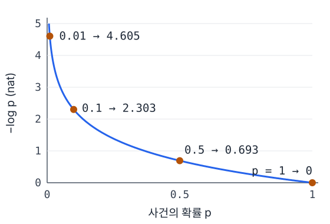
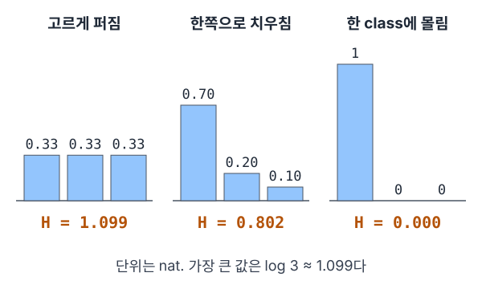

# 2.4 information theory: entropy와 cross-entropy

> **수준** L2 · **선수** [2.3 probability와 statistics](02-03-probability-statistics.md) · **이 장의 질문** entropy·cross-entropy·KL divergence는 무엇을 재나? 분류 loss에 왜 쓰나?

## 한눈에

- self-information(자기 정보량)은 사건 하나가 일어났을 때 얼마나 놀라운지를 $-\log p$로 잰다. 확률 1인 사건은 0이고, 확률이 작을수록 커진다. 자연로그로 재면 단위가 nat, 밑이 2인 log로 재면 bit다.
- entropy(엔트로피)는 distribution(분포) 하나의 평균 놀람이다. 고르게 퍼질수록 크고, 한 값에 몰리면 0이다.
- cross-entropy(교차 엔트로피)는 실제 distribution $p$에서 나온 결과를 모델 distribution $q$의 확률로 놀랄 때의 평균이다. KL divergence(KL 발산)는 그중 $q$가 $p$와 달라서 더 생긴 놀람 $H(p, q) - H(p)$다. 0 이상이고, 두 distribution의 순서를 바꾸면 값이 달라질 수 있다(대칭이 아니다).
- 정답이 one-hot이면 cross-entropy는 정답 class(클래스)에 준 확률의 $-\log$, 곧 negative log-likelihood(음의 로그 가능도)다. 그래서 cross-entropy를 줄이는 것은 정답의 likelihood(가능도)를 키우는 것이자 데이터 distribution과의 KL divergence를 줄이는 것이고, 분류 모델과 language model(언어 모델)이 이 loss(손실)로 배운다.

## 1. 놀람을 숫자로: self-information

분류 모델이 사진 한 장에 cat의 확률로 0.9를 냈고 정답이 cat이면 별로 놀랍지 않다. 0.01을 냈는데 정답이 cat이면 크게 놀랍다. 이 장은 이 놀람을 재는 information theory(정보 이론)의 양 몇 가지를 정리하고, 그 양이 왜 분류 모델의 loss가 되는지 본다.

information theory의 기본 직관은 드문 사건이 일어났다는 소식이 흔한 사건의 소식보다 정보가 많다는 것이다 [@Goodfellow2016]. Goodfellow 외의 교과서는 정보량이 갖춰야 할 성질 세 가지를 든다 [@Goodfellow2016].

- 흔한 사건은 정보가 적고, 반드시 일어나는 사건은 정보가 없다.
- 드문 사건일수록 정보가 많다.
- independent(독립)한 사건의 정보는 더해진다. 동전 앞면이 두 번 나왔다는 것은 한 번 나왔다는 것의 두 배 정보다.

세 성질을 모두 만족하도록 사건 $x$의 self-information을 다음처럼 정의한다 [@Goodfellow2016].

$$I(x) = -\log P(x)$$

$P(x)$는 사건 $x$의 확률이고, $I(x)$는 그 사건이 일어났다는 것을 알 때 얻는 정보량이다. 세 성질은 [2.3장 §6](02-03-probability-statistics.md#6-exp와-log)의 log 성질에서 바로 나온다. 확률은 1 이하이므로 $\log P(x) \le 0$이고 $I(x) \ge 0$이다. $\log 1 = 0$이므로 확률 1인 사건의 정보량은 0이다. log는 단조 증가이므로 확률이 작을수록 $-\log P(x)$가 크다. independent한 두 사건이 함께 일어날 확률은 [2.3장 §5](02-03-probability-statistics.md#5-conditional-probability와-independence)대로 두 확률의 곱이고, log는 곱을 합으로 바꾸므로 정보량은 각각의 정보량의 합이다.

| 사건의 확률 $p$ | $-\log p$ (nat) | $-\log_2 p$ (bit) |
|---|---|---|
| 1 | 0 | 0 |
| 0.9 | 0.105 | 0.152 |
| 0.5 | 0.693 | 1 |
| 0.1 | 2.303 | 3.322 |
| 0.01 | 4.605 | 6.644 |

동전 앞면이 두 번 연속 나올 확률은 0.25이고, 그 정보량은 $-\log 0.25 \approx 1.386$ nat이다. 한 번 나올 때의 0.693 nat의 두 배다.



그림: 가로축은 사건의 확률 $p$, 세로축은 $-\log p$다. $p = 1$에서 0이고, $p$가 0에 다가갈수록 가파르게 커진다.

정보량의 단위는 log의 밑이 정한다. Goodfellow 외의 교과서는 $\log$를 언제나 자연로그로 쓰므로 $I(x)$의 단위가 nat이고, 1 nat은 확률 $1/e$인 사건을 관측해 얻는 정보량이다 [@Goodfellow2016]. 밑이 2인 log를 쓰면 단위는 bit이고, 1 bit는 $\log 2 \approx 0.693$ nat이다 [@Goodfellow2016; @Bishop2006]. 확률 0.5인 사건 하나, 곧 공정한 동전을 한 번 던진 결과의 정보량이 1 bit다. 이 책은 [2.3장 §6](02-03-probability-statistics.md#6-exp와-log)의 약속대로 $\log$를 자연로그로 쓰므로, 따로 밝히지 않으면 정보량을 nat으로 잰다.

> **핵심** 확률이 작은 사건일수록 $-\log p$가 크다. 확률 1이면 0이고, 확률이 0에 다가가면 한없이 커진다.

이 장의 코드는 NumPy로 쓴다. 블록마다 혼자 돌아가고, 적어 둔 출력은 Python 3.14.6, NumPy 2.5.5, Apple M5 Pro CPU에서 돌린 결과다.

## 2. entropy

사건 하나가 아니라 distribution 전체가 얼마나 불확실한지 재고 싶을 때가 있다. 공정한 동전은 결과를 맞히기 어렵고, 앞면이 0.99의 확률로 나오는 동전은 쉽다. 이 차이를 숫자 하나로 나타낸 것이 entropy다.

Shannon entropy는 distribution $P$에서 뽑은 사건이 가진 정보량의 expectation(기댓값)이다 [@Goodfellow2016].

$$H(P) = \mathbb{E}_{x \sim P}[I(x)] = -\mathbb{E}_{x \sim P}[\log P(x)]$$

$x \sim P$는 $x$를 distribution $P$에서 뽑는다는 뜻이고, $\mathbb{E}$는 [2.3장 §4.1](02-03-probability-statistics.md#41-expectation-확률로-가중한-평균)의 expectation이다. 값이 `K`개인 discrete distribution에서는 expectation이 확률로 가중한 합이다. distribution $p$가 $k$번째 값에 주는 확률을 $p_k$로 쓰면 다음과 같다.

$$H(p) = -\sum_{k=1}^{K} p_k \log p_k$$

$p_k$는 $k$번째 값의 확률이고, $-\log p_k$는 그 값이 나왔을 때의 정보량이다. 놀람을 그 값이 나올 확률로 가중해 더한 것이 entropy다. 확률이 0인 값이 있으면 $0 \log 0$이 나오는데, information theory에서는 관례로 $\lim_{x \to 0} x \log x = 0$을 따라 0으로 다룬다 [@Goodfellow2016]. 일어나지 않는 값은 평균 놀람에 보태지 않는다.

동전 셋으로 손 계산해 보자.

| 동전 | 계산 | entropy |
|---|---|---|
| 공정한 동전 $[0.5, 0.5]$ | $0.5 \times 0.693 + 0.5 \times 0.693$ | 0.693 nat = 1 bit |
| 치우친 동전 $[0.9, 0.1]$ | $0.9 \times 0.105 + 0.1 \times 2.303 \approx 0.095 + 0.230$ | 0.325 nat = 0.469 bit |
| 앞면만 나오는 동전 $[1, 0]$ | $1 \times 0 + 0$ | 0 |

치우친 동전에서 드문 뒷면은 놀람이 2.303 nat으로 크지만 10번에 1번만 나오므로 평균에 0.230만 보탠다. 동전 하나의 entropy를 앞면 확률 $\phi$의 함수로 쓰면 $-\phi \log \phi - (1 - \phi) \log (1 - \phi)$이고, $\phi = 0.5$에서 두 결과에 고르게 퍼져 가장 크며, $\phi$가 0이나 1에 가까우면 결과가 거의 정해져 있어 작다 [@Goodfellow2016]. $\phi$는 [2.3장 §3](02-03-probability-statistics.md#3-자주-쓰는-distribution)의 Bernoulli distribution(베르누이 분포)의 parameter(파라미터)와 같은 것이다.

class 세 개 위의 distribution도 같다. $[0.7, 0.2, 0.1]$의 entropy는 항마다 $0.7 \times 0.357 \approx 0.250$, $0.2 \times 1.609 \approx 0.322$, $0.1 \times 2.303 \approx 0.230$을 더한 0.802 nat이다.



그림: 고르게 퍼진 $[1/3, 1/3, 1/3]$은 entropy가 $\log 3 \approx 1.099$로 가장 크고, $[0.7, 0.2, 0.1]$은 0.802, 한 class에 몰린 $[1, 0, 0]$은 0이다.

일반적으로 결과가 거의 정해진 distribution은 entropy가 낮고, uniform distribution(균등 분포)에 가까운 distribution은 entropy가 높다 [@Goodfellow2016]. 범위도 정해져 있다. discrete distribution의 확률은 0과 1 사이이므로 entropy는 음수가 아니고, 한 값의 확률이 1이고 나머지가 모두 0일 때 최솟값 0이 된다 [@Bishop2006]. 값이 `K`개이면 모든 확률이 $1/K$인 uniform distribution에서 entropy가 가장 크고, 그 값은 $\log K$다 [@Bishop2006].

밑이 2인 log로 잰 entropy에는 code length(부호 길이)라는 뜻도 있다. distribution $P$에서 뽑은 기호를 code로 바꿔 보낼 때, 기호 하나에 평균으로 필요한 bit 수의 하한이 entropy다 [@Goodfellow2016]. 상태 8개가 모두 같은 확률이면 entropy는 $-8 \times \frac{1}{8} \log_2 \frac{1}{8} = 3$ bit이고, 상태를 보내려면 3 bit 길이의 메시지가 필요하다 [@Bishop2006]. 같은 8개 상태라도 확률이 $1/2, 1/4, 1/8, 1/16$, 그리고 $1/64$가 네 개로 고르지 않으면 entropy가 2 bit로 uniform distribution보다 작다 [@Bishop2006]. 어떤 상태가 나올지 덜 불확실하기 때문이다. 자주 나오는 상태에 짧은 code를, 드문 상태에 긴 code를 주면 메시지의 평균 길이를 줄일 수 있다 [@Bishop2006].

```python
import numpy as np

def entropy(p, base=np.e):
    p = np.asarray(p, dtype=float)
    nz = p > 0                                   # 0 log 0 = 0으로 둔다
    return np.sum(p[nz] * np.log(1 / p[nz])) / np.log(base)

for p in [[0.5, 0.5], [0.9, 0.1], [1.0, 0.0]]:   # 동전 세 개
    print(p, round(entropy(p), 4), round(entropy(p, base=2), 4))
for p in [[1/3, 1/3, 1/3], [0.7, 0.2, 0.1], [1.0, 0.0, 0.0]]:
    print(np.round(p, 3), round(entropy(p), 4))
print(round(np.log(3), 4))                       # class 3개일 때의 최댓값
```

```text
[0.5, 0.5] 0.6931 1.0
[0.9, 0.1] 0.3251 0.469
[1.0, 0.0] 0.0 0.0
[0.333 0.333 0.333] 1.0986
[0.7 0.2 0.1] 0.8018
[1. 0. 0.] 0.0
1.0986
```

식의 $-p_k \log p_k$를 코드에서는 $p_k \log(1/p_k)$로 썼다. 같은 값이다. `nz`는 확률이 0이 아닌 자리만 True인 boolean 배열이다. 이 배열 없이 $[1, 0]$을 그대로 계산하면 NumPy는 $0 \times \log(1/0) = 0 \times \infty$를 `nan`으로 계산해 합 전체가 `nan`이 된다. 셋째 줄의 0.0은 $0 \log 0 = 0$의 관례를 코드로 지킨 결과다.

> **핵심** entropy는 distribution 하나가 얼마나 불확실한지를 잰다. 값이 `K`개이면 entropy는 0과 $\log K$ 사이에 있다.

## 3. cross-entropy

학습에서는 실제 distribution과 모델의 distribution이 따로 있다. 데이터는 실제 distribution $p$를 따라 나오지만, 모델은 $p$를 모르고 자기가 계산한 distribution $q$로 예측한다. 그러면 결과는 $p$대로 나오는데, 놀람은 모델이 그 결과에 준 확률 $q$로 생긴다. 이 놀람의 평균이 cross-entropy다.

$$H(p, q) = -\mathbb{E}_{x \sim p}[\log q(x)] = -\sum_{k=1}^{K} p_k \log q_k$$

$p_k$는 실제 distribution이 $k$번째 값에 주는 확률, $q_k$는 모델 distribution이 주는 확률이다. 첫 식은 Goodfellow 외의 정의이고 [@Goodfellow2016], 둘째 식은 값이 `K`개일 때 expectation을 합으로 쓴 것이다. entropy 식에서 log 안의 $p_k$만 $q_k$로 바꾼 꼴이다. 평균을 낼 때 곱하는 비중은 여전히 $p_k$다. 어떤 결과가 얼마나 자주 나오는지는 실제 distribution이 정하기 때문이다.

실제 distribution이 $p = [0.7, 0.2, 0.1]$일 때, 모델 distribution $q$를 바꿔 가며 cross-entropy를 계산하면 다음과 같다.

| 모델 distribution $q$ | $H(p, q)$ |
|---|---|
| $[0.7, 0.2, 0.1]$ ($q = p$) | 0.802 |
| $[0.6, 0.3, 0.1]$ | 0.829 |
| $[1/3, 1/3, 1/3]$ | 1.099 |
| $[0.1, 0.2, 0.7]$ | 1.969 |

마지막 줄을 손으로 풀면 다음과 같다.

$$
-(0.7 \log 0.1 + 0.2 \log 0.2 + 0.1 \log 0.7) \approx 1.6118 + 0.3219 + 0.0357 \approx 1.969
$$

가장 자주 나오는 첫째 값에 모델이 0.1만 줘서 첫 항이 크다. $q$가 uniform distribution이면 $-\sum_k p_k \log \frac{1}{K} = \log K \sum_k p_k = \log K$이므로, $p$가 무엇이든 cross-entropy는 $\log 3 \approx 1.099$다.

표에서 cross-entropy는 $q = p$일 때 가장 작고, 그 값은 §2에서 구한 $p$의 entropy 0.802와 같다. 어떤 $q$로도 $H(p)$보다 작게 만들 수 없다는 것은 다음 절의 KL divergence로 보인다.

## 4. KL divergence

cross-entropy $H(p, q)$에는 모델이 어떻게 해도 줄일 수 없는 부분이 들어 있다. $q$가 $p$와 똑같아도 결과 자체가 무작위이므로 $H(p)$만큼은 놀란다. 그 위에 $q$가 $p$와 달라서 더 생긴 놀람만 떼어 낸 것이 KL divergence다.

같은 random variable(확률 변수) 위의 두 distribution $P$와 $Q$가 얼마나 다른지 다음 KL divergence로 잴 수 있다 [@Goodfellow2016].

$$D_{\mathrm{KL}}(P \Vert Q) = \mathbb{E}_{x \sim P}[\log P(x) - \log Q(x)]$$

값이 `K`개이면 $D_{\mathrm{KL}}(p \Vert q) = \sum_k p_k \log \frac{p_k}{q_k}$다. $\log \frac{p_k}{q_k}$는 $k$번째 값이 나왔을 때 $q$로 놀란 양 $-\log q_k$에서 $p$로 놀란 양 $-\log p_k$를 뺀 것이다. 합을 둘로 나누면 다음과 같다.

$$
\sum_k p_k \log p_k - \sum_k p_k \log q_k = -H(p) + H(p, q)
$$

그래서 다음이 성립한다 [@Goodfellow2016].

$$H(p, q) = H(p) + D_{\mathrm{KL}}(p \Vert q)$$

code로 보면 뜻이 분명하다. discrete 변수에서 KL divergence는 $Q$에 맞춰 길이를 가장 짧게 설계한 code로 $P$에서 뽑은 기호를 보낼 때 추가로 드는 정보량이다 [@Goodfellow2016]. Bishop의 교과서는 같은 양을 relative entropy라고도 부른다 [@Bishop2006]. KL divergence도 밑이 2인 log로 재면 단위가 bit지만, machine learning(머신러닝)에서는 보통 자연로그와 nat을 쓴다 [@Goodfellow2016].

KL divergence의 가장 중요한 성질은 음수가 아니라는 것이다 [@Goodfellow2016]. discrete 변수에서는 $P$와 $Q$가 같은 distribution일 때, 그리고 그때만 0이다 [@Goodfellow2016; @Bishop2006]. 그래서 위 식에서 $H(p, q) \ge H(p)$이고, 등호는 $q = p$일 때만 성립한다. §3의 표에서 $q = p$일 때 cross-entropy가 가장 작았던 까닭이다. 모델 $q$에 대해 cross-entropy를 최소화하는 것은 KL divergence를 최소화하는 것과 같다. 두 값의 차이인 $H(p)$에는 $q$가 들어 있지 않기 때문이다 [@Goodfellow2016].

KL divergence는 두 distribution의 차이를 재고 음수가 아니어서 두 distribution 사이의 거리처럼 여겨지곤 한다 [@Goodfellow2016]. 하지만 대칭이 아니어서, 곧 어떤 $P$와 $Q$에서는 $D_{\mathrm{KL}}(P \Vert Q) \ne D_{\mathrm{KL}}(Q \Vert P)$라서 참된 거리 척도가 아니다 [@Goodfellow2016]. 동전 두 개로 확인해 보자. $a = [0.9, 0.1]$, $b = [0.5, 0.5]$다.

$$D_{\mathrm{KL}}(a \Vert b) = 0.9 \log \frac{0.9}{0.5} + 0.1 \log \frac{0.1}{0.5} \approx 0.529 - 0.161 = 0.368$$

$$D_{\mathrm{KL}}(b \Vert a) = 0.5 \log \frac{0.5}{0.9} + 0.5 \log \frac{0.5}{0.1} \approx -0.294 + 0.805 = 0.511$$

두 값이 다른 까닭은 평균을 내는 비중에 있다. 앞에 놓인 distribution이 그 비중을 정한다. $b$를 앞에 두면 뒷면이 절반의 비중을 갖는데, 그 뒷면에 $a$는 0.1만 준다. 그래서 $D_{\mathrm{KL}}(b \Vert a)$가 더 크다. 비대칭 때문에 두 방향 중 어느 쪽을 쓰느냐가 결과에 중요한 차이를 낳는다 [@Goodfellow2016]. 쓰는 곳마다 어느 distribution을 앞에 두는지 정해져 있다. §5의 학습은 데이터 distribution을 앞에, §6의 reinforcement learning from human feedback(RLHF)은 학습 중인 모델을 앞에 둔다.

```python
import numpy as np

def entropy(p):
    p = np.asarray(p, dtype=float); nz = p > 0
    return np.sum(p[nz] * np.log(1 / p[nz]))

def cross_entropy(p, q):
    p, q = np.asarray(p, dtype=float), np.asarray(q, dtype=float); nz = p > 0
    return np.sum(p[nz] * np.log(1 / q[nz]))

def kl(p, q):
    p, q = np.asarray(p, dtype=float), np.asarray(q, dtype=float); nz = p > 0
    return np.sum(p[nz] * np.log(p[nz] / q[nz]))

p = [0.7, 0.2, 0.1]                              # 실제 distribution
for q in [[0.7, 0.2, 0.1], [0.6, 0.3, 0.1], [1/3, 1/3, 1/3], [0.1, 0.2, 0.7]]:
    print(np.round(q, 3), round(cross_entropy(p, q), 4),
          round(kl(p, q), 4), round(entropy(p) + kl(p, q), 4))
a, b = [0.9, 0.1], [0.5, 0.5]                    # 두 방향의 KL
print(round(kl(a, b), 4), round(kl(b, a), 4))
```

```text
[0.7 0.2 0.1] 0.8018 0.0 0.8018
[0.6 0.3 0.1] 0.8286 0.0268 0.8286
[0.333 0.333 0.333] 1.0986 0.2968 1.0986
[0.1 0.2 0.7] 1.9694 1.1675 1.9694
0.3681 0.5108
```

줄마다 둘째 값이 cross-entropy, 셋째 값이 KL divergence, 넷째 값이 $H(p) + D_{\mathrm{KL}}(p \Vert q)$다. 둘째와 넷째가 모든 줄에서 같고, KL은 $q = p$일 때만 0이다. 마지막 줄은 두 방향의 KL이 0.368과 0.511로 다르다는 것을 보인다.

> **핵심** $H(p, q) = H(p) + D_{\mathrm{KL}}(p \Vert q)$다. 모델 $q$가 바꿀 수 있는 것은 KL 부분뿐이므로, $q$에 대해 cross-entropy를 줄이는 것과 KL divergence를 줄이는 것은 같다.

## 5. 분류 loss로 쓰는 까닭

### 5.1 정답이 one-hot이면 정답 class의 $-\log q$

분류 학습 데이터는 예제마다 정답 class 하나를 준다. class가 `K`개인 분류의 정답을 1-of-K 방식으로 나타내면, class $k$에 속한 예제의 정답 vector(벡터)는 $k$번째 원소만 1이고 나머지가 모두 0이다 [@Bishop2006]. [2.1장 §3.2](02-01-vectors-matrices-tensors.md#32-문장-token-id에서-vector-열로)의 one-hot vector다. 이 vector는 원소가 0 이상이고 합이 1이므로 그대로 distribution으로 볼 수 있다. 정답 class가 $y$이면 $p_y = 1$이고 나머지 $p_k = 0$이다.

이 $p$를 앞 절의 식에 넣으면 세 양이 간단해진다.

- $p$는 한 값에 몰려 있으므로 $H(p) = 0$이다(§2).
- $H(p, q) = -\sum_k p_k \log q_k$에서 $p_k = 0$인 항이 모두 사라지고 $-\log q_y$만 남는다.
- $D_{\mathrm{KL}}(p \Vert q) = H(p, q) - H(p) = -\log q_y$다.

$q_y$는 모델이 정답 class에 준 확률, 곧 이 예제 하나의 likelihood다. 그러므로 예제 하나의 cross-entropy는 [2.3장 §7.3](02-03-probability-statistics.md#73-학습은-log-likelihood를-키운다)의 negative log-likelihood와 같은 값이다.

| 정답 class에 준 확률 $q_y$ | loss $-\log q_y$ |
|---|---|
| 0.99 | 0.010 |
| 0.9 | 0.105 |
| 0.5 | 0.693 |
| 0.1 | 2.303 |
| 0.01 | 4.605 |
| 0.001 | 6.908 |

정답에 높은 확률을 주면 loss가 0에 가깝다. 정답에 확률을 거의 주지 않으면, 곧 다른 class를 확신하면 loss가 빠르게 커진다. §1 그림의 곡선 그대로다. 확률을 0.1에서 0.01로 10분의 1로 줄일 때마다 loss는 $\log 10 \approx 2.303$씩 늘어난다.

분류 모델의 $q$는 보통 [2.3장 §8.1](02-03-probability-statistics.md#81-logit에서-확률로)의 softmax(소프트맥스)가 logit(로짓)에서 만든다. [2.3장 §8.3](02-03-probability-statistics.md#83-overflow를-피하는-계산)의 log softmax 식을 쓰면 loss를 logit으로 바로 쓸 수 있다.

$$-\log q_y = -z_y + \log \sum_{j=1}^{K} \exp(z_j)$$

$z_j$는 $j$번째 class의 logit이고, $z_y$는 정답 class의 logit이다. 2.3장의 logit $[2.0, 1.0, 0.1]$로 손 계산해 보자. softmax는 $[0.659, 0.242, 0.099]$이고, exp의 합은 약 11.21이다. 정답이 첫째 class이면 loss는 $-\log 0.659 \approx 0.417$이고, logit으로 계산해도 $-2.0 + \log 11.21 \approx -2.0 + 2.417 = 0.417$이다. 같은 출력이라도 정답이 셋째 class이면, 셋째 확률을 네 자리로 쓴 0.0986을 넣어 loss는 $-\log 0.0986 \approx 2.317$이다.

softmax의 exp는 언제나 양수이므로, 수학적으로는 어떤 class의 확률도 정확히 0이나 1이 되지 않는다. 그래서 loss는 0에 다가갈 수는 있어도 0이 되지는 않는다 [@Goodfellow2016]. logit이 $[20, 0, 0]$이고 첫째 class가 정답이면 확률은 약 0.999999996이고 loss는 약 $4.1 \times 10^{-9}$이다. Goodfellow 외의 교과서는 학습이 최소화하는 함수를 cost function(비용 함수)이라고도 부르고, loss function·error function과 같은 뜻으로 쓴다 [@Goodfellow2016].

### 5.2 데이터 전체로 보면: maximum likelihood와 같다

학습은 예제 하나가 아니라 데이터 전체의 loss를 줄인다. Bishop의 교과서는 class가 여럿인 분류에서 negative log-likelihood를 다음처럼 쓰고, 이것을 cross-entropy error function이라 부른다 [@Bishop2006].

$$E = -\sum_{n=1}^{N} \sum_{k=1}^{K} p_{nk} \log q_{nk}$$

$N$은 예제 수, $p_{nk}$는 $n$번째 예제의 one-hot 정답 vector의 $k$번째 원소, $q_{nk}$는 모델이 $n$번째 예제의 $k$번째 class에 준 softmax 확률이다. Bishop의 교과서는 정답을 $t$, 모델 확률을 $y$로 쓰는데, 이 장은 §5.1의 $p$·$q$로 맞췄다. 안쪽 합은 §5.1대로 정답 class의 $-\log q_{nk}$ 하나만 남긴다. 그러니 $E$는 예제마다의 negative log-likelihood의 합이고, 이것을 줄이는 것은 [2.3장 §7](02-03-probability-statistics.md#7-likelihood와-maximum-likelihood)의 maximum likelihood estimation(MLE, 최대 가능도 추정)과 같다. 합 대신 평균을 써도 $N$으로 나누는 것뿐이라 가장 작게 만드는 parameter는 같다.

distribution의 눈으로 보면 같은 일이 KL divergence로 보인다. 학습 데이터가 정하는 empirical distribution(경험 분포)을 $\hat{p}_{\text{data}}$로 쓴다. 학습 데이터에서 예제 하나를 무작위로 고를 때의 distribution이다. maximum likelihood estimation은 $\hat{p}_{\text{data}}$와 모델 distribution $p_{\text{model}}$ 사이의 차이를 KL divergence로 재어 최소화하는 것으로 볼 수 있다 [@Goodfellow2016].

$$D_{\mathrm{KL}}(\hat{p}_{\text{data}} \Vert p_{\text{model}}) = \mathbb{E}_{x \sim \hat{p}_{\text{data}}}[\log \hat{p}_{\text{data}}(x) - \log p_{\text{model}}(x)]$$

왼쪽 항 $\log \hat{p}_{\text{data}}(x)$는 데이터에만 달려 있고 모델과 무관하다. 그래서 KL을 줄이려면 $-\mathbb{E}_{x \sim \hat{p}_{\text{data}}}[\log p_{\text{model}}(x)]$만 최소화하면 되고, 이것은 likelihood를 최대화하는 것과 같다 [@Goodfellow2016]. 이 KL을 최소화하는 것은 두 distribution 사이의 cross-entropy를 최소화하는 것과 정확히 같다 [@Goodfellow2016]. §4의 핵심 식에서 $H(p)$가 $q$와 무관한 상수였던 것과 같은 이야기다. 여기서는 $p$가 $\hat{p}_{\text{data}}$, $q$가 $p_{\text{model}}$이다.

| 보는 눈 | 줄이는 것 |
|---|---|
| probability·statistics | 데이터 전체의 negative log-likelihood(2.3장) |
| information theory | 데이터 distribution과 모델 distribution 사이의 cross-entropy |
| distribution 사이의 차이 | 데이터 distribution에서 모델 distribution으로의 KL divergence |

likelihood를 최대화하든 KL divergence를 최소화하든 최적 parameter는 같지만, 최소화하는 값 자체는 다르다 [@Goodfellow2016]. KL은 평균 negative log-likelihood, 곧 cross-entropy $H(\hat{p}_{\text{data}}, p_{\text{model}})$보다 $H(\hat{p}_{\text{data}})$만큼 작다(§4의 핵심 식). KL divergence는 최솟값이 0으로 알려져 있다는 점에서 maximum likelihood를 KL 최소화로 보는 관점이 쓸모 있다 [@Goodfellow2016]. 평균 negative log-likelihood는 §4대로 데이터의 entropy 밑으로 내려가지 않으므로 그 하한이 데이터마다 다르지만, KL의 하한은 언제나 0이다. §5.1에서 둘이 같았던 것은 예제 하나의 정답 distribution이 한 class에 몰려 entropy가 0이었기 때문이다. 분류 모델은 입력 $x$가 주어졌을 때의 정답 $y$의 distribution을 배우므로, 분류의 cost function은 $-\mathbb{E}_{x, y \sim \hat{p}_{\text{data}}} \log p_{\text{model}}(y \mid x)$다 [@Goodfellow2016]. 그래서 분류에서 비교하는 KL은 입력마다 데이터의 정답 distribution $\hat{p}_{\text{data}}(y \mid x)$와 모델의 $p_{\text{model}}(y \mid x)$ 사이의 KL을 입력에 대해 평균한 것이다. 앞에서 말한 차이 $H(\hat{p}_{\text{data}})$는 예제 위의 distribution에 대한 것이었고, 이 KL과 평균 negative log-likelihood의 차이는 서로 다른 예제 $N$개에 $1/N$씩 주는 그 entropy $\log N$이 아니다. 그 차이는 입력마다의 정답 distribution의 entropy를 입력에 대해 평균한 값이다. 입력마다 정답이 하나로 정해져 있으면 이 값이 0이라 두 값이 같고, 같은 입력 뒤에 서로 다른 정답이 섞여 나오는 데이터에서는 0보다 커서 두 값이 달라진다.

이것이 분류에 cross-entropy를 쓰는 까닭이다. neural network(신경망)는 대부분 이렇게 maximum likelihood로 학습한다 [@Goodfellow2016]. maximum likelihood에서 cost function을 유도하면 모델마다 cost function을 따로 설계할 부담이 사라진다. 모델 $p(y \mid x)$를 정하면 cost function $-\log p(y \mid x)$가 저절로 정해진다 [@Goodfellow2016]. 출력을 어떻게 나타내느냐가 cross-entropy 함수의 꼴을 정한다 [@Goodfellow2016]. 출력이 softmax의 categorical distribution(범주형 분포)이면 §5.1의 $-\log q_y$가 되고, 다음 절처럼 sigmoid(시그모이드)의 Bernoulli distribution이면 binary cross-entropy(이진 교차 엔트로피)가 된다. language model도 다음 token(토큰)을 고르는 분류를 token마다 하는 것이므로 같은 loss를 쓴다. [2.3장 §7.3](02-03-probability-statistics.md#73-학습은-log-likelihood를-키운다)의 language modeling 목표에 $-1$을 곱한 것이 token마다의 cross-entropy의 합이다.

다음 코드는 예제 세 개의 logit에서 loss를 계산한다. 첫째와 둘째 예제는 logit이 같고 정답만 다르다. 코드의 class 번호는 0부터 센다.

```python
import numpy as np

logits = np.array([[2.0, 1.0, 0.1],              # 예제 3개, class 3개: (B, K)
                   [2.0, 1.0, 0.1],
                   [0.5, 2.5, 0.0]])
y = np.array([0, 2, 1])                          # 예제마다의 정답 class
z = logits - logits.max(axis=1, keepdims=True)   # 가장 큰 logit을 뺀다
log_q = z - np.log(np.exp(z).sum(axis=1, keepdims=True))   # log softmax
print(np.round(np.exp(log_q), 4))                # softmax 확률
nll = -log_q[np.arange(len(y)), y]               # 정답 class의 -log q
print(np.round(nll, 4), round(nll.mean(), 4))
onehot = np.eye(3)[y]                            # 정답을 one-hot distribution으로
ce = -(onehot * log_q).sum(axis=1)               # cross-entropy 식 그대로
print(np.round(ce, 4))
```

```text
[[0.659  0.2424 0.0986]
 [0.659  0.2424 0.0986]
 [0.1112 0.8214 0.0674]]
[0.417  2.317  0.1967] 0.9769
[0.417  2.317  0.1967]
```

`keepdims=True`는 결과를 `(B, 1)`로 남겨 [2.1장 §5.3](02-01-vectors-matrices-tensors.md#53-broadcasting)의 broadcasting(브로드캐스팅)으로 행마다 빼게 한다. 같은 출력 $[0.659, 0.242, 0.099]$라도 정답이 0번이면 0.417, 2번이면 2.317이다. 셋째 예제는 정답 class에 0.821을 줘서 0.197이다. 평균 0.977이 이 batch(배치)의 loss다. `nll`은 정답 자리의 log 확률만 꺼냈고, `ce`는 one-hot 정답과 cross-entropy 식을 그대로 계산했는데 값이 같다. §5.1에서 손으로 보인 것을 코드로 확인한 것이다. 0을 곱하는 항을 모두 계산하는 `ce`보다 정답 자리만 꺼내는 `nll`이 계산이 적다.

### 5.3 class가 둘이면 binary cross-entropy

class가 둘이면 모델은 [2.3장 §8.4](02-03-probability-statistics.md#84-class가-둘이면-sigmoid)처럼 sigmoid로 「label(라벨)이 1일 확률」 $q$ 하나만 낸다. 정답 $y$는 0이나 1이다. Bishop의 교과서는 두 class 분류에서 negative log-likelihood를 다음 cross-entropy error function으로 쓴다 [@Bishop2006].

$$E = -\sum_{n=1}^{N} \left\{ y_n \log q_n + (1 - y_n) \log (1 - q_n) \right\}$$

$y_n$은 $n$번째 예제의 정답(0 또는 1), $q_n$은 모델이 그 예제의 label을 1로 본 확률이다. $y_n = 1$이면 $-\log q_n$만, $y_n = 0$이면 $-\log(1 - q_n)$만 남는다. distribution $[y_n, 1 - y_n]$과 $[q_n, 1 - q_n]$ 사이의 cross-entropy이므로, §5.1의 식에서 `K = 2`인 경우와 같다. PyTorch는 이 loss를 Binary Cross Entropy라 부른다 [@PyTorch2026].

[2.3장 §8.4](02-03-probability-statistics.md#84-class가-둘이면-sigmoid)에서 스팸 점수 1.5에 sigmoid를 씌운 값은 0.818이었다. 네 자리로 쓰면 0.8176이다. 정말 스팸이면($y = 1$) loss는 $-\log 0.8176 \approx 0.201$이고, 스팸이 아니면($y = 0$) $-\log(1 - 0.8176) = -\log 0.1824 \approx 1.702$이다. PyTorch에서 어떤 loss 함수를 고르고 무엇을 입력으로 넘기는지, mean squared error(평균 제곱 오차) 같은 다른 loss와 어떻게 비교하는지는 4.4장에서 본다.

> **표준과 관례** cross-entropy라는 말은 넓은 뜻과 좁은 뜻으로 쓰인다. 흔히 Bernoulli distribution이나 softmax distribution의 negative log-likelihood만 cross-entropy라 부르는데, Goodfellow 외의 교과서는 이것을 잘못 붙인 이름으로 보고 negative log-likelihood로 된 loss는 모두 학습 데이터의 empirical distribution과 모델 distribution 사이의 cross-entropy라고 적었다 [@Goodfellow2016]. 그 넓은 뜻으로는 mean squared error도 empirical distribution과 Gaussian 모델, 곧 normal distribution(정규 분포, 2.3장)을 쓰는 모델 사이의 cross-entropy다 [@Goodfellow2016]. 이 책에서 cross-entropy loss라고 하면 분류의 좁은 뜻, 곧 §5.1과 §5.3의 loss를 가리킨다.

## 6. 뒤에서 다시 만나는 곳

cross-entropy와 KL divergence는 뒤의 여러 장에서 이름 그대로 다시 나온다.

| 어디서 | 무엇에 쓰나 | 본 장 |
|---|---|---|
| distillation(증류) | 큰 모델이 낸 class 확률을 soft target으로 삼아 작은 모델을 학습한다 [@Hinton2015]. 정답 label이 있으면 soft target과의 cross-entropy와 정답 label과의 cross-entropy를 가중 평균해 줄인다 [@Hinton2015]. soft target은 temperature(온도)를 높인 softmax로 만든다 [@Hinton2015] | 9.6장, [1.4장 §3](../part01-big-picture/01-04-training-methods-map.md#3-학습-한-번에-붙는-여러-이름) |
| RLHF·DPO | InstructGPT는 reward model(보상 모델)에 과하게 맞추는 것을 줄이려고 token마다 supervised fine-tuning(SFT, 지도 파인튜닝) 모델로부터의 KL penalty를 더한다 [@Ouyang2022]. direct preference optimization(DPO) 논문은 이 목표를 reward(보상)의 expectation에서 $\beta \cdot D_{\mathrm{KL}}(\pi_\theta \Vert \pi_{\text{ref}})$를 뺀 것으로 정리한다 [@Rafailov2023]. $\pi_\theta$는 학습 중인 모델, $\pi_{\text{ref}}$는 처음의 SFT 모델이고, $\beta$가 벗어나는 정도를 조절한다 [@Rafailov2023] | 10.4·10.5·10.8장, [1.4장 §5](../part01-big-picture/01-04-training-methods-map.md#5-reinforcement-learning과-preference-learning은-왜-함께-묶이나) |
| variational autoencoder(VAE, 변분 오토인코더) | VAE의 loss에 든 KL divergence 항이 regularizer(규제 항)로 작용한다 [@Kingma2013]. regularizer는 cost function에 더하는 penalty 항이고, 4.6장에서 본다 [@Goodfellow2016] | 11.4장 |

[1.4장 §5](../part01-big-picture/01-04-training-methods-map.md#5-reinforcement-learning과-preference-learning은-왜-함께-묶이나)의 「원래 모델에서 너무 멀어지지 않게」가 이 KL 항이다. reward model은 특정 distribution의 답에서 정확하다 [@Rafailov2023]. KL 제약은 학습 중인 모델이 그 distribution에서 너무 멀리 벗어나지 않게 한다 [@Rafailov2023]. 생성의 다양성을 지키는 것도 이 제약의 몫이다 [@Rafailov2023]. §4에서 본 대로 여기서는 학습 중인 모델이 KL의 앞에 놓인다.

perplexity는 7.4장에서 본다.

## 헷갈리기 쉬운 점

| 헷갈리는 개념 | 차이 |
|---|---|
| entropy와 cross-entropy | entropy $H(p)$는 distribution 하나의 평균 놀람이다. cross-entropy $H(p, q)$는 $p$에서 나온 결과를 $q$로 놀랄 때의 평균이고, 언제나 $H(p)$ 이상이다 |
| KL divergence와 거리 | 0 이상이고 두 distribution이 같을 때만 0이지만, 순서를 바꾸면 값이 다르다(0.368과 0.511). 그래서 참된 거리가 아니다 |
| nat과 bit | 같은 양을 다른 밑의 log로 잰 것이다. 1 bit는 $\log 2 \approx 0.693$ nat이다. 이 책의 loss 값은 모두 자연로그, 곧 nat이다 |
| cross-entropy와 negative log-likelihood | 정답이 one-hot이면 같은 값의 두 이름이다. Goodfellow 외의 교과서는 negative log-likelihood로 된 loss를 모두 cross-entropy로 본다 |
| loss 값 0.693 | class 둘에 0.5씩 준 추측의 loss $\log 2$다. class가 `K`개이면 모든 class에 $1/K$를 주는 추측의 loss가 $\log K$다(10개면 2.303, 1000개면 6.908). 평균 loss가 $\log K$보다 크면 고르게 찍는 것보다 못한 예측이다 |
| log 확률과 loss의 부호 | 확률의 log는 0 이하이고, loss $-\log q$는 0 이상이다. loss는 0에 가까울수록 좋다 |

## 정리

- self-information $-\log p$는 사건 하나의 놀람이다. 확률 1이면 0이고, independent한 사건의 정보량은 더해진다. 자연로그면 nat, 밑 2면 bit이고 1 bit는 $\log 2$ nat이다.
- entropy $H(p) = -\sum_k p_k \log p_k$는 distribution의 평균 놀람이다. 한 값에 몰리면 0, `K`개 값에 고르게 퍼지면 최대 $\log K$다.
- cross-entropy $H(p, q) = -\sum_k p_k \log q_k$는 $p$에서 나온 결과를 $q$로 놀랄 때의 평균이다. $H(p, q) = H(p) + D_{\mathrm{KL}}(p \Vert q)$이고, KL divergence는 0 이상이며 $q = p$일 때만 0이다. KL은 순서를 바꾸면 값이 달라질 수 있다(대칭이 아니다).
- 정답이 one-hot이면 cross-entropy = KL = $-\log q_y$ = 예제 하나의 negative log-likelihood다. 데이터 전체의 cross-entropy를 줄이는 것은 maximum likelihood이고, 데이터 distribution과의 KL을 줄이는 것이다.
- class가 둘이면 같은 loss가 binary cross-entropy $-[y \log q + (1 - y) \log(1 - q)]$가 된다. loss 고르기와 PyTorch의 loss 함수는 4.4장에서 본다.

## 확인 문제

1. class 네 개 위의 distribution A $[0.5, 0.5, 0, 0]$, B $[0.25, 0.25, 0.25, 0.25]$, C $[0.97, 0.01, 0.01, 0.01]$을 entropy가 큰 순서로 놓아라. A와 B의 entropy는 몇 bit인가?
2. 실제 distribution $p = [0.5, 0.5]$, 모델 distribution $q = [0.8, 0.2]$일 때 cross-entropy $H(p, q)$와 $D_{\mathrm{KL}}(p \Vert q)$를 손으로 계산하라.
3. $p = [1, 0]$, $q = [0.5, 0.5]$일 때 $D_{\mathrm{KL}}(p \Vert q)$와 $D_{\mathrm{KL}}(q \Vert p)$는 각각 얼마인가? 왜 이렇게 다른가?
4. 분류 모델이 정답 class에 0.5를 줬다. 이 예제의 loss는 몇 nat인가? 정답 class의 확률이 0.25로 반이 되면 loss는 얼마나 늘어나나?

<details>
<summary>답</summary>

1. B > A > C다. B는 네 값에 고르게 퍼져 $\log 4 \approx 1.386$ nat = 2 bit로 가장 크다. A는 두 값에 고르게 퍼져 $\log 2 \approx 0.693$ nat = 1 bit다. C는 한 값에 거의 몰려 약 0.168 nat이다.

    $$
    0.97 \log \frac{1}{0.97} + 3 \times 0.01 \log 100 \approx 0.030 + 0.138 = 0.168
    $$

2. cross-entropy는 다음과 같다.

    $$
    H(p, q) = -(0.5 \log 0.8 + 0.5 \log 0.2) \approx 0.1116 + 0.8047 \approx 0.916
    $$

    $H(p) = \log 2 \approx 0.693$이므로 $D_{\mathrm{KL}}(p \Vert q) = 0.916 - 0.693 = 0.223$이다.

3. $D_{\mathrm{KL}}(p \Vert q) = 1 \cdot \log \frac{1}{0.5} + 0 = \log 2 \approx 0.693$이다. 둘째 값의 항은 $0 \log 0 = 0$의 관례로 0이다. $D_{\mathrm{KL}}(q \Vert p) = 0.5 \log \frac{0.5}{1} + 0.5 \log \frac{0.5}{0}$이고, 둘째 항의 $\log \frac{0.5}{0}$이 무한대라 값이 무한대다. 앞에 놓인 distribution이 평균을 내는 비중을 정하기 때문이다. $q$를 앞에 두면 $q$가 0.5를 주는 둘째 값이 평균에 들어가는데, $p$는 그 값에 확률 0을 줘서 놀람이 끝없이 커진다.

4. $-\log 0.5 \approx 0.693$ nat(1 bit)이다. 0.25이면 $-\log 0.25 \approx 1.386$ nat으로 0.693만큼 늘어난다. log는 곱을 합으로 바꾸므로, 확률이 반이 될 때마다 loss는 $\log 2$씩 늘어난다.

</details>

## 더 읽을거리

- [@Goodfellow2016] 3.13절. self-information, Shannon entropy, KL divergence, cross-entropy를 deep learning(딥러닝)에 필요한 만큼 정의한다. 5.5절은 maximum likelihood를 KL divergence와 cross-entropy의 최소화로 보고, 6.2.1.1절은 neural network의 cost function을 maximum likelihood에서 유도한다
- [@Bishop2006] 1.6절. code length로 entropy와 KL divergence를 설명하고, 8개 상태의 예와 KL divergence가 0 이상이라는 증명을 보인다. 4.3.2절과 4.3.4절은 두 class와 여러 class의 cross-entropy error function을 유도한다
