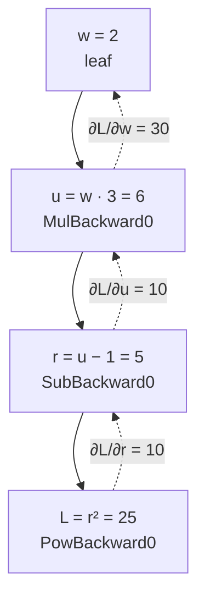
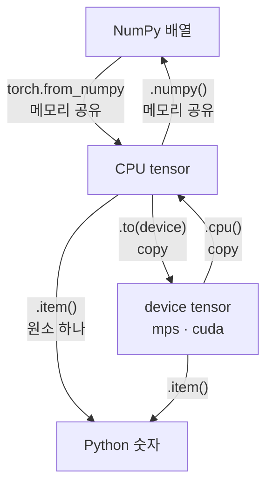

# 2.5 PyTorch로 계산하기: tensor·autograd·GPU

> **수준** L2 · **선수** [2.1 vector·matrix·tensor](02-01-vectors-matrices-tensors.md), [2.2 derivative와 gradient](02-02-derivatives-gradients.md) · **이 장의 질문** 다른 언어를 쓰던 개발자가 알아야 할 Python·NumPy 관례는? tensor 연산과 autograd는 코드로 어떻게 쓰나? 계산을 GPU로 어떻게 옮기나?

## 한눈에

- NumPy 코드는 원소마다 도는 반복문 대신 배열 전체에 연산을 거는 vectorization(벡터화)으로 쓴다. slicing은 원본과 메모리를 공유하는 view(뷰)를 돌려주고, 기본 dtype(데이터 타입)은 NumPy가 float64, PyTorch가 float32다.
- PyTorch의 tensor(텐서)는 2.1장의 숫자 배열에 dtype과 device(장치)가 붙은 것이다. 2.1장의 matrix multiplication(행렬 곱)을 그대로 옮기면 같은 값이 나온다.
- autograd는 forward 계산을 하는 동안 graph를 기록하고, scalar(스칼라)에서 `backward()`를 부르면 그 graph를 거꾸로 따라가 `.grad`에 gradient(기울기)를 넣는다. 2.2장에서 손으로 구한 30과 20이 그대로 나온다. `.grad`는 덮어쓰지 않고 더해진다.
- 계산을 graphics processing unit(GPU, 그래픽 처리 장치)으로 옮기려면 tensor를 `.to(device)`로 명시적으로 옮기고, 함께 계산하는 tensor를 모두 같은 device에 둔다. 시간을 잴 때는 warm-up 뒤 device마다 동기화한다. 이 장에서는 큰 matrix multiplication만 MPS가 CPU보다 빨랐다.

## 1. 프레임워크가 대신하는 세 가지

[1.6장 §4](../part01-big-picture/01-06-industry-stack.md#4-프레임워크-pytorchjaxtensorflow)에서 deep learning framework(딥러닝 프레임워크)가 모델 코드와 칩 사이에서 세 가지를 대신한다고 했다. 숫자 배열 계산, 미분의 자동 계산, 칩을 바꿔 돌리기다. PyTorch는 동적인 tensor 계산을 바로 실행하면서 automatic differentiation(자동 미분)을 함께 제공하고, GPU 가속도 지원한다 [@Paszke2019]. 이 장은 세 가지를 하나씩 직접 돌려 본다.

| 1.6장의 세 가지 | 이 장에서 쓰는 것 | 절 |
|---|---|---|
| 숫자 배열 계산 | `torch.tensor`, dtype, shape 바꾸기, `@`, `sum(dim=…)` | §3 |
| 미분의 자동 계산 | `requires_grad`, `backward()`, `.grad`, `torch.no_grad()` | §4 |
| 칩을 바꿔 돌리기 | `torch.device`, `.to(device)`, `.cpu()`, 동기화 | §5 |

§2는 그 앞에서 NumPy의 관례를 본다. PyTorch의 tensor는 NumPy의 배열과 비슷하고, 다른 점은 GPU나 다른 accelerator(가속기)에서 돌 수 있다는 것이다 [@PyTorch2026]. 그래서 NumPy에서 익힌 관례가 PyTorch에도 대부분 이어진다. §6은 이 장의 코드를 짤 때 자주 만나는 오류를 모은다.

**실행 조건.** 코드 블록은 각각 혼자 돌아간다. 적어 둔 출력은 Python 3.14.6, NumPy 2.5.5, PyTorch 2.11.0을 Apple M5 Pro에서 돌린 결과다. 이 책의 실행 결과는 CPU와 MPS에서 얻었다. MPS는 Mac의 GPU를 쓰는 PyTorch의 device이고, §5에서 본다. NVIDIA GPU에서 돌린 출력과 속도는 이 장에 없다.

## 2. 개발자가 알아야 할 Python·NumPy 관례

Python 문법은 다루지 않는다. 다른 언어의 습관대로 쓰면 느리거나 틀리는 NumPy의 관례 다섯 가지만 본다.

### 2.1 반복문 대신 배열 연산

코드에 명시적인 반복과 인덱싱이 없고, 그 일이 미리 컴파일된 C 코드 안에서 일어나는 것을 vectorization이라 한다 [@NumPy2026]. vectorization이 없으면 코드는 비효율적이고 읽기 어려운 for 반복문으로 가득해진다 [@NumPy2026]. 원소 100만 개짜리 두 배열의 dot product(내적)로 비교한다. dot product는 [2.1장 §4.2](02-01-vectors-matrices-tensors.md#42-dot-product-곱해서-더하기)의 「곱해서 더하기」다.

```python
import time
import numpy as np

rng = np.random.default_rng(0)
x, w = rng.random(1_000_000), rng.random(1_000_000)

def loop_dot(x, w):
    s = 0.0
    for i in range(len(x)):
        s += x[i] * w[i]
    return s

for name, f in [("반복문", loop_dot), ("vectorization", lambda x, w: x @ w)]:
    ts = []
    for _ in range(5):
        t0 = time.perf_counter()
        s = f(x, w)
        ts.append(time.perf_counter() - t0)
    print(f"{name}: 결과 {s:.3f}, 5번의 중앙값 {sorted(ts)[2] * 1000:.1f} ms")
```

```text
반복문: 결과 250031.515, 5번의 중앙값 76.3 ms
vectorization: 결과 250031.515, 5번의 중앙값 0.1 ms
```

두 결과는 출력한 자리까지 같다. 시간은 Apple M5 Pro CPU에서 반복문이 76.3 ms, `x @ w`가 0.1 ms로, 이 실행에서는 반복문이 수백 배 느렸다. 시간은 기계마다 다르다. deep learning(딥러닝) 코드에서 원소 하나씩 도는 Python 반복문이 보이면 배열 연산으로 바꿀 수 있는지 먼저 본다.

### 2.2 slicing은 view를 돌려준다

NumPy의 view는 데이터는 그대로 두고 그 데이터를 읽는 정보(stride·dtype 같은 metadata)만 바꿔, 같은 데이터를 다르게 보는 배열이다 [@NumPy2026]. 그래서 view를 바꾸면 원본도 바뀐다 [@NumPy2026]. copy(복사본)는 데이터까지 복제한 배열이라 바꿔도 원본이 그대로이고, 대신 더 느리고 메모리를 더 쓴다 [@NumPy2026]. slicing 같은 basic indexing은 언제나 view를 만들고 [@NumPy2026], 정수 배열로 고르는 advanced indexing은 언제나 copy를 만든다 [@NumPy2026].

```python
import numpy as np

a = np.arange(6)
v = a[1:4]            # slicing: view
v[0] = 100
print(a)
c = a[[1, 2, 3]]      # 정수 배열로 고르기: copy
c[0] = -1
print(a)
print(np.shares_memory(a, v), np.shares_memory(a, c))
s = a[1:4].copy()     # 원본과 떨어진 배열이 필요하면 copy
s[0] = 0
print(a)
```

```text
[  0 100   2   3   4   5]
[  0 100   2   3   4   5]
True False
[  0 100   2   3   4   5]
```

`v[0] = 100`이 `a[1]`을 바꿨고, `c[0] = -1`과 `s[0] = 0`은 `a`를 바꾸지 않았다. 다른 언어에서 부분 배열을 잘라 내면 새 배열이 생기는 데 익숙하다면 여기서 틀리기 쉽다. 함수가 인자로 받은 배열을 slicing해 고치면 호출한 쪽의 배열도 바뀐다. 원본과 떨어진 배열이 필요하면 `copy()`를 부른다. [2.1장 §5.2](02-01-vectors-matrices-tensors.md#52-reshape와-transpose)의 `reshape`도 가능하면 view를, 아니면 copy를 만든다 [@NumPy2026].

### 2.3 기본 dtype: NumPy는 float64, PyTorch는 float32

dtype은 배열의 원소 하나를 어떤 숫자 형식으로 담는지 정한 것이다. NumPy의 `zeros`·`ones`·`empty`로 만든 배열의 기본 dtype은 float64다 [@NumPy2026]. PyTorch는 시작할 때 기본 부동소수점 dtype이 float32이고, Python float로 만든 tensor는 float32로 해석된다 [@PyTorch2026].

```python
import numpy as np
import torch

print(np.zeros(3).dtype, np.array([1.0, 2.0]).dtype)
print(torch.zeros(3).dtype, torch.tensor([1.0, 2.0]).dtype)
x = np.array([1.0, 2.0])
print(torch.from_numpy(x).dtype)
print(torch.from_numpy(x).float().dtype)
```

```text
float64 float64
torch.float32 torch.float32
torch.float64
torch.float32
```

Python float 리스트로 만든 NumPy 배열도 float64였다. `torch.from_numpy`(§3.4)로 가져온 tensor는 float64를 그대로 가졌고, `.float()`를 부르자 float32가 됐다. PyTorch에서 만든 weight(가중치)는 float32이므로, NumPy에서 온 데이터는 `.float()`로 float32에 맞춘다. 맞추지 않으면 §6의 dtype 오류가 나고, MPS로는 아예 옮겨지지 않는다(§5.3).

### 2.4 난수는 seed를 준 생성기로

`default_rng`는 NumPy의 난수 생성기 `Generator`를 만드는 권장 생성자다 [@NumPy2026]. NumPy의 난수는 결정적 수열이라 seed(시드) 정수를 주면 같은 수가 다시 나온다 [@NumPy2026]. seed를 주지 않으면 `default_rng`는 운영체제의 비결정적 데이터로 seed를 잡아 실행마다 다른 수를 낸다 [@NumPy2026]. 옛 `RandomState`나 `numpy.random`의 함수를 쓰는 코드도 남아 있지만, NumPy는 `Generator`로 옮기기를 권한다 [@NumPy2026].

```python
import numpy as np

rng = np.random.default_rng(0)
print(rng.normal(size=3))
rng = np.random.default_rng(0)       # 같은 seed로 다시 만들면
print(rng.normal(size=3))            # 같은 수열이 나온다
```

```text
[ 0.12573022 -0.13210486  0.64042265]
[ 0.12573022 -0.13210486  0.64042265]
```

이 책의 코드에서 난수를 쓰는 블록은 NumPy에서는 `np.random.default_rng(0)`, PyTorch에서는 `torch.manual_seed(0)`(§5.4)으로 seed를 정한다.

### 2.5 axis와 keepdims

[2.1장 §5.1](02-01-vectors-matrices-tensors.md#51-axis마다-뜻을-붙여-읽기)에서 평균을 낸 axis(축)는 사라진다고 했다. axis $n$을 따라 하는 연산은 axis $n$의 index마다 잘린 조각들을 놓고 계산하는 것처럼 동작한다 [@NumPy2026]. `keepdims=True`를 주면 줄인 axis가 크기 1로 남아, 결과가 입력 배열과 올바르게 broadcasting(브로드캐스팅)된다 [@NumPy2026].

```python
import numpy as np

X = np.arange(6.0).reshape(2, 3)     # (B, D)
print(X.sum(axis=0), X.sum(axis=1))
m = X.mean(axis=1, keepdims=True)    # (B, 1)
print(m.shape)
print(X - m)                         # 행마다 자기 평균을 뺀다
try:
    X - X.mean(axis=1)               # (2, 3) - (2,)
except ValueError as e:
    print(e)
```

```text
[3. 5. 7.] [ 3. 12.]
(2, 1)
[[-1.  0.  1.]
 [-1.  0.  1.]]
operands could not be broadcast together with shapes (2,3) (2,) 
```

`axis=0`으로 더하면 `B` axis가 사라져 `D`개가 남고, `axis=1`로 더하면 `D` axis가 사라져 `B`개가 남는다. `keepdims=True`로 낸 평균은 `(B, 1)`이라, `X - m`이 [2.1장 §5.3](02-01-vectors-matrices-tensors.md#53-broadcasting)의 규칙대로 행마다 자기 평균을 뺀다. `keepdims` 없이 낸 `(2,)`를 빼면 맨 뒤 axis가 3과 2로 맞지 않아 오류가 난다. PyTorch에서는 같은 인자를 `dim`과 `keepdim`이라 부른다(§3.3).

## 3. PyTorch tensor

### 3.1 2.1장의 계산을 tensor로

모든 `torch.Tensor`는 dtype, device, layout을 가진다 [@PyTorch2026]. 이 책에서는 앞의 둘을 쓴다. [2.1장 §4.5](02-01-vectors-matrices-tensors.md#45-matrix-multiplication과-shape-규칙)의 손 계산, [§4.6](02-01-vectors-matrices-tensors.md#46-layer-하나-수식의-mathbfwmathbfx와-코드의-x--wt)의 `X @ W.T`, §4.2의 스팸 점수를 그대로 옮긴다.

```python
import torch

A = torch.tensor([[1, 2, 3], [4, 5, 6]])     # (2, 3)
B = torch.tensor([[1, 0], [0, 1], [1, 1]])   # (3, 2)
print(A @ B)
print((A @ B).shape, A.dtype)
W = B.T                                      # (out, in) = (2, 3)
X = torch.tensor([[1, 2, 3], [0, 1, 0]])     # (B, in)
print(X @ W.T)
w = torch.tensor([2.0, 0.5])
x = torch.tensor([1.0, 3.0])
print(w @ x - 2.0, w * x)
```

```text
tensor([[ 4,  5],
        [10, 11]])
torch.Size([2, 2]) torch.int64
tensor([[4, 5],
        [0, 1]])
tensor(1.5000) tensor([2.0000, 1.5000])
```

2.1장의 NumPy 출력과 같은 `[[4, 5], [10, 11]]`, `[[4, 5], [0, 1]]`, 1.5가 나왔다. `@`는 matrix multiplication, `*`는 element-wise product(원소별 곱)라는 것도 NumPy와 같다. shape는 `torch.Size`로 나오고, 정수로 만든 tensor는 이 실행에서 int64였다. 많은 PyTorch 연산이 NumPy의 broadcasting 규칙을 따른다 [@PyTorch2026]. 두 tensor는 맨 뒤 axis부터 비교해 크기가 같거나, 한쪽이 1이거나, 한쪽에 없으면 broadcasting할 수 있다 [@PyTorch2026]. 2.1장 §5.3의 규칙과 같다.

### 3.2 dtype과 메모리

PyTorch의 dtype 표에서 float32는 32비트, float64는 64비트 IEEE 754 부동소수점이다 [@PyTorch2026]. 16비트 형식은 둘이다. float16은 16비트 IEEE 754 부동소수점이고 부호·지수·가수 비트가 1-5-10이다 [@PyTorch2026]. bfloat16은 Brain floating point라고도 하는 16비트 형식이고 1-8-7이다 [@PyTorch2026].

```python
import torch

x = torch.zeros(1000, 1000)
for dt in [torch.float64, torch.float32, torch.float16, torch.bfloat16]:
    y = x.to(dt)
    print(dt, y.element_size(), y.element_size() * y.numel())
third = torch.tensor(1 / 3, dtype=torch.float64)
for dt in [torch.float32, torch.float16, torch.bfloat16]:
    print(dt, third.to(dt).item())
```

```text
torch.float64 8 8000000
torch.float32 4 4000000
torch.float16 2 2000000
torch.bfloat16 2 2000000
torch.float32 0.3333333432674408
torch.float16 0.333251953125
torch.bfloat16 0.333984375
```

원소 100만 개를 담는 데 float64는 원소마다 8바이트씩 8,000,000바이트, float32는 그 절반, 16비트 두 형식은 다시 그 절반인 2,000,000바이트가 든다. [1.6장 §3](../part01-big-picture/01-06-industry-stack.md#3-반도체-gpu와-accelerator)에서 parameter(파라미터) 130억 개를 16비트로 담으면 약 26GB라고 한 계산이 이 2바이트에서 나온다. 같은 1/3도 dtype에 따라 담기는 값이 다르다. 이 예에서는 가수 비트가 7개인 bfloat16이 10개인 float16보다 1/3에서 더 멀었다.

지수 비트와 가수 비트가 각각 무엇을 정하는지는 `torch.finfo`로 본다. `max`는 그 dtype이 나타낼 수 있는 가장 큰 수, `eps`는 1.0과 1.0보다 큰 바로 다음 수의 차이다 [@PyTorch2026].

```python
import torch

for dt in [torch.float32, torch.float16, torch.bfloat16]:
    fi = torch.finfo(dt)
    print(dt, fi.max, fi.eps, torch.tensor(70000.0).to(dt).item())
```

```text
torch.float32 3.4028234663852886e+38 1.1920928955078125e-07 70000.0
torch.float16 65504.0 0.0009765625 inf
torch.bfloat16 3.3895313892515355e+38 0.0078125 70144.0
```

지수 비트가 8개인 bfloat16은 가장 큰 수가 float32와 거의 같은 약 $3.4 \times 10^{38}$이고, 지수 비트가 5개인 float16은 65504다. 그래서 70000을 float16에 담으면 [2.3장 §8.3](02-03-probability-statistics.md#83-overflow를-피하는-계산)의 overflow(오버플로)로 `inf`가 된다. 지수 비트는 나타낼 수 있는 크기의 범위를, 가수 비트는 그 범위 안의 자릿수를 정한다. bfloat16은 가장 큰 수가 float32와 거의 같지만, 가수 비트가 7개라 `eps`가 0.0078로 float16의 0.00098보다 크다. `eps`가 크면 이웃한 두 수의 간격이 그만큼 넓다. 앞에서 bfloat16이 1/3에서 더 멀었던 것도 이 때문이다. 간격은 수가 2배 커질 때마다 2배로 넓어진다. 70000이 놓인 $2^{16}$(65536)과 $2^{17}$ 사이에서 bfloat16의 간격은 $2^{16} \times 2^{-7} = 512$이고, 70000에 가장 가까운 512의 배수는 $137 \times 512 = 70144$다. 그래서 70000이 70144로 담겼다. 학습에서 어느 dtype을 언제 쓰는지는 4.8장에서 본다.

### 3.3 shape 바꾸기와 합치기

shape를 바꾸는 함수는 데이터를 공유하는 view를 돌려주는지가 서로 다르다.

| 함수 | 하는 일 | 데이터 |
|---|---|---|
| `view(shape)` | 원소 수가 같은 다른 shape로 본다 | 공유. 원래 size·stride와 맞지 않으면 실패한다 [@PyTorch2026] |
| `reshape(shape)` | 원소 수가 같은 다른 shape. 한 axis를 `-1`로 두면 나머지에서 추론한다 | 가능하면 view, 아니면 copy [@PyTorch2026] |
| `permute(dims)` | axis 순서를 바꾼다. NumPy의 `transpose`와 같은 일이다 | view [@PyTorch2026] |
| `unsqueeze(dim)` | 그 위치에 크기 1인 axis를 끼운다 | 공유 [@PyTorch2026] |
| `torch.cat(tensors, dim)` | 있는 axis를 따라 잇는다. 잇는 axis 말고는 shape가 같아야 한다 [@PyTorch2026] | — |
| `torch.stack(tensors, dim)` | 새 axis를 만들어 잇는다. 모든 tensor의 size가 같아야 한다 [@PyTorch2026] | — |
| `sum(dim, keepdim)` | `dim`을 따라 합한다. `keepdim=True`면 그 axis가 크기 1로 남는다 [@PyTorch2026] | — |

```python
import torch

x = torch.arange(24).reshape(2, 3, 4)        # (B, T, D)
print(x.view(6, 4).shape, x.reshape(2, -1).shape)
p = x.permute(0, 2, 1)                       # (B, D, T)
print(p.shape, x.stride(), p.stride())
try:
    p.view(2, 12)
except RuntimeError as e:
    print(str(e).split(".")[0])
print(p.reshape(2, 12).shape)
print(x[0].unsqueeze(0).shape)               # 맨 앞에 크기 1인 axis
a, b = torch.ones(2, 3), torch.zeros(2, 3)
print(torch.cat([a, b]).shape, torch.stack([a, b]).shape)
print(x.sum(dim=1).shape, x.sum(dim=1, keepdim=True).shape)
```

```text
torch.Size([6, 4]) torch.Size([2, 12])
torch.Size([2, 4, 3]) (12, 4, 1) (12, 1, 4)
view size is not compatible with input tensor's size and stride (at least one dimension spans across two contiguous subspaces)
torch.Size([2, 12])
torch.Size([1, 3, 4])
torch.Size([4, 3]) torch.Size([2, 2, 3])
torch.Size([2, 4]) torch.Size([2, 1, 4])
```

`permute`로 axis 순서를 바꾼 `p`는 `view`로 펼칠 수 없었고, `reshape`는 됐다. 까닭은 stride에 있다. 메모리는 한 줄로 늘어선 주소이고, stride는 index를 메모리 주소로 옮기는 방법이다. axis $n$의 index를 하나 늘리면 주소가 stride의 $n$번째 값만큼 움직인다 [@NumPy2026]. NumPy는 이 값을 바이트로 세고, PyTorch의 `stride()`는 원소 개수로 센다. 위 출력에서 `x`의 stride `(12, 4, 1)`은 `T` axis로 한 칸 가면 4원소, `D` axis로 한 칸 가면 1원소를 건너뛴다는 뜻이다. `permute`는 데이터를 옮기지 않고 stride만 바꿔서, `p`의 stride는 `(12, 1, 4)`가 됐다. `view`는 데이터를 그대로 두고 shape와 stride만 새로 정한다. 그래서 여러 axis를 하나로 합치려면 합칠 axis마다 stride[i] = stride[i+1] × size[i+1]이 성립해야 한다 [@PyTorch2026]. `x.view(6, 4)`는 앞 두 axis를 합치는데 12 = 4 × 3이라 됐다. `p.view(2, 12)`는 뒤 두 axis를 합치는데 1 ≠ 4 × 3이라 실패했다. 이때 `reshape`는 데이터를 새 순서로 복사한 copy를 돌려준다 [@PyTorch2026]. view가 가능한지 분명하지 않으면 `reshape`를 쓰라고 문서가 권한다 [@PyTorch2026]. 다만 `reshape`가 copy를 돌려줄지 view를 돌려줄지에 의존하는 코드는 쓰지 말라고 한다 [@PyTorch2026]. `cat`은 있는 axis를 늘려 `(4, 3)`을, `stack`은 맨 앞에 새 axis를 만들어 `(2, 2, 3)`을 냈다. `sum(dim=1)`은 `T` axis를 없애 `(B, D)`를 남긴다.

### 3.4 NumPy와 오가기

`torch.from_numpy`가 돌려준 tensor와 원래 ndarray는 같은 메모리를 공유해서, 한쪽을 바꾸면 다른 쪽에 보인다 [@PyTorch2026]. 거꾸로 `Tensor.numpy()`는 기본값에서 tensor가 CPU에 있고 gradient가 필요 없을 때만 바꿔 주며, 돌려준 ndarray는 tensor와 storage를 공유한다 [@PyTorch2026].

```python
import numpy as np
import torch

a = np.array([1.0, 2.0, 3.0])
t = torch.from_numpy(a)        # a와 메모리를 공유한다
u = torch.tensor(a)
a[0] = 100.0
print(t)
print(u)
t.mul_(2)                      # 이름이 _로 끝나면 in-place
print(a)
```

```text
tensor([100.,   2.,   3.], dtype=torch.float64)
tensor([1., 2., 3.], dtype=torch.float64)
[200.   4.   6.]
```

`a[0]`을 바꾸자 `t`도 100이 됐고, `t.mul_(2)`는 `a`를 두 배로 만들었다. `torch.tensor(a)`로 만든 `u`는 이 실행에서 바뀌지 않았다. `mul_`처럼 이름이 `_`로 끝나는 연산은 결과를 피연산자 자신에 저장하는 in-place 연산이다 [@PyTorch2026]. 메모리를 조금 아끼지만, §4에서 볼 autograd의 계산 기록(history)을 잃어 미분 계산에서 문제가 될 수 있어 권하지 않는다 [@PyTorch2026]. 그 오류는 §6에서 본다.

> **주의** NumPy 배열과 tensor가 메모리를 공유하면, 한쪽을 고친 코드가 다른 쪽 값을 오류 없이 바꾼다. 원본을 지켜야 하면 NumPy에서 `a.copy()`로 떼어 낸 뒤 가져온다.

## 4. autograd

### 4.1 2.2장의 손 계산을 backward()로

autograd는 PyTorch의 automatic differentiation이다. autograd는 연산을 실행하는 동안 데이터를 만든 연산을 모두 graph에 기록한다 [@PyTorch2026]. 이 graph에서 leaf는 입력 tensor, root는 출력 tensor다 [@PyTorch2026]. root에서 leaf로 graph를 따라가며 chain rule(연쇄 법칙)로 gradient를 자동으로 계산한다 [@PyTorch2026]. [2.2장 §4.2](02-02-derivatives-gradients.md#42-computational-graph-앞으로-값-뒤로-derivative)에서 손으로 그린 computational graph(계산 그래프)를 PyTorch가 계산하면서 대신 그려 두는 셈이다.

무엇을 기록할지는 `requires_grad`로 정한다. 이 flag의 기본값은 False이고, 입력 중 하나라도 gradient를 요구해야 연산이 backward graph에 기록된다 [@PyTorch2026]. backward에서는 `requires_grad=True`인 leaf tensor의 `.grad`에만 gradient가 쌓인다 [@PyTorch2026].

[2.2장 §1](02-02-derivatives-gradients.md#1-weight를-고칠-방향이-필요하다)의 loss(손실) $L = (wx - y)^2$을 $x = 3$, $y = 1$, $w = 2$로 계산한다.

```python
import torch

x, y = 3.0, 1.0
w = torch.tensor(2.0, requires_grad=True)
L = (w * x - y) ** 2                   # 2.2장 §1의 loss
L.backward()
print(L.item(), w.grad)                # 손 계산 25와 30
f = lambda w: (w * x - y) ** 2
h = 1e-5
print((f(2.0 + h) - f(2.0 - h)) / (2 * h))   # centered difference
w1 = torch.tensor(2.0, requires_grad=True)
w2 = torch.tensor(3.0, requires_grad=True)
L2 = (w2 * (w1 * 1.0) - 1.0) ** 2      # 2.2장 §4.2, x = 1, y = 1
L2.backward()
print(w1.grad, w2.grad)                # 손 계산 30과 20
```

```text
25.0 tensor(30.)
30.000000000640622
tensor(30.) tensor(20.)
```

`w.grad`는 2.2장에서 식을 전개해 구한 $L'(2) = 30$과 같다. 같은 loss를 Python 함수로 두고 [2.2장 §5.1](02-02-derivatives-gradients.md#51-정의로-돌아가-어림하기)의 centered difference로 어림하면 30.000000000640622로, 근사라서 끝자리에 작은 오차가 있다. 뒤의 두 줄은 2.2장 §4.2의 weight 두 개짜리 계산이고, 그림의 점선을 따라 손으로 구한 $\frac{\partial L}{\partial w_1} = 30$, $\frac{\partial L}{\partial w_2} = 20$이 그대로 나왔다. `backward()`는 graph의 leaf에 대한 현재 tensor의 gradient를 chain rule로 계산한다 [@PyTorch2026].

### 4.2 forward에서 쌓고 backward에서 거꾸로

forward pass(순전파) 동안 autograd는 계산을 하면서 gradient를 계산할 함수의 graph를 함께 쌓고, 출력 tensor의 `.grad_fn`이 그 graph의 입구다 [@PyTorch2026]. forward가 끝나면 backward pass에서 이 graph를 평가해 gradient를 낸다 [@PyTorch2026]. 위의 loss를 [2.2장 §4.1](02-02-derivatives-gradients.md#41-이어-붙인-함수의-derivative는-곱이다)처럼 세 단계로 쪼개고, `L.grad_fn`에서 `w` 쪽으로 따라가 본다.

```python
import torch

w = torch.tensor(2.0, requires_grad=True)
u = w * 3.0
r = u - 1.0
L = r ** 2
node = L.grad_fn
while node is not None:                # L에서 w 쪽으로 graph를 따라간다
    print(type(node).__name__)
    nxt = [n for n, _ in node.next_functions if n is not None]
    node = nxt[0] if nxt else None
print(w.is_leaf, u.is_leaf, w.grad_fn)
```

```text
PowBackward0
SubBackward0
MulBackward0
AccumulateGrad
True False None
```

`L = r ** 2`, `r = u - 1`, `u = w * 3`을 거꾸로 만나 `PowBackward0`, `SubBackward0`, `MulBackward0`이 차례로 나오고, 마지막 `AccumulateGrad`에서 `w`에 닿는다. `w`는 직접 만든 leaf라 `grad_fn`이 없고, `u`는 연산의 결과라 leaf가 아니다.



그림: 실선은 forward에서 값을 계산하며 graph를 기록하는 방향이고, 점선은 `L.backward()`가 그 graph를 거꾸로 따라 단계마다의 derivative(도함수)를 곱해 내려오는 방향이다. 상자 아래 이름은 그 결과의 `grad_fn`이고, 끝에서 `w.grad`가 30이 된다.

forward를 실행할 때마다 graph를 처음부터 새로 만들므로, Python의 `if`·`for` 같은 제어 흐름을 그대로 써도 된다 [@PyTorch2026]. 가능한 실행 경로를 미리 모두 정해 둘 필요 없이, 이번 실행에서 실제로 실행된 연산만 graph에 기록되어 미분된다 [@PyTorch2026]. `backward()`를 부른 뒤 autograd는 새 graph를 처음부터 채운다 [@PyTorch2026]. PyTorch 논문은 이것을 함수가 실행될 때마다 계산한 함수의 표현을 새로 쌓는 방식이라고 설명한다 [@Paszke2019]. backpropagation(역전파)이 graph를 어떤 순서로 돌아 계산을 줄이는지는 4.3장에서 본다.

### 4.3 backward()는 scalar에서 시작한다

`backward()`를 부르는 tensor가 scalar면 인자를 생략할 수 있고, 원소가 둘 이상이면 gradient 인자를 따로 줘야 한다 [@PyTorch2026]. 학습의 loss는 scalar 하나라서 `loss.backward()`면 된다. scalar 하나에서 거꾸로 내려오며 여러 입력의 gradient를 함께 얻는 원리와, 끝이 vector(벡터)인 경우의 Jacobian(야코비 행렬) 곱은 [2.2장 §6](02-02-derivatives-gradients.md#6-심화-vector를-내는-함수와-jacobian)에서 봤다. 여기서는 쓰는 법만 본다.

```python
import torch

w = torch.tensor([2.0, 0.5], requires_grad=True)
x = torch.tensor([1.0, 3.0])
s = w @ x - 2.0                        # 2.2장 §3.4의 스팸 점수
s.backward()
print(s.item(), w.grad, w.grad.shape)
v = torch.tensor([1.0, 2.0], requires_grad=True)
y = torch.stack([v[0] ** 2, v[0] * v[1]])   # 2.2장 §6의 f, 점 (1, 2)
y.backward(torch.tensor([1.0, 3.0]))   # z = y1 + 3·y2에서 온 [1, 3]
print(v.grad)                          # 손 계산 [8, 3]
W = torch.ones(3, 2, requires_grad=True)   # (out, in) = (3, 2)인 weight
(W @ x).sum().backward()
print(W.grad.shape)
```

```text
1.5 tensor([1., 3.]) torch.Size([2])
tensor([8., 3.])
torch.Size([3, 2])
```

첫 줄은 [2.2장 §3.4](02-02-derivatives-gradients.md#34-스팸-점수의-gradient)의 스팸 점수다. gradient가 $\mathbf{x} = [1, 3]$이고, shape는 `w`와 같은 `(2,)`다. 둘째 줄은 2.2장 §6의 $\mathbf{f}(x_1, x_2) = [x_1^2, x_1x_2]$다. 출력이 vector라서 $z = y_1 + 3y_2$의 $\nabla_{\mathbf{y}} z = [1, 3]$을 `backward()`에 넘겼고, 손으로 구한 $\mathbf{J}^\top[1, 3] = [8, 3]$이 나왔다. 셋째 줄은 (out, in) = (3, 2)인 weight `W`의 gradient의 shape다. [2.2장 §3.2](02-02-derivatives-gradients.md#32-gradient-partial-derivative를-모은-vector)대로 `W`와 같은 `(3, 2)`다.

### 4.4 .grad는 더해진다

`.grad`의 기본값은 None이다 [@PyTorch2026]. `backward()`가 처음 gradient를 계산할 때 tensor가 되고, 그 뒤의 `backward()`는 그 안에 gradient를 더한다 [@PyTorch2026]. 그래서 `backward()`를 부르기 전에 `.grad`를 0으로 만들거나 None으로 둬야 할 수 있다 [@PyTorch2026].

```python
import torch

w = torch.tensor(2.0, requires_grad=True)
for i in range(2):
    L = (w * 3.0 - 1.0) ** 2           # forward를 다시 계산해 graph를 새로 만든다
    L.backward()
    print(i, w.grad)
w.grad = None                          # 다음 계산 전에 비운다
L = (w * 3.0 - 1.0) ** 2
L.backward()
print(w.grad)
```

```text
0 tensor(30.)
1 tensor(60.)
tensor(30.)
```

`backward()`를 두 번 부르자 `w.grad`는 30이 아니라 60이 됐다. `w.grad = None`으로 비운 뒤에는 다시 30이다. 반복마다 forward를 다시 계산한 것은, 기본값에서는 gradient 계산에 쓴 graph가 `backward()` 뒤에 해제되기 때문이다 [@PyTorch2026]. 같은 graph에서 `backward()`를 두 번 부르면 §6의 오류가 난다.

학습 코드에서는 `.grad`를 비우는 일을 optimizer(옵티마이저)가 맡는다. optimizer는 `backward()`가 구한 gradient로 parameter를 고치는(update) 객체이고, 고칠 parameter의 gradient를 비우는 `zero_grad()`도 가진다 [@PyTorch2026]. `zero_grad()`는 기본값에서 gradient를 0 대신 None으로 둔다 [@PyTorch2026]. optimizer는 4.5장에서, 학습 루프는 3.1장·3.2장·4.11장에서 본다. 이 누적을 일부러 이용하는 기법이 4.8장의 gradient accumulation이다.

### 4.5 gradient가 필요 없을 때: no_grad와 detach

[1.3장 §3](../part01-big-picture/01-03-model-lifecycle.md#3-학습과-inference)에서 inference(추론)는 forward pass만 한다고 했다. `torch.no_grad()`는 gradient 계산을 끄는 context manager로, `backward()`를 부르지 않을 inference에 쓸모 있고 메모리 사용을 줄인다 [@PyTorch2026]. 이 안에서는 입력이 `requires_grad=True`여도 모든 계산 결과가 `requires_grad=False`다 [@PyTorch2026]. no-grad 모드의 계산은 backward graph에 기록되지 않아서, optimizer가 parameter를 in-place로 고칠 때도 이 모드를 쓴다 [@PyTorch2026]. `detach()`는 현재 graph에서 떨어진 새 tensor를 돌려준다. 결과는 gradient를 요구하지 않고 원본과 storage를 공유한다 [@PyTorch2026].

```python
import torch

w = torch.tensor(2.0, requires_grad=True)
with torch.no_grad():
    p = w * 3.0                        # graph를 만들지 않는다
print(p.requires_grad, p.grad_fn)
q = w * 3.0
print(q.requires_grad, type(q.grad_fn).__name__)
d = q.detach()                         # graph에서 떼어 낸 tensor
print(d.requires_grad, d.data_ptr() == q.data_ptr())
```

```text
False None
True MulBackward0
False True
```

`no_grad` 안에서 만든 `p`는 `grad_fn`이 없다. 밖에서 만든 `q`는 `MulBackward0`을 달고 있고, `q.detach()`는 같은 메모리를 가리키지만 gradient를 요구하지 않는다. `no_grad`는 그 안의 계산 전체를, `detach`는 tensor 하나를 graph 밖으로 뺀다.

> **핵심** autograd는 forward 계산을 하는 동안 graph를 기록하고, `backward()`는 그 graph를 거꾸로 따라 `requires_grad=True`인 leaf의 `.grad`에 gradient를 더한다.

## 5. 계산을 GPU로 옮기기

### 5.1 device를 고르고 옮기기

`torch.device`는 tensor가 할당되었거나 할당될 device를 나타낸다 [@PyTorch2026]. device 종류는 주로 `cpu`나 `cuda`이고, `mps`·`xpu`·`xla`·`meta`일 수도 있다 [@PyTorch2026]. `cuda`는 [1.6장 §4](../part01-big-picture/01-06-industry-stack.md#4-프레임워크-pytorchjaxtensorflow)에서 본 CUDA로 돌리는 NVIDIA GPU다. `mps` device는 Metal을 쓰는 macOS 기기의 GPU에서 계산하게 해 준다 [@PyTorch2026]. 이 책의 실행 device가 MPS다.

tensor는 기본으로 CPU에 만들어진다 [@PyTorch2026]. accelerator를 쓸 수 있는지 확인한 뒤 `.to`로 명시적으로 옮겨야 한다 [@PyTorch2026]. PyTorch 공식 튜토리얼은 `torch.accelerator.is_available()`로 확인하고 `torch.accelerator.current_accelerator()`로 옮길 곳을 정한다 [@PyTorch2026]. 이 책도 이 방식을 쓴다.

```python
import torch

if torch.accelerator.is_available():
    device = torch.accelerator.current_accelerator()
else:
    device = torch.device("cpu")
print(device)
A = torch.tensor([[1.0, 2.0, 3.0], [4.0, 5.0, 6.0]])
B = torch.tensor([[1.0, 0.0], [0.0, 1.0], [1.0, 1.0]])
print(A.device)
C = A.to(device) @ B.to(device)        # 두 tensor를 모두 같은 device로
print(C.device)
print(C.cpu())
print(C.sum().item())
```

```text
mps
cpu
mps:0
tensor([[ 4.,  5.],
        [10., 11.]])
30.0
```

`is_available()`은 현재 accelerator를 실행 시점에 쓸 수 있는지, 즉 빌드됐고 드라이버가 있고 device가 하나 이상 보이는지 확인한다 [@PyTorch2026]. device마다 있는 `is_available`에 확인을 맡기는 방식이다 [@PyTorch2026]. `current_accelerator()`는 PyTorch를 컴파일할 때 있던 accelerator를 돌려주고, 없으면 None이다 [@PyTorch2026]. 기본값에서는 실행 시점 확인을 하지 않으므로 [@PyTorch2026], `is_available()`을 먼저 묻는다. 뒤의 블록은 같은 일을 `current_accelerator(check_available=True) or torch.device("cpu")` 한 줄로 쓴다. `check_available=True`면 실행 시점 확인도 더한다 [@PyTorch2026].

`.to`는 dtype·device를 바꾼다. 이미 맞는 dtype·device면 자기 자신을, 아니면 원하는 dtype·device의 copy를 돌려준다 [@PyTorch2026]. 그래서 `A.to(device)` 뒤에도 `A`는 CPU에 그대로 있고, 옮긴 tensor는 새 이름으로 받는다. CUDA semantics 문서는 연산 결과가 언제나 입력 tensor와 같은 device에 놓인다고 쓰고 [@PyTorch2026], 위 실행에서도 `C`는 `mps:0`에 놓였다. `C.cpu()`로 가져온 값은 2.1장과 같은 `[[4, 5], [10, 11]]`이다. `torch.device`는 device 종류와 device 번호(device ordinal)로 정할 수 있고, `mps:0`의 `0`이 그 번호다 [@PyTorch2026]. 같은 종류의 device가 여러 개일 때 몇 번째인지를 가리키며, `print(device)`의 `mps`처럼 번호가 없으면 그 종류의 현재 device를 뜻한다 [@PyTorch2026].

결과를 다시 쓰려면 `.cpu()`로 CPU 메모리에 있는 copy를 받는다 [@PyTorch2026]. 이미 CPU에 있으면 복사 없이 원래 객체를 돌려준다 [@PyTorch2026]. 원소가 하나인 tensor는 `.item()`으로 Python 숫자를 받고, 이 값은 미분되지 않는다 [@PyTorch2026]. 큰 tensor를 device 사이로 복사하는 데는 시간과 메모리가 든다 [@PyTorch2026]. 그래서 데이터와 weight를 한 번 옮겨 두고, 계산 도중에는 오가지 않게 짠다.



그림: tensor가 오가는 길. `torch.from_numpy`와 `.numpy()`로 오가면 NumPy 배열과 CPU tensor가 메모리를 공유하고, CPU와 accelerator 사이를 오갈 때는 copy가 생긴다. 계산은 같은 device에 있는 tensor끼리 한다.

### 5.2 모든 tensor가 같은 device에

tensor는 device 사이를 자동으로 옮겨지지 않으므로, 사용자가 명시적으로 옮겨야 한다 [@PyTorch2026]. 그래서 CPU tensor와 MPS tensor를 섞어 계산하면 오류가 난다.

```python
import torch

device = torch.accelerator.current_accelerator(check_available=True) or torch.device("cpu")
a = torch.ones(2)                      # CPU, 원소 2개
b = torch.ones(2, device=device)
try:
    print((a + b).device)
except RuntimeError as e:
    print(e)
s = torch.tensor(5.0)                  # CPU, axis 0개
print((s + b).device)
```

```text
Expected all tensors to be on the same device, but found at least two devices, mps:0 and cpu!
mps:0
```

원소가 2개인 CPU tensor `a`와 MPS tensor `b`를 더하자 「Expected all tensors to be on the same device」 오류가 났다. 반면 axis가 0개인 CPU tensor `s`(scalar tensor, `s.dim()`이 0)는 `b`와 더해졌다. `tensor.dim()`이 0인 scalar tensor는 이 규칙의 유일한 예외로, 필요하면 CPU에서 GPU로 자동으로 옮겨진다 [@PyTorch2026]. 문서의 예는 CUDA이고, MPS에서도 같다는 것은 위 실행으로 확인했다. 거꾸로 GPU의 scalar tensor는 CPU로 옮겨지지 않아, GPU의 scalar와 CPU의 scalar가 아닌 tensor를 섞으면 실패한다 [@PyTorch2026]. accelerator가 없는 기계에서는 `device`가 CPU라서 두 줄 모두 `cpu`를 출력한다.

### 5.3 MPS와 float64

```python
import numpy as np
import torch

x = torch.from_numpy(np.array([1.0, 2.0]))   # float64
print(x.dtype)
try:
    x.to("mps")
except TypeError as e:
    print(e)
y = x.to(torch.float32).to("mps")            # float32로 바꾼 뒤 옮긴다
print(y.dtype, y.device)
```

```text
torch.float64
Cannot convert a MPS Tensor to float64 dtype as the MPS framework doesn't support float64. Please use float32 instead.
torch.float32 mps:0
```

이 블록은 MPS가 있는 Mac에서만 돈다. float64 tensor를 MPS로 옮기자 「MPS framework doesn't support float64」라는 TypeError가 났다. Metal Shading Language에는 double 형이 없어서 MPS는 float64를 지원하지 않는다 [@PyTorch2026]. float64 tensor를 옮기면 float32로 자동 변환하지 않고 TypeError를 낸다 [@PyTorch2026]. §2.3대로 NumPy 배열은 기본이 float64라서, MPS로 옮기기 전에 float32로 바꾼다. double 정밀도가 꼭 필요한 계산은 CPU에서 돌린다 [@PyTorch2026].

### 5.4 CPU와 MPS의 결과는 같은가

같은 seed로 만든 matrix(행렬)를 CPU와 MPS에서 곱하고, 원소마다의 차이에서 최댓값을 본다. 원소 100만 개의 합도 두 device에서 구한다.

```python
import torch

device = torch.accelerator.current_accelerator(check_available=True) or torch.device("cpu")
torch.manual_seed(0)
for n in [64, 4096]:
    A, B = torch.randn(n, n), torch.randn(n, n)
    C_cpu = A @ B
    C_dev = (A.to(device) @ B.to(device)).cpu()
    print(n, device, (C_cpu - C_dev).abs().max().item())
x = torch.randn(1_000_000)
print("sum", x.sum().item(), x.to(device).sum().item())
```

```text
64 mps 0.0
4096 mps 0.0
sum 1263.8861083984375 1263.885986328125
```

이 실행에서 64×64와 4096×4096 float32 matrix multiplication은 두 device의 결과가 원소마다 같아 최대 차이가 0.0이었다. 원소 100만 개의 합은 CPU가 1263.8861083984375, MPS가 1263.885986328125로 소수점 셋째 자리부터 달랐다. PyTorch 문서의 「Numerical accuracy(수치 정확도)」 노트에 따르면 부동소수점 덧셈과 곱셈은 결합법칙이 성립하지 않아서 연산 순서가 결과를 바꾼다 [@PyTorch2026]. 그래서 PyTorch는 수학적으로 같은 계산이라도 비트 단위로 같은 결과를 보장하지 않는다 [@PyTorch2026].

PyTorch 문서도 완전한 재현성은 PyTorch 버전·commit·플랫폼 사이에 보장되지 않고, 같은 seed라도 CPU와 GPU의 실행 결과가 다를 수 있다고 쓴다 [@PyTorch2026]. 재현성을 위해 할 수 있는 일은 두 가지다. 무작위성의 원천을 통제하는 것과, 일부 연산에서 비결정적 알고리즘을 피하게 설정하는 것이다 [@PyTorch2026]. `torch.manual_seed()`는 모든 device(CPU와 CUDA)의 난수 생성기 seed를 정한다 [@PyTorch2026]. NumPy 난수를 함께 쓰면 NumPy 쪽도 따로 seed를 정해야 한다 [@PyTorch2026]. `torch.use_deterministic_algorithms()`는 가능한 곳에서 결정적 알고리즘을 쓰게 하고, 결정적 대안이 없는 비결정적 연산을 만나면 오류를 낸다 [@PyTorch2026]. 결정적 연산은 대개 비결정적 연산보다 느리다 [@PyTorch2026]. 실험을 재현하는 관리는 12.2장에서 본다.

### 5.5 시간 재기: warm-up과 동기화

CUDA semantics 문서에 따르면 GPU 연산은 기본으로 비동기다. GPU를 쓰는 함수를 부르면 연산이 device의 대기열에 들어갈 뿐, 실제로는 나중에 실행될 수 있다 [@PyTorch2026]. GPU에서 실행되는 연산 하나하나를 kernel이라 부른다. stream은 한 device에 속한 실행 대기열이고, 한 stream 안의 연산은 만들어진 순서대로 실행된다 [@PyTorch2026]. device는 대기열 순서대로 실행하고, CPU와 GPU 사이 복사 때는 PyTorch가 필요한 동기화를 자동으로 하므로 이 비동기는 대개 보이지 않는다 [@PyTorch2026]. PyTorch 논문도 CUDA stream으로 kernel 호출을 GPU 대기열에 넣어, CPU의 Python 실행과 GPU 연산이 겹치게 설계했다고 설명한다 [@Paszke2019].

시간을 잴 때는 이 비동기가 드러난다. 함수가 연산을 대기열에 넣고 바로 돌아오므로, 동기화하지 않으면 연산이 끝나기 전에 시계를 멈춰 실제보다 짧은 시간을 잴 수 있다. 동기화 없이 잰 시간은 정확하지 않아서, CUDA에서는 `torch.cuda.synchronize()`를 먼저 부르거나 `torch.cuda.Event`로 잰다 [@PyTorch2026]. MPS에는 MPS device의 모든 stream의 kernel이 끝날 때까지 기다리는 `torch.mps.synchronize()`가 있다 [@PyTorch2026]. device를 가리지 않는 `torch.accelerator.synchronize()`는 주어진 device의 모든 stream에 있는 kernel이 끝날 때까지 기다린다 [@PyTorch2026]. device를 주지 않으면 현재 device를 쓴다 [@PyTorch2026].

[`matmul_timing.py`](../code/part02/02-05-pytorch-basics/matmul_timing.py)는 n×n float32 matrix 두 개의 곱을 CPU와 accelerator에서 잰다. device마다 스무 번 먼저 돌린 뒤(warm-up), 한 번 곱할 때마다 동기화하고 시계를 멈추며, 여러 번 잰 값의 중앙값을 낸다. warm-up을 두는 까닭은 처음 몇 번의 호출이 그 뒤의 호출과 다르게 동작하기 때문이다. PyTorch 논문은 CUDA GPU에서 ResNet-50 학습 한 반복을 추적해, 첫 반복의 동작이 그 뒤 반복과 크게 다르다고 보고한다. 처음에는 CUDA의 메모리 할당·해제 함수 호출이 실행을 크게 늦추고, PyTorch가 할당해 둔 메모리를 다시 쓰기 시작하면 이 효과가 사라진다 [@Paszke2019]. 이 기계에서도 1024×1024 곱을 새 프로세스에서 호출마다 재 보니(세 번 실행), MPS의 첫 호출은 31~37 ms였다. 2~11번째 호출의 중앙값은 1.3~1.7 ms였고, 대개 열몇 번째 호출부터 약 0.5 ms로 내려갔다(12~40번째 중앙값 0.47~0.52 ms). 첫 호출이 안정된 뒤보다 수십 배 길고, 첫 호출 뒤에도 한동안 느리다. 스크립트가 warm-up을 스무 번 두는 것은 이 느린 구간을 지나서 재기 위해서다. 동기화는 CPU가 아닐 때만 `torch.accelerator.synchronize()`를 불러서, CUDA GPU에서 돌려도 동기화를 건너뛰지 않는다. 핵심은 다음 두 함수다.

```python
def sync(device):
    """CPU가 아니면 그 장치에 넣은 계산이 다 끝날 때까지 기다린다."""
    if device.type != "cpu":
        torch.accelerator.synchronize()


def median_ms(A, B, device, reps):
    for _ in range(WARMUP):            # 먼저 몇 번 돌린 뒤에 잰다
        A @ B
    sync(device)
    times = []
    for _ in range(reps):
        t0 = time.perf_counter()
        A @ B
        sync(device)                   # 계산이 끝난 뒤에 시계를 멈춘다
        times.append(time.perf_counter() - t0)
    return statistics.median(times) * 1000
```

한 번 실행한 결과는 다음과 같다. Apple M5 Pro, PyTorch 2.11.0, CPU thread 6개, float32, warm-up 20번, 반복은 n이 64·256일 때 50번, 1024일 때 20번, 4096일 때 10번이고, 값은 반복의 중앙값이다.

| n | CPU (ms) | MPS (ms) | CPU 시간 ÷ MPS 시간 |
|---|---|---|---|
| 64 | 0.001 | 0.225 | 0.01 |
| 256 | 0.022 | 0.194 | 0.12 |
| 1024 | 1.236 | 0.476 | 2.60 |
| 4096 | 84.688 | 18.857 | 4.49 |

같은 스크립트를 열한 번 돌린 기록에서는 64·256에서 매번 CPU가 빨랐고, 1024에서는 MPS가 1.98~2.85배, 4096에서는 4.33~5.38배 빨랐다. 이 범위는 그 열한 번의 값이고, 다시 돌리면 범위 밖의 배율도 나온다. 재현해 볼 기준은 배율이 아니라 작은 n에서는 CPU가, 큰 n에서는 MPS가 빠르다는 결론이다. 1024의 MPS 시간은 대개 0.46~0.51 ms였지만 한 번은 0.652 ms였고, 4096의 CPU 시간은 81.7~101.0 ms 사이에서 달라졌다. 표의 MPS 열은 n이 64에서 256으로 커져도 0.225 ms와 0.194 ms로 거의 같았다. 작은 계산을 GPU로 옮긴다고 빨라지지는 않는다. 옮길지는 실제 크기에서 재어 보고 정한다. 시간은 기계와 그때의 부하에 따라 다르다.

accelerator가 없는 기계에서는 스크립트가 「accelerator를 쓰지 않는다(없거나 --cpu-only): CPU만 잰다」를 출력하고 CPU 열만 낸다. `--cpu-only`를 붙이면 accelerator가 있어도 이 경로로 돈다.

## 6. 자주 나는 오류와 읽는 법

오류 메시지의 첫 문장이 무엇이 맞지 않는지 말한다. 다음 블록은 이 장에서 본 실수 다섯 가지를 일부러 내고, 메시지의 첫 문장만 출력한다.

```python
import torch

def show(f):
    try:
        f()
    except (RuntimeError, TypeError) as e:
        print(type(e).__name__ + ":", str(e).split(". ")[0])

A = torch.ones(2, 3)
show(lambda: A @ torch.ones(2, 3))                       # shape
show(lambda: A @ torch.ones(3, 2, dtype=torch.float64))  # dtype
w = torch.tensor([1.0, 2.0], requires_grad=True)
show(lambda: (w * 2).backward())                         # scalar가 아니다
L = (w ** 2).sum()
L.backward()
show(lambda: L.backward())                               # 같은 graph에서 두 번
u = w * 1.0
v = u ** 2
u.add_(1)                                                # backward에 쓸 u를 덮어쓴다
show(lambda: v.sum().backward())
```

```text
RuntimeError: mat1 and mat2 shapes cannot be multiplied (2x3 and 2x3)
RuntimeError: expected m1 and m2 to have the same dtype, but got: float != double
RuntimeError: grad can be implicitly created only for scalar outputs
RuntimeError: Trying to backward through the graph a second time (or directly access saved tensors after they have already been freed)
RuntimeError: one of the variables needed for gradient computation has been modified by an inplace operation: [torch.FloatTensor [2]], which is output 0 of AddBackward0, is at version 1; expected version 0 instead
```

| 오류 | 까닭 | 고치는 법 |
|---|---|---|
| `shapes cannot be multiplied (2x3 and 2x3)` | matrix multiplication의 안쪽 크기 3과 2가 다르다([2.1장 §4.5](02-01-vectors-matrices-tensors.md#45-matrix-multiplication과-shape-규칙)) | 각 tensor의 shape를 출력해 보고, 한쪽을 transpose(전치)하거나 shape를 맞춘다 |
| `same dtype, but got: float != double` | float32와 float64를 곱했다. PyTorch는 float32를 `float`, float64를 `double`이라 부른다 [@PyTorch2026] | `.float()`로 float32에 맞춘다(§2.3) |
| `only for scalar outputs` | 원소가 둘인 tensor에서 인자 없이 `backward()`를 불렀다(§4.3) | loss를 scalar로 줄이거나 gradient 인자를 준다 |
| `backward through the graph a second time` | 해제된 graph에서 다시 `backward()`를 불렀다(§4.4) | forward를 다시 계산한다 |
| `modified by an inplace operation` | backward에 쓰려고 저장해 둔 `u`를 `add_`가 덮어썼다 | in-place 연산을 빼고 새 tensor로 계산한다 |
| `Expected all tensors to be on the same device` | CPU tensor와 accelerator tensor를 섞었다(§5.2) | 함께 계산할 tensor를 모두 `.to(device)`로 옮긴다 |

마지막 오류의 메시지에 나오는 version은 tensor마다 있는 version counter다. backward용으로 저장된 tensor가 그 뒤 in-place로 바뀌었으면 autograd가 이 counter로 알아채고 오류를 낸다 [@PyTorch2026]. `u ** 2`의 derivative $2u$를 구하려면 `u`가 필요해서, autograd는 `u`를 저장해 둔다. in-place 연산은 이렇게 gradient 계산에 필요한 값을 덮어쓸 수 있어서 autograd에서는 대부분 권하지 않는다 [@PyTorch2026].

`.grad`가 None으로 남는 경우는 둘이다.

```python
import warnings
import torch

warnings.simplefilter("ignore")          # u.grad를 읽을 때의 경고를 숨긴다
w = torch.tensor(2.0)                    # requires_grad를 빠뜨렸다
L = (w * 3.0 - 1.0) ** 2
try:
    L.backward()
except RuntimeError as e:
    print(e)
print(w.grad)
w = torch.tensor(2.0, requires_grad=True)
u = w * 3.0                              # 중간 결과: leaf가 아니다
L = (u - 1.0) ** 2
L.backward()
print(w.grad, u.grad)
```

```text
element 0 of tensors does not require grad and does not have a grad_fn
None
tensor(30.) None
```

첫째, `requires_grad`를 빠뜨리면 graph가 만들어지지 않아 `backward()`가 오류를 내고, `w.grad`는 None이다. 둘째, `requires_grad=True`를 주어도 gradient가 쌓이는 곳은 leaf뿐이라 [@PyTorch2026], 중간 결과 `u`의 `.grad`는 오류 없이 None이다.

CUDA에서는 오류의 위치를 읽을 때 하나 더 볼 것이 있다. 비동기 실행에서는 GPU 오류가 연산이 실제로 실행된 뒤에야 보고돼, stack trace가 그 연산을 요청한 곳을 가리키지 않는다 [@PyTorch2026]. 환경 변수 `CUDA_LAUNCH_BLOCKING=1`로 동기 실행을 강제하면 오류가 난 줄을 찾을 수 있다 [@PyTorch2026].

## 헷갈리기 쉬운 점

| 헷갈리는 개념 | 차이 |
|---|---|
| NumPy 배열과 tensor | 둘 다 숫자 배열이다. tensor는 GPU 같은 accelerator에서 돌 수 있고, autograd graph에 기록될 수 있다. 기본 부동소수점 dtype이 NumPy는 float64, PyTorch는 float32다 |
| `view`와 `reshape` | `view`는 copy 없이 같은 데이터를 다른 shape로 보고, 데이터 배치가 맞지 않으면 실패한다. `reshape`는 가능하면 view, 아니면 copy를 돌려준다 |
| `detach`와 `no_grad` | `detach`는 tensor 하나를 graph에서 떼어 낸 새 tensor이고 storage를 공유한다. `no_grad`는 그 블록 안의 계산 전체를 graph에 기록하지 않는다 |
| `.item()`과 `.cpu()` | `.item()`은 원소가 하나인 tensor를 Python 숫자로 바꾼다. `.cpu()`는 tensor 전체를 CPU 메모리의 tensor로 가져온다 |
| autograd와 automatic differentiation | automatic differentiation은 chain rule로 gradient를 계산하는 방법의 이름이다([2.2장 §5.3](02-02-derivatives-gradients.md#53-학습에는-쓰지-않는-까닭)). autograd는 그 방법을 구현한 PyTorch의 엔진(`torch.autograd`)이다 [@PyTorch2026] |
| autograd와 finite difference(유한 차분) | autograd는 기록한 graph를 따라 chain rule로 gradient를 한 번의 `backward()`로 계산한다. finite difference는 parameter마다 loss를 다시 계산하는 근사로, 검산에 쓴다([2.2장 §5.3](02-02-derivatives-gradients.md#53-학습에는-쓰지-않는-까닭)) |
| GPU·CUDA·MPS | GPU는 칩이다. PyTorch에서 NVIDIA GPU는 device `cuda`, Mac의 GPU는 device `mps`로 쓴다. dtype 같은 device별 제약(§5.3)만 지키면 같은 코드가 device만 바꿔 돈다 |
| `.grad` 누적과 gradient accumulation | `.grad` 누적은 `backward()`의 기본 동작이다. gradient accumulation은 그 동작을 일부러 이용하는 4.8장의 기법이다 |
| CPU tensor와 accelerator tensor 섞기 | device가 다른 tensor끼리 계산하면 오류가 난다. CPU에 있는 axis가 0개인 tensor(scalar tensor, `dim()`이 0)만 예외로 자동으로 옮겨진다. 원소가 하나여도 shape가 `(1,)`이면 예외가 아니다 |

> **표준과 관례** device를 고르는 코드는 한 가지로 정해져 있지 않다. PyTorch의 CUDA semantics 문서는 `torch.cuda.is_available()`로 `cuda`와 `cpu` 가운데 하나를 고르는 흔한 패턴을 보인다 [@PyTorch2026]. 이 패턴은 MPS를 고르지 않는다. PyTorch 공식 Tensors 튜토리얼은 `torch.accelerator.is_available()`과 `current_accelerator()`를 쓴다 [@PyTorch2026]. 이 책은 튜토리얼의 방식을 따른다. 어느 쪽이든 나머지 코드는 `.to(device)`와 `device=` 인자만 쓰면 된다.

## 정리

- NumPy는 반복문 대신 배열 연산(vectorization)으로 쓴다. slicing은 view라 원본을 바꾸고, 정수 배열로 고르면 copy다. 기본 부동소수점 dtype은 NumPy가 float64, PyTorch가 float32다. 난수는 `default_rng(seed)`로 만든다.
- tensor는 dtype과 device를 가진 숫자 배열이다. 2.1장의 matrix multiplication과 broadcasting이 같은 규칙으로 돈다. float32는 원소마다 4바이트, float16·bfloat16은 2바이트다. 지수 비트는 범위를, 가수 비트는 자릿수를 정해서, float16은 가장 큰 수가 65504라 70000 같은 수는 `inf`가 되고 bfloat16은 가장 큰 수가 float32와 거의 같은 대신 자릿수가 적다. `view`는 공유하고, `reshape`는 가능하면 공유한다. `torch.from_numpy`는 메모리를 공유하고 dtype을 그대로 가져온다.
- autograd는 forward에서 graph를 기록하고, scalar에서 `backward()`를 부르면 leaf의 `.grad`에 gradient를 더한다. 2.2장의 30과 20, [1, 3], [8, 3]이 그대로 나온다. `.grad`는 누적되므로 비우고, inference에서는 `torch.no_grad()`를 쓴다.
- GPU로 옮기려면 device를 고르고 `.to(device)`로 옮기며, 함께 계산하는 tensor를 같은 device에 둔다. 결과는 `.cpu()`와 `.item()`으로 가져온다. MPS는 float64를 받지 않는다.
- 시간은 warm-up 뒤 device마다 동기화하고 여러 번 잰 중앙값으로 비교한다. 이 장의 측정에서는 작은 matrix에서 CPU가, 큰 matrix에서 MPS가 빨랐다.

## 확인 문제

1. `x = torch.zeros(8, 3, 32, 32)`일 때 `x.permute(0, 2, 3, 1)`, `x.sum(dim=1)`, `x.sum(dim=1, keepdim=True)`, `torch.stack([x, x])`, `torch.cat([x, x])`의 shape는 각각 무엇인가?
2. 다음 코드를 돌리면 `w.grad`가 30이 아니라 60이 나온다. 까닭은 무엇이고, 반복마다 30이 나오게 하려면 어떻게 고치나?

   ```python
   import torch

   w = torch.tensor(2.0, requires_grad=True)
   for _ in range(2):
       L = (w * 3.0 - 1.0) ** 2
       L.backward()
   print(w.grad)
   ```

3. weight `W`를 `W = torch.ones(2, 3, device=device)`로 accelerator에 만들고, 입력 `x = torch.ones(4, 3)`으로 `x @ W.T`를 계산했더니 오류가 났다. 무엇이 문제이고 어떻게 고치나?
4. `a = np.random.default_rng(0).random((2, 3))`를 `torch.from_numpy(a).to("mps")`로 옮기면 어떻게 되나? 어떻게 고치나?

<details>
<summary>답</summary>

1. `permute(0, 2, 3, 1)`은 `(8, 32, 32, 3)`이다. `sum(dim=1)`은 channel(채널) axis가 사라져 `(8, 32, 32)`, `keepdim=True`면 `(8, 1, 32, 32)`다. `stack`은 맨 앞에 새 axis를 만들어 `(2, 8, 3, 32, 32)`, `cat`은 맨 앞 axis를 이어 `(16, 3, 32, 32)`다.
2. `backward()`는 `.grad`에 gradient를 더한다. 두 번째 `backward()`가 30을 한 번 더 더해 60이 됐다. 반복의 맨 앞에서 `w.grad = None`으로 비우면 매번 30이다. 학습 코드에서는 optimizer의 `zero_grad()`가 이 일을 한다.
3. `W`는 accelerator에, `x`는 CPU에 있다. 이 책의 환경(MPS)에서는 「Tensor for argument #1 'mat1' is on CPU, but expected it to be on GPU」라는 오류가 났다. 메시지 문구는 연산에 따라 다르지만, §5.2의 오류와 같은 device 불일치를 알린다. `x.to(device) @ W.T`처럼 `x`를 같은 device로 옮기면 `(4, 2)`가 나온다. accelerator가 없는 기계에서는 둘 다 CPU라 오류가 나지 않는다.
4. NumPy 배열의 기본 dtype은 float64이고 `from_numpy`는 그 dtype을 그대로 가져오므로, MPS로 옮기면 「MPS framework doesn't support float64」 TypeError가 난다. `torch.from_numpy(a).float().to("mps")`처럼 float32로 바꾼 뒤 옮긴다.

</details>

## 더 읽을거리

- [@PyTorch2026] 「Autograd mechanics」와 「A Gentle Introduction to torch.autograd」. graph 기록, `requires_grad`, no-grad 모드, in-place 연산이 autograd와 어떻게 부딪히는지 정리한다
- [@PyTorch2026] 「CUDA semantics」와 「Reproducibility」. GPU의 비동기 실행과 시간 재기, seed와 결정적 알고리즘을 다룬다
- [@NumPy2026] 「Copies and views」. 어떤 연산이 view를, 어떤 연산이 copy를 만드는지 정리한다
- [@Paszke2019] PyTorch의 설계 논문. 즉시 실행, operator overloading으로 쌓는 autograd, GPU의 비동기 실행을 설명한다
