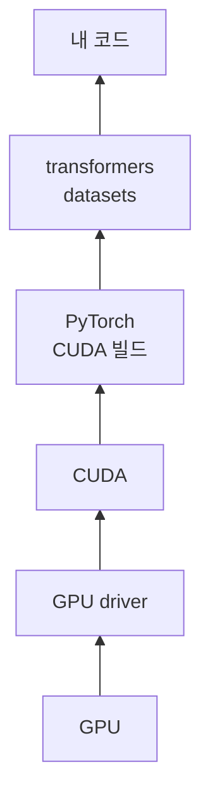
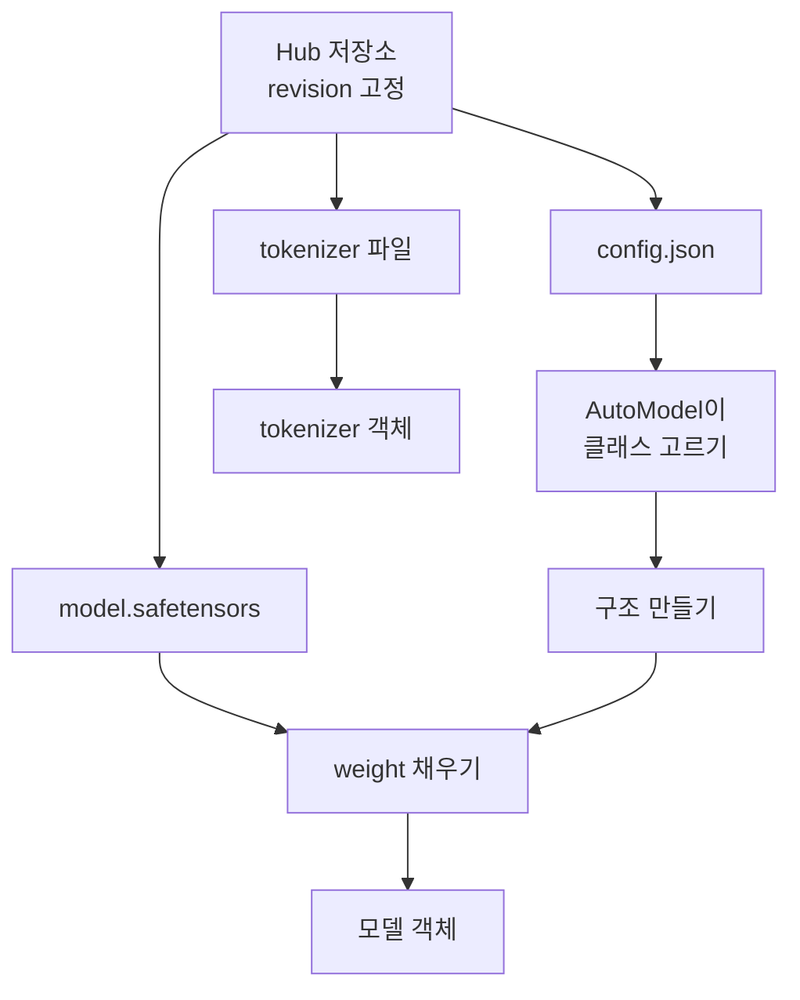

# 2.6 개발 환경: GPU·클라우드·Hugging Face

> **수준** L2 · **선수** [2.3 probability와 statistics](02-03-probability-statistics.md), [2.5 PyTorch로 계산하기: tensor·autograd·GPU](02-05-pytorch-basics.md) · **이 장의 질문** 학습에 필요한 GPU는 어떻게 고르고 빌리나? Hugging Face의 모델·dataset·라이브러리는 무엇을 대신해 주나?

## 한눈에

- graphics processing unit(GPU, 그래픽 처리 장치)을 고를 때는 GPU memory(GPU 메모리) 용량을 먼저 본다. 학습에는 weight(가중치)뿐 아니라 gradient(기울기), optimizer(옵티마이저) 상태, activation(forward 계산 중에 나오는 중간 결과값)이 함께 들어가야 한다. 그다음 내가 쓸 dtype(데이터 타입)의 처리량과 memory bandwidth(메모리 대역폭)를 본다.
- 클라우드에서는 GPU가 달린 VM을 필요한 동안만 빌린다. Azure에서는 꺼 둘 때 할당 해제(deallocate)까지 해야 instance 요금이 멈추고, spot VM은 싸지만 언제든 회수될 수 있어 checkpoint(체크포인트)를 자주 남긴다.
- 빌린 GPU를 PyTorch가 쓰려면 GPU driver와 CUDA를 지원하는 PyTorch 빌드가 맞아야 한다. 맞았는지는 `torch.cuda.is_available()`로 확인한다.
- Hugging Face Hub는 모델과 dataset(데이터셋)을 Git 저장소로 둔다. model repository(모델 저장소) 하나에 weight 파일, 설정 파일, tokenizer(토크나이저) 파일, model card(모델 카드)가 함께 있고, revision을 commit hash로 고정해 받는다.
- transformers 라이브러리의 `from_pretrained`는 설정 파일을 읽어 구조를 만들고 weight를 채운다. 이 편리함은 tokenizer 규칙, 구조의 세부, dtype 같은 기본 설정값을 가린다. datasets 라이브러리는 dataset을 받아 캐시해 둔다.

## 1. GPU를 고르는 기준

이 책의 예제는 노트북 CPU에서 몇 분 안에 끝나는 크기로 만든다. [2.5장 §5.5](02-05-pytorch-basics.md#55-시간-재기-warm-up과-동기화)에서 잰 것처럼, 큰 matrix multiplication(행렬 곱)에서는 Mac의 GPU인 MPS도 CPU보다 빨랐다. 모델과 데이터가 커져서 학습 한 번이 몇 시간, 며칠씩 걸리게 되면 더 큰 GPU를 빌려야 한다. 이 절은 그때 무엇을 보고 고르는지 정리한다. 제품의 숫자는 빨리 바뀌므로 적지 않고, 기준만 둔다.

### 1.1 메모리: 학습에 필요한 것이 다 들어가나

[1.6장 §3](../part01-big-picture/01-06-industry-stack.md#3-반도체-gpu와-accelerator)에서 칩의 메모리가 돌릴 수 있는 모델의 크기를 제한한다고 했다. 거기서 어림한 parameter(파라미터) 130억 개, 16비트 weight 약 26GB는 inference(추론)에 weight만 올릴 때의 크기다. 학습에는 그보다 훨씬 많이 든다.

여기서 activation은 모델이 forward pass(순전파) 중에 내놓는 중간 결과값이다. 2.1장·2.2장의 activation function(활성화 함수)과는 다른 말이다. Transformers 문서는 학습 중 GPU memory에 무엇이 올라가는지 다음처럼 나눈다.

| 무엇 | parameter 하나에 드는 바이트 | 조건 |
|---|---|---|
| weight | 6 | mixed precision(혼합 정밀도) 학습에서 16비트 사본과 32비트 사본을 함께 둘 때 [@HuggingFace2026e] |
| optimizer 상태 | 8 | Adam(널리 쓰는 optimizer의 하나로, 4.5장에서 본다)처럼 parameter마다 32비트 값 두 개를 더 저장할 때 [@HuggingFace2026e] |
| gradient | 4 | 32비트로 둘 때 [@HuggingFace2026e] |
| activation | parameter 수로 정해지지 않는다 | batch(배치) 크기, sequence 길이(문장 하나의 길이, 2.1장의 `T`), 모델 깊이, hidden 크기(위치 하나에 붙는 숫자의 개수, 2.1장의 `D`)에 따라 커진다 [@HuggingFace2026e] |

mixed precision은 계산량이 많은 forward·backward 계산은 16비트로 하고, weight를 고칠 때 쓰는 32비트 사본은 따로 두는 방식이다([§1.2](#12-처리량-내가-쓸-dtype에서-얼마나-빠른가), 4.8장) [@HuggingFace2026e].

activation은 backward 계산에 쓰려고 저장해 둔다 [@HuggingFace2026e]. 그래서 weight가 GPU memory에 들어가도 batch나 sequence 길이 때문에 메모리가 모자랄 수 있다 [@HuggingFace2026e]. 같은 문서는 parameter 40억 개 모델을 mixed precision으로 batch 16에서 학습하려면 GPU memory가 대략 85GB 든다고 어림한다 [@HuggingFace2026e]. 표의 세 항목을 더하면 parameter당 6 + 8 + 4 = 18바이트이고, 40억 × 18바이트 = 72GB다. 85GB와의 차이는 parameter 수로 정해지지 않는 몫이다. 같은 문서는 그런 몫으로 activation과, matrix multiplication 같은 연산 중에 잠깐 생겼다 사라지는 임시 결과를 든다 [@HuggingFace2026e]. 같은 모델의 weight만 16비트로 담으면 40억 × 2바이트 = 8GB이니, 학습에는 그 열 배 넘게 필요한 셈이다. 메모리가 모자랄 때 무엇을 줄이는지는 4.8장, 가진 GPU로 학습할 수 있는 크기를 어림하는 법은 14.1장에서 본다.

### 1.2 처리량: 내가 쓸 dtype에서 얼마나 빠른가

같은 GPU라도 숫자를 어떤 dtype으로 계산하느냐에 따라 속도가 다르다. dtype마다 원소 하나가 차지하는 바이트는 [2.5장 §3.2](02-05-pytorch-basics.md#32-dtype과-메모리)에서 보았다. PyTorch의 자동 mixed precision 문서는 linear layer(선형 층)와 convolution(합성곱) 같은 연산이 float16·bfloat16에서 훨씬 빠르다고 쓴다 [@PyTorch2026b]. 반면 합을 구하는 reduction 같은 연산은 float32의 범위가 필요할 때가 많다 [@PyTorch2026b]. §1.1에서 본 mixed precision은 이 차이를 이용해 forward와 backward를 float16이나 bfloat16으로 계산한다 [@HuggingFace2026e]. 모든 것을 32비트로 저장하고 계산하는 학습과 비교하면 계산이 빨라지고 activation의 메모리가 준다 [@HuggingFace2026e]. weight는 32비트 사본을 함께 두므로, §1.1 표처럼 parameter당 6바이트가 든다.

NVIDIA Ampere 이후 GPU에는 TF32(TensorFloat-32)라는 연산 형식이 있다. float32로 하는 matrix multiplication과 convolution을 빠르게 하려고 입력을 더 낮은 정밀도로 반올림해 계산하는 방식이다 [@PyTorch2026]. PyTorch 문서는 TF32가 float32 그대로 계산할 때보다 빠른 정도가 GPU 세대와 모델마다 다르다고 쓴다 [@PyTorch2026]. 값을 읽는 속도인 memory bandwidth([§1.3](#13-memory-bandwidth-값을-얼마나-빨리-읽고-쓰나))에 비해 연산이 얼마나 빠른지가 세대마다 다르기 때문이다 [@PyTorch2026]. 문서의 예에서 A100은 10240×10240 matrix multiplication을 TF32로 할 때 float32보다 약 7배 빨랐다 [@PyTorch2026]. 그래서 GPU의 처리량은 한 숫자로 비교하지 않고, 내가 학습에 쓸 dtype에서의 값을 본다. 어느 dtype으로 학습할지는 4.8장에서 정한다.

### 1.3 memory bandwidth: 값을 얼마나 빨리 읽고 쓰나

[1.6장 §3](../part01-big-picture/01-06-industry-stack.md#3-반도체-gpu와-accelerator)에서 GPU는 memory bandwidth가 높다고 했다. memory bandwidth는 메모리에서 값을 읽고 쓰는 속도다. neural network(신경망)의 parameter, activation, gradient를 담은 버퍼는 보통 CPU의 cache보다 커서, 계산 속도가 memory bandwidth에 막히는 경우가 많다 [@Goodfellow2016]. [1.6장 §6](../part01-big-picture/01-06-industry-stack.md#6-serving-모델을-부를-수-있게)에서 요청을 묶어 처리하면 weight를 읽는 부담을 나눠 진다고 한 것도 이 속도 때문이다. 연산 유닛이 빨라도 값을 제때 가져오지 못하면 기다린다.

### 1.4 한 장에 다 들어가지 않으면

모델이나 batch가 GPU 한 장의 메모리에 들어가지 않으면 여러 장에 나눠 학습한다. 어떻게 나누는지는 12.7장에서 본다.

§1의 기준을 모으면 다음과 같다.

| 무엇을 보나 | 왜 | 자세히 |
|---|---|---|
| GPU memory 용량 | weight, gradient, optimizer 상태, activation이 모두 들어가야 학습이 돈다 | §1.1, 4.8장, 14.1장 |
| 쓸 dtype의 처리량 | 같은 GPU도 dtype마다 속도가 다르고, TF32처럼 빨라지는 정도가 GPU 세대마다 다른 연산 형식도 있다 | §1.2, 4.8장 |
| memory bandwidth | 큰 버퍼를 읽고 쓰는 속도가 계산을 막는 경우가 많다 | §1.3, 13.2장 |
| 여러 장 연결 | 한 장에 들어가지 않으면 나눠야 한다 | 12.7장 |

> **핵심** GPU는 메모리 용량부터 본다. 학습에 필요한 메모리가 들어가지 않으면 처리량이 높아도 그 학습을 돌릴 수 없다.

## 2. GPU를 빌리는 방법

GPU를 사지 않고 클라우드에서 필요한 동안만 빌릴 수 있다. 이 절의 예는 Microsoft Azure의 문서로 든다(2026년 11월 기준). 서비스 이름과 요금 체계는 사업자마다 다르고 자주 바뀌므로, 쓰기 전에 그 사업자의 문서를 확인한다.

| 방식 | 받는 것 | 맞는 쓰임 |
|---|---|---|
| GPU VM | GPU가 달린 가상 머신. Azure는 GPU 최적화 VM을 GPU 하나, 여러 개, 일부(fractional)로 제공한다 [@Microsoft2026] | 환경을 직접 꾸려 오래 학습할 때 |
| 관리형 notebook 환경 | Azure Machine Learning compute instance는 notebook 환경이 붙은 관리형 클라우드 워크스테이션이다 [@Microsoft2026]. machine learning(머신러닝) 패키지, deep learning framework(딥러닝 프레임워크), GPU driver가 미리 설치돼 있다 [@Microsoft2026] | 설치 없이 바로 실험할 때 |

### 2.1 시간 과금: 끄는 방법이 중요하다

빌린 GPU는 쓰는 시간만큼 낸다. 그런데 「꺼 둔」 상태에도 여러 가지가 있다. Azure VM은 실행 중일 때뿐 아니라, 호스트에 할당된 채 꺼진 Stopped(Allocated) 상태에도 instance 요금이 나간다 [@Microsoft2026]. 하드웨어 할당을 해제한 Deallocated 상태가 되어야 instance 요금이 멈추고, 그때도 디스크와 네트워크 같은 자원의 요금은 계속 나간다 [@Microsoft2026]. 관리형 notebook 환경도 비용을 아끼려면 일정에 따라 자동으로 켜고 끄거나, 쓰지 않을 때 자동으로 꺼지게 한다 [@Microsoft2026].

### 2.2 spot VM: 싸지만 회수될 수 있다

spot VM은 클라우드의 남는 용량을 크게 할인된 값에 빌려 쓰는 방식이다 [@Microsoft2026]. 대신 사업자가 그 용량을 되찾아야 하면 언제든 회수(evict)된다 [@Microsoft2026]. Azure는 회수 30초 전에 알리고, 가용성 보장(SLA)을 주지 않는다 [@Microsoft2026]. 다른 일반 요금(pay-as-you-go) 작업에 용량이 필요해지거나, spot 가격이 내가 정한 최대 가격을 넘으면 멈출 수 있다 [@Microsoft2026]. 기본 회수 정책에서는 VM이 할당 해제된 상태가 되어 다시 배포할 수 있지만, 할당은 보장되지 않고 디스크 요금은 계속 나간다 [@Microsoft2026]. 그래서 Azure는 spot VM을 batch 처리나 개발·시험 환경처럼 중단을 견딜 수 있는 작업에 맞는다고 쓴다 [@Microsoft2026].

학습을 spot VM에서 돌리면 중간에 끊겨도 이어 갈 수 있어야 한다. [1.3장 §2.4](../part01-big-picture/01-03-model-lifecycle.md#24-학습-데이터로-weight를-정한다)의 checkpoint를 일정한 간격으로 VM 밖의 저장소에 남기고, 다시 시작할 때 마지막 checkpoint에서 이어 학습한다. 30초 알림 안에 큰 checkpoint를 다 쓰기는 어려울 수 있으므로, 알림을 받은 뒤에 저장하는 방식에 기대지 않는다. checkpoint에 무엇을 담는지는 4.10장·4.11장에서 본다.

## 3. 소프트웨어 층 맞추기

[1.6장 §2](../part01-big-picture/01-06-industry-stack.md#2-다섯-층-한눈에)의 반도체 층과 프레임워크 층 사이에는 서로 맞춰야 하는 단위가 여럿 있다. 빌린 GPU에서 내 코드가 돌기까지의 층은 다음과 같다.



그림: 빌린 NVIDIA GPU에서 내 코드까지. 아래 층이 맞아야 위 층이 GPU를 쓴다. CUDA 칸은 PyTorch 빌드가 맞춰 나온 CUDA 버전을 뜻한다. 이 책은 Hugging Face 라이브러리를 PyTorch 위에서 쓴다.

맨 아래는 GPU driver다. NVIDIA GPU를 단 Azure의 N-series VM에서 GPU를 쓰려면 NVIDIA GPU driver를 설치해야 하고, Azure의 확장 기능으로 이 driver를 설치할 수도 있다 [@Microsoft2026]. 관리형 notebook 환경은 이 driver를 미리 설치해 둔다(§2).

그 위는 PyTorch 빌드다. PyTorch는 같은 버전도 계산할 곳에 따라 따로 빌드해 내놓는다. PyTorch의 설치 안내는 CUDA를 쓸 수 있는 시스템이면 설치 선택기에서 기계에 맞는 CUDA 버전을 고르게 한다 [@PyTorch2026b]. CUDA나 ROCm(AMD GPU에서 NVIDIA의 CUDA에 해당하는 소프트웨어)을 쓸 수 없거나 GPU가 필요 없으면 CPU를 고른다 [@PyTorch2026b]. 이 책이 쓰는 PyTorch 2.11.0의 Linux·Windows용 wheel은 CUDA 12.6·12.8·13.0용, Linux의 ROCm 7.2용, CPU 전용으로 나뉘고 설치할 index URL(`--index-url`)이 서로 다르다 [@PyTorch2026b]. macOS용은 index URL을 주지 않고 설치한다 [@PyTorch2026b]. 이 책은 라이브러리 버전을 [`requirements.txt`](../code/requirements.txt) 한 곳에 고정하고, 설치법은 [예제 코드 안내](../code/README.md)에 있다. CUDA GPU가 있는 기계라면 torch만은 설치 안내에서 그 기계에 맞는 CUDA 버전으로 같은 PyTorch 버전의 빌드를 고른다.

설치가 맞았는지는 PyTorch에서 확인한다.

```python
import torch

print(torch.__version__)
print(torch.cuda.is_available())             # NVIDIA GPU·driver·CUDA 빌드가 모두 맞나
print(torch.backends.mps.is_available())     # Mac의 GPU를 쓸 수 있나
```

```text
2.11.0
False
True
```

PyTorch 설치 안내는 GPU driver와 CUDA가 켜져 있고 PyTorch가 거기에 접근할 수 있는지를 `torch.cuda.is_available()`로 확인하게 한다 [@PyTorch2026b]. ROCm용 빌드도 Python에서는 같은 `torch.cuda` API를 쓰므로 같은 코드로 확인한다 [@PyTorch2026b]. 이 책의 실행 환경인 Apple M5 Pro에는 NVIDIA GPU가 없어 `False`가 나왔고, MPS는 `True`였다. CUDA GPU를 빌렸는데 `False`가 나오면 아래 층부터 본다. GPU driver가 설치됐는지, PyTorch가 CPU 전용 빌드로 설치되지 않았는지를 차례로 확인한다. 코드에서 device(장치)를 고르는 법은 [2.5장 §5.1](02-05-pytorch-basics.md#51-device를-고르고-옮기기)의 방식을 그대로 쓴다. 그 코드는 CUDA가 있는 기계에서는 `cuda`를, Mac에서는 `mps`를 고른다.

## 4. Hugging Face Hub: 모델과 dataset

[1.6장 §8](../part01-big-picture/01-06-industry-stack.md#8-open-weight-model과-api-모델)에서 open-weight model(오픈 가중치 모델)은 weight 파일을 받아 내 기계에서 돌린다고 했다. 그 파일을 받는 대표적인 곳이 Hugging Face Hub다. [1.2장 §4](../part01-big-picture/01-02-naming-axes.md#4-공식-분류-체계가-있나)의 task(과제) 목록도 이 Hub에 있다.

### 4.1 Git 저장소로 두는 모델과 dataset

Hub의 모델과 dataset은 Git 저장소로 호스팅되고, 그래서 버전 관리가 Hub의 중심에 있다 [@HuggingFace2026c]. 이 저장소는 Parquet나 safetensors 같은 큰 바이너리 파일에 맞게 최적화돼 있다 [@HuggingFace2026c]. 모델을 두는 model repository는 model checkpoint를 저장하고 찾고 공유하는 곳이다 [@HuggingFace2026c]. 받을 때는 huggingface_hub 라이브러리나 transformers를 쓴다 [@HuggingFace2026c].

이 장은 Hub의 공개 모델 SmolLM2-135M을 예로 쓴다. SmolLM2는 parameter 1억 3,500만·3억 6,000만·17억 개의 작은 language model(언어 모델) 계열이고, 135M 모델은 token(토큰) 2조 개로 학습됐다 [@HuggingFace2025]. 라이선스는 Apache 2.0이다 [@HuggingFace2025]. 먼저 고정한 버전의 파일 목록과 크기를 본다.

```python
from huggingface_hub import HfApi

REPO = "HuggingFaceTB/SmolLM2-135M"
REV = "93efa2f097d58c2a74874c7e644dbc9b0cee75a2"   # 고정한 commit hash

info = HfApi().model_info(REPO, revision=REV, files_metadata=True)
print(info.sha)
for f in info.siblings:
    print(f"{f.rfilename:24} {f.size:>12,}")
print(info.card_data.license)
```

```text
93efa2f097d58c2a74874c7e644dbc9b0cee75a2
.gitattributes                  1,519
README.md                       6,340
config.json                       704
generation_config.json            111
merges.txt                    466,391
model.safetensors         269,060,552
special_tokens_map.json           831
tokenizer.json              2,104,556
tokenizer_config.json           3,658
vocab.json                    800,662
apache-2.0
```

**실행 조건.** 이 장의 Hub 블록은 Python 3.14.6, PyTorch 2.11.0, transformers 5.24.1, datasets 5.2.0, huggingface_hub 2.4.0, safetensors 0.8.0, tokenizers 0.23.3에서 Apple M5 Pro로 돌렸다. 로그인이나 access token 없이 공개 저장소에서 받았다. 네트워크가 없고 파일이 캐시에도 없으면 Hub 블록은 돌지 않는다. `model_info`에 `files_metadata=True`를 주면 파일마다 크기도 받는다 [@HuggingFace2026d].

저장소의 파일은 하는 일에 따라 넷으로 나뉜다.

| 파일 | 하는 일 | 이 저장소에서 |
|---|---|---|
| `model.safetensors` | weight | 269,060,552바이트. 저장소 전체 272,445,324바이트의 98.8%다 |
| `config.json` | 구조를 만드는 설정. layer 수, vocabulary(어휘) 크기 같은 속성을 담는다 [@HuggingFace2026e; @HuggingFace2025] | 704바이트 |
| `tokenizer.json`·`vocab.json`·`merges.txt`·`tokenizer_config.json` | 글을 token id(토큰 ID)로 바꾸는 tokenizer의 파일 | 넷을 합쳐 3,375,267바이트 |
| `README.md` | model card | 6,340바이트 |

`config.json`을 열면 구조 이름이 `LlamaForCausalLM`, `model_type`이 `llama`다 [@HuggingFace2025]. hidden 크기는 576, layer는 30개, vocabulary 크기는 49,152다 [@HuggingFace2025]. 이 숫자들이 §4.4에서 볼 weight tensor(텐서)의 shape가 된다.

### 4.2 model card와 라이선스

model card는 [1.2장 §3.1](../part01-big-picture/01-02-naming-axes.md#31-한-모델에-여러-축의-이름이-붙는다)에서 본, 모델을 공개할 때 함께 내놓는 설명 문서다. Hub에서는 model repository의 `README.md`가 model card이고, 메타데이터를 붙인 Markdown 파일이다 [@HuggingFace2026c]. model card에는 모델과 의도한 쓰임, 윤리적 문제를 포함한 한계, 학습 설정, 학습에 쓴 dataset, 평가 결과를 적어야 한다 [@HuggingFace2026c]. 맨 위의 YAML 메타데이터에 라이선스 같은 정보를 적고, Hub는 그 메타데이터로 라이선스를 표시하고 검색 필터를 만든다 [@HuggingFace2026c]. 위 블록의 마지막 줄 `apache-2.0`이 그 메타데이터에서 읽은 값이다. 메타데이터의 license 칸에는 Hub가 정한 라이선스 식별자를 쓴다. Apache 2.0은 `apache-2.0`, MIT는 `mit`다 [@HuggingFace2026c].

남의 모델이나 데이터를 쓰기 전에는 그 라이선스를 찾아 지켜야 한다 [@HuggingFace2026c]. 받기 전에 model card의 라이선스부터 확인하는 습관을 들인다. 라이선스 조항을 읽는 법은 13.5장에서 본다.

### 4.3 revision: 받을 버전을 고정한다

Hub의 저장소는 Git이라서 같은 이름의 저장소도 commit마다 내용이 다를 수 있다. 내려받기 함수는 기본으로 main branch가 가리키는 commit을 받고, `revision` 인자로 branch, tag, commit hash를 지정할 수 있다 [@HuggingFace2026d]. commit hash를 줄 때는 7자로 줄인 hash가 아니라 전체 길이의 hash를 써야 한다 [@HuggingFace2026d]. 이 장의 코드는 `REV`에 40자 commit hash를 적어 고정했다. 저장소가 나중에 바뀌어도 같은 파일을 받으므로, 이 장의 출력이 다시 나온다. 위 블록의 첫 줄은 받은 버전의 commit hash다.

### 4.4 safetensors: 코드를 실행하지 않는 weight 파일

PyTorch weight의 기본 저장 형식은 Python의 직렬화 형식인 pickle이다 [@HuggingFace2026c]. pickle 파일은 불러오는 순간 임의의 코드가 실행되는 공격이 가능하다 [@HuggingFace2026c]. 남이 올린 weight를 받아 쓰는 일이 많으니 이 위험이 크다.

safetensors는 tensor를 pickle과 달리 안전하게 저장하는 단순한 형식이다 [@HuggingFace2026g]. 여기서 안전하다는 것은 아무 데서나 받은 파일을 불러와도 임의의 코드가 실행되지 않는다는 뜻이다 [@HuggingFace2026g]. 파일 구조는 셋으로 되어 있다. 처음 8바이트는 header의 크기 $N$을 담은 64비트 부호 없는 정수(little-endian)다 [@HuggingFace2026g]. 그다음 $N$바이트는 header인 JSON 문자열이고, tensor 이름마다 dtype, shape, 숫자 영역 안의 데이터 위치(`data_offsets`)를 담는다 [@HuggingFace2026g]. 나머지는 숫자를 그대로 늘어놓은 바이트다 [@HuggingFace2026g]. 불러오는 쪽은 JSON을 읽고 바이트를 숫자로 해석할 뿐 실행할 코드가 없다.

이 구조를 직접 읽어 본다. `hf_hub_download`는 Hub의 파일 하나를 내려받아 캐시에 두고 그 로컬 경로를 돌려준다 [@HuggingFace2026d].

```python
import json
import math
import struct
from pathlib import Path
from huggingface_hub import hf_hub_download

REPO = "HuggingFaceTB/SmolLM2-135M"
REV = "93efa2f097d58c2a74874c7e644dbc9b0cee75a2"

path = Path(hf_hub_download(REPO, "model.safetensors", revision=REV))
print(path.parts[-4:])                       # 캐시 안의 위치
print(path.is_symlink())                     # 내용은 blob에 두고 가리킨다
with open(path, "rb") as f:
    n = struct.unpack("<Q", f.read(8))[0]    # 처음 8바이트: header 크기
    header = json.loads(f.read(n))           # 다음 n바이트: JSON header
header.pop("__metadata__", None)
print(n, len(header))
print(header["model.embed_tokens.weight"])
for name in sorted(header)[:3]:
    print(name, header[name]["shape"])
print(sum(math.prod(t["shape"]) for t in header.values()))
```

```text
('models--HuggingFaceTB--SmolLM2-135M', 'snapshots', '93efa2f097d58c2a74874c7e644dbc9b0cee75a2', 'model.safetensors')
True
30528 272
{'dtype': 'BF16', 'shape': [49152, 576], 'data_offsets': [0, 56623104]}
model.embed_tokens.weight [49152, 576]
model.layers.0.input_layernorm.weight [576]
model.layers.0.mlp.down_proj.weight [576, 1536]
134515008
```

첫 두 줄은 캐시의 모양이다. 캐시의 기본 위치는 `~/.cache/huggingface/hub`이고, `cache_dir` 인자나 `HF_HOME`·`HF_HUB_CACHE` 환경 변수로 바꾼다 [@HuggingFace2026d]. 저장소마다 폴더가 하나 있고, 그 안의 `snapshots`는 revision마다 폴더를 두어 실제 파일을 가리키는 symlink를 담는다 [@HuggingFace2026d]. 실제 파일은 hash를 이름으로 한 blob으로 따로 둔다 [@HuggingFace2026d]. 그래서 같은 파일을 다시 요청하면 내려받지 않고 캐시의 경로를 돌려준다.

나머지 줄은 header를 읽은 결과다. `struct.unpack("<Q", …)`의 `<`는 little-endian, `Q`는 64비트 부호 없는 정수다. header는 30,528바이트이고, tensor 272개의 이름이 들어 있다. `__metadata__`는 tensor가 아닌 메타데이터 항목이라 빼고 셌다.

embedding(임베딩) weight `model.embed_tokens.weight`는 shape가 `(49152, 576)`, 곧 [2.1장 §3.2](02-01-vectors-matrices-tensors.md#32-문장-token-id에서-vector-열로)의 `(V, D)`다. vocabulary 크기 49,152와 hidden 크기 576이 `config.json`의 값과 같다. dtype은 bfloat16(`BF16`)이라 원소 하나가 2바이트이고, 이 tensor는 header 뒤 숫자 영역의 바이트 0부터 56,623,104까지를 차지한다. `data_offsets`는 파일 처음이 아니라 숫자 영역의 시작에서 잰 위치라서 [@HuggingFace2026g], 파일 안에서는 8 + 30,528 = 30,536바이트 뒤부터다. 49,152 × 576 = 28,311,552개에 2바이트를 곱하면 정확히 56,623,104다. `mlp.down_proj.weight`의 `(576, 1536)`은 [2.1장 §4.6](02-01-vectors-matrices-tensors.md#46-layer-하나-수식의-mathbfwmathbfx와-코드의-x--wt)의 `(out, in)` 순서다. 이 모델을 불러 보면 이 layer는 `nn.Linear`이고 입력 1,536개를 받아 576개를 낸다.

마지막 줄은 shape의 원소 수를 모두 더한 parameter 수 134,515,008이다. 백만 단위로 반올림하면 이름의 「135M」이 된다([1.2장 §2.6](../part01-big-picture/01-02-naming-axes.md#26-규모와-활용-얼마나-크고-어떻게-쓰나)). 그중 embedding 하나가 28,311,552개로 전체의 21%다. 이 tensor의 크기는 vocabulary 크기 × hidden 크기로만 정해지고 layer 수와는 상관없다. 파일 크기도 맞춰 볼 수 있다. 8바이트 + header 30,528바이트 + 134,515,008 × 2바이트 = 269,060,552바이트로, §4.1 목록의 `model.safetensors` 크기와 같다. safetensors 파일은 header 뒤에 숫자만 늘어놓은 것이다.

tensor 272개는 layer 30개에 9개씩인 270개와, layer 밖의 embedding과 마지막 normalization(정규화) weight 2개다. 여기서 normalization은 모델 안의 layer가 하는 normalization으로, [2.1장 §3.1](02-01-vectors-matrices-tensors.md#31-사진-높이너비channel)의 입력 전처리와 다르다(4.6장). 출력 layer의 weight는 파일에 없다. `config.json`의 `tie_word_embeddings`가 true라서, 입력 embedding과 출력 layer가 weight를 함께 쓰기 때문이다 [@HuggingFace2025].

이 블록은 header만 읽고 weight 숫자는 메모리에 올리지 않았다. safetensors는 파일 전체를 불러오지 않고 살펴보거나 일부 tensor만 불러오는 lazy loading을 지원한다 [@HuggingFace2026g]. 라이브러리로는 `safe_open`으로 파일을 열고 `keys()`로 tensor 이름을, `get_tensor()`로 tensor를 읽는다 [@HuggingFace2026g].

### 4.5 dataset repository

dataset도 같은 방식으로 Hub의 dataset repository(데이터셋 저장소)에 둔다. dataset repository의 `README.md`가 dataset card(데이터셋 카드)이고, 메타데이터에 라이선스, 언어, 크기 같은 정보를 담는다 [@HuggingFace2026c]. 이 장은 손글씨 숫자 dataset MNIST를 예로 쓴다. MNIST는 손글씨 숫자 28×28 흑백 이미지 70,000장이고, train 60,000장과 test 10,000장으로 나뉘며 class(클래스)는 10개다 [@LeCun2024]. dataset card의 라이선스는 MIT다 [@LeCun2024]. 고정한 버전의 데이터는 Parquet 파일 둘(test 2.6MB, train 15.6MB)과 README뿐이라, 불러올 때 저장소 안의 스크립트를 실행하지 않는다 [@LeCun2024].

## 5. Hugging Face 라이브러리가 대신해 주는 것

§4의 블록은 파일을 받고 header를 직접 읽었다. 실제로 모델을 쓰려면 tokenizer 파일로 글을 token id로 바꾸고, `config.json`대로 구조를 만들고, weight를 채워야 한다. transformers와 datasets 라이브러리가 이 일을 대신한다.

### 5.1 transformers: 설정에서 구조를, 파일에서 weight를

transformers의 모델은 configuration, model, preprocessor의 세 가지 주요 클래스로 구현된다 [@HuggingFace2026e]. 라이브러리를 소개한 논문은 모든 모델을 tokenizer, transformer, head의 세 블록으로 설명한다 [@Wolf2020]. tokenizer는 글을 token id로 바꾸고, 모델 본체(논문은 transformer라 부른다)는 token id를 문맥이 반영된 embedding으로 바꾸며, head는 그 embedding으로 task별 예측을 낸다 [@Wolf2020]. 두 나눔을 맞대면 preprocessor가 tokenizer에, model이 모델 본체와 head에 해당하고, configuration은 구조를 정하는 설정이다.

여기서 architecture(구조)와 checkpoint를 가른다. architecture는 모델의 뼈대이고, checkpoint는 그 architecture에 채울 weight다 [@HuggingFace2026e]. configuration은 layer 수, vocabulary 크기 같은 속성을 담고, 모델 코드가 이 속성으로 구조를 만든다 [@HuggingFace2026e]. 저장소에서는 이 configuration이 `config.json` 파일이다(§4.1) [@HuggingFace2025]. `AutoModel` 계열 클래스는 이 설정 파일을 보고 맞는 모델 클래스를 자동으로 고른다 [@HuggingFace2026e]. `AutoModel`은 hidden state(token마다 모델 본체가 내는 vector(벡터), 모으면 `(B, T, D)` tensor)를 내는 기본 모델이고, `AutoModelForCausalLM`처럼 task에 맞는 head를 붙인 클래스가 따로 있다 [@HuggingFace2026e]. `from_pretrained()`는 Hub에 있는 모델의 weight와 설정을 내려받아 불러온다 [@HuggingFace2026e]. safetensors 형식의 weight가 있으면 그것을 불러온다 [@HuggingFace2026e].

SmolLM2-135M의 model card도 `AutoTokenizer`와 `AutoModelForCausalLM`의 `from_pretrained`로 불러오는 예를 든다 [@HuggingFace2025]. 같은 고정 버전으로 불러서 글 하나를 넣어 본다.

```python
import torch
from transformers import AutoModelForCausalLM, AutoTokenizer

REPO = "HuggingFaceTB/SmolLM2-135M"
REV = "93efa2f097d58c2a74874c7e644dbc9b0cee75a2"

tok = AutoTokenizer.from_pretrained(REPO, revision=REV)
model = AutoModelForCausalLM.from_pretrained(REPO, revision=REV)
print(type(model).__name__, model.dtype, model.device)
batch = tok(["The capital of France is"], return_tensors="pt")
print(batch["input_ids"])                         # (B, T)
with torch.no_grad():
    logits = model(**batch).logits                # (B, T, V)
print(logits.shape)
probs = logits[0, -1].float().softmax(dim=-1)     # 마지막 위치의 다음 token 분포
top = probs.topk(3)
for p, i in zip(top.values, top.indices):
    print(f"{tok.decode(i)!r} {p:.3f}")
```

```text
LlamaForCausalLM torch.bfloat16 cpu
tensor([[ 504, 3575,  282, 4649,  314]])
torch.Size([1, 5, 49152])
' the' 0.258
' Paris' 0.084
' located' 0.079
```

`AutoModelForCausalLM`이 `config.json`의 `LlamaForCausalLM`을 골랐다. tokenizer는 다섯 단어를 token id 5개로 바꿨고, 그 shape `(1, 5)`가 [2.1장 §3.2](02-01-vectors-matrices-tensors.md#32-문장-token-id에서-vector-열로)의 `(B, T)`다. 모델의 출력 `logits`는 `(1, 5, 49152)`, 곧 `(B, T, V)`다. 위치마다 vocabulary의 token 49,152개 각각에 점수 하나씩을 낸다. 이 점수가 [2.3장 §8.1](02-03-probability-statistics.md#81-logit에서-확률로)의 logit(로짓)이고, 마지막 위치의 logit에 softmax(소프트맥스)를 걸면 다음 token의 probability distribution(확률 분포)이 된다. 이 135M 모델은 「The capital of France is」 다음 token으로 「 the」에 0.258, 「 Paris」에 0.084를 줬다. 같은 블록을 두 번 돌려 같은 출력을 얻었고, 파일이 캐시에 있을 때 블록 전체가 이 기계의 CPU에서 3초 안에 끝났다.

`model.dtype`이 bfloat16인 것을 눈여겨본다. [2.5장 §2.3](02-05-pytorch-basics.md#23-기본-dtype-numpy는-float64-pytorch는-float32)에서 PyTorch의 기본 dtype은 float32라고 했다. `from_pretrained()`는 기본으로 `config.json`의 dtype 값(예전 이름 `torch_dtype`)대로 weight를 불러오고, `dtype` 인자로 바꿀 수 있다 [@HuggingFace2026e]. 이 모델의 `config.json`은 `torch_dtype`이 bfloat16이다 [@HuggingFace2025]. device도 따로 정하지 않아 `cpu`에 올라왔다. GPU에서 돌리려면 2.5장처럼 모델과 입력을 같은 device로 옮긴다.

> **주의** `from_pretrained()`의 기본값은 PyTorch의 기본값과 다를 수 있다. 이 장의 모델은 dtype을 주지 않았는데 bfloat16으로 불러졌다. 결과를 비교하거나 다른 dtype의 tensor와 섞을 때는 `model.dtype`과 `model.device`를 먼저 출력해 본다.

모델을 불러오는 데 드는 메모리도 weight 크기보다 클 수 있다. 큰 pre-trained model(사전학습 모델)을 불러올 때는 무작위 weight로 모델을 만든 뒤 받은 weight를 올리므로, weight 두 벌을 담을 메모리가 필요할 수 있다 [@HuggingFace2026e].

transformers에 없는 모델 코드를 쓰는 custom model은 `from_pretrained()`에 `trust_remote_code=True`를 줘야 불러지고, 이때는 저장소의 코드가 내 기계에서 실행되므로 악성 코드를 실행하지 않게 주의해야 한다 [@HuggingFace2026e]. 그런 모델은 코드가 바뀌었을 수 있으니 특정 commit hash로 불러오기를 권한다 [@HuggingFace2026e]. safetensors가 weight 파일에서 막은 코드 실행을, 이 옵션은 다시 허용하는 셈이다. 이 장의 모델은 transformers에 들어 있는 `LlamaForCausalLM`이라 이 옵션이 필요 없었다.

논문 시점(2020년)의 transformers는 글을 token으로 나누는 기본 구현으로 Rust로 쓴 빠른 라이브러리 tokenizers를 썼다 [@Wolf2020]. tokenizer가 글을 어떤 규칙으로 나누는지는 7.1장에서 본다.

### 5.2 datasets: 받아서 캐시하고 나눠 준다

datasets 라이브러리는 작은 dataset부터 인터넷 규모의 데이터까지 같은 방식으로 다루도록 사용자 인터페이스, 버전 관리, 문서화를 표준화하려 한다 [@Lhoest2021]. Apache Arrow 위에 만들어져 디스크의 캐시를 memory-map으로 읽으므로, 메모리가 작은 기계에서도 큰 dataset을 쓸 수 있다 [@Lhoest2021]. Arrow 덕분에 NumPy, Pandas, PyTorch 등으로 데이터를 복사 없이 넘길 수 있다 [@Lhoest2021]. 같은 함수로 처리한 결과는 세션 사이에 자동으로 캐시된다 [@Lhoest2021].

§4.5의 MNIST를 고정한 버전으로 받아 test split을 본다.

```python
from datasets import Image, load_dataset

REV = "77f3279092a1c1579b2250db8eafed0ad422088c"

ds = load_dataset("ylecun/mnist", split="test", revision=REV)
print(type(ds).__name__, ds.num_rows)
print(ds.features)
ds = ds.cast_column("image", Image(decode=False))   # 이미지를 풀지 않고 바이트로 본다
ex = ds[0]
print(ex["label"], len(ex["image"]["bytes"]))
```

```text
Dataset 10000
{'image': Image(mode=None, decode=True), 'label': ClassLabel(names=['0', '1', '2', '3', '4', '5', '6', '7', '8', '9'])}
7 254
```

`load_dataset()`은 split을 주면 `Dataset`을, 주지 않으면 split마다 `Dataset`을 묶은 `DatasetDict`를 돌려준다 [@HuggingFace2026f]. `revision`으로 tag, branch, commit hash를 지정해 dataset의 버전을 고정한다 [@HuggingFace2026f]. test split은 dataset card의 10,000장과 같은 10,000행이다. 예시 하나는 `image`와 `label` 열로 되어 있고, label(라벨)은 0부터 9까지의 class다 [@LeCun2024]. 첫 예시의 label은 7이다.

`image` 열은 읽을 때 이미지 객체로 풀린다. 이렇게 풀려면 Pillow 패키지가 있어야 해서, 위 블록은 `decode=False`로 바꿔 이미지의 바이트(254바이트)를 그대로 봤다. 이미지를 모델 입력 tensor로 바꾸는 일은 6.1장에서 본다.

내려받은 원본 파일은 `~/.cache/huggingface/hub`에, datasets가 Arrow로 바꾼 데이터는 기본으로 `~/.cache/huggingface/datasets`에 둔다 [@HuggingFace2026f]. Hub 캐시가 있으므로 다음 실행에서는 다시 내려받지 않는다 [@HuggingFace2026f]. 이 실행에서는 `split="test"`만 요청했는데 train Parquet 파일까지 캐시에 받아졌다. dataset을 받을 때 드는 디스크와 시간은 요청한 split만이 아니라 저장소의 파일 크기로 어림한다.

### 5.3 무엇을 대신하고 무엇을 가리나

Hub의 저장소 하나가 라이브러리를 거쳐 모델과 dataset 객체가 되는 길은 다음과 같다.



그림: `from_pretrained`가 하는 일. 설정 파일로 클래스를 고르고 구조를 만든 뒤, safetensors 파일의 weight를 채운다. tokenizer는 tokenizer 파일에서 따로 만든다. 모두 고정한 revision의 캐시 파일을 쓴다.

| 라이브러리 | 대신해 주는 것 | 가리는 것 | 직접 보는 곳 |
|---|---|---|---|
| huggingface_hub | 파일 목록, 내려받기, revision별 캐시 | 캐시의 위치와 모양 | §4 |
| transformers | 설정에서 구조 만들기, weight 채우기, tokenizer 불러오기 | tokenizer 규칙, 구조의 세부, dtype 같은 기본 설정값 | 5.8장, 7.1장 |
| datasets | dataset 내려받기, Arrow 캐시, split 나누기 | 원본 파일 형식, 저장소에서 받는 파일의 범위 | 6.1장, 4.11장 |

`from_pretrained` 한 줄 뒤에는 이 장에서 따로 열어 본 일들이 모두 들어 있다. 남이 만든 모델을 빨리 써 볼 때는 이 편리함이 크다. 하지만 모델 안에서 무슨 계산이 일어나는지 배우려면 가려진 부분을 직접 짜 봐야 한다. 그래서 이 책은 5.8장에서 Transformer를 고수준 라이브러리 없이 짜고, 8.6장과 14.3장에서 작은 language model을 직접 학습한다. Hub와 라이브러리는 그 결과를 공개 모델과 비교하거나, 공개 weight에서 출발해 fine-tuning(파인튜닝)할 때 쓴다.

## 헷갈리기 쉬운 점

| 헷갈리는 개념 | 차이 |
|---|---|
| GPU memory와 시스템 메모리 | GPU memory는 GPU에 달린 메모리이고, 학습할 weight·gradient·optimizer 상태·activation이 여기에 들어가야 한다. 컴퓨터의 시스템 메모리가 넉넉해도 GPU memory가 모자라면 그 GPU로 학습할 수 없다 |
| GPU driver, CUDA, PyTorch 빌드 | 셋은 서로 맞아야 하는 다른 층이다. PyTorch를 설치할 때는 설치 안내에서 그 기계에 맞는 CUDA 버전의 빌드를 고른다. driver가 깔려 있어도 PyTorch가 CPU 전용 빌드면 GPU를 쓰지 못한다. `torch.cuda.is_available()`이 False면 아래 층부터 본다 |
| Stopped와 Deallocated | Azure에서 Stopped(Allocated)는 꺼져 있어도 instance 요금이 나간다. Deallocated여야 instance 요금이 멈춘다. 디스크 요금은 둘 다 나간다 |
| Hugging Face Hub와 transformers | Hub는 모델과 dataset을 Git 저장소로 두는 곳이다. transformers는 Hub의 파일로 모델을 만드는 Python 라이브러리다 |
| transformers와 Transformer | transformers는 라이브러리 이름이다. Transformer는 구조 이름이고 5.6장에서 본다. 대소문자 하나로 갈린다 |
| architecture와 checkpoint | architecture는 `config.json`으로 만드는 뼈대이고, checkpoint는 거기에 채우는 weight다. 같은 architecture에 checkpoint가 여럿일 수 있다 |
| model card와 모델 | model card는 저장소의 `README.md`이고 모델을 설명한다. 모델은 `config.json`과 weight 파일이다 |
| branch 이름과 commit hash | `main` 같은 branch는 가리키는 commit이 바뀐다. 전체 길이의 commit hash는 한 버전만 가리킨다 |
| open-weight model과 open source AI(오픈소스 AI) | Hub에서 weight를 받을 수 있어도 학습 데이터 정보와 코드까지 공개된 것은 아니다([1.6장 §8](../part01-big-picture/01-06-industry-stack.md#8-open-weight-model과-api-모델)) |

> **표준과 관례** 남는 용량을 싸게 빌려 주고 회수할 수 있게 한 방식의 이름과 조건은 클라우드 사업자가 정한다. 이 장의 spot VM, 30초 알림, 회수 정책, 요금 상태 이름은 Azure 문서의 것이다(2026년 11월 기준) [@Microsoft2026]. 다른 사업자를 쓸 때는 그 사업자의 문서에서 같은 항목을 확인한다.

## 정리

- GPU는 GPU memory 용량부터 본다. 학습에는 weight 말고도 gradient, optimizer 상태, activation이 들어간다. 그다음 내가 쓸 dtype의 처리량과 memory bandwidth를 본다.
- 클라우드 GPU는 필요한 동안만 빌린다. Azure에서 instance 요금을 멈추려면 Deallocated 상태로 둔다. spot VM은 싸지만 회수될 수 있으니 checkpoint를 VM 밖에 자주 남긴다.
- PyTorch가 GPU를 쓰려면 GPU driver가 설치돼 있고 PyTorch도 CUDA 빌드여야 한다. `torch.cuda.is_available()`로 확인하고, False면 아래 층부터 본다.
- Hub의 model repository에는 weight(`model.safetensors`), 설정(`config.json`), tokenizer 파일, model card(`README.md`)가 있다. 받기 전에 라이선스를 확인하고, revision을 전체 commit hash로 고정한다.
- safetensors는 JSON header와 숫자 바이트만 담아 불러올 때 코드를 실행하지 않는다. header만 읽어도 tensor 이름, shape, parameter 수를 알 수 있다.
- transformers는 설정으로 구조를 만들고 weight를 채우며, datasets는 dataset을 받아 캐시하고 split을 나눠 준다. 기본 설정값(dtype, device)과 내부 계산이 가려지므로 출력해 확인하고, 구조는 뒤 장에서 직접 짠다.

## 확인 문제

1. GPU 한 장에서 모델의 weight는 메모리에 들어가는데, 학습을 시작하자 메모리가 모자라다는 오류가 났다. weight 말고 무엇이 메모리를 쓰나? batch 크기를 줄이면 무엇이 줄어드나?
2. Azure의 spot VM에서 며칠짜리 학습을 돌리려 한다. 무엇을 준비해야 하나? 학습이 끝난 뒤 VM을 할당된 채로 꺼 두기만 하면 요금은 어떻게 되나?
3. CUDA GPU가 달린 클라우드 VM에서 `torch.cuda.is_available()`이 False를 냈다. 어느 층부터 무엇을 확인하나?
4. Hub에서 처음 보는 모델을 받아 제품에 쓰려 한다. 내려받기 전에 model card에서 무엇을 확인하고, 코드에는 무엇을 고정하나? `trust_remote_code=True`를 요구하는 모델이면 무엇에 주의하나?

<details>
<summary>답</summary>

1. 학습에는 weight 말고도 gradient, optimizer 상태, activation이 GPU memory에 올라간다. Adam이면 parameter마다 32비트 값 두 개가 더 든다. activation은 batch 크기와 sequence 길이에 따라 커지므로, batch 크기를 줄이면 activation 메모리가 준다. weight·gradient·optimizer 상태는 parameter 수로 정해져 batch를 줄여도 그대로다. 더 줄이는 방법은 4.8장에서 본다.
2. spot VM은 언제든 회수될 수 있고, Azure는 회수 30초 전에야 알린다. checkpoint를 일정한 간격으로 VM 밖의 저장소에 남기고, 마지막 checkpoint에서 이어 학습하는 코드를 준비한다. 할당된 채로 꺼 둔 Stopped(Allocated) 상태에서는 instance 요금이 계속 나간다. Deallocated 상태로 둬야 instance 요금이 멈추고, 그때도 디스크 요금은 나간다.
3. 아래 층부터 본다. GPU driver가 설치됐는지 먼저 확인하고, 다음으로 PyTorch가 CPU 전용 빌드로 설치되지 않았는지 본다. CPU 전용이면 설치 안내에서 그 기계에 맞는 CUDA 버전의 빌드를 골라 다시 설치한다.
4. model card 맨 위 메타데이터의 라이선스를 확인하고, 의도한 쓰임과 한계, 학습 데이터, 평가 결과도 읽는다. 코드에는 `revision`을 전체 길이의 commit hash로 고정해 저장소가 바뀌어도 같은 파일을 받게 한다. `trust_remote_code=True`는 저장소의 코드를 내 기계에서 실행하므로, 그 코드를 읽어 보고 commit hash로 고정해 불러온다. weight가 pickle 형식이면 불러올 때 코드가 실행될 수 있으니 safetensors 파일이 있는지도 본다.

</details>

## 더 읽을거리

- [@HuggingFace2026c] Hub 문서의 Repositories, Model Cards, Licenses, Pickle Scanning. Hub 저장소의 구조와 model card에 적을 것, pickle의 위험을 정리한다
- [@HuggingFace2026d] huggingface_hub 문서의 Download files from the Hub와 Manage cache. 파일 내려받기, revision 고정, 캐시 구조를 다룬다
- [@HuggingFace2026e] Transformers 문서의 Loading models와 GPU memory usage. `from_pretrained`의 동작과 학습 메모리의 내역을 설명한다
- [@HuggingFace2026g] safetensors 문서와 README. 파일 형식과 다른 형식과의 비교를 보여 준다
- [@Wolf2020] transformers 라이브러리의 설계 논문. tokenizer·transformer·head로 모델을 나누고 Auto 클래스로 묶은 까닭을 설명한다
- [@Lhoest2021] datasets 라이브러리의 설계 논문. Arrow 기반 캐시와 memory-map으로 큰 dataset을 다루는 법을 설명한다
- [@Microsoft2026] Azure의 Spot Virtual Machines, VM 상태와 과금 문서. spot VM의 회수 조건과 꺼 둘 때의 요금을 다룬다
